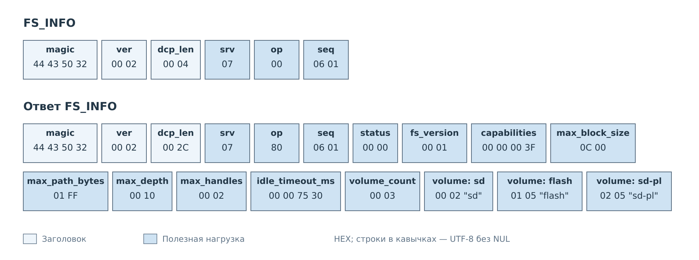
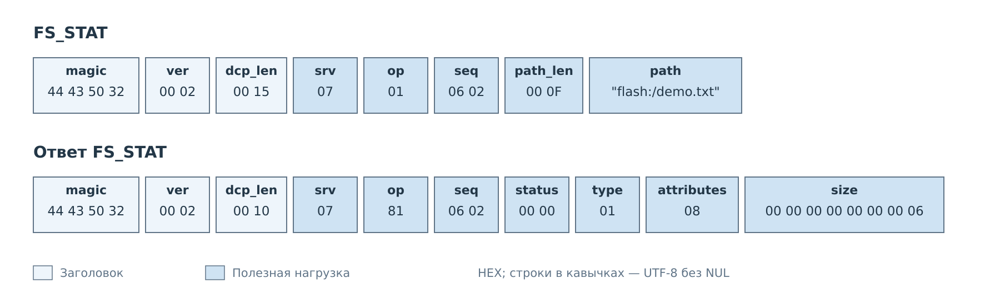
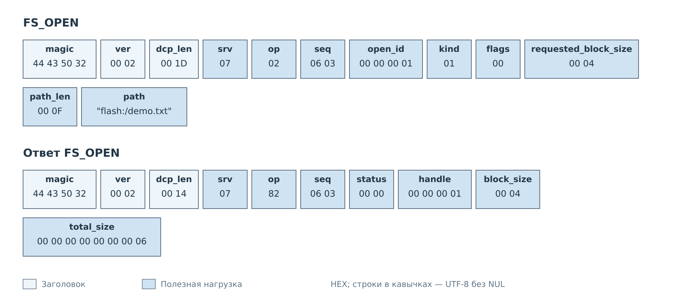
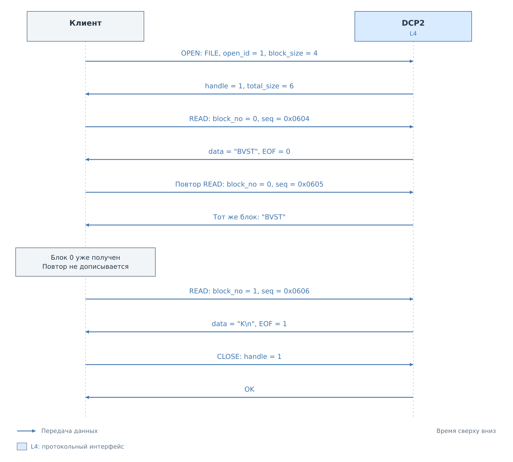
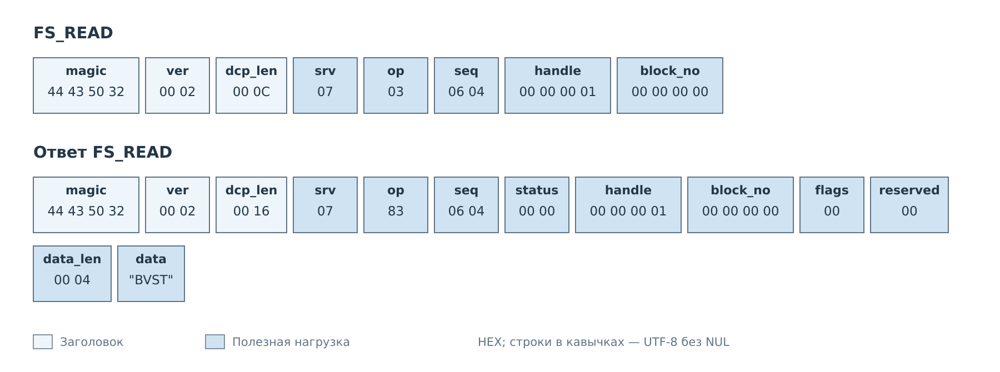
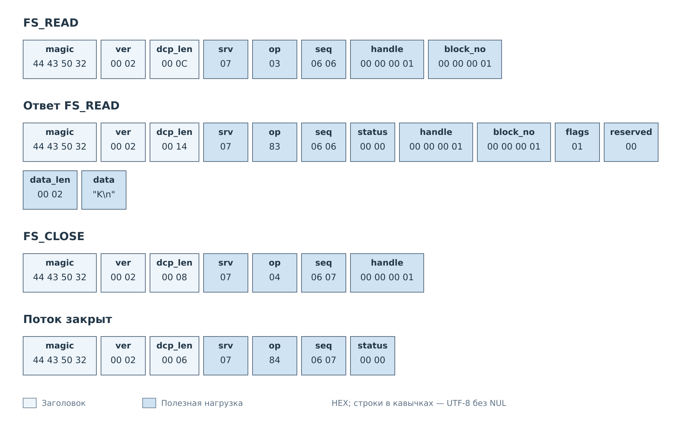

# Чтение файла

Рассмотрим файл `flash:/demo.txt`, содержащий шесть байт: пять букв `BVSTK`
и перевод строки `0x0A`. Клиент узнаёт возможности FS, проверяет файл,
открывает поток и собирает его по блокам. В примере блок намеренно мал —
четыре байта, чтобы показать продолжение и повтор чтения.

Файл и его содержимое условные; команды FS его не создают. Предполагается,
что том flash готов, а файл существует и не меняется во время чтения.

## Возможности FS

*Рисунок 1. INFO не содержит параметров. В ответе показаны текущие ограничения
формата и пример состояния трёх томов.*

Клиент узнаёт максимальный блок 3072 байта и предел двух одновременно открытых
потоков. В примере готов только flash; sd не готов, а sd-pl не поддерживает
файловый доступ в выбранной сборке. Эти состояния нужно читать из ответа
конкретного сервера. Запись тома на рисунке объединяет `state`, `name_len`
и байты имени.

Маска возможностей `0x3F` разрешает FILE, TREE, рекурсивный TREE, TAR,
пути UTF-8 и чтение текущей файловой системы. Последнее означает, что открытие
потока не создаёт снимок носителя.

## Проверка файла и открытие

*Рисунок 2. STAT возвращает тип FILE и размер шесть байт.*

Клиент кодирует путь UTF-8 без завершающего NUL. Поле `path_len` содержит
число байтов, что особенно важно для имён с кириллицей. В примере ASCII-путь
занимает 15 байт. `attributes=8` обозначает архивный атрибут файла.

STAT удобен для предварительной информации, но не резервирует объект.
Состояние файла ещё может измениться до OPEN; окончательный размер открытого
FILE клиент берёт из ответа OPEN.

*Рисунок 3. Клиент передаёт `open_id`, сервер возвращает `handle`.*

`open_id=1` выбран клиентом для попытки открытия. `handle=1` выдан сервером
для последующих READ и CLOSE. Совпадение чисел в примере случайно: их назначение
различается. При повторе OPEN после таймаута клиент сохраняет `open_id`
и все параметры, меняя только `seq`. Пока поток жив, сервер вернёт тот же
дескриптор. Новый `open_id` обозначает новое открытие.

## Блоки и повтор чтения

*Рисунок 4. Повтор READ сохраняет дескриптор и номер блока. Клиент не добавляет
один и тот же блок в результат дважды.*

*Рисунок 5. Из ответа в файл попадает только массив `data`.*

В первом ответе `data="BVST"`, а EOF сброшен. Общий статус, дескриптор,
номер блока и длина нужны протоколу; в содержимое файла они не включаются.

Если ответ задержался, клиент может повторить последний READ с новым `seq`.
В данном обмене запрос `seq=0x0605` снова содержит `handle=1`, `block_no=0`.
Сервер возвращает сохранённый блок, не продвигая файловый поток. Поля такого
кадра совпадают с рисунком 5, кроме номера запроса и соответствующего ответа.
Если оба ответа дошли, блок 0 принимается только один раз.

READ не является произвольным чтением по смещению. Для живого дескриптора
можно запросить следующий блок или повторить последний. Возврат к давно
прочитанному блоку требует нового открытия и последовательного чтения.

## Конец файла и закрытие

*Рисунок 6. Блок 1 содержит `K` и перевод строки. После EOF клиент закрывает поток.*

`data_len=2` описывает только эти два байта. На рисунке перевод строки
обозначен `\n`; в данных это один байт `0x0A`. EOF сообщает, что после них
поток закончен. Полученный файл состоит из блока 0 и блока 1 и занимает
ровно шесть байт.

Закрытие освобождает дескриптор. Повтор CLOSE для уже отсутствующего ненулевого
дескриптора тоже успешен. При потере TCP-соединения прежний handle использовать
нельзя: новый сеанс требует нового OPEN. Поток также закрывается после
30 секунд неактивности.

У пустого FILE первый READ сразу возвращает EOF с `data_len=0`; клиент
создаёт пустой результат и закрывает поток. Если файл меняется во время чтения,
сервер может вернуть `ERR_FS_CHANGED`. Клиент не должен выдавать частично
полученные данные за завершённый файл.

---

Далее: [Каталоги и архивы](directories.md).
[Файловый сервис](../06-fs.md).
