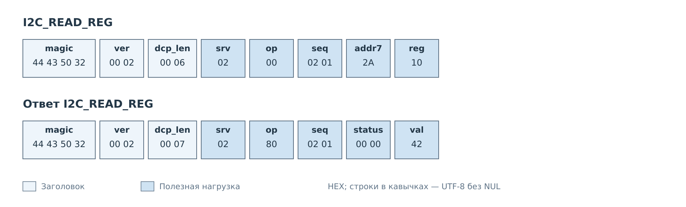
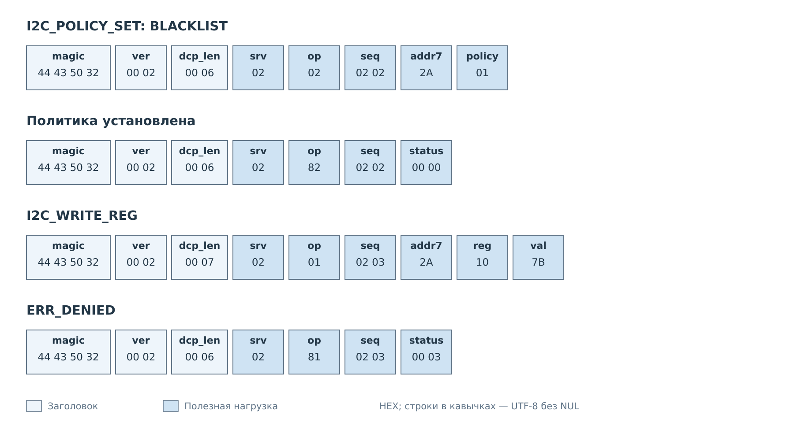
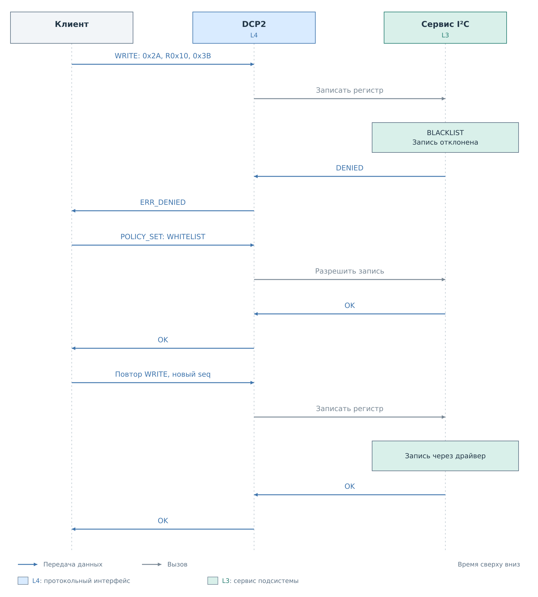
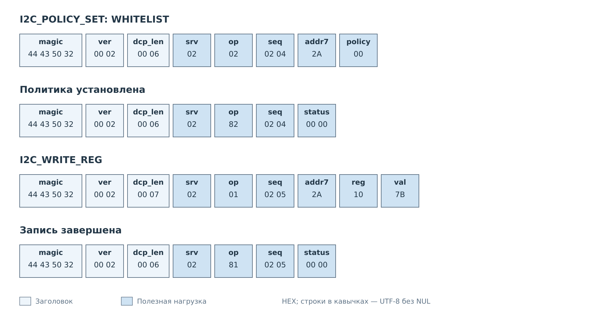

# Регистры и политика I²C

В этом примере в сервисе I²C зарегистрировано устройство с адресом `0x2A`.
Его байтовый регистр `0x10` доступен для чтения и записи. Условное начальное
значение — `0x42`; клиент хочет заменить его на `0x3B`.
В обоих списках политики заранее есть пара `reg=0x10`, `val=0x3B`:
белый список разрешает её, чёрный запрещает. Поэтому смена режима
в показанном обмене меняет решение сервиса. Сами списки SET не редактирует;
для этого используются [команды управления политикой](../04-policies.md).

Адрес и значения выбраны для разбора формата. Для конкретной платы клиент
использует адрес из действующего профиля и учитывает назначение регистра.
Сервер должен быть собран с подсистемой I²C, а её сервис — готов к работе.

## Чтение регистра

*Рисунок 1. `addr7` содержит семибитный адрес устройства. Бит направления
транзакции в него не добавляется.*

Сервер находит устройство по `addr7` и передаёт чтение в сервис I²C.
Сервис выполняет аппаратное чтение через драйвер и обновляет своё состояние.
Клиент после успешного статуса извлекает один байт результата.

Такая команда подходит для запроса к устройству в момент обращения.
Для получения уже сохранённых значений без новой транзакции на шине
предназначен [CACHE_GET](cache.md).

## Запрет записи

Клиент устанавливает BLACKLIST и затем отправляет запись нового значения.
Установка политики и запись — два самостоятельных запроса со своими `seq`.

*Рисунок 2. POLICY_SET завершается успешно. Следующая запись отклоняется
по действующей политике.*

`ERR_DENIED` относится именно к записи. Её параметры разобраны, устройство
найдено, но сервис запрещает изменение. Эта команда не должна быть учтена
клиентом как успешно применённое значение `0x3B`.

## Разрешение и повторная запись

Чтобы разрешить запись, клиент меняет политику на WHITELIST. После её
подтверждения он повторяет WRITE с новым номером запроса.

*Рисунок 3. Политику проверяет сервис подсистемы. До драйвера доходит
разрешённая запись.*

*Рисунок 4. Параметры записи прежние; изменились политика и `seq`.*

После `status=0` клиент знает, что сервис завершил запись. Подтверждение
не содержит прочитанного значения. Если требуется обратная проверка и регистр
допускает её по своему назначению, клиент отдельно отправляет READ.

Команда POLICY_SET меняет политику работающего устройства. Её успешный ответ
сам по себе не подтверждает сохранение настроек на носитель. Аналогично,
новый `seq` у WRITE не является защитой от повторного выполнения: при потере
ответа на разрешённую запись клиент должен учитывать возможные побочные
эффекты регистра. В показанном случае повтор безопасен по другой причине —
первая попытка получила явный отказ.

Подробный путь транзакции через ядро PL, драйвер и сервис описан
в [статье о подсистеме I²C](../../../system/pl-subsystem/i2c/i2c.md).

---

Далее: [Регистры MDIO](mdio.md).
[Формат команд](../03-commands.md).
