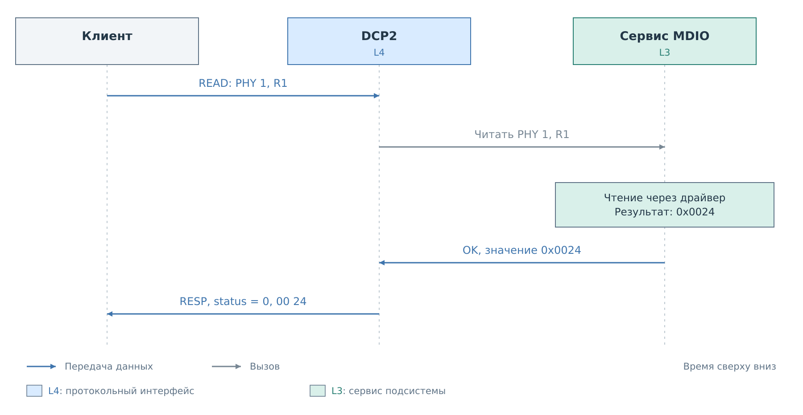
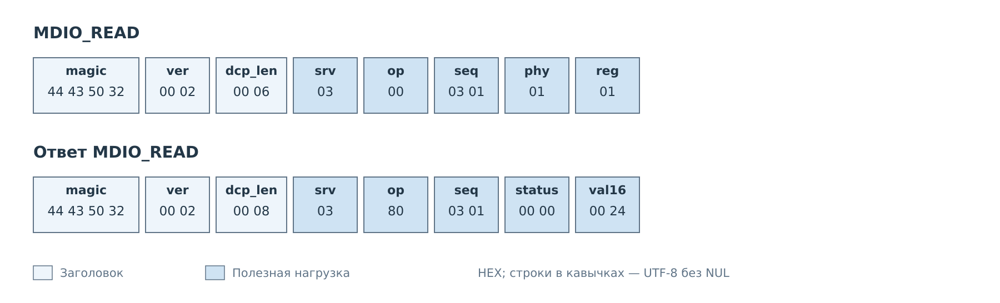
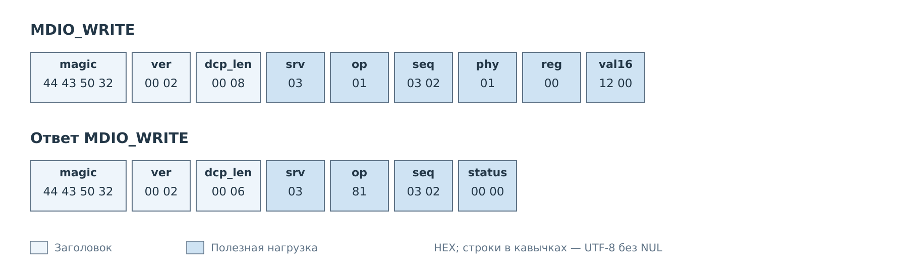

# Регистры MDIO

Рассмотрим PHY с адресом 1, зарегистрированный в сервисе MDIO сервера
FreeRTOS. Клиент сначала читает регистр 1, затем записывает 16-битное значение
в регистр 0. Значения ниже иллюстрируют обмен; их смысл на конкретном PHY
определяется картой регистров.

## Чтение

*Рисунок 1. MDIO_READ выполняет чтение через драйвер. Ответ несёт результат
этого обращения к устройству.*

*Рисунок 2. Два байта параметров выбирают PHY и регистр. Значение регистра
занимает два байта ответа.*

Клиент назначает запросу `seq=0x0301`. Успешный ответ содержит `0x0024`;
клиент читает его как одно 16-битное число. Это отличается от I²C, где похожая
команда возвращает один байт. Сам код операции `0x00` не определяет ширину
результата: нужно учитывать и сервис `srv=0x03`.

Обращение идёт к физическому PHY через рабочий сервис. Если нужен его
программный кэш, клиент использует CACHE и имена ресурсов профиля.

## Запись

*Рисунок 3. Значение `0x1200` следует за адресом PHY и номером регистра.
В ответе остаётся только статус.*

Для успешного результата предполагается, что политика сервиса разрешает
запись, а аппаратная операция завершилась. Отдельной команды изменения
политики MDIO в текущем наборе DCP2 нет. Параметры политики задаются средствами
конфигурации системы.

В следующем примере эта же запись `PHY=1`, `reg=0`, `val16=0x1200`
станет причиной уведомления NOTIFY. Так один обмен можно рассмотреть
с двух сторон: как команду клиента и как событие в журнале системы.

---

Далее: [Уведомления NOTIFY](notify.md).
[Все примеры](../07-examples.md).
