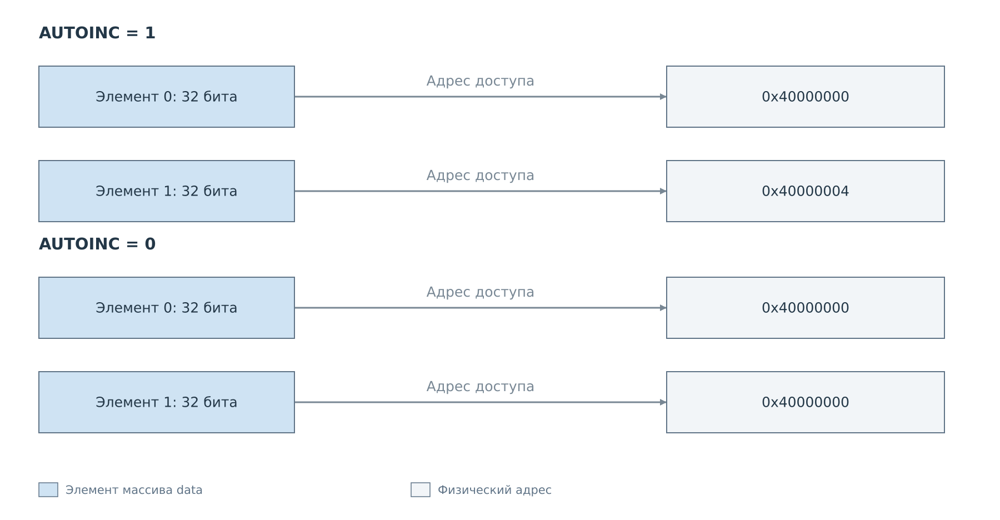
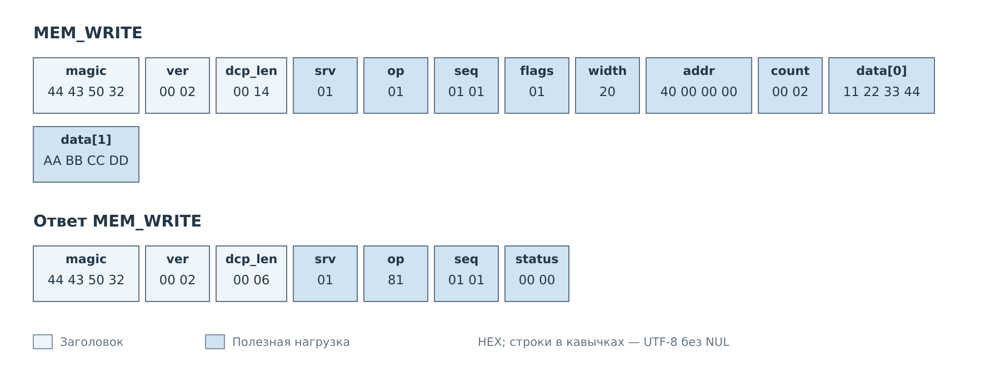
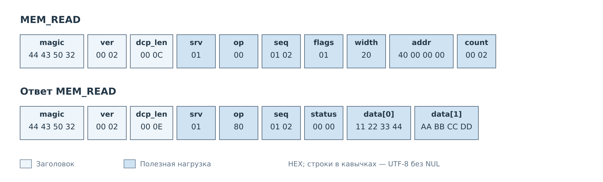

# Доступ к памяти

MEM передаёт элементы заданной разрядности между клиентом и физическим
адресным пространством платы. Рассмотрим запись двух 32-битных значений
и последующее чтение тех же адресов в сервере FreeRTOS.

В примере использован адрес `0x40000000` — начало BRAM подсистемы I²C
в конфигурации AX7020. Предполагается, что выбранные слова доступны для
такого обмена и не меняются другим участником. На работающей подсистеме
эта память занята её данными; выбор адресов должен учитывать контракт BRAM.

## Адреса элементов

Клиент задаёт `width=32` и `count=2`. Флаг AUTOINC определяет, изменится ли
адрес после первого элемента.

*Рисунок 1. В FreeRTOS AUTOINC увеличивает адрес на размер элемента.
При нулевом флаге оба доступа направлены в один адрес.*

Для соседних слов нужен `flags=1`: второй доступ произойдёт по адресу
`0x40000004`. При `flags=0` повторится доступ к `0x40000000`. Последний режим
подходит только тогда, когда повторное обращение к одному адресу соответствует
назначению регистра.

## Запись двух слов

*Рисунок 2. Два элемента `data` следуют за параметрами MEM. Ответ сообщает
результат записи и не повторяет массив.*

Первый элемент равен `0x11223344`, второй — `0xAABBCCDD`. Числовое значение
каждого элемента передаётся старшим байтом вперёд, независимо от представления
чисел в памяти PS. `count` считает элементы, поэтому массив занимает восемь
байт, а не два.

Сервер проверяет разрядность, выравнивание, разрешённый диапазон адресов
и соответствие длины массива. При успехе клиент получает только `status=0`.
Запись MEM не проходит через политику регистрового сервиса I²C или MDIO.

## Чтение результата

*Рисунок 3. Параметры адресации сохранены, код команды изменён на чтение.
Массив теперь находится в ответе.*

В успешном ответе клиент разбирает восемь байт как два числа по 32 бита.
В выбранных условиях они совпадают с записанными. Если другой участник успел
изменить память, ответ содержит уже прочитанное состояние: пара WRITE и READ
не образует атомарную операцию.

Эти конкретные кадры относятся к FreeRTOS. Текущий `bvstkd` принимает MEM
только с `width=32`, `flags=0` и числом элементов от 1 до 256, причём всегда
увеличивает адрес на четыре. Для него аналогичный доступ к соседним словам
кодируется с нулевым флагом. Остальные ограничения перечислены
в [описании MEM](../03-commands.md#mem-чтение-и-запись-памяти).

---

Далее: [Регистры и политика I²C](i2c.md).
[Формат команд](../03-commands.md).
