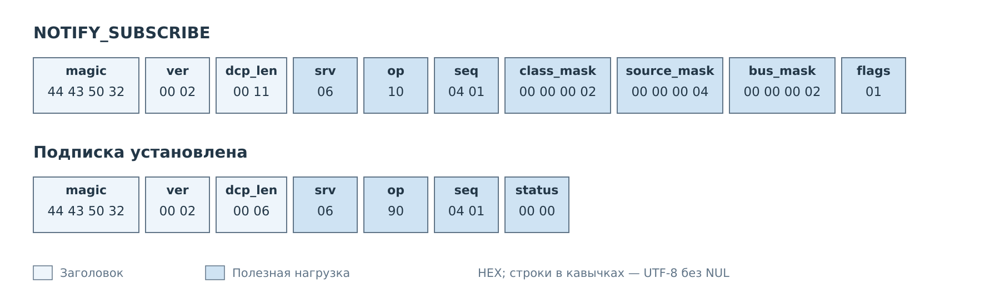
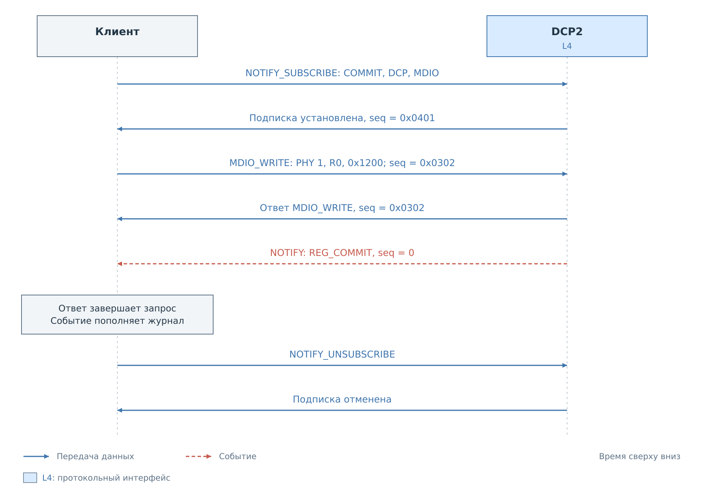
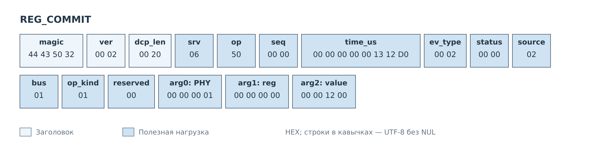
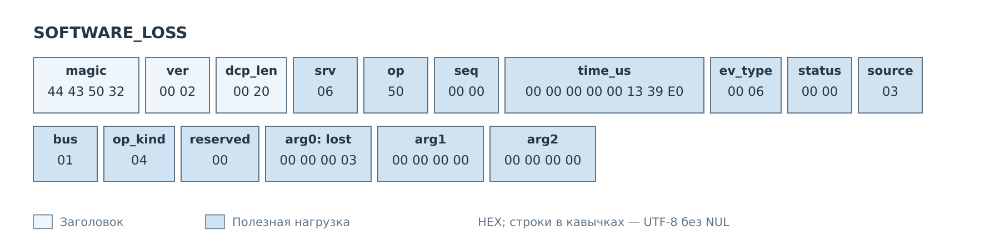
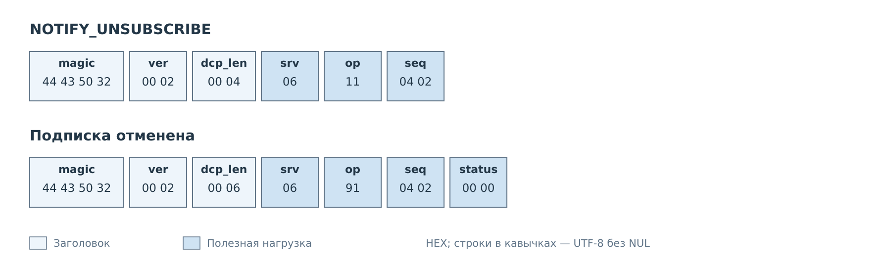

# Уведомления NOTIFY

Продолжим [пример записи MDIO](mdio.md): клиент записывает `0x1200`
в регистр 0 PHY 1. Перед записью он подписывается на уведомления о завершённых
операциях MDIO, инициированных через DCP. Подписка и команда записи
используют одно TCP-соединение.

## Установка фильтра

Нужное событие должно одновременно соответствовать трём условиям:
класс REG_COMMIT, источник DCP и шина MDIO. Поэтому в запросе используются
маски `0x00000002`, `0x00000004` и `0x00000002`. Это маски выбора,
а не числовые коды полей будущего события.

*Рисунок 1. `flags=1` включает метку времени. Успешный ответ подтверждает
установку фильтра.*

После подтверждения сервер передаёт новые подходящие события. Прошлая
история не воспроизводится. Повторный SUBSCRIBE заменяет действующий фильтр
этого соединения, поэтому его не нужно отправлять перед каждой записью.

## Ответ на команду и событие

*Рисунок 2. Ответ MDIO_WRITE связан с запросом через `seq=0x0302`.
Уведомление NOTIFY имеет `seq=0` и обрабатывается отдельно.*

Здесь показан обмен без других действий системы. В общем случае между
запросами и ответами могут приходить и другие уведомления. Клиент постоянно
разбирает входящие кадры: ответы передаёт ожидающему запросу, события —
обработчику журнала. Событие REG_COMMIT само по себе не завершает ожидание
ответа MDIO_WRITE и не содержит его `seq`.

*Рисунок 3. Тело уведомления с меткой времени занимает 28 байт.*

В событии `source=2` означает DCP, `bus=1` — MDIO, `op_kind=1` — запись.
Аргументы восстанавливают предмет действия: PHY 1, регистр 0, значение
`0x1200`. Время `1 250 000` мкс — условная отметка регистрации события PS,
а не длительность транзакции. Её точность ограничена системным тиком.

Поле `status` внутри события описывает результат действия в шкале общего
C API. Общего статуса ответа перед телом события нет. В данном случае оба
успешных результата равны нулю, но для ошибок эти шкалы нельзя смешивать.
При выключенном WITH_TIMESTAMP первые восемь байт тела отсутствуют;
клиент определяет формат по сохранённым флагам подписки.

## Потеря записей журнала

Пусть до чтения сервером были вытеснены три записи журнала MDIO.
Тогда приходит отдельное служебное уведомление.

*Рисунок 4. `arg0=3` сообщает о потере записей; поля регистра и значения
в этом событии не используются.*

Уведомление имеет источник INTERNAL и вид STATE_TOGGLE. Оно проходит даже
через выбранный выше узкий фильтр COMMIT и DCP: сообщение о потере учитывает
выбор шины, но обходит маски классов и источников. Клиент отмечает разрыв
в истории. Три потерянные записи могли относиться и к действиям,
которые обычный фильтр всё равно исключил бы.

NOTIFY не восстанавливает значения всех регистров после такого разрыва.
Если задача клиента — поддерживать согласованную копию состояния устройства,
для неё предусмотрена [подписка CACHE](cache.md#подписка-и-изменения).

## Отмена

*Рисунок 5. UNSUBSCRIBE не содержит параметров: на соединении один фильтр NOTIFY.*

После обработки отмены новые уведомления этой подписки не формируются.
Клиент завершает ожидание отмены по обычному ответу с её `seq`.
Закрытие соединения также уничтожает подписку.

---

Далее: [Потоки STREAM](stream.md).
[Все примеры](../07-examples.md).
