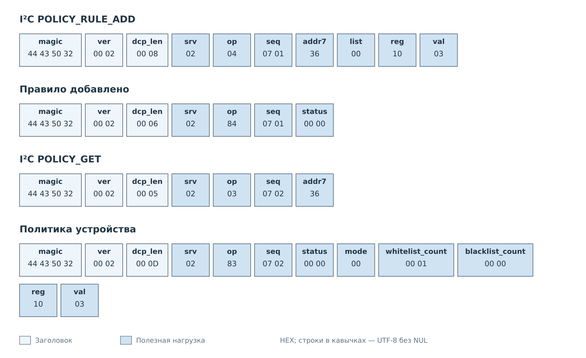
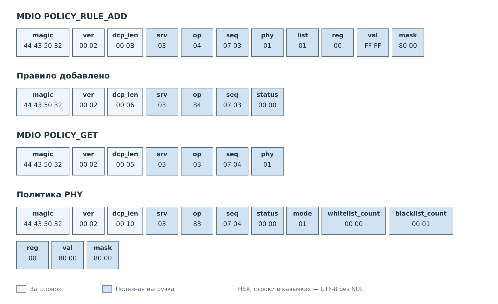

# Политики I²C и MDIO

Рассмотрим добавление правила I²C и правило MDIO с маской.
В каждом обмене клиент сначала изменяет список, затем читает
текущую политику через GET. Общие форматы команд описаны
в [главе о политиках](../04-policies.md).

## Правило I²C

Пусть устройство с адресом `0x36` уже зарегистрировано, его режим — WHITELIST,
а оба списка пусты. Профиль разрешает регистр `0x10` и значение `0x03`.
Клиент добавляет эту пару в белый список, затем читает результат.

*Рисунок 1. Два запроса с разными `seq`: редактирование и проверка политики.*

После добавления разрешена запись `0x03` в регистр `0x10`; другие пары
не получают разрешения этого белого списка. Никакая запись регистра
не выполняется до отдельной команды обмена. Для удаления клиент отправляет
POLICY_RULE_DELETE с теми же адресом, списком и парой. После этого белый
список снова пуст и запрещает записи. POLICY_CLEAR удаляет все правила
выбранного списка, сохраняя режим и другой список.

## Правило MDIO с маской

Пусть PHY 1 зарегистрирован и работает в режиме BLACKLIST с пустыми списками.
Клиент добавляет в регистр 0 правило с `val=0xFFFF`, `mask=0x8000`.
В чёрном списке оно запрещает записи, у которых установлен старший бит
регистра; остальные биты не участвуют в сравнении.

*Рисунок 2. Переданное значение `0xFFFF` сохраняется как `0x8000` с маской `0x8000`.*

GET показывает одну запись чёрного списка с `val=0x8000`.
POLICY_RULE_DELETE с `val=0x8000` или `val=0xFFFF` при той же маске
удалит её. POLICY_CLEAR очищает весь чёрный список. В обоих случаях
режим BLACKLIST сохраняется; пустой список вновь разрешает все
допустимые записи PHY.

Правки изменяют рабочую политику. Правила её сохранения описаны
в [спецификации](../04-policies.md#рабочая-конфигурация-и-сохранение),
а команды штатного клиента — в
[руководстве DCP2](../../../operations/dcp2.md#политики-i²c-и-mdio).

---

Далее: [Уведомления NOTIFY](notify.md).
[Форматы управления политиками](../04-policies.md).
