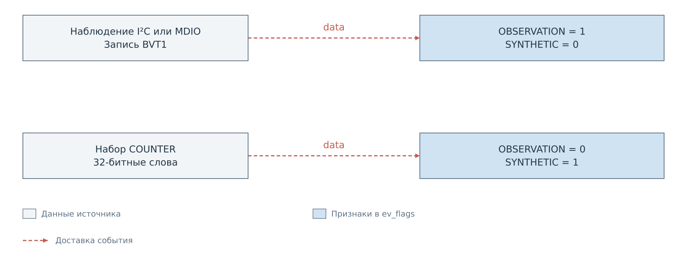
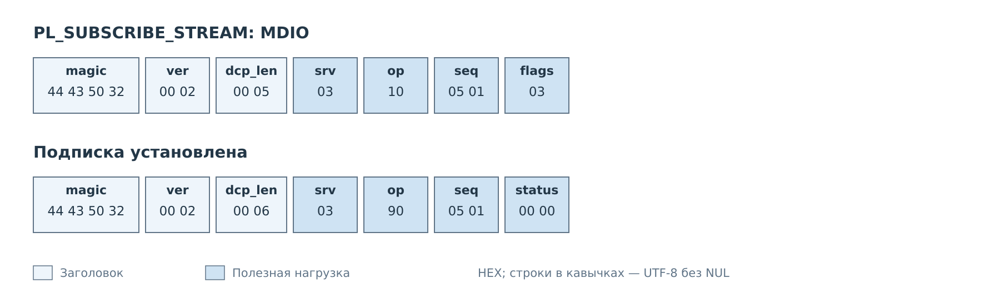
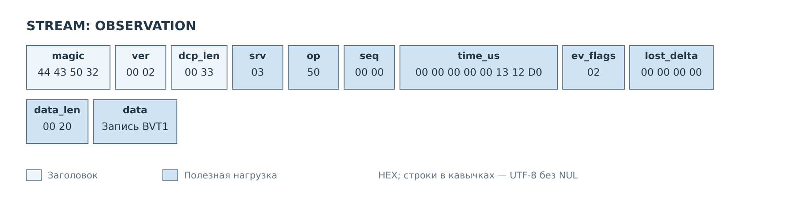
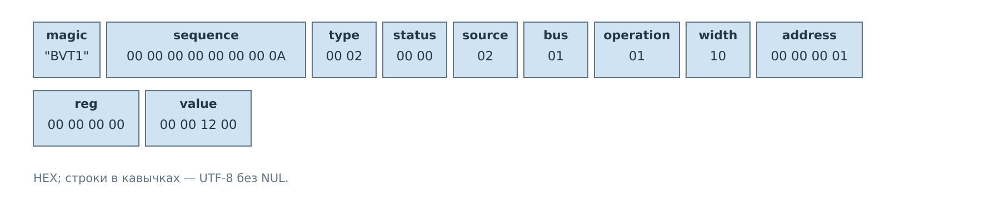
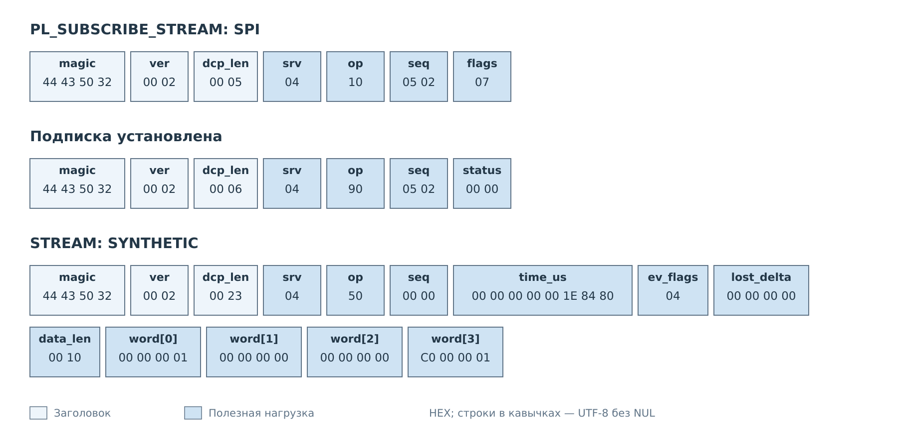
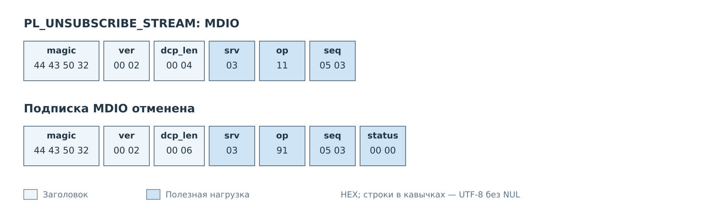

# Потоки STREAM

STREAM передаёт данные от выбранной шины. В текущем сервере это могут быть
записи наблюдений I²C и MDIO либо значения тестового генератора. Клиент
сначала определяет происхождение события, затем разбирает его массив `data`.

*Рисунок 1. Признаки OBSERVATION и SYNTHETIC выбирают два разных формата данных.*

## Подписка на наблюдения MDIO

Подпишемся на MDIO до выполнения записи из [предыдущего примера](mdio.md).
Флаги RAW_WORDS и WITH_TIMESTAMP дают `flags=3`.

*Рисунок 2. `srv=0x03` выбирает поток MDIO. Подписка подтверждается обычным ответом.*

Подписка начинает наблюдение с текущего конца журнала. Она не запускает
транзакцию на шине. Новое действие сервиса должно сначала попасть в журнал,
после чего сервер сможет передать его клиенту.

## Событие и запись BVT1

Пусть следующая интересующая нас запись журнала имеет собственный номер 10
и описывает успешную запись `0x1200` в регистр 0 PHY 1. Сервер помещает её
в событие STREAM.

*Рисунок 3. Оболочка события сообщает время, происхождение данных,
потери и длину вложенной записи.*

`ev_flags=2` означает OBSERVATION. `lost_delta=0` сообщает об отсутствии
обнаруженной потери перед этой записью. `data_len=32` позволяет отделить
саму запись BVT1 от полей события.

*Рисунок 4. Полная запись BVT1 остаётся в `data`, в том числе при RAW_WORDS.*

Клиент проверяет сигнатуру BVT1 и разбирает действие: COMMIT, успешный статус,
источник DCP, шина MDIO и операция WRITE. `width=16` описывает регистр MDIO,
хотя поле `value` самой записи занимает 32 бита.

Здесь существуют два разных номера. `seq=0` в DCP2 означает событие,
а `sequence=10` внутри BVT1 — позицию наблюдения в журнале этой шины.
Он не связан с номером команды MDIO_WRITE. В журнале могут быть и другие
действия, например предшествующая попытка записи.

При потере наблюдений сервер выставляет OVERFLOW, поэтому вместе
с OBSERVATION получится `ev_flags=3`; `lost_delta` содержит число потерянных
записей. Клиент отмечает разрыв. Повторная подписка начинает чтение с текущего
конца и не возвращает утраченную историю.

## Тестовый поток SPI

Для второго примера предполагается, что тестовый генератор SPI уже включён
в режиме COUNTER и формирует по четыре слова. Настройка генератора выполняется
отдельно; команда SUBSCRIBE только подписывает соединение на его выход.
Рассматривается первый набор генератора после его запуска.

*Рисунок 5. `srv=0x04`, `ev_flags=4`: передаются синтетические данные SPI.*

`flags=7` включает RAW_WORDS, метку времени и сброс счётчика потерь
генератора. Первое слово содержит номер набора 1, второе — нулевой endpoint
генератора SPI, третье — индекс 0. В четвёртом находится шаблон `0xC0000001`.
В `data` нет BVT1: способ разбора выбран по SYNTHETIC.

Этот набор не подтверждает аппаратный обмен SPI или чтение SD-карты.
В текущем DCP2-сервере FreeRTOS обычные команды SPI и UART не подключены;
для этих сервисов доступны `PL_SUBSCRIBE_STREAM` и `PL_UNSUBSCRIBE_STREAM`.

## Другие шины и отмена

Формат управления потоком одинаков для четырёх сервисов:

| Шина | `srv` | Источник реальных наблюдений в текущем сервере |
|---|---|---|
| I²C | `0x02` | Журнал I²C |
| MDIO | `0x03` | Журнал MDIO |
| SPI | `0x04` | Аппаратные наблюдения не подключены к этому потоку |
| UART | `0x05` | Аппаратные наблюдения не подключены к этому потоку |

Для I²C можно использовать кадр подписки MDIO, заменив `srv` на `0x02`
и назначив свободный `seq`. В BVT1 поле `width` будет равно 8. Тестовый
генератор выбирается и настраивается отдельно для соответствующего сервиса.

*Рисунок 6. Отмена адресуется сервису шины.*

В показанном соединении отмена MDIO оставляет подписку SPI действующей.
Для её отмены нужен такой же запрос с `srv=0x04` и новым `seq`.
Разрыв TCP уничтожает все потоковые подписки соединения.

---

Далее: [Чтение файла](files.md).
[Все примеры](../07-examples.md).
