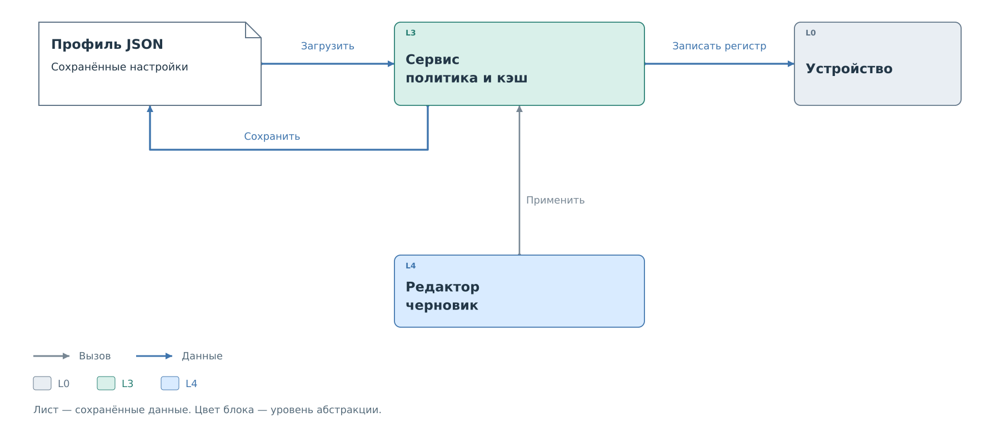
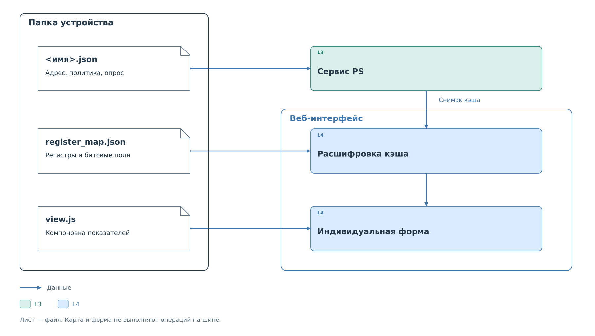

# Конфигурация и состояние устройства

Для разбора транзакции нужны адрес ведомого, допустимые регистры
и правило записи. Эти сведения сервис получает из профиля устройства.
Файл профиля, рабочая конфигурация сервиса и физическое состояние
устройства изменяются разными операциями.

## Загрузка профиля

При запуске загрузчик читает профили из Flash и преобразует JSON
в структуры общего кода. Профиль v2 выбирает обработчик шины и задаёт
параметры устройства, политику, опрос и начальные значения кэша.
В текущей системе подключены `bvstk_i2c_bridge` и `bvstk_mdio_bridge`.

*Рисунок 1. Загрузка, применение, сохранение и физическая запись.*

После загрузки сервис работает со своей конфигурацией в памяти.
Редактирование JSON на носителе не посылает ему уведомление.
Обратное тоже верно: изменение правила в работающем сервисе само
по себе не меняет сохранённый файл.

Загрузчик проверяет профиль целиком. Неизвестный обработчик,
недопустимый адрес или повреждённая политика не превращаются
в разрешительные значения по умолчанию. Во FreeRTOS ошибка сохранённого
профиля отключает загрузку соответствующей шины. MDIO также прекращает
её при недоступной QSPI, поскольку сохранённые правила установить нельзя.
Начальное заполнение отсутствующих файлов и восстановление после
повреждения уже настроенного профиля — разные случаи.

## Применение и сохранение

Рассмотрим устройство I²C по адресу `0x2A` и запись `0x3B` в регистр
`0x10`. Это тот же учебный запрос, который далее проходит через
[ядро, драйвер и сервис I²C](../pl-subsystem/i2c/i2c.md).

Пользователь меняет правило в интерфейсе. Пока оно находится в черновике,
сервис продолжает использовать прежнюю политику. Операция **Применить**
проверяет новую конфигурацию и заменяет рабочие правила. Следующая
транзакция будет проверяться уже по ним. Данные физического регистра
при этом не меняются.

**Сохранить** записывает текущие настройки в профиль для следующего
запуска. Если применение прошло успешно, а сохранение завершилось
ошибкой, новые правила действуют до перезапуска, но файл остаётся
прежним. Интерфейс поэтому показывает применение и сохранение отдельно.

В HTTP UI перед изменением проверяется `revision` прочитанной
конфигурации. Если другой клиент успел её изменить, сервер возвращает
конфликт, и редактор должен получить свежий снимок. Эта проверка
защищает от перезаписи чужих настроек устаревшим черновиком.

Физическая запись — отдельный запрос сервиса. В нашем примере он
проверяет пару `0x10 = 0x3B` по действующей политике и только при
разрешении вызывает master-драйвер. Результат обмена обновляет состояние
сервиса и попадает в наблюдения. Сохранение JSON не является такой записью.

## Начальные значения и кэш

`cache_seed` задаёт значения, которые программа может поместить в кэш
при загрузке. Они помечаются источником `settings`: это сведения из
профиля, а не результат чтения ведомого устройства. Их наличие не
подтверждает присутствие устройства и не запускает последовательность
физических записей.

Затем кэш обновляют реальные операции. Для разных шин порядок публикации
различается: I²C может потребовать ответ на промах в ограниченное время,
MDIO отвечает из заранее подготовленной копии. Общая связь кэша с BRAM
описана в [механизме подсистем](../pl-subsystem/pl-subsystem.md),
а внешнее чтение его состояния — в [наблюдении](../observation/observation.md).

## Пакет устройства

*Рисунок 2. Профиль управляет сервисом, карта и форма описывают представление данных.*

Профиль может находиться в папке вместе с `register_map.json` и `view.js`.
Карта сопоставляет адреса и биты с именами и физическим смыслом величин.
Форма выбирает, как браузер покажет эти значения. Например, значение
регистра PHY можно вывести как скорость и дуплекс, а не как hex-слово.

Карта и форма не меняют политику, список опрашиваемых регистров или
последовательность драйвера. Они получают уже доступные значения кэша.
Обновление страницы поэтому не создаёт нового обмена на шине.
Файлы карты и формы устанавливаются во Flash отдельно; генератор
встроенных профилей не включает их в ELF.

Форматы находятся в справочниках [профиля](../../reference/configuration/device-profile.md)
и [пакета](../../reference/device-package/device-package.md).
Порядок установки и изменения — в [рабочей процедуре](../../operations/configuration.md).
Далее проследим запрос через [подсистемы PL](../pl-subsystem/pl-subsystem.md).
