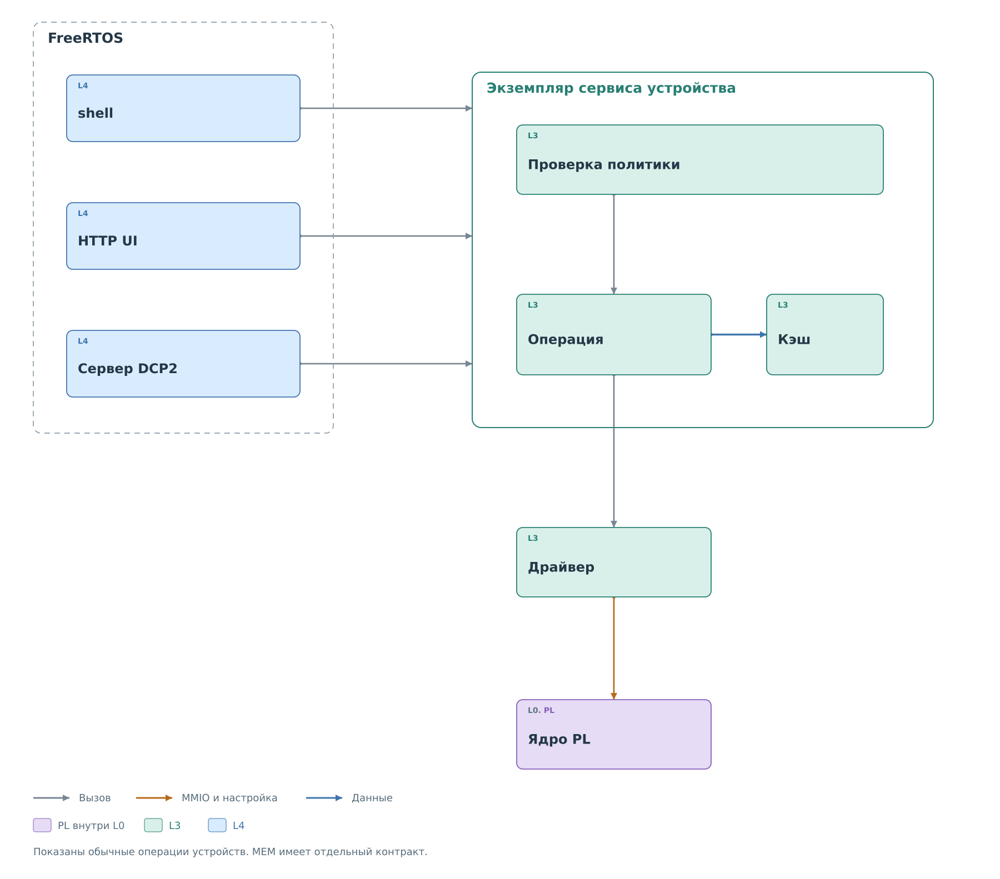

# Внешние интерфейсы

Консоль, HTTP и DCP2 представляют операции в разных формах: строка
команды, JSON и двоичный кадр. После разбора адреса, регистра и значения
обработчик получает экземпляр нужного сервиса и передаёт ему запрос.
Правило записи проверяется сервисом по его текущему состоянию.

*Рисунок 1. Разные обработчики обращаются к одним экземплярам сервисов.*

Пусть клиент запрашивает запись `0x3B` в регистр `0x10` устройства I²C
`0x2A`. HTTP-обработчик проверяет форму JSON, DCP2 — размер кадра
и поля двоичного тела. Оба ещё могут отклонить некорректный запрос
до вызова сервиса. Для допустимого запроса сервис проверяет устройство
и политику, а затем вызывает драйвер. Отказ политики одинаков по смыслу,
хотя представление ошибки в HTTP и DCP2 различается.

Обработчики не обязаны проходить через одну универсальную функцию.
Часть путей использует `bvstk_control_api`, другие вызывают сервис
непосредственно. Общность обеспечивается владельцем состояния и
контрактом операции. Это особенно важно при чтении исходников:
одинаковый результат не означает одинаковую цепочку вызовов.

Диагностический доступ к памяти имеет другой контракт и не проходит
проверку политики регистра устройства. Его область применения и
различия целей указаны в [вариантах сборки](../architecture/variants.md).

## Разделы

- [Консоль](console.md): сеанс, разбор команд и вызов сервиса.
- [HTTP](http.md): маршруты, конфигурация и файловые операции.
- [DCP2](dcp2.md): кадры, ответы и асинхронные события.
- [Веб-интерфейс](web-ui.md): черновик, снимки и отображение данных.

После выполнения операции её состояние доступно через
[кэш и журналы](../observation/observation.md).
