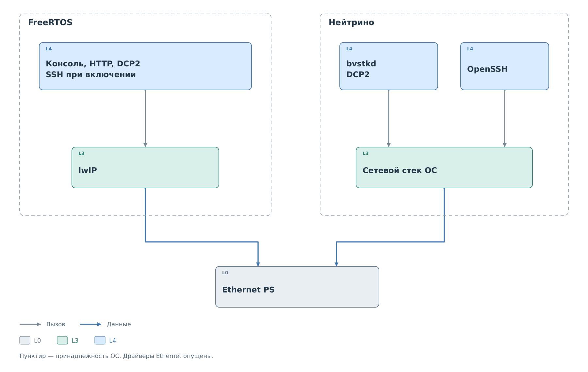

# Сеть

Сеть переносит команды к рабочей среде и результаты к клиенту.
Она не участвует в формировании битов I²C или MDIO. Эти операции
выполняет уже вызванный сервис через соответствующее ядро PL.

*Рисунок 1. Ethernet PS, стек ОС и прикладные серверы.*

Во FreeRTOS Ethernet PS подключён к lwIP. Задачи консоли, HTTP, DCP2
и необязательного SSH используют его сокеты. Сетевой интерфейс получает
статические параметры из `network.json`. Задача сервера и наличие
слушающего сокета ещё не подтверждают доступность ведомого устройства
за PL: это устанавливается на другом участке системы.

В Нейтрино сетевой стек и драйвер Ethernet принадлежат ОС.
`bvstkd` использует сокеты для DCP2; OpenSSH запускается отдельно
из состава IFS. Штатный сценарий IFS задаёт адрес интерфейса.
FreeRTOS-файл `network.json` не управляет этим сценарием.

## Смена адреса

Работающий сетевой интерфейс и сохранённый файл могут содержать разные
значения. Например, HTTP-запрос может сохранить новый адрес для следующего
старта без немедленного применения. При включённом применении обработчик
пытается сохранить файл, меняет `netif` и только затем отправляет ответ.
Само применение не зависит от успеха сохранения.

Ответ после смены адреса может потеряться, хотя операция уже выполнена.
Клиенту требуется повторное подключение по новому адресу и раздельное
чтение действующих и сохранённых параметров. Последовательность показана
в [процедуре изменения сети](../../operations/network.md).

Далее рассмотрены [внешние интерфейсы](../interfaces/interfaces.md),
которые превращают сетевые сообщения в операции сервисов.
