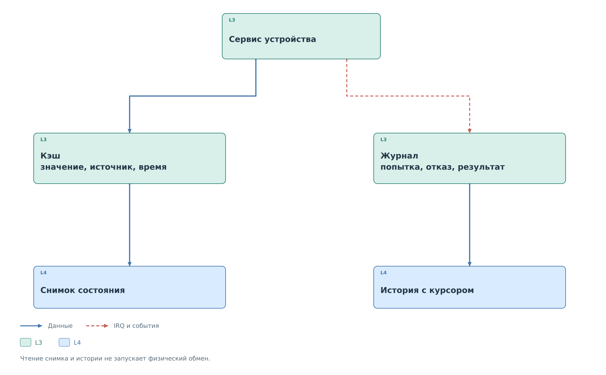
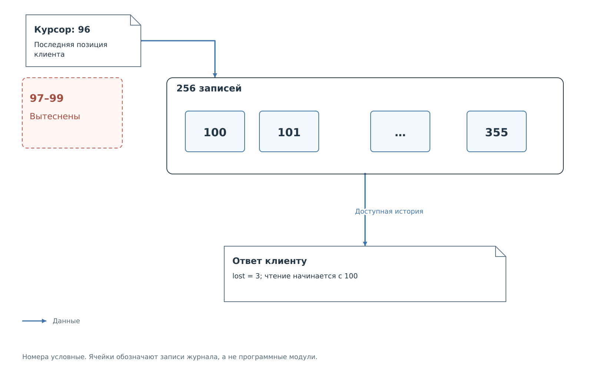

# Кэш и журналы наблюдений

После обработки запроса остаются два вида сведений: текущее известное
значение и история действий, которые к нему привели. Кэш отвечает
на запрос состояния регистра. Журнал позволяет увидеть попытку записи,
отказ политики, завершение обмена или ошибку.

*Рисунок 1. Значения и события предоставляются клиенту разными путями.*

## Значение регистра

Продолжим пример I²C: сервис выполнил запись `0x3B` в регистр `0x10`.
Кэш хранит значение вместе с признаком достоверности, источником
и временем обновления. Для данных из профиля источником будет `settings`;
для результата аппаратного обмена — устройство. Ошибка может сделать
сохранённое значение недостоверным, даже если сами байты ещё остались
в памяти.

Общий каталог `bvstk_cache` представляет записи I²C и MDIO в одной
форме для DCP2. Он получает обновления от сервисов, а не опрашивает
физические шины самостоятельно. HTTP UI также читает состояние
сервисов без нового обмена. Частое обновление страницы поэтому
не повышает частоту опроса ведомого устройства.

Согласованность копии программного кэша означает, что клиент получил
целостные структуры. Она не означает одновременного аппаратного
измерения всех регистров. У каждого значения собственное время
обновления. Для составного показателя важна самая ранняя из меток
участвующих регистров.

Присутствие устройства хранится отдельно. Начальное значение кэша
и успешная запись не всегда подтверждают возможность чтения.
Например, I²C переводит неизвестное устройство в отвечающее после
успешного физического чтения. MDIO также имеет собственные проверки
присутствия, отличные от результата передачи одного кадра записи.

## События операции

Попытка записи публикуется до решения политики. При запрете остаётся
событие отказа, но физический master не запускается. При разрешении
добавляются сведения о выполнении. Поэтому несколько строк журнала
могут относиться к одной пользовательской операции.

Во FreeRTOS адаптер `bvstk_observer` записывает события в ограниченные
кольцевые журналы. Телеметрия и управляющие события хранятся раздельно
для каждой шины. Неподтверждённая телеметрия отфильтровывается: подготовка
ответа в BRAM сама по себе ещё не доказывает выдачу байтов ведущему.
Временная метка означает регистрацию программой PS с доступным
разрешением часов, а не точный момент фронта на линии.

## Курсор и потеря истории

*Рисунок 2. Записи старше окна хранения недоступны; клиент получает число пропусков.*

У каждой записи есть последовательный номер. Клиент передаёт курсор
последней обработанной позиции и получает следующую порцию. Курсор
продвигается также через записи, не прошедшие фильтр адреса: иначе
клиент повторно сканировал бы один и тот же участок.

В примере на рисунке журнал хранит 256 записей с номерами 100–355,
а клиент остановился после 96. Записи 97–99 уже вытеснены. Ответ
сообщит три потерянные записи и продолжит чтение с доступной части.
Пауза браузера не останавливает кольцевой буфер.

У подписки CACHE собственная история изменений. Её курсор нельзя
подставлять в запрос журнала наблюдений. При смене поколения каталога
или потере нужного диапазона клиент заново получает снимок кэша,
а затем продолжает подписку от связанного с ним курсора.

Так завершается путь учебной транзакции: её биты приняло ядро PL,
драйвер передал запрос сервису, политика определила действие,
а кэш и события позволили внешней программе увидеть результат.
Процедуры работы собраны в [руководстве эксплуатации](../../operations/operations.md),
точные поля — в [справочнике](../../reference/reference.md).
