# Ведущее ядро I²C

`I2C_master_0` исполняет команду PS на стороне физического устройства.
Рассмотрим чтение регистра `0x10` по адресу `0x2A` из
[примера подсистемы](../i2c.md): передать указатель, выполнить
повторный START и получить байт.

## Состав ядра

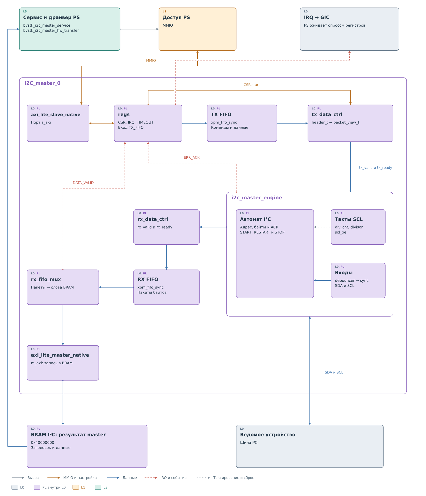

*Рисунок 1. I²C master: состав ядра.*

PS обращается к `regs` через порт `s_axi`. Командные заголовки
и данные записи помещаются в TX FIFO — очередь слов. `tx_data_ctrl`
извлекает их по порядку и выдаёт engine отдельные пакеты адреса
и байтов. Признаки `tx_valid` и `tx_ready` согласуют передачу между
модулями.

`i2c_master_engine` выполняет обмен на SDA и SCL. При чтении байты
поступают через `rx_data_ctrl` в RX FIFO. Затем `rx_fifo_mux`
упаковывает их в слова и записывает результат в BRAM через `m_axi`.
FIFO позволяет приёмной ветви сохранять данные независимо от текущего
состояния автомата шины, пока в очереди есть место.

Эти части соединены в `top_i2c_master` и `i2c_master_wrapper`.
Аппаратная линия IRQ подключена к GIC, но текущий драйвер master
ожидает результат опросом CSR и IRQ через платформу L1.

## Подготовка команды

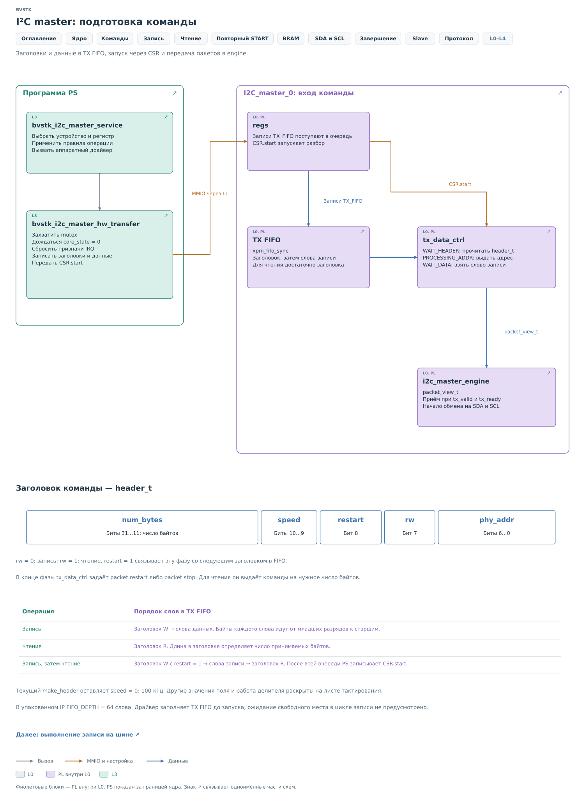

*Рисунок 2. I²C master: подготовка команды.*

После заполнения TX FIFO программа передаёт `CSR.start`. Ядро получает
готовую последовательность фаз; блокировка и очистка старых признаков
перед запуском разобраны в [главе драйвера](../drivers/master.md#подготовка-команды).

Заголовок задаёт одну фазу: адрес, направление, число байтов и способ
завершения. После заголовка записи идут слова передаваемых данных.
Для чтения достаточно заголовка с нужным количеством байтов.

`tx_data_ctrl` превращает эту последовательность в пакеты для engine.
Последний пакет фазы содержит `stop` или `restart`. Engine получает
инструкцию, как завершить фазу, вместе с её последним байтом.
Битовые поля заголовка приведены в справочном разделе ниже.

## Повторный START

Для регистра `0x10` устройства `0x2A` драйвер подготавливает две фазы.
Первая записывает указатель, вторая принимает один байт. Ядро получает
их за один запуск.

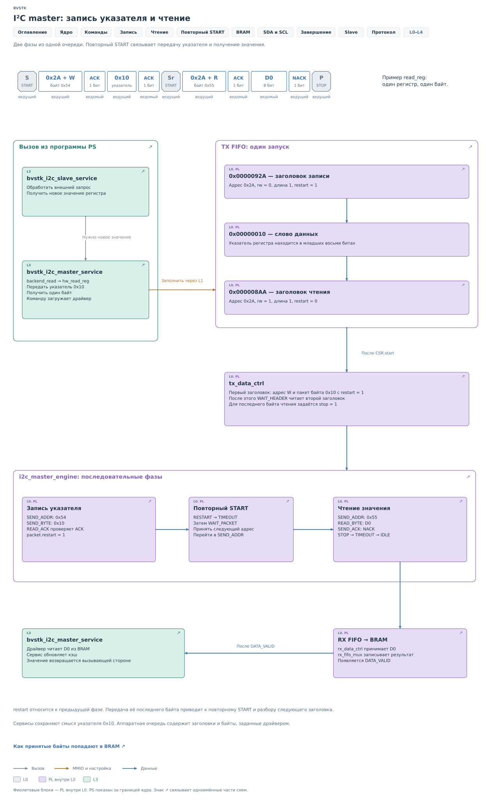

*Рисунок 3. I²C master: две фазы из одной очереди.*

В TX FIFO сначала помещается заголовок записи длиной один байт
с `restart = 1`, затем байт `0x10`, затем заголовок чтения длиной
один байт с `restart = 0`.

Engine передаёт адрес с направлением W и указатель. Признак restart
на последнем пакете вызывает повторный START без промежуточного STOP.
Контроллер разбирает следующий заголовок и передаёт новый адресный
пакет с направлением R. Ядро принимает D0, выдаёт NACK и STOP.

Программа не выполняет дополнительный вызов между фазами. К моменту
первого START в очереди уже лежит и команда чтения. Поэтому engine
получает следующее направление из аппаратного контроллера, сохраняя
занятость шины. Две отдельные команды со STOP между ними дали бы
другую последовательность, даже при тех же адресе и данных.

## Выполнение записи

Для записи сервис передаёт два байта: указатель `0x10` и значение
`0x7B`. Политика проверена до запуска ядра.

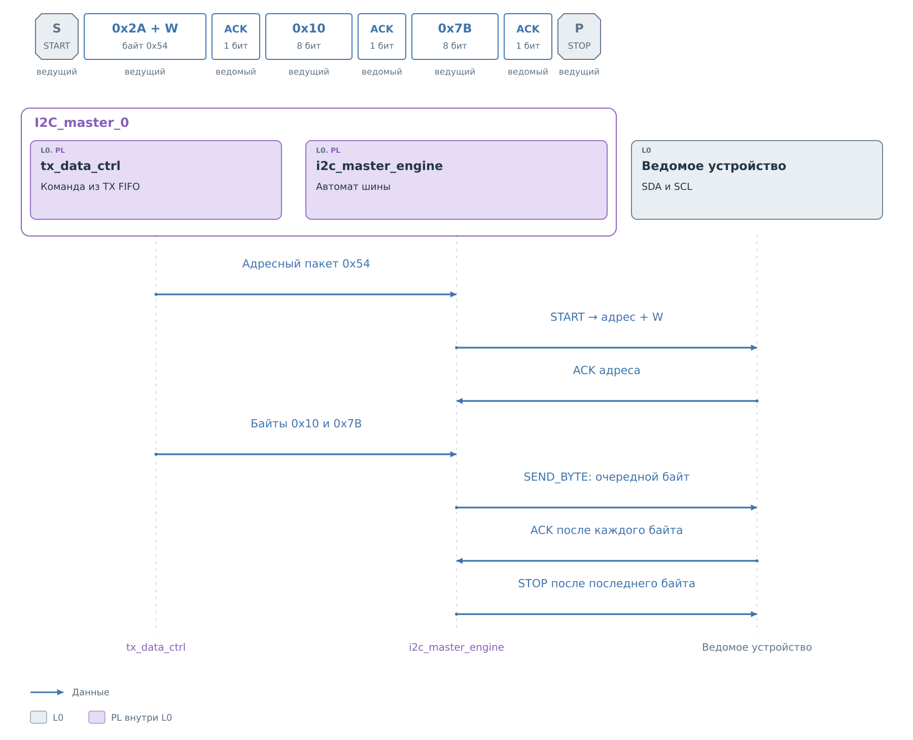

*Рисунок 4. I²C master: передача записи.*

После START передаётся адресный байт `0x54`, затем `0x10` и `0x7B`.
После каждого байта ядро проверяет ACK устройства. Последний пакет
содержит `stop`: engine формирует STOP и возвращается в `IDLE`.
Драйверу достаточно свободного ядра при отсутствии `ERR_ACK`;
полезного результата в BRAM у этой операции нет.

## Выполнение чтения

После адреса с направлением R направление данных меняется. Такты
по-прежнему формирует master, а SDA с данными теперь задаёт устройство.

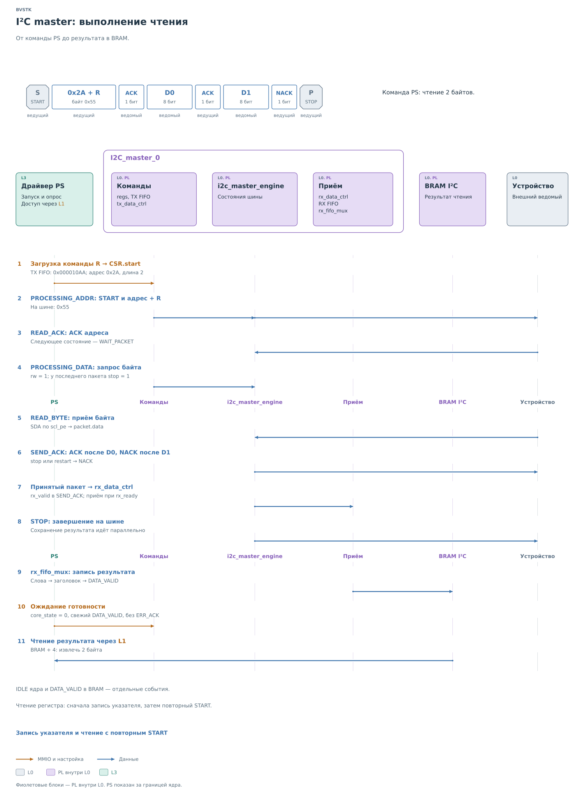

*Рисунок 5. I²C master: приём байтов.*

На рисунке принимаются два байта, чтобы показать промежуточный ACK
и завершающий NACK. Engine передаёт адресный байт `0x55` и получает
подтверждение устройства. Затем собирает восемь бит D0 и выдаёт ACK.
После D1 последняя команда содержит `stop`, поэтому master выдаёт
NACK и завершает обмен. В исходном однобайтовом чтении NACK следует
сразу после D0.

Принятые байты поступают в `rx_data_ctrl`. Их дальнейшее движение
к BRAM продолжается независимо от формирования STOP. Публикацию
результата выполняет отдельная ветвь ядра.

## Приёмные буферы и BRAM

Проследим промежуток между получением байта на шине и появлением
`DATA_VALID`. Здесь происходит преобразование внутренних пакетов
в представление, которое читает программа.

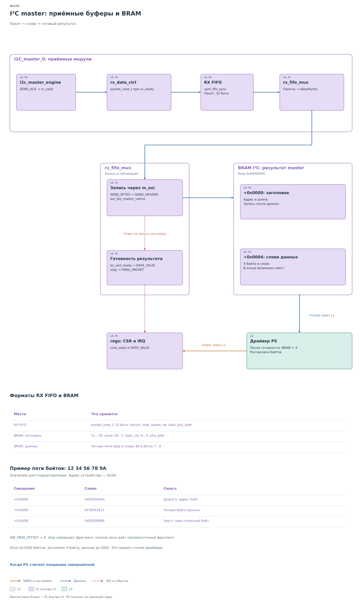

*Рисунок 6. I²C master: приём и публикация результата.*

RX FIFO хранит по одному `packet_view_t` в 32-битном слове.
Кроме байта, в пакете есть адрес и признаки фазы. `rx_fifo_mux`
извлекает поле `data` и собирает по четыре полезных байта для записи
в BRAM. Поэтому слово внутренней очереди и слово результата имеют
разный формат.

Сначала записываются данные, затем заголовок с адресом и длиной.
После подтверждения записи заголовка появляется `DATA_VALID`.
Признак `stop` задаёт `FINAL_PACKET`; при заполнении области ядро
может опубликовать промежуточный фрагмент.

Например, пять принятых байтов занимают пять элементов RX FIFO,
но в BRAM для них нужны два слова данных. В первом находятся четыре
байта, во втором — один полезный байт. Заголовок сообщает длину 5,
поэтому оставшиеся разряды второго слова не входят в результат.
Упаковка и запись заголовка требуют отдельных обращений к памяти.

Отсюда возникает промежуток между завершением обмена на линиях
и готовностью результата для PS. Engine уже мог выдать STOP,
а `rx_fifo_mux` ещё записывает хвост или ждёт подтверждения AXI.
Раннее чтение BRAM в этот момент могло бы вернуть смесь новых
и старых слов. `DATA_VALID` позволяет драйверу дождаться публикации
целиком; свободное состояние engine подтверждает окончание другой
части работы.

## Формирование SCL

До сих пор мы рассматривали обмен байтами. Чтобы понять, как engine
выполняет его на линиях, нужно различать команду отпустить SCL
и фактический подъём этой линии.

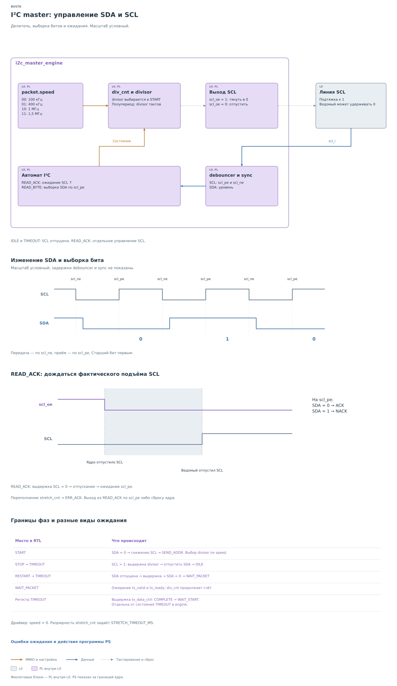

*Рисунок 7. I²C master: формирование SCL.*

В состоянии `START` ядро выбирает `divisor` по полю `speed` команды.
На обычных тактах счётчик `div_cnt` переключает разрешение выхода
`scl_oe` через этот интервал. Сам `scl_o` равен нулю:
включённый выход тянет SCL вниз, выключенный отпускает её. Текущий
драйвер выбирает режим `speed = 0`, номинально 100 кГц в RTL.

Входные уровни фильтрует `debouncer`, затем `sync` синхронизирует
их с тактами ядра. Engine использует полученные признаки спада
`scl_ne` и фронта `scl_pe` для работы с SDA.

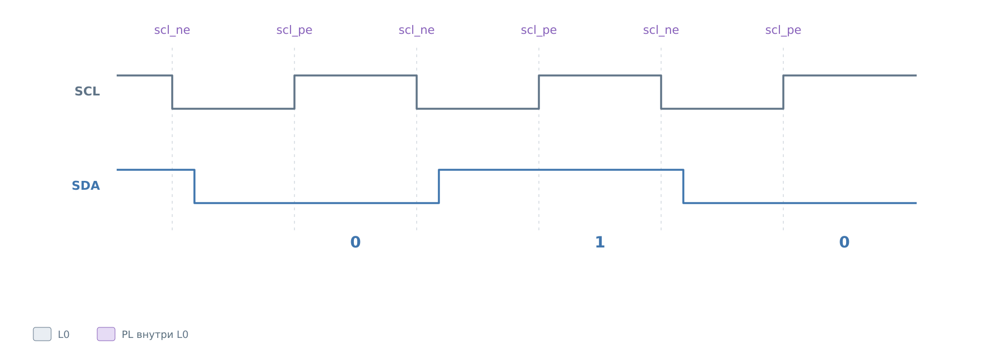

*Рисунок 8. I²C master: изменение и выборка SDA.*

При отправке адреса и данных SDA меняется по спаду SCL, чтобы
к следующему фронту значение было установлено. При чтении SDA
выбирается по фронту SCL. Биты каждого байта идут от старшего
к младшему. Масштаб рисунка условный, задержки фильтра и синхронизации
на нём не показаны.

## Ожидание подъёма SCL

Ведомое устройство может удерживать SCL в нуле после того, как master
её отпустил. На фазе подтверждения ядро ждёт реальный фронт, чтобы
не прочитать ACK раньше времени.

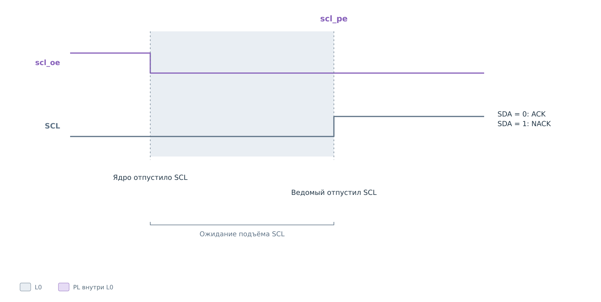

*Рисунок 9. I²C master: ожидание SCL в READ_ACK.*

В `READ_ACK` ядро выдерживает низкий SCL, отпускает линию и ждёт
`scl_pe`. На фронте SDA = 0 означает ACK, SDA = 1 — NACK. Пока
линия удерживается, счётчик `stretch_cnt` продолжает счёт.

При его заполнении устанавливается `ERR_ACK`. Сам переход из
`READ_ACK` всё ещё связан с фронтом SCL, поэтому для завершения
зависшего ожидания драйвер может сбросить ядро. Аппаратный признак
ошибки и программное восстановление здесь дополняют друг друга.

## Завершение и восстановление

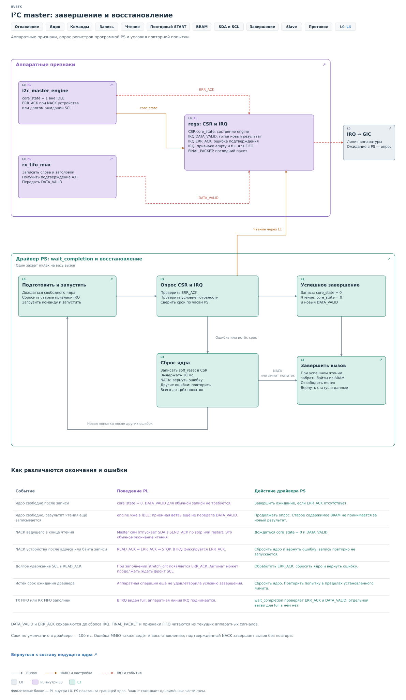

*Рисунок 10. I²C master: признаки готовности.*

`core_state = 0` означает `IDLE`. Для записи этого достаточно при
отсутствии `ERR_ACK`. Для чтения дополнительно требуется свежий
`DATA_VALID`. Признаки `DATA_VALID` и `ERR_ACK` сохраняются до сброса
IRQ. Драйвер проверяет условия и срок ожидания по часам PS.

NACK устройства после адреса или записанного байта означает ошибку.
Штатный NACK, который master выдаёт после последнего принятого байта,
такой ошибки не создаёт. Программные сроки, сброс и повторные попытки
описаны в [ведущем драйвере](../drivers/master.md#ошибка-и-повторная-попытка).

Срок ответа slave проверяется отдельно от успеха master — см.
[промах кэша](../i2c.md#промах-кэша-и-срок-ответа).

## Форматы команды и результата

Эти сведения позволяют сопоставить описанные действия с содержимым
регистров, FIFO и BRAM.

### Заголовок команды

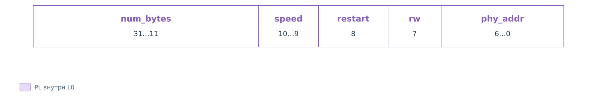

*Рисунок 11. I²C master: заголовок header_t.*

| Поле header_t | Биты | Назначение |
|---|---|---|
| `num_bytes` | `31…11` | Число байтов фазы |
| `speed` | `10…9` | Выбор делителя SCL |
| `restart` | `8` | Связать фазу со следующим заголовком |
| `rw` | `7` | 0 — запись, 1 — чтение |
| `phy_addr` | `6…0` | Семибитный адрес устройства |

Для чтения одного байта регистра `0x10` устройства `0x2A`:

| Порядок в TX FIFO | Слово | Смысл |
|---|---|---|
| 1 | `0x0000092A` | Запись одного байта, `restart = 1` |
| 2 | `0x00000010` | Указатель в младших восьми битах |
| 3 | `0x000008AA` | Чтение одного байта, `restart = 0` |

Для отдельной записи `0x7B` по указателю `0x10` используются заголовок
`0x0000102A` и слово `0x00007B10`. Для отдельного чтения двух байтов —
заголовок `0x000010AA`. Младший байт слова данных передаётся первым.

### Результат в памяти

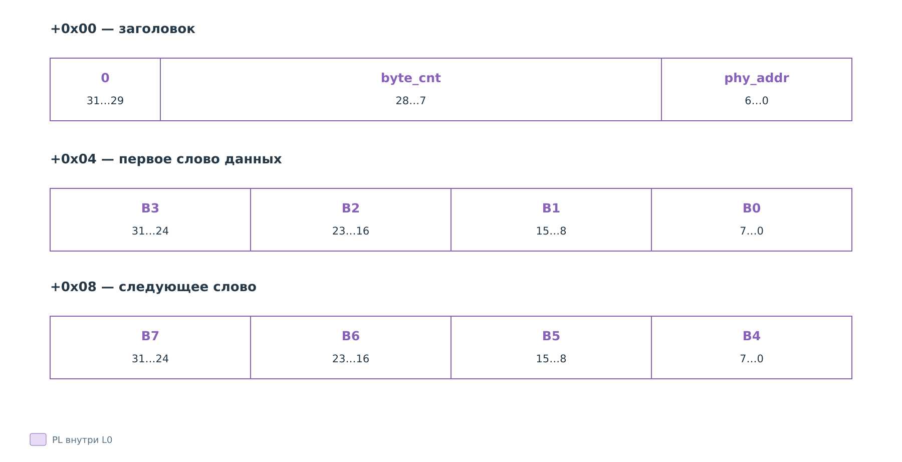

*Рисунок 12. I²C master: формат результата в BRAM.*

База — `0x40000000`, `WR_MEM_OFFSET = 0`. Заголовок находится по
смещению `+0x0000`, данные начинаются с `+0x0004`.

| Часть заголовка BRAM | Биты | Содержимое |
|---|---|---|
| Старшие разряды | `31…29` | Нули |
| Длина | `28…7` | 22-битный счётчик `byte_cnt` |
| Адрес | `6…0` | `phy_addr` |

Пример для адреса `0x2A` и пяти байтов `12 34 56 78 9A`:

| Смещение | Слово | Смысл |
|---|---|---|
| `+0x0000` | `0x000002AA` | Длина 5, адрес `0x2A` |
| `+0x0004` | `0x78563412` | Первые четыре байта, B0 в битах `7…0` |
| `+0x0008` | `0x0000009A` | Один полезный байт хвоста |

Область занимает `0x1000` байтов: заголовок и до 4092 байтов данных.
Длина определяет полезную часть последнего слова.

## Параметры и обработка ошибок

TX FIFO имеет глубину 64 слова. Драйвер заполняет его до запуска,
без ожидания освобождения места внутри цикла загрузки. Текущий
`make_header` оставляет `speed = 0`.

| Код speed | Номинальный режим в RTL |
|---|---|
| `00` | 100 кГц |
| `01` | 400 кГц |
| `10` | 1 МГц |
| `11` | 1,5 МГц |

`STRETCH_TIMEOUT_MS` определяет разрядность счётчика `stretch_cnt`.
Время в состоянии `TIMEOUT` engine используется для выдержки
условий STOP и повторного START. Регистр с тем же именем `TIMEOUT`
задаёт отдельную выдержку `tx_data_ctrl` перед возвратом к ожиданию
запуска. В `WAIT_PACKET` счёт `div_cnt` продолжается.

`DATA_VALID` и `ERR_ACK` сохраняются до сброса IRQ. `FINAL_PACKET`,
а также признаки empty и full для FIFO отражают текущие аппаратные
сигналы. Для full отдельной ветви в текущем `wait_completion` нет.
