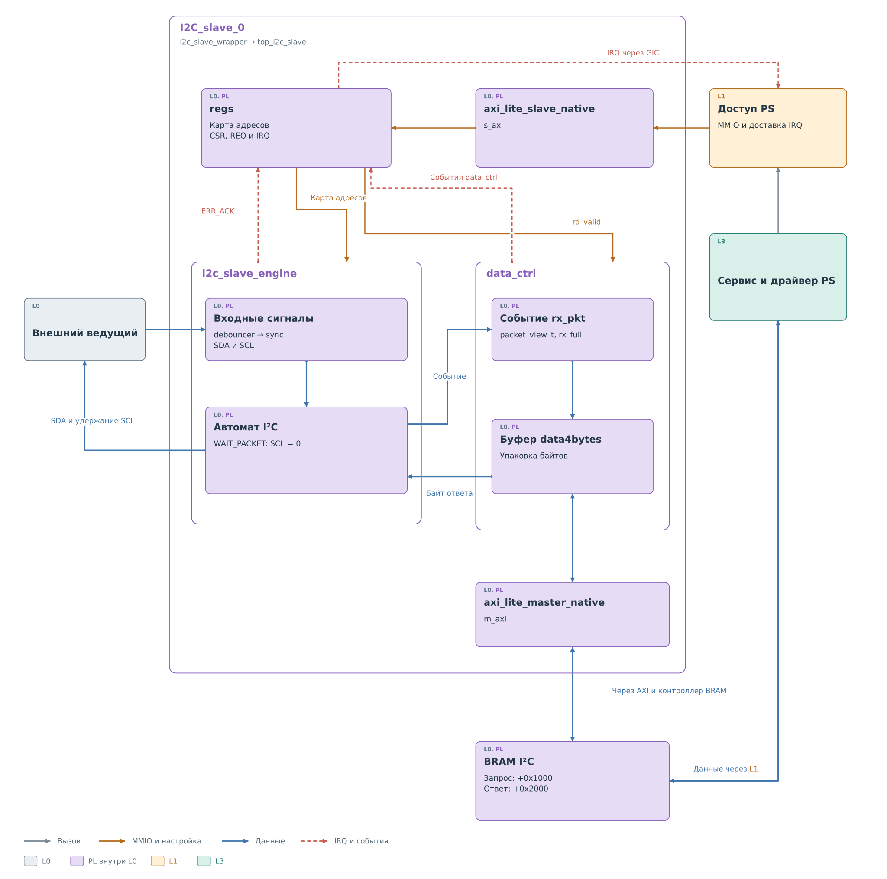
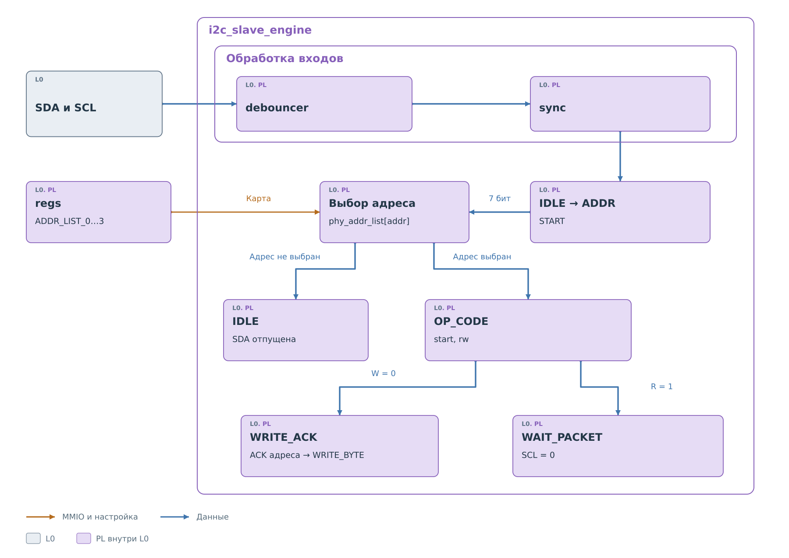
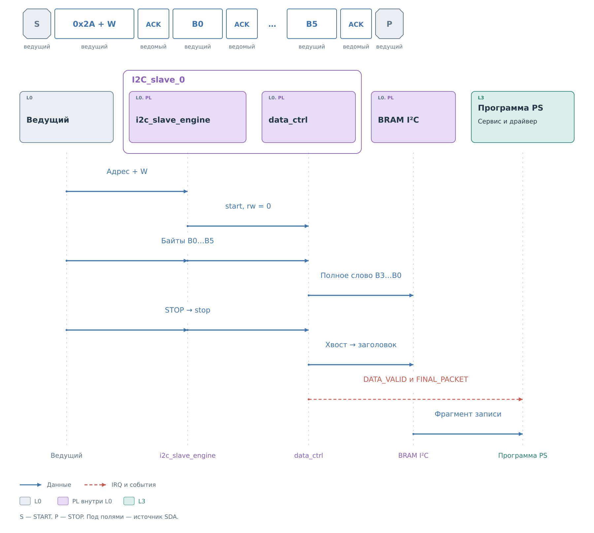
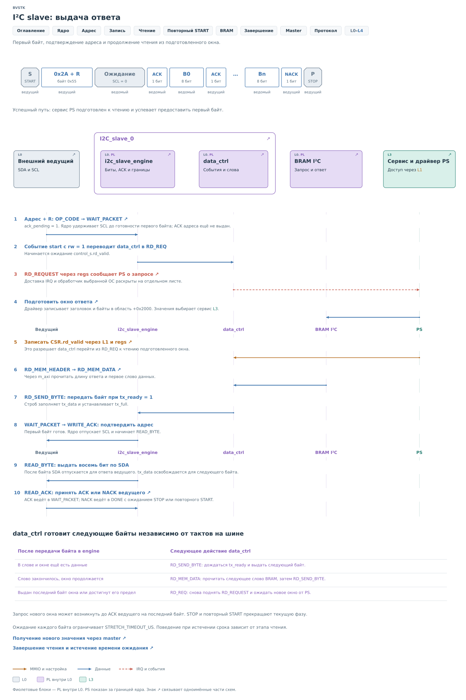
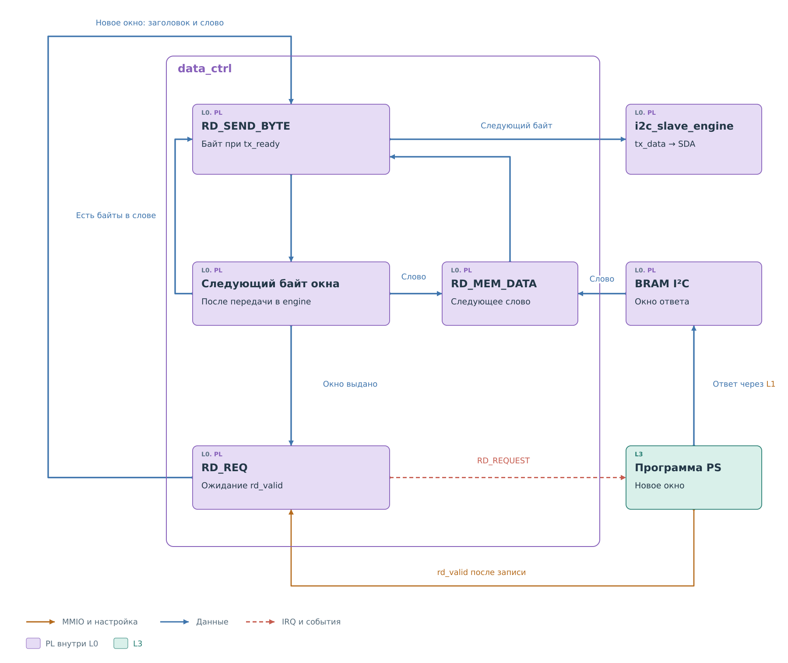
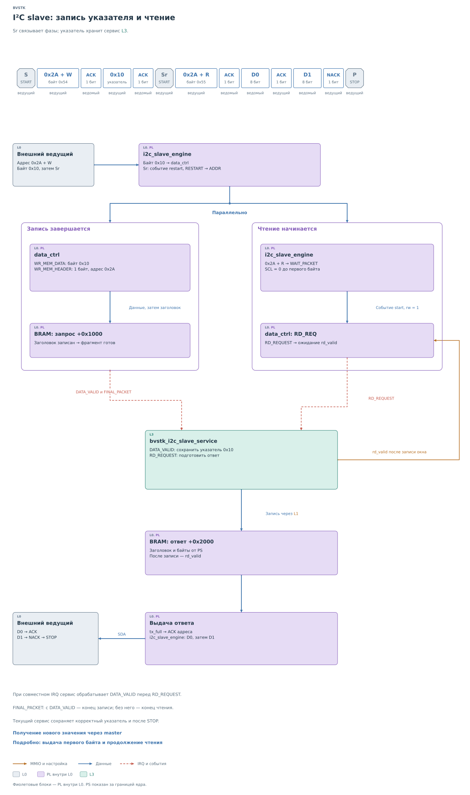
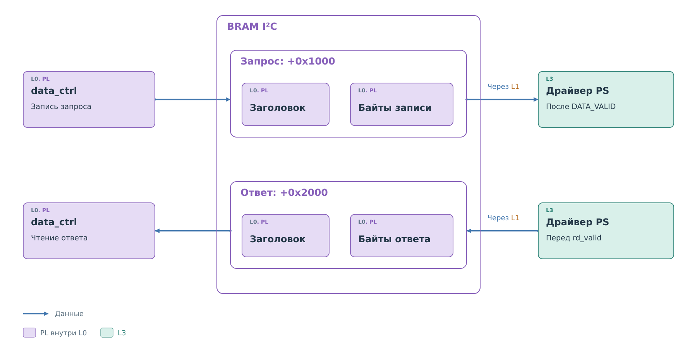
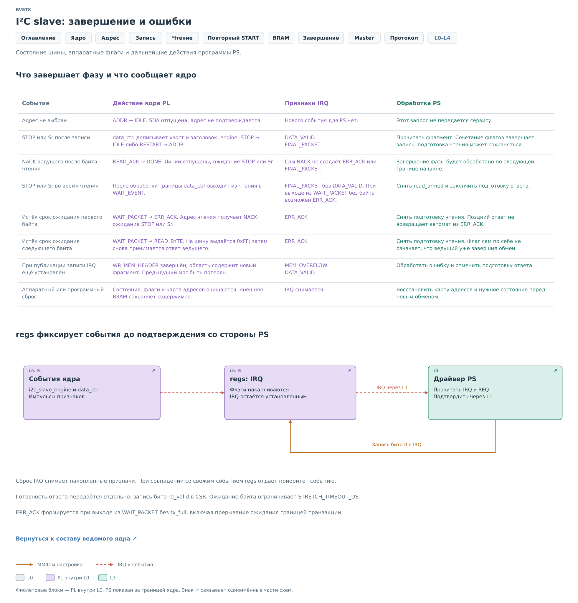
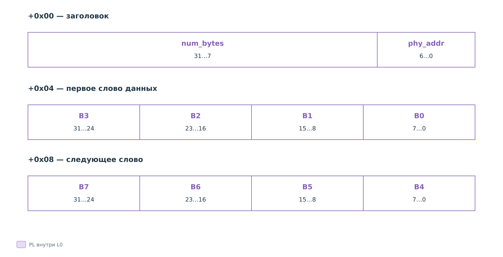

# Ведомое ядро I²C

`I2C_slave_0` принимает запрос внешнего ведущего и выдаёт подготовленный
PS ответ. В [примере подсистемы](../i2c.md) запись содержит указатель
`0x10`, после которого ведущий начинает чтение. Ядро передаёт байты
и события; указатель, политика и выбор значений относятся к сервису L3.

## Состав ядра

Внутри ядра работа разделена между автоматом шины и контроллером
данных. Первый следует тактам внешнего ведущего. Второй обслуживает
память, которая работает словами и требует отдельных обращений.

*Рисунок 1. I²C slave: состав ядра.*

`i2c_slave_engine` принимает адрес, собирает биты в байты, обрабатывает
ACK и выдаёт ответ на SDA. Модуль `debouncer` фильтрует внешние
SDA и SCL, а `sync` синхронизирует их с тактами ядра. События начала
фазы, принятого байта и завершения передаются как `packet_view_t`.

`data_ctrl` получает эти события и упаковывает байты в слова BRAM.
При чтении он выполняет обратную работу: забирает подготовленное
окно из памяти и по одному байту передаёт его в engine. Между ними
нужно хранить хотя бы ожидающий обработки пакет или следующий байт,
поскольку обмен с памятью и такты I²C происходят независимо.

Через `regs` программа задаёт выбранные адреса и обменивается
признаками готовности. Порт `s_axi` принимает обращения PS к регистрам.
Через `m_axi` ядро само обращается к BRAM. Внешние модули
`i2c_slave_wrapper` и `top_i2c_slave` соединяют эти части.

## Выбор адреса и направления

*Рисунок 2. I²C slave: выбор адреса.*

После распознавания START автомат принимает семь бит адреса
и проверяет карту `phy_addr_list`. Её 128 бит задаются регистрами
`ADDR_LIST_0…3`. Если адрес не выбран, SDA остаётся отпущенной,
а ядро возвращается к ожиданию. Событие в PS не передаётся.

Для выбранного адреса принимается бит направления. При записи ядро
подтверждает адрес и начинает собирать байты. При чтении оно должно
сначала получить первый байт ответа: состояние `WAIT_PACKET`
удерживает SCL, а подтверждение адреса откладывается до готовности
`tx_full`. Поэтому уже на адресной фазе пути чтения и записи расходятся.

Повторный START снова запускает приём адреса. Предыдущее направление
не сохраняется: ведущий выбирает его заново.

## Приём записи

На рисунке показаны шесть байтов: целое слово BRAM и неполный хвост.
Один байт указателя публикуется тем же способом.

*Рисунок 3. I²C slave: приём записи.*

Engine подтверждает каждый принятый байт и передаёт его в `data_ctrl`.
Четыре байта собираются в `data4bytes`, после чего записываются одним
словом. Если STOP или повторный START приходит раньше заполнения
следующего слова, контроллер сохраняет его полезный хвост.

Затем записывается заголовок с адресом устройства и числом байтов.
Только после этого появляются `DATA_VALID` и `FINAL_PACKET`,
а регистры поднимают IRQ. Программа может прочитать законченный
фрагмент и определить его смысл: один байт задаёт указатель, следующие
байты в принятой модели сервиса задают значения для записи.

При заполнении области до границы транзакции ядро публикует
промежуточный фрагмент с `DATA_VALID` и продолжает с начала той же
области. Признак `FINAL_PACKET` добавляется на STOP или повторном
START. Поэтому доступность фрагмента и окончание фазы — разные события.

## Подготовка первого байта чтения

После адреса с направлением R ядро знает, что нужно передавать данные,
но само значение регистра ему неизвестно. Здесь аппаратный путь
встречается с программным сервисом.

*Рисунок 4. I²C slave: первый байт ответа.*

Engine переходит в `WAIT_PACKET` и удерживает SCL. `data_ctrl`
формирует `RD_REQUEST`. Событие доходит до PS, как показано в
[главе о доставке IRQ](../drivers/ports.md#доставка-события-slave).

Программа выбирает данные ответа и через драйвер записывает окно
в BRAM, затем передаёт `CSR.rd_valid`. До этого признака ядро не должно
использовать содержимое как новый ответ. Выбор данных описан в
[сервисе](../services/services.md#подготовка-окна-ответа).

Контроллер читает заголовок и первое слово BRAM через `m_axi`.
Когда engine готов принять байт (`tx_ready`), контроллер передаёт
ему пакет с признаком `tx_valid`. Engine сохраняет байт в `tx_data`
и устанавливает внутренний `tx_full`. Теперь можно отпустить SCL,
подтвердить адрес и начать выдачу восьми бит.

Между публикацией окна и отпусканием SCL тоже проходит время.
`rd_valid` сообщает контроллеру, что память заполнена. `tx_full`
сообщает engine, что первый байт уже находится у него на входе.
Это признаки на разных границах: после первого ещё требуется
прочитать заголовок и слово BRAM, извлечь байт и передать его
автомату шины. Подтверждение адреса зависит от последнего шага.

Такой порядок удерживает внешний обмен до готовности данных.
Ведущий пока не получил ACK адреса чтения и не начал вычитывать
первый байт. Если PS не уложится в ожидание, ядро сможет отвергнуть
адрес через NACK, не начав выдачу ответа. При продолжении чтения
адрес уже подтверждён, поэтому последствия опоздания будут другими.

Аппаратный срок включает и работу программы, и последующее получение
байта из BRAM. Записать окно к самому концу этого срока может быть
недостаточно. Соотношение ожидания с длительностью физического чтения
разобрано в [сценарии подсистемы](../i2c.md#промах-кэша-и-срок-ответа).

## Продолжение чтения

Внешний ведущий заранее не сообщает, сколько байтов примет. После
каждого байта он выдаёт ACK для продолжения либо NACK для окончания.
Поэтому подготовленное окно и вся транзакция могут иметь разную длину.

*Рисунок 5. I²C slave: продолжение чтения.*

Если в прочитанном слове остались байты, `data_ctrl` передаёт
следующий. Когда слово исчерпано, он читает следующее слово BRAM.
Когда исчерпано окно, формирует новый `RD_REQUEST` и ждёт публикации
от PS. Так длинное внешнее чтение может обслуживаться несколькими
короткими окнами.

Счётчик контроллера учитывает передачу байта в engine. В этот момент
внешний ведущий ещё может не закончить его приём. Поэтому запрос
следующего окна способен появиться до ACK на последний байт текущего.
Это предварительная подготовка данных, а не подтверждение их получения
внешней стороной.

Например, контроллер уже передал в engine последний байт окна
и запросил у PS следующее. Внешний ведущий затем завершает чтение
NACK на этот последний байт. Новое окно могло быть подготовлено,
но в этой транзакции оно не понадобится. Поэтому по числу запросов
`RD_REQUEST` нельзя восстановить длину фактически прочитанного
ответа. Состояние указателя в сервисе также учитывает подготовленные
окна; перед следующим чтением ведущий задаёт нужный регистр заново.

После ACK engine ожидает следующий байт. После NACK переходит
в `DONE` и ждёт STOP или повторный START. Ожидание каждого байта
ограничено `STRETCH_TIMEOUT_US`; последствия опоздания разобраны
в разделе о завершении.

## Запись указателя и повторный START

Соединим приём записи и подготовку чтения в исходный запрос к регистру
`0x10`. Его две фазы связаны состоянием сервиса PS.

*Рисунок 6. I²C slave: указатель и повторный START.*

Ведущий передаёт адрес `0x2A` с направлением W, байт `0x10`, затем
Sr и адрес `0x2A` с направлением R. На границе Sr контроллер памяти
заканчивает публикацию записи, а engine принимает адрес новой фазы
и ожидает первый байт.

PS обрабатывает `DATA_VALID` раньше `RD_REQUEST`, чтобы связать
новое чтение с только что принятым указателем. Состояние
`register_pointer` и `read_armed` принадлежит [ведомому сервису](../services/services.md#указатель-и-разрешение-чтения).
Аппаратное ядро его не хранит.

Подготовленные данные публикуются в BRAM. Первый байт разрешает ACK
адреса, а дальнейшее число байтов определяет внешний ведущий своими
ACK и завершающим NACK. На рисунке показан приём двух байтов.
Для исходного примера с одним байтом NACK последует сразу после D0.

`FINAL_PACKET` вместе с `DATA_VALID` завершает запись указателя.
`FINAL_PACKET` без `DATA_VALID` сообщает об окончании фазы чтения.
По нему порт завершает программную транзакцию. Сохранение указателя
и разрешение следующего чтения определяет сервис.

## Окна BRAM

*Рисунок 7. I²C slave: окна запроса и ответа.*

Запрос публикуется в порядке «данные, заголовок, DATA_VALID».
При подготовке ответа PS записывает заголовок и байты, затем передаёт
`rd_valid`. Признак готовности отделяет заполнение области от чтения
другой стороной.

Каждая аппаратная область имеет конечный размер и повторно
используется. Если новый фрагмент записи публикуется при ещё
установленном IRQ, ядро сообщает `MEM_OVERFLOW`: предыдущие данные
могли быть потеряны. Наличие BRAM позволяет разнести работу PL и PS
во времени, но не даёт программе неограниченного времени на обработку.

## Завершение, ошибки и IRQ

Для slave окончание обмена задаётся прежде всего внешним ведущим.
При этом завершение чтения, публикация записи и ошибка ожидания
имеют разные последствия для PS.

*Рисунок 8. I²C slave: события и подтверждение IRQ.*

События engine и `data_ctrl` фиксируются в `regs`. Драйвер читает IRQ
и REQ, затем подтверждает IRQ записью бита 0 регистра IRQ. При
одновременном появлении нового события оно имеет приоритет над
сбросом. Готовность ответа передаётся отдельно через `CSR.rd_valid`.

Штатный NACK ведущего после последнего байта сам по себе не является
`ERR_ACK`. Ядро ожидает границу фазы. Ошибка `ERR_ACK` возникает
при выходе из `WAIT_PACKET` без готового байта, в том числе при
прерывании ожидания границей транзакции.

Если истекло ожидание первого байта, ядро выдаёт NACK адреса.
Если опоздал следующий байт, оно выдаёт `0xFF` и принимает ответ
ведущего. Во втором случае шина ещё может оставаться занятой.
Поздняя подготовка ответа программой не превращает уже произошедшую
ошибку в успешное чтение.

Физическое чтение устройства выполняет
[ведущее ядро](master.md#повторный-start).

## Формат памяти

Следующие детали нужны для сопоставления рассказа с драйвером и RTL.
База BRAM I²C в показанной конфигурации — `0x40000000`.

| Смещение от базы | Содержимое | Кто записывает | Кто читает |
|---|---|---|---|
| `+0x1000` | Фрагмент внешней записи | `data_ctrl` | Драйвер PS после `DATA_VALID` |
| `+0x2000` | Окно ответа на внешнее чтение | Драйвер PS | `data_ctrl` после `rd_valid` |

*Рисунок 9. I²C slave: формат окна BRAM.*

Первое слово — `header_t`. В нём отсутствуют направление транзакции
и номер регистра. Направление известно из события, а номер регистра
находится в полезных данных и интерпретируется сервисом.

| Поле | Биты | Смысл |
|---|---|---|
| `num_bytes` | `31…7` | Число полезных байтов текущего фрагмента |
| `phy_addr` | `6…0` | Адрес устройства на I²C |

Пример для адреса `0x2A` и шести байтов `10 7B 20 30 40 50`:

| Смещение внутри окна | Слово | Содержимое |
|---|---|---|
| `+0x00` | `0x0000032A` | Адрес `0x2A`, длина 6 |
| `+0x04` | `0x30207B10` | Первые четыре байта, B0 в битах `7…0` |
| `+0x08` | `0x00005040` | Два полезных байта хвоста |

`MEM_DEPTH = 0x1000`: четыре байта заголовка и до 4092 байтов данных.
Текущие программные порты подготавливают окна ответа до 64 байтов.
Полезную часть последнего слова определяет длина в заголовке.

## Справка по событиям

| Событие | Поведение ядра | Признаки и действие PS |
|---|---|---|
| Адрес не выбран | `ADDR → IDLE`, SDA отпущена | Нового события нет |
| STOP или Sr после записи | Дописать хвост и заголовок | `DATA_VALID`, `FINAL_PACKET`; разобрать фрагмент |
| NACK ведущего после байта чтения | `READ_ACK → DONE`, ждать STOP или Sr | Сам NACK не создаёт `ERR_ACK` или `FINAL_PACKET` |
| STOP или Sr во время чтения | `data_ctrl` возвращается в `WAIT_EVENT` | `FINAL_PACKET` без `DATA_VALID`; снять `read_armed`; при выходе из ожидания без байта возможен `ERR_ACK` |
| Тайм-аут первого байта | `WAIT_PACKET → ERR_ACK`, NACK адреса | `ERR_ACK`; отменить подготовку чтения |
| Тайм-аут следующего байта | `WAIT_PACKET → READ_BYTE`, выдача `0xFF` | `ERR_ACK`; отменить подготовку чтения |
| Новый фрагмент при неснятом IRQ | Заголовок нового фрагмента уже записан | `MEM_OVERFLOW`, `DATA_VALID`; обработать потерю данных |
| Сброс | Очистить состояния, флаги и карту адресов; BRAM сохраняется | Восстановить карту адресов и рабочее состояние |
