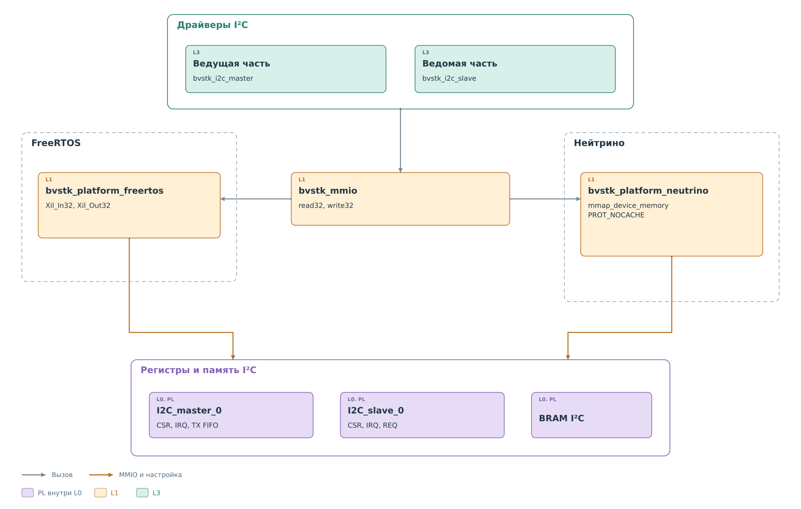

# Драйверы I²C

В [примере чтения регистра](../i2c.md) сервису понадобился байт
физического устройства. Теперь проследим, как программа получает
его через PL, а затем передаёт ведомому ядру для ответа внешнему
ведущему.

На этом участке работают два общих модуля. `bvstk_i2c_master`
запускает ведущую операцию и возвращает её результат.
`bvstk_i2c_slave` забирает входящие данные, фиксирует события и
публикует ответ ведомого ядра. Оба относятся к L3. Доступ к регистрам
и BRAM они получают через интерфейс платформы L1.

*Рисунок 1. I²C: общий драйвер и доступ к PL.*

Пунктирные области показывают код выбранной ОС. Общая часть находится
между ними. В одной сборке используется один из этих портов.
Он обеспечивает чтение и запись аппаратных слов; порядок работы
с ядром задают общие драйверы. Поэтому смена ОС не меняет формат
команды master или порядок публикации ответа slave.

## Что передаётся через границу драйвера

Ведущая часть получает адрес устройства, байты записи и требуемую
длину чтения. Ей уже не нужно решать, разрешено ли изменять регистр.
В рабочем пути это проверил ведущий сервис. Драйвер собирает команду
аппаратного ядра и возвращает байты либо ошибку. Затем сервис
обновляет кэш с учётом результата.

Для ведомой части направление обратное. Ядро сообщает о принятой
записи или потребности в ответе. Драйвер предоставляет доступ к этим
сведениям, а порт ОС вызывает сервис. Именно сервис понимает первый
байт как указатель регистра и выбирает данные из кэша либо запрашивает
физическое чтение. Подготовленные байты порт передаёт обратно драйверу.

Таким образом, **решение о данных принадлежит сервису, а обмен
с аппаратурой — драйверу**. Прямой вызов драйвера сам по себе
не выполняет проверку политики и не обновляет программный кэш.
Это та же граница, которая показана в
[общей схеме подсистемы](../../pl-subsystem.md#кто-выполняет-каждый-этап).

## Три области обмена

Оба драйвера открывают доступ к банку BRAM I²C. Внутри него каждому
направлению выделено собственное окно:

| Смещение в BRAM | Назначение | Передача данных |
|---|---|---|
| `+0x0000` | Результат master | Ядро записывает, ведущий драйвер читает |
| `+0x1000` | Входящая запись slave | Ядро записывает, ведомый драйвер читает |
| `+0x2000` | Ответ slave | Ведомый драйвер записывает, ядро читает |

Первое 32-битное слово окна занимает заголовок, далее идут данные.
Наличие байтов в памяти ещё не означает готовности нового результата:
для этого служат отдельные признаки. При чтении master ожидает `DATA_VALID`,
а при подготовке ответа slave программа передаёт `rd_valid` после
записи всего окна. Полные форматы приведены в главах о
[master](../cores/master.md#форматы-команды-и-результата)
и [slave](../cores/slave.md#формат-памяти).

При инициализации драйверы открывают свои регистры и общий банк BRAM.
Это подготовка доступа; запуск обмена master и обслуживание событий
slave происходят позднее. Для slave рабочая среда также задаёт адрес
выбранного устройства и подключает доставку IRQ.

## Как читать раздел

Сначала рассмотрим [ведущую часть](master.md): как запрос регистра
превращается в содержимое TX FIFO и как драйвер узнаёт о завершении.
Затем [ведомая часть](slave.md) замкнёт путь — от входящего запроса
до публикации ответа. [Порты ОС](ports.md) объясняют, кто исполняет
эти операции и что различается между FreeRTOS и Нейтрино.

Распределение уровней сохраняется из [общей статьи](../../../system.md#уровни-абстракции).
Устройство автоматов на шине раскрыто отдельно в [главе о ядрах](../cores/cores.md).
