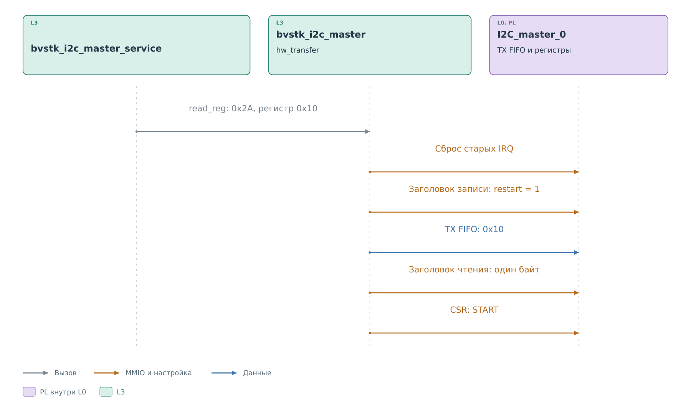
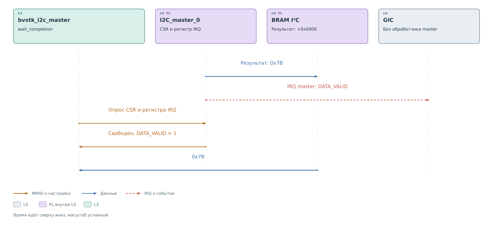

# Ведущая часть драйвера I²C

Продолжим пример: нужно получить регистр `0x10` устройства `0x2A`.
Ведущий сервис вызывает `bvstk_i2c_master_hw_read_reg`. Эта функция
сводит операцию к общей `bvstk_i2c_master_hw_transfer`: записать один
байт указателя, затем прочитать один байт ответа.

Драйвер работает синхронно. Вызывающая задача или поток остаётся внутри
операции до результата либо ошибки. Отдельного исполнителя master
в портах ОС нет; ожидания и блокировку предоставляет платформа.

Если чтение понадобилось для ответа внешнему ведущему, исходный IRQ
приходит от **slave**. Его порт вызывает ведомый сервис, а тот при
промахе кэша обращается к ведущему сервису. Эта цепочка начинается на
[рисунке подготовки ответа slave](slave.md#публикация-ответа).
Тот же ведущий драйвер может быть вызван программной командой без
предшествующего IRQ slave.

## Сначала подготовить команду

Драйвер захватывает mutex ведущего ядра. Под этой блокировкой проходит
весь обмен, включая получение результата и возможное восстановление.
Поэтому команды двух вызывающих сторон не должны перемешиваться
в одной TX FIFO.

Перед загрузкой команды драйвер ждёт освобождения ядра по CSR и
сбрасывает ранее накопленные признаки IRQ. Затем помещает в TX FIFO
заголовки фаз и данные. Только после этого записывает `START` в CSR.

*Рисунок 1. Драйвер master: чтение регистра.*

В первой фазе заголовок задаёт запись одного байта и `restart = 1`.
Следующее слово содержит `0x10`. За ним идёт заголовок чтения одного
байта. Ядро получает обе фазы до начала обмена и само формирует
повторный START между ними. Программа не переключает направление
посреди транзакции.

Тот же вход драйвера поддерживает три сочетания буферов:

| Переданные данные | Команда для ядра |
|---|---|
| Только байты записи | Заголовок записи и данные, затем STOP |
| Только длина чтения | Заголовок чтения, затем STOP |
| Байты записи и длина чтения | Запись с `restart`, затем чтение |

Данные упаковываются по четыре байта в 32-битное слово, первый байт
занимает младшие разряды. Неиспользуемые разряды последнего слова
заполняются нулями; действительную длину задаёт заголовок.
При записи регистра `hw_write_reg` передаёт два байта: номер регистра
и значение.

На рисунке сокращены имена входов драйвера: `hw_transfer` означает
`bvstk_i2c_master_hw_transfer`. Работа ядра после `START` раскрыта
в [аппаратной последовательности](../cores/master.md#повторный-start).

## Как отличить новый результат от старого

Собственный IRQ **master** появляется уже во время выполнения команды.
В показанном успешном чтении ядро публикует данные в BRAM,
устанавливает `DATA_VALID` и поднимает аппаратную линию IRQ к GIC.

*Рисунок 2. Драйвер master: IRQ и получение результата.*

После запуска функция `wait_completion` опрашивает CSR и регистр IRQ.
На рисунке красная пунктирная стрелка обозначает аппаратное
прерывание, коричневые стрелки — обращение к регистрам. В портах
FreeRTOS и Нейтрино обработчик IRQ master не подключён. Драйвер узнаёт о результате
через MMIO, продолжая синхронный вызов.

| Проверка | Действие драйвера |
|---|---|
| Установлен `ERR_ACK` | Завершить попытку с ошибкой |
| Запись: ядро свободно | Вернуть успешное завершение |
| Чтение: ядро свободно и установлен `DATA_VALID` | Забрать данные из BRAM |
| Завершения пока нет | Проверить время и запросить паузу 1 мс |

Для чтения одного свободного CSR недостаточно. Автомат шины может
уже закончить обмен, пока контроллер памяти ещё публикует принятые
байты. Кроме того, в BRAM может оставаться предыдущий ответ.
Сброс старых IRQ перед запуском и ожидание нового `DATA_VALID`
связывают получаемые данные с текущей операцией.

После завершения драйвер читает данные с `+0x0004` относительно банка
BRAM I²C, пропуская заголовок окна master. Он копирует ровно заказанное
число байтов в буфер вызывающей стороны. Заголовок результата на этом
пути не разбирается. Максимальная длина чтения ограничена размером
окна за вычетом заголовка — 4092 байта.

Получив байт `0x34`, драйвер освобождает mutex и возвращает результат.
Ведущий сервис сохраняет успешное значение в кэше. Если запрос пришёл
от ведомого сервиса, тот использует байт для
[окна ответа slave](slave.md#публикация-ответа).

## Ошибка и повторная попытка

При установленном `ERR_ACK`, в частности после NACK, драйвер выполняет
мягкий сброс и возвращает ошибку без повторной передачи. В остальных
неуспешных попытках он тоже
сбрасывает ядро, ждёт 10 мс и может повторить всю операцию. Всего
предусмотрено до трёх попыток.

Из этого следует, что общий неуспех операции не всегда означает
отсутствие действий на шине. До тайм-аута или ошибки доступа часть
обмена уже могла состояться; повтор после такого сбоя может снова
передать данные. Драйвер не обеспечивает однократность записи при
любом отказе.

Параметр `timeout_ms` используется отдельно для ожидания свободного
ядра и завершения попытки. Это не предел суммарного времени всей
функции с повторами и восстановлением. Нулевое значение выбирает
100 мс для этих аппаратных ожиданий. Ожидание mutex имеет отдельную
[зависимость от порта ОС](ports.md#время-и-блокировка-master).

При проверке входных данных драйвер отклоняет пустую операцию,
несогласованные буферы и недопустимую длину. Такие запросы не доходят
до загрузки TX FIFO.

## Реализация

Порядок загрузки, ожидания и восстановления находится в
[bvstk_i2c_master.c](../../../../../src/drivers/pl/i2c/bvstk_i2c_master.c).
Состав регистров задан в
[bvstk_i2c_regs.h](../../../../../src/hardware/pl/i2c/bvstk_i2c_regs.h).
Проверка политики перед записью и обновление кэша после операции —
в [ведущем сервисе](../../../../../src/services/i2c/bvstk_i2c_master_service.c).
