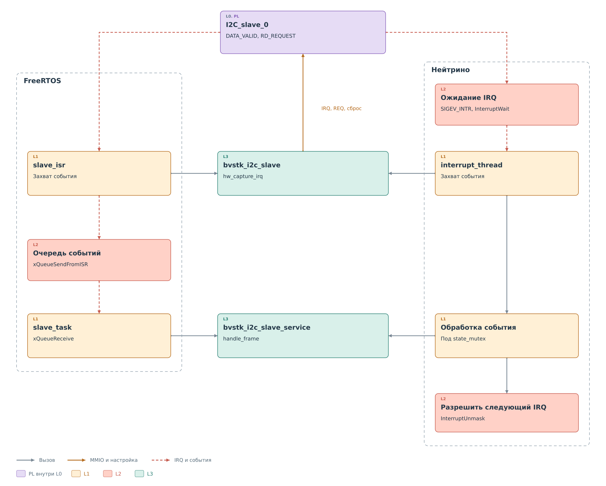

# Исполнение драйверов в двух ОС

Общий код определяет последовательность аппаратных операций.
Порт связывает её с конкретным исполнением: где доступны регистры,
как ждать завершения и кто получает события slave.
Цвета на рисунках сохраняют уровни L0–L4, а пунктирная граница
выделяет принадлежность к ОС.

## Доступ к регистрам и памяти

На [рисунке общего доступа](drivers.md) оба драйвера обращаются к
`bvstk_mmio`. При открытии области порт получает физический адрес
и размер из описания платы.

Во FreeRTOS реализация использует этот адрес непосредственно.
Чтение и запись выполняются через `Xil_In32` и `Xil_Out32`.
В Нейтрино порт сначала отображает область в адресное пространство
процесса с помощью `mmap_device_memory` и `PROT_NOCACHE`, затем
обращается к полученному адресу и выполняет барьер памяти.
Оба порта проверяют границы области и выравнивание 32-битного доступа.

Это относится и к регистрам ядра, и к BRAM. Программный кэш регистров
устройства, который использует сервис I²C, существует отдельно.
Он не является кэшем процессора и не управляется флагом
`PROT_NOCACHE`.

## Время и блокировка master

Ведущий драйвер принимает интерфейсы `bvstk_clock_t` и `bvstk_mutex_t`.
Штатные рабочие среды передают ему mutex своего порта. Отдельный
объект часов они не задают, поэтому используются функции платформы.

| Средство | FreeRTOS | Нейтрино |
|---|---|---|
| Текущее время | `xTaskGetTickCount` с переводом в миллисекунды | `clock_gettime(CLOCK_MONOTONIC)` |
| Пауза при опросе | `vTaskDelay` | `nanosleep` |
| Блокировка ядра | Mutex через `xSemaphoreTake` и `xSemaphoreGive` | `pthread_mutex_lock` и `pthread_mutex_unlock` |

Драйвер запрашивает паузу 1 мс между проверками. Реальное время
возобновления зависит от часов и планировщика выбранной ОС.
Синхронный вызов при этом продолжается в той же задаче или потоке.

Есть различие в ожидании mutex. Порт FreeRTOS переводит `timeout_ms`
в тики, а нулевое значение означает попытку без ожидания.
Текущий порт Нейтрино игнорирует этот аргумент и использует обычный
блокирующий `pthread_mutex_lock`. Поэтому аппаратный тайм-аут
не следует воспринимать как одинаковую в обеих ОС границу всего
вызова.

## Доставка события slave

Ведомое ядро сообщает о готовой записи или запросе ответа через IRQ.
Оба порта в итоге вызывают общий `hw_capture_irq` и общий сервис,
но момент захвата состояния и исполнитель различаются.

*Рисунок 1. I²C slave: доставка и обработка события.*

Во FreeRTOS аппаратный обработчик `slave_isr` вызывает драйвер,
сохраняет снимок события и подтверждает IRQ. Затем он отправляет
структуру через `xQueueSendFromISR`. Задача `slave_task` получает
её через `xQueueReceive`, читает фрагмент или готовит ответ.
Обработка политики, кэша и возможное физическое чтение происходят
в задаче.

Очередь рассчитана на 16 событий. Она хранит флаги и сведения
запроса; каждый элемент не содержит отдельную копию окна BRAM.
Поэтому её наличие не превращает аппаратное окно в очередь
принятых пакетов. Результат отправки в очередь текущий ISR
не обрабатывает: при переполнении событие может быть потеряно.

В Нейтрино `interrupt_thread` подключает событие `SIGEV_INTR`
через `InterruptAttachEvent` и ждёт в `InterruptWait`.
После пробуждения этот же поток вызывает `hw_capture_irq`.
Затем под `state_mutex` выполняет обработку записи и запроса
чтения. После обработки освобождает блокировку и вызывает
`InterruptUnmask`, разрешая следующую доставку прерывания.

Аппаратный сброс IRQ и `InterruptUnmask` выполняют разные задачи.
Первый снимает признаки в ядре PL. Второй относится к доставке
прерывания средствами ОС. Подтверждение готового ответа через
`rd_valid` — ещё одна отдельная операция, описанная в
[ведомом драйвере](slave.md#публикация-ответа).

На рисунке центральные блоки — общие исходники. Функции обработки
события внутри пунктирных областей реализованы отдельно в каждом
порте, хотя последовательность вызовов у них похожа.
У FreeRTOS и Нейтрино нет общего исполняемого потока или общей
очереди между двумя сборками.

## Две разные блокировки

Mutex ведущего драйвера защищает одну аппаратную операцию master.
В Нейтрино дополнительно существует `state_mutex` рабочей среды:
он согласует обработку ведомого события с остальными обращениями
к состоянию I²C внутри `bvstkd`. Это разные объекты с разной
областью действия. Порт slave FreeRTOS такой внешней блокировки
не использует; ему нельзя приписывать ту же схему синхронизации.

Теперь путь замкнут: PL публикует событие, порт передаёт работу
сервису, сервис выбирает данные, а драйвер подготавливает аппаратный
ответ. Общая логика запроса описана в [главе о подсистеме](../i2c.md),
аппаратная выдача байтов — в [главе о ядре slave](../cores/slave.md).

## Реализация

Доступ к аппаратуре и время задают
[платформа FreeRTOS](../../../../../src/ports/freertos-xilinx/os/bvstk_platform_freertos.c)
и [платформа Нейтрино](../../../../../src/ports/neutrino-zynq7000/os/bvstk_platform_neutrino.c).
Реализации mutex находятся в
[bvstk_sync_freertos.c](../../../../../src/ports/freertos-xilinx/os/bvstk_sync_freertos.c)
и [bvstk_sync_neutrino.c](../../../../../src/ports/neutrino-zynq7000/os/bvstk_sync_neutrino.c).
События обслуживают
[bvstk_i2c_slave_freertos.c](../../../../../src/ports/freertos-xilinx/os/i2c/bvstk_i2c_slave_freertos.c)
и [bvstk_i2c_slave_neutrino.c](../../../../../src/ports/neutrino-zynq7000/os/i2c/bvstk_i2c_slave_neutrino.c).
