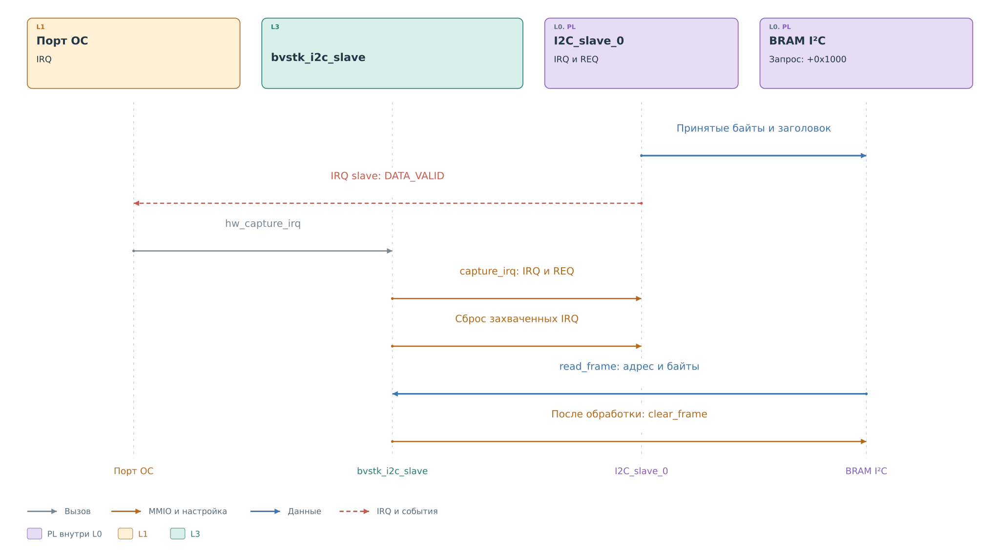
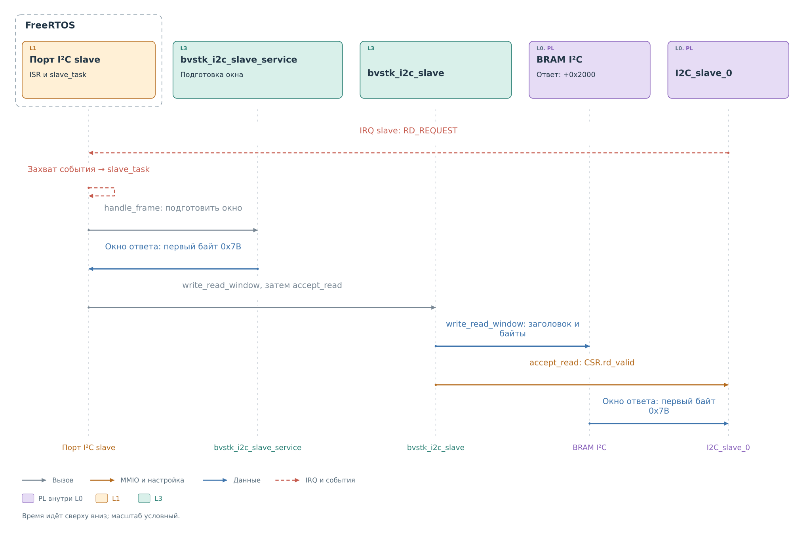

# Ведомая часть драйвера I²C

У slave работу начинает внешний ведущий. Ядро принимает запись
или запрашивает данные для чтения, а программа должна вовремя
обработать это событие. Общий модуль `bvstk_i2c_slave` предоставляет
операции над регистрами и окнами BRAM. Их порядок задаёт исполнитель
в [порте ОС](ports.md#доставка-события-slave).

## Выбор адреса

При запуске рабочая среда выбирает устройство из конфигурации и
передаёт его семибитный адрес в `bvstk_i2c_slave_hw_set_address`.
Ядро имеет карту из 128 адресных битов, размещённую в четырёх словах.
Драйвер записывает в неё один установленный бит, остальные сбрасывает.
Так этот вызов выбирает один адрес для ответа ведомого ядра.

В действующих рабочих средах начальная цель — первое устройство
из конфигурации. Перед передачей запроса сервису порт дополнительно
сверяет адрес с выбранной целью. Аппаратное распознавание адреса
описано в [главе о slave](../cores/slave.md#выбор-адреса-и-направления).

## Получение принятой записи

Пусть внешний ведущий передал указатель `0x10`. Ядро сохраняет байты
в окне входящей записи, публикует заголовок и устанавливает
`DATA_VALID`. IRQ передаёт работу порту ОС, который вызывает общий
драйвер. Теперь программе нужно отдельно зафиксировать событие
и забрать содержимое окна.

*Рисунок 1. Драйвер slave: получение принятой записи.*

Красная пунктирная стрелка показывает причину начала обработки в PS.
Участник «Порт ОС» обозначает выбранную реализацию из
[схемы доставки событий](ports.md#доставка-события-slave).

`bvstk_i2c_slave_hw_capture_irq` сначала читает IRQ и REQ. В структуре
события сохраняются флаги, исходный заголовок запроса, адрес и размер.
Только после этого драйвер сбрасывает IRQ. Сброс признаков не читает
и не освобождает окно BRAM.

Затем `bvstk_i2c_slave_hw_read_frame` читает заголовок из `+0x1000`,
проверяет длину и копирует байты, начиная с `+0x1004`. Первым извлекается
младший байт слова. Текущий программный предел принятого фрагмента —
256 байтов; учитывается и ёмкость переданного буфера.

В этих двух шагах используются разные сведения. IRQ и REQ описывают
захваченное событие. Заголовок BRAM задаёт адрес и длину фрагмента,
который программа фактически копирует. Во FreeRTOS в очередь попадает
только структура события; сами байты остаются в аппаратном окне
до обработки задачей.

Порт передаёт скопированный фрагмент в
`bvstk_i2c_slave_service_handle_frame`. Один байт задаёт указатель
и разрешает последующее чтение. Если после указателя есть значения,
сервис передаёт их ведущему сервису, где проверяется политика записи.
Это продолжает [общий сценарий подсистемы](../i2c.md#запись-в-тот-же-регистр).

После обработки порт вызывает `bvstk_i2c_slave_hw_clear_frame`:
драйвер обнуляет заголовок и использованные слова окна. Порт делает
это и при отказе сервиса. Очистка означает завершение обработки
фрагмента в PS; она не является подтверждением внешнему ведущему
или доказательством записи в физическое устройство.

## Публикация ответа

Когда ядро поднимает IRQ с `RD_REQUEST`, порт захватывает событие
и просит сервис подготовить окно.
Сервис использует указатель регистра и кэш. Если первого значения
нет, он получает один байт через [драйвер master](master.md).
Текущие порты выделяют под окно ответа 64 байта.

*Рисунок 2. Драйвер slave: публикация окна ответа.*

На рисунке синяя стрелка от сервиса к драйверу показывает путь данных
через порт ОС. Сервис возвращает байты исполнителю; тот вызывает
`bvstk_i2c_slave_hw_write_read_window`. Драйвер записывает в `+0x2000`
заголовок с адресом и длиной, а с `+0x2004` — упакованные байты.

**Разрешение выдачи — отдельная операция.** Только после успешной
записи всего окна порт вызывает `bvstk_i2c_slave_hw_accept_read`.
Она передаёт `rd_valid` через CSR. Теперь ядро может прочитать окно
и продолжить обмен на SDA. Такой порядок не даёт ему использовать
частично записанный ответ.

При ошибке подготовки или пустом окне порт не передаёт `rd_valid`.
Дальнейшее поведение задаётся аппаратным ожиданием. Для первого байта
и продолжения чтения оно различается; это разобрано в
[описании ядра](../cores/slave.md#завершение-ошибки-и-irq).
Программный тайм-аут физического чтения сам по себе не продлевает
допустимое удержание SCL.

Если внешнему ведущему нужны дополнительные байты, ядро снова
поднимает `RD_REQUEST`. Повторяются подготовка и публикация окна.
Готовность окна означает готовность к выдаче, но ещё не подтверждает,
сколько байтов внешний ведущий действительно принял.

В подписях рисунков опущен общий префикс `bvstk_i2c_slave_hw_`:
например, `accept_read` обозначает полный одноимённый вход драйвера.

## Когда одновременно пришло несколько признаков

На повторном START ядро может сообщить и о принятой записи,
и о запросе чтения. Оба порта сначала обрабатывают `DATA_VALID`.
Лишь после успешной обработки записи, при отсутствии признаков
ошибки, они переходят к `RD_REQUEST`. Поэтому ответ подготавливается
уже от нового указателя регистра.

`FINAL_PACKET` вместе с `DATA_VALID` закрывает фазу записи. Это
может быть запись указателя перед повторным START; такой набор
не должен отменять только что подготовленное чтение.
Функция `bvstk_i2c_slave_irq_ends_read` отличает этот случай от
окончания чтения: она возвращает истину при `ERR_ACK`,
`MEM_OVERFLOW` или `FINAL_PACKET` без `DATA_VALID`.

Если обработка не удалась либо чтение завершено, порт вызывает
`bvstk_i2c_slave_service_end_transaction`. Сервис снимает `read_armed`,
чтобы следующий запрос не использовал ранее разрешённое чтение.

## Реализация

Регистры и окна обслуживает
[bvstk_i2c_slave.c](../../../../../src/drivers/pl/i2c/bvstk_i2c_slave.c).
Указатель регистра, подготовка окна и обращение к ведущему сервису
находятся в
[bvstk_i2c_slave_service.c](../../../../../src/services/i2c/bvstk_i2c_slave_service.c).
Порядок вызовов драйвера и сервиса задают
[порт FreeRTOS](../../../../../src/ports/freertos-xilinx/os/i2c/bvstk_i2c_slave_freertos.c)
и [порт Нейтрино](../../../../../src/ports/neutrino-zynq7000/os/i2c/bvstk_i2c_slave_neutrino.c).
