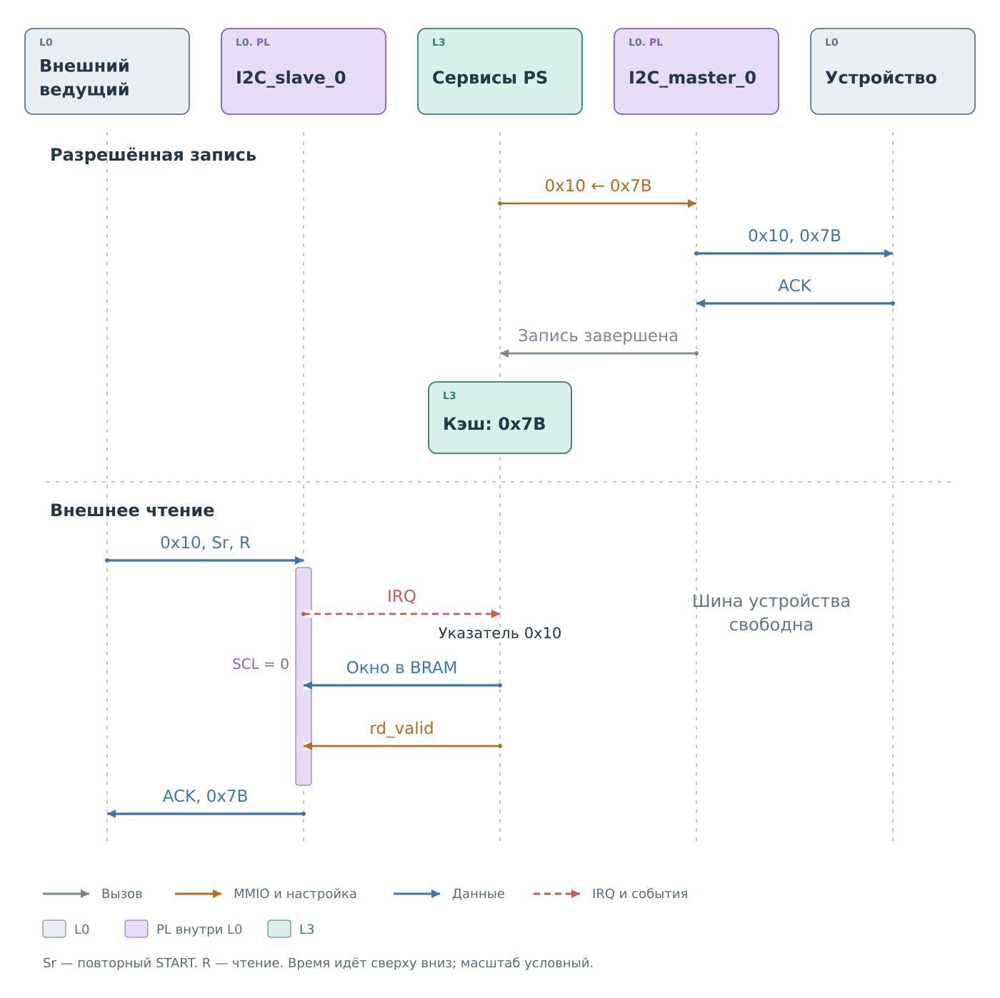
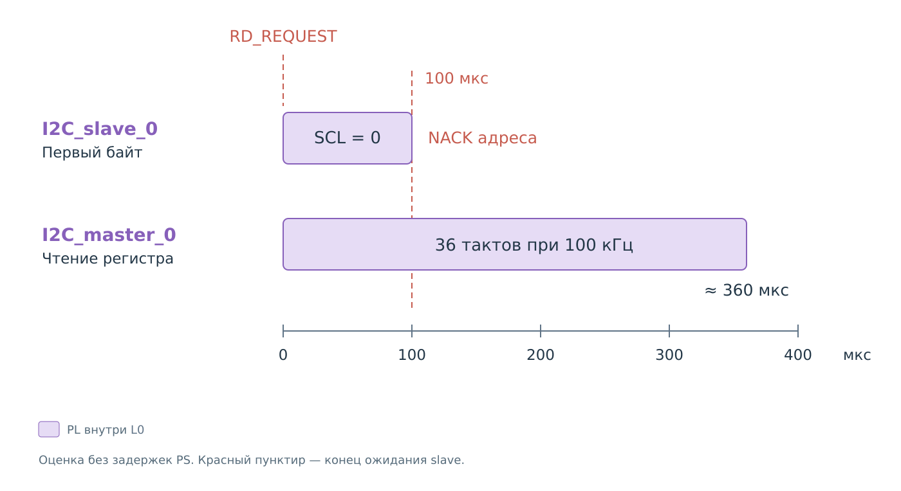

# Подсистема I²C

Проследим один регистр через обе стороны BVSTK. Пусть в профиле задано
устройство с адресом `0x2A`, а внешний ведущий хочет прочитать его регистр
`0x10`. Адрес и значения в примере условные. На стороне ведущего отвечает
`I2C_slave_0`, на стороне физического устройства работает `I2C_master_0`.

Начнём с известного значения: программа уже выполнила физическое чтение
регистра и сохранила `0x34` в достоверном кэше. Например, это произошло
по команде из консоли.
Начальное значение профиля тоже может заполнить кэш, но его происхождение
другое: оно ещё не подтверждено чтением устройства.

## Выбор регистра

Адрес устройства и номер регистра передаются в разных местах обмена.
Ведущий выбирает `0x2A` с направлением записи и передаёт байт `0x10`.
Затем выдаёт повторный START, выбирает `0x2A` с направлением чтения
и принимает байт. Чтение одного байта заканчивается NACK и STOP.

Первая фаза только выбирает регистр: после `0x10` нет значения для записи.
Такой смысл байту придаёт сервис BVSTK. Ядро PL видит адрес, направление
и данные. Если START, ACK или повторный START пока незнакомы, сначала
прочитайте [короткую главу о протоколе](protocol/protocol.md).

## Чтение из кэша

На рисунке сначала показано предыдущее чтение устройства, затем текущее
обращение внешнего ведущего. Между ними может пройти произвольное время.
Шина устройства не повторяет каждый обмен на шине ведущего.

*Рисунок 1. Предварительное чтение и ответ из кэша.*

Предварительный обмен на стороне устройства уже закончился. Master
получил `0x34` и завершил работу. Драйвер вернул результат ведущему
сервису, который сохранил байт в кэше.
Окно BRAM для нового внешнего чтения ещё предстоит подготовить.
Таким образом, наличие значения в программе и готовность ведомого
ядра выдать его — два отдельных состояния.

При повторном START ведомое ядро публикует принятый указатель в BRAM
и сообщает PS о готовности через `DATA_VALID`. Сервис разбирает `0x10`,
сохраняет указатель и разрешает подготовку чтения.

Когда ядро принимает адрес с направлением чтения, оно поднимает
`RD_REQUEST` и удерживает SCL. Адрес пока не подтверждён: первый байт
ответа ещё нужен аппаратуре. Если оба события пришли вместе, программа
сначала разбирает запись указателя, затем обслуживает чтение.

Сервис находит достоверный `0x34` и передаёт окно ответа коду обслуживания.
Через драйвер тот записывает окно в BRAM, затем передаёт `rd_valid`.
Ядро получает первый байт, отпускает SCL, подтверждает адрес и выдаёт
значение внешнему ведущему. В этой части примера master не запускается.
Успех предполагает, что доставка IRQ и подготовка окна уложились
в аппаратный срок ожидания.

Если ведущий продолжает чтение, он подтверждает очередной байт ACK.
Ядро использует подготовленное окно и при необходимости запрашивает
следующее. Длина внешнего чтения заранее программе неизвестна.

Если физическое устройство между предварительным опросом и этим
обращением изменило регистр, ответ всё равно будет `0x34`. Slave
выдаёт подготовленное программой значение. Внешний ведущий не получает
вместе с байтом время опроса или признак его происхождения. Поэтому
успешное чтение через мост подтверждает получение сохранённого
значения, а его свежесть зависит от предыдущих операций с устройством.

## Промах кэша и срок ответа

В сервисе предусмотрена другая ветвь: получить один недостающий байт
через master и лишь затем подготовить ответ slave. Но для текущих
параметров исходников эту ветвь нельзя считать гарантированным способом
ответить на уже начавшееся внешнее чтение.

*Рисунок 2. Промах кэша: сроки master и slave.*

У оболочки slave параметр `STRETCH_TIMEOUT_US` равен 100 мкс.
В `Burevestnik_21.tcl` он не переопределён. Текущий драйвер master
задаёт `speed = 0`, номинально 100 кГц. Чтение одного регистра требует
как минимум четырёх групп по девять тактов: адрес записи, указатель,
адрес чтения и байт ответа. Это около **360 мкс только на такты шины**,
без доставки события, работы PS и дополнительных выдержек.

Кроме того, ведущий драйвер между проверками состояния вызывает
ожидание на 1 мс; фактическая задержка зависит от порта ОС.
Следовательно, программная возможность запустить чтение есть,
но при этих параметрах его результат не успевает в первое окно 100 мкс.
Это вывод из исходников, а не измерение загруженной в плату прошивки.

Ожидания master и slave начинаются у разных участников. Slave уже
обслуживает запрос внешнего ведущего и ограничивает удержание SCL.
Программное ожидание master относится к отдельной операции на другой
шине. Его более длинный тайм-аут позволяет дождаться результата
устройства, но не продлевает аппаратное ожидание slave. Даже без
затрат на доставку IRQ физический обмен в этом примере длиннее
допустимой задержки ответа.

При опоздании первого байта slave не подтверждает адрес чтения.
Если ожидалось продолжение уже начатой выдачи, аппаратное поведение
другое: вместо недоступного байта выдаётся `0xFF`. Поздний успех master
может обновить кэш, но не превращает уже сорванное внешнее чтение
в успешное. И ответ из кэша требует, чтобы PS успел подготовить окно;
сам признак достоверности такого срока не гарантирует.

После позднего успешного чтения состояние системы всё же изменится:
кэш уже будет содержать полученный байт. Повторное обращение ведущего
с явной записью указателя сможет использовать его без физического
чтения. Это новая транзакция; предыдущая завершилась с ошибкой.

Этим объясняется роль предварительного получения данных. Состояние
кэша и срок ответа нужно рассматривать вместе. Аппаратные ветви
опоздания разобраны в [главе slave](cores/slave.md#завершение-ошибки-и-irq).

## Запись регистра

Теперь ведущий передаёт `0x10`, затем `0x7B` и завершает запись STOP.
Сервис понимает первый байт как номер регистра, второй — как новое
значение. После аппаратного приёма ведущий сервис проверяет границы
устройства и политику записи.

При запрете новое обращение к физическому устройству не начинается.
Ранее выданный ACK подтверждал приём байта ядром slave; программный отказ
не может изменить этот ACK задним числом.

При разрешении master передаёт указатель и значение на стороне устройства.
Успешная операция сохраняет переданный `0x7B` в кэше. Ошибка физической
операции снимает достоверность этой записи. Автоматического перечитывания
после записи в этом пути I²C нет, поэтому сохранённый байт отражает
успешно отправленное значение, а не отдельную проверку содержимого регистра.

Подготовка окон и политика разобраны в [сервисах I²C](services/services.md).
[Драйверы](drivers/drivers.md) описывают доступ к PL,
[ядра](cores/cores.md) — работу на линиях SDA и SCL.
В следующей подсистеме, [MDIO](../mdio/mdio.md), ответы всегда
подготавливаются заранее.
