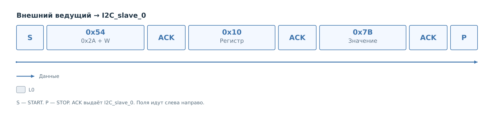

# Подсистема I²C

Внешний ведущий записывает `0x7B` в регистр `0x10` устройства
с адресом `0x2A`. Проследим эту запись от SDA до изменения кэша PS.
Адреса и значение выбраны для примера; устройство настроено в профиле,
выбрано для slave и допускает такой регистр. Политика разрешает
пару `(0x10, 0x7B)`. Основной путь показан для FreeRTOS.

## Транзакция на шине

*Рисунок 1. Внешняя запись регистра 0x10.*

После START ведущий передаёт адресный байт `0x54`: семь бит `0x2A`
и направление W. Затем следуют `0x10` и `0x7B`, после них — STOP.
На этом участке шины адрес и данные подтверждает `I2C_slave_0`.
Обозначения START, ACK и STOP разобраны в [главе о протоколе](protocol/protocol.md).

Аппаратура принимает два байта `10 7B`. Их назначение задаёт
модель сервиса: первый байт выбирает регистр, второй содержит
записываемое значение. До обработки в PS ядро не знает, разрешена
ли эта пара политикой и приняло ли её физическое устройство.

## Обработка принятой записи

В следующих главах сохраняются эти же два байта:

1. [Ведомое ядро](cores/slave.md#приём-записи) собирает `10 7B`,
   публикует их в BRAM с адресом `0x2A` и длиной 2, затем поднимает IRQ.
2. [Ведомый драйвер](drivers/slave.md#получение-принятой-записи)
   захватывает событие и копирует байты. Порт ОС передаёт их сервису.
3. [Сервисы](services/services.md#разбор-принятой-записи) получают
   из `10 7B` операцию записи регистра. После проверки политики
   запускают физический master и учитывают его результат в кэше.

Модули и представление данных меняются, но адрес `0x2A`, регистр
`0x10` и значение `0x7B` сохраняются. На схемах следующего этапа
повторяются BRAM, драйвер или сервис, которым передана работа.

## Результат операции

Разрешённая запись порождает новый кадр на участке физического
устройства. Его выполняет `I2C_master_0`. При успехе сервис сохраняет
`0x7B` в кэше и отмечает значение достоверным. Действия master разобраны
в [драйвере](drivers/master.md) и [ядре](cores/master.md).

Это два отдельных обмена. ACK внешнему ведущему подтверждает приём
байта аппаратным slave. Последующий отказ политики или ошибка master
уже не могут изменить выданное подтверждение.

Следующая внешняя операция может прочитать сохранённый `0x7B`.
[Чтение и подготовка ответа](services/read.md) продолжает пример:
запись указателя, повторный START, окно BRAM и срок удержания SCL.

[Состав ядер](cores/cores.md), [интерфейсы драйверов](drivers/drivers.md)
и [порты ОС](drivers/ports.md) раскрывают участников этого пути.
В [MDIO](../mdio/mdio.md) та же задача приёма записи решается иначе:
вместо фрагмента байтов ядро сразу адресует ячейку регистра.
