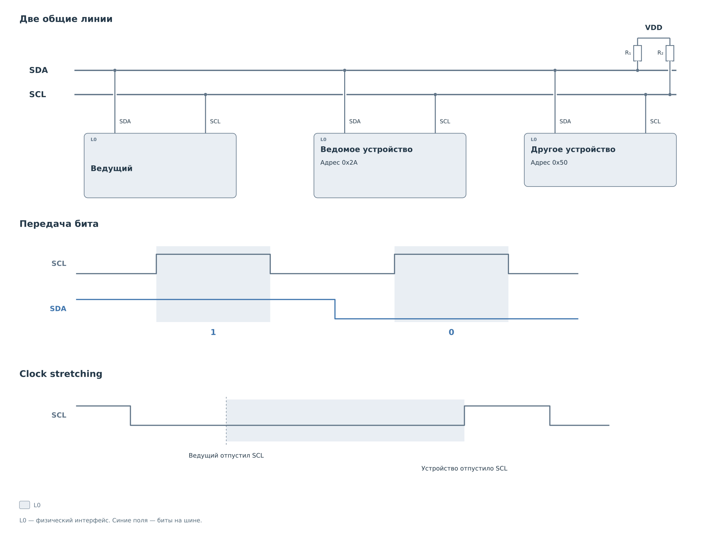
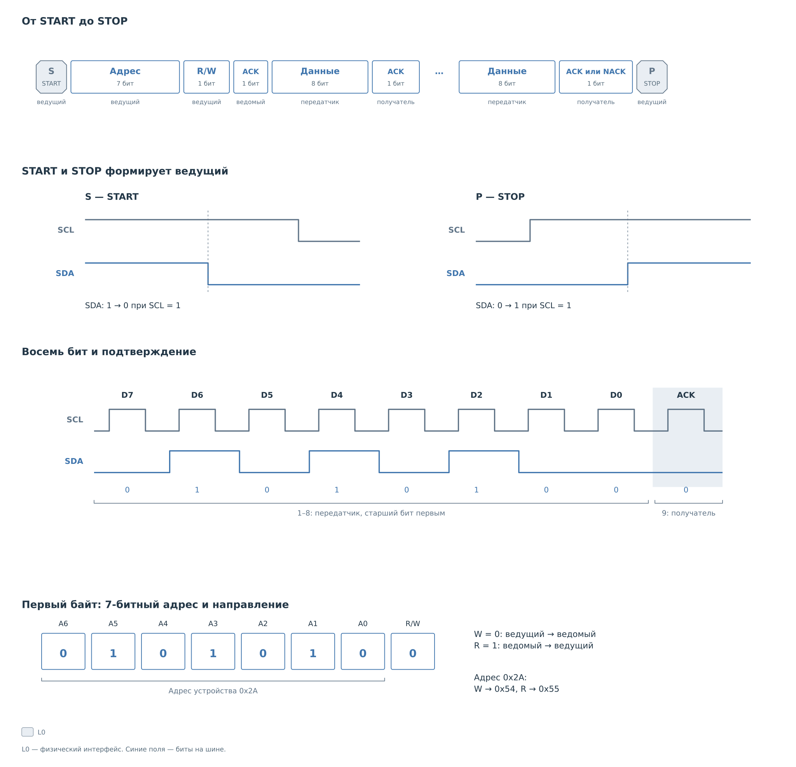
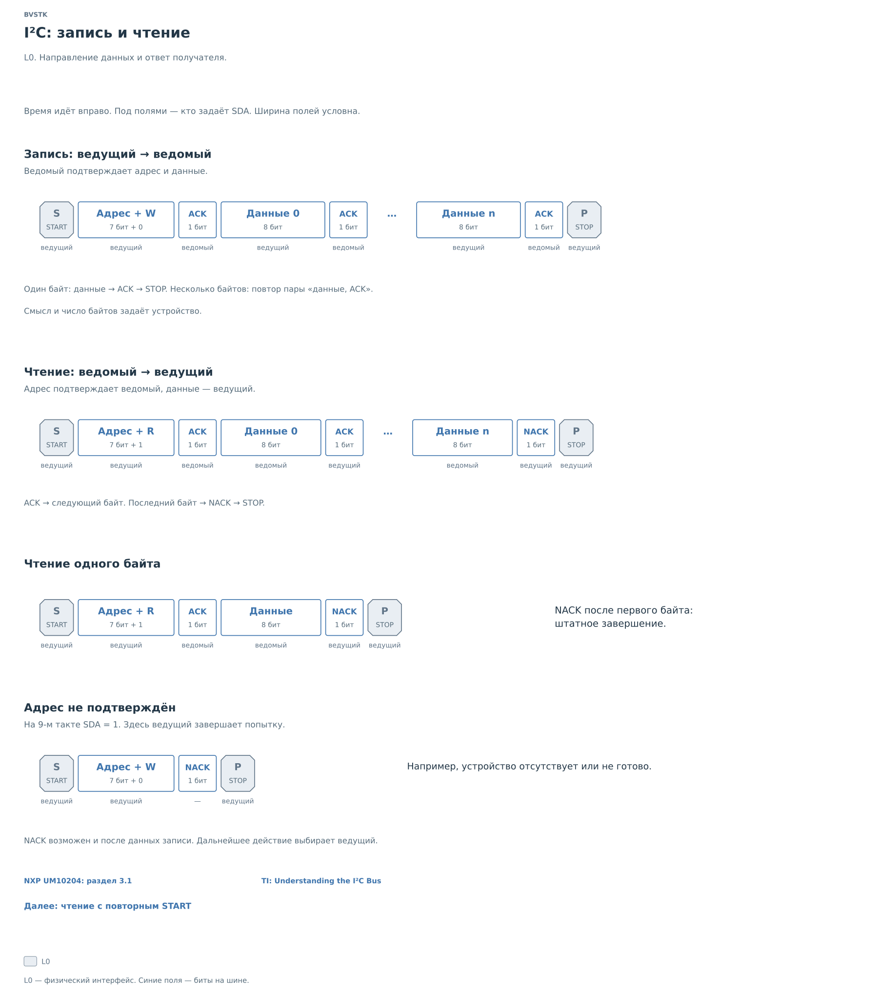
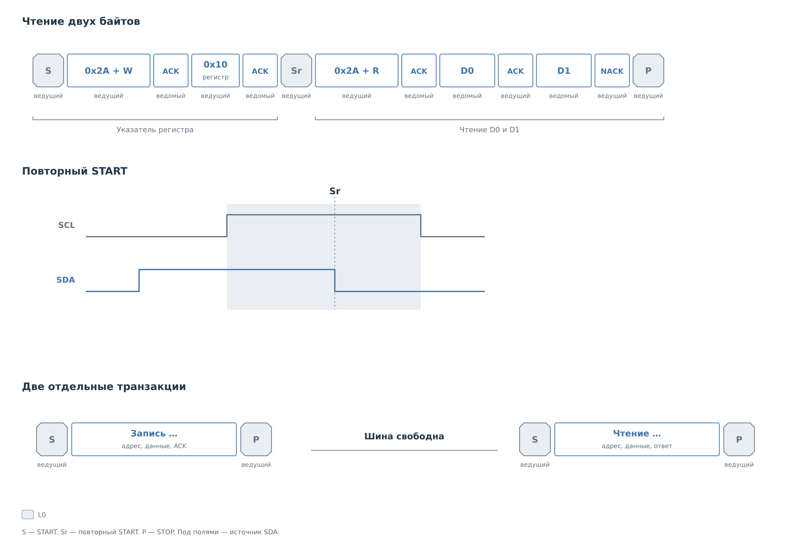

# Протокол I²C

В [примере BVSTK](../i2c.md) нужно выбрать регистр и получить его
значение. Чтобы понять аппаратную обработку этого запроса, разберём,
что участники действительно передают по линиям. Достаточно обычного
двунаправленного I²C с одним ведущим и семибитными адресами.

## Линии и участники

На шине две сигнальные линии: SDA передаёт данные, SCL задаёт такты.
Несколько устройств подключаются к одним линиям и различаются адресами.

*Рисунок 1. I²C: линии и участники.*

Выход с открытым стоком может тянуть линию вниз. Высокий уровень
создаёт подтяжка. Поэтому отпускание SCL ведущим ещё не гарантирует,
что линия уже поднялась: ведомое устройство может удерживать её в нуле.
Такое ожидание называется clock stretching. Именно оно позволяет
ведомому ядру BVSTK отложить следующий такт, пока программа готовит
байт ответа. Сколько можно ждать, определяют ограничения участников
и реализация ядра.

При передаче обычного бита SDA остаётся стабильной на высоком SCL.
Изменение данных происходит во время низкого SCL. Условия START
и STOP выделяются отдельно.

## Из чего состоит транзакция

START — спад SDA при высоком SCL. STOP — подъём SDA при высоком SCL.
Между этими условиями передаются адрес и данные.

*Рисунок 2. I²C: устройство транзакции.*

Первый байт содержит семь бит адреса и бит направления. Для устройства
с адресом `0x2A` на шину передаётся `0x54` при записи или `0x55` при
чтении. Затем идут байты данных, начиная со старшего бита каждого байта.

На девятом такте передатчик отпускает SDA. Получатель тянет её в ноль
для ACK либо оставляет высокой для NACK. Адрес подтверждает выбранное
ведомое устройство. При передаче данных получатель меняется с
направлением обмена: запись подтверждает ведомый, чтение — ведущий.

## Запись и чтение

При записи ведущий передаёт байты, а ведомый подтверждает их. При
чтении ведомый выдаёт данные, а ведущий отвечает ACK или NACK.

*Рисунок 3. I²C: запись и чтение.*

ACK после принятого байта чтения означает продолжение. После последнего
байта ведущий выдаёт NACK и завершает обмен. Длина чтения в адресной
фазе не передаётся: ведомый узнаёт об окончании по ответу ведущего.
Поэтому NACK в конце чтения является штатной частью протокола.

NACK после адреса означает, что адрес не был подтверждён. На рисунке
ведущий завершает такую попытку условием STOP. Смысл переданных данных
и их допустимое число задаёт конкретное устройство.

## Повторный START и указатель регистра

Адрес I²C выбирает устройство, но не регистр внутри него. У многих
устройств номер нужного регистра сначала передаётся как байт записи.
После этого ведущий меняет направление и начинает получать значение.
Повторный START связывает обе фазы без освобождения шины.

*Рисунок 4. I²C: повторный START.*

Повторный START, обозначенный Sr, начинается без предшествующего STOP.
Шина остаётся занятой, а адрес и направление выбираются заново.
В примере после записи указателя устройство выдаёт D0 и D1; ведущий
отвечает ACK после D0 и NACK после D1.

В этой последовательности первая фаза записи только выбирает регистр;
нового значения для него ведущий не передаёт. Сам протокол I²C
не задаёт понятия регистра. Формат указателя, его сохранение и
автоувеличение определяет устройство или обслуживающий его сервис.
Для устройства, которое сбрасывает указатель по STOP, две отдельные
транзакции дадут другое поведение.

Теперь можно перейти к [ядрам BVSTK](../cores/cores.md) и проследить,
как условия на линиях превращаются в состояния автомата, события
и обращения к BRAM. Общий путь подсистемы описан в [главе I²C](../i2c.md).
