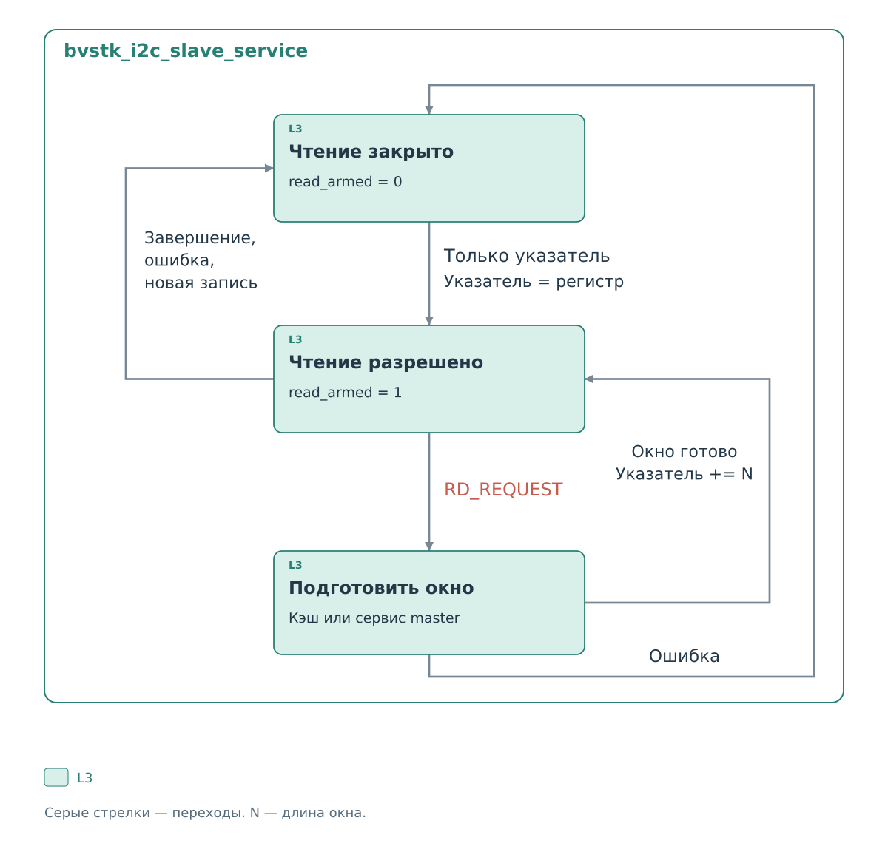

# Чтение I²C и подготовка ответа

После успешной [записи](services.md) кэш регистра `0x10` устройства
`0x2A` содержит `0x3B`. Теперь внешний ведущий хочет прочитать этот
регистр. В этом продолжении примера значение уже известно программе;
аппаратному slave ещё нужно подготовить окно ответа.

## Выбор регистра

Ведущий передаёт `0x54`, затем один байт `0x10`, выдаёт повторный
START и адрес чтения `0x55`. После единственного байта ответа
он выдаёт NACK и STOP. В первой фазе значения для записи нет:
сервис получает только указатель.

## Чтение из кэша

*Рисунок 1. Запись и последующее чтение регистра 0x10.*

При повторном START slave публикует указатель в BRAM и сообщает
`DATA_VALID`. Адрес чтения вызывает `RD_REQUEST` и удержание SCL.
Если признаки пришли вместе, порт сначала передаёт сервису `0x10`,
затем запрашивает окно ответа. Сервис находит достоверный `0x3B`.
Драйвер записывает окно в BRAM, после чего передаёт `rd_valid`.

Получив первый байт, ядро отпускает SCL, подтверждает адрес и выдаёт
`0x3B`. На участке физического устройства нового чтения в этот момент
нет. Если регистр там уже изменился, внешний ведущий всё равно
получит сохранённую копию. Свежесть ответа определяется предыдущими
операциями с устройством.

## Указатель и разрешение чтения

Для выбранного устройства сервис хранит `register_pointer` и
`read_armed`. Указатель задаёт начало следующего окна. `read_armed`
показывает, разрешила ли предшествующая запись указателя готовить чтение.
Одного сохранившегося указателя для ответа недостаточно.

*Рисунок 2. Состояние ведомого сервиса между фазами обмена.*

Новая фаза записи сначала снимает прежнее разрешение. Если в ней ровно
один допустимый байт, он становится указателем, а `read_armed` получает 1.
Физическое чтение в этот момент не запускается. Если за указателем идут
данные, начинается обработка записи регистров; чтение этой фазой
не разрешается. Ошибочный или пустой фрагмент тоже оставляет его запрещённым.

При `RD_REQUEST` сервис готовит окно только с установленным
`read_armed`. Без него возвращается пустое окно, и код обслуживания
не публикует `rd_valid`. При завершении чтения или соответствующем
событии ошибки порт вызывает `end_transaction`: разрешение снимается,
сам указатель сохраняется. Следующая явная запись указателя задаёт
новое начало независимо от того, где остановилось прошлое чтение.

Допустим, предыдущее чтение
оставило указатель `0x12`, а затем завершилось. Адрес по-прежнему
хранится, но новый `RD_REQUEST` при снятом `read_armed` не получит
ответа. Для нового чтения ведущий должен снова передать допустимый
указатель.

Достоверность кэша проверяется позднее. Разрешённое чтение может
запросить регистр, значения которого в кэше ещё нет. И наоборот,
наличие достоверного значения не даёт права отвечать при снятом
`read_armed`.

## Подготовка окна ответа

Пусть указатель равен `0x10`, а кэш содержит:

| Регистр | Значение | Достоверность |
|---|---|---|
| `0x10` | `0x3B` | Да |
| `0x11` | `0x56` | Да |
| `0x12` | Не используется | Нет |
| `0x13` | `0x78` | Да |

Сервис отдаст два байта: `3B 56`. Он идёт по последовательным регистрам
и останавливается перед первой недостоверной записью. Если бы он
добавил `0x78`, внешний ведущий принял бы его как значение `0x12`:
номер регистра рядом с каждым байтом по шине не передаётся. Поэтому
разрыв в кэше завершает окно даже при наличии последующих значений.
Другие границы — конец модели устройства и вместимость переданного
буфера, сейчас до 64 байтов в портах ОС.

После подготовки этого окна указатель равен `0x12`. Если понадобится
следующее окно, поиск начнётся именно с него. Недостоверный первый
регистр вызовет одну физическую операцию master. При успехе сервис
вернёт только полученный байт; `0x13` сможет попасть в последующее
окно. Так границы окон определяются состоянием кэша и буфера PS,
хотя внешний ведущий видит непрерывную последовательность байтов.

За один запрос окна сервис не собирает цепочку физических чтений.
Но и единственная операция master может превысить
[срок ожидания slave](#промах-кэша-и-срок-ответа).

После подготовки указатель продвигается на длину окна. Дойдя до конца
устройства, он возвращается к нулю. Продвижение происходит до передачи
байтов на шину. В нашем примере ведущий может принять только `0x3B`
и завершить чтение NACK. Сервис к этому моменту уже подготовил два
байта и передвинул указатель на `0x12`.

Ядро также может заранее запросить следующее окно. Поэтому длина
окна, положение указателя и число действительно принятых байтов
могут различаться. Порт завершает разрешённое чтение по аппаратному
событию, а последующая запись указателя задаёт новое начало явно.
Событие журнала `SLAVE_REPLY_PREPARED` учитывает подготовленные
значения; считать по нему байты, полученные внешним ведущим, нельзя.

## Промах кэша и срок ответа

В сервисе предусмотрена другая ветвь: получить один недостающий байт
через master и лишь затем подготовить ответ slave. Но для текущих
параметров исходников эту ветвь нельзя считать гарантированным способом
ответить на уже начавшееся внешнее чтение.

*Рисунок 3. Промах кэша: сроки master и slave.*

У оболочки slave параметр `STRETCH_TIMEOUT_US` равен 100 мкс.
В `Burevestnik_21.tcl` он не переопределён. Текущий драйвер master
задаёт `speed = 0`, номинально 100 кГц. Чтение одного регистра требует
как минимум четырёх групп по девять тактов: адрес записи, указатель,
адрес чтения и байт ответа. Это около **360 мкс только на такты шины**,
без доставки события, работы PS и дополнительных выдержек.

Кроме того, ведущий драйвер между проверками состояния вызывает
ожидание на 1 мс; фактическая задержка зависит от порта ОС.
Следовательно, программная возможность запустить чтение есть,
но при этих параметрах его результат не успевает в первое окно 100 мкс.
Это вывод из исходников, а не измерение загруженной в плату прошивки.

Ожидания master и slave начинаются у разных участников. Slave уже
обслуживает запрос внешнего ведущего и ограничивает удержание SCL.
Программное ожидание master относится к отдельной операции на другой
шине. Его более длинный тайм-аут позволяет дождаться результата
устройства, но не продлевает аппаратное ожидание slave. Даже без
затрат на доставку IRQ физический обмен в этом примере длиннее
допустимой задержки ответа.

При опоздании первого байта slave не подтверждает адрес чтения.
Если ожидалось продолжение уже начатой выдачи, аппаратное поведение
другое: вместо недоступного байта выдаётся `0xFF`. Поздний успех master
может обновить кэш, но не превращает уже сорванное внешнее чтение
в успешное. И ответ из кэша требует, чтобы PS успел подготовить окно;
сам признак достоверности такого срока не гарантирует.

После позднего успешного чтения состояние системы всё же изменится:
кэш уже будет содержать полученный байт. Повторное обращение ведущего
с явной записью указателя сможет использовать его без физического
чтения. Это новая транзакция; предыдущая завершилась с ошибкой.

Этим объясняется роль предварительного получения данных. Состояние
кэша и срок ответа нужно рассматривать вместе. Аппаратные ветви
опоздания разобраны в [главе slave](../cores/slave.md#завершение-ошибки-и-irq).

Публикация окна и порядок обработки совмещённых событий разобраны
в [ведомом драйвере](../drivers/slave.md#публикация-ответа).
Доставку IRQ и вызов сервиса выполняет [порт ОС](../drivers/ports.md).
