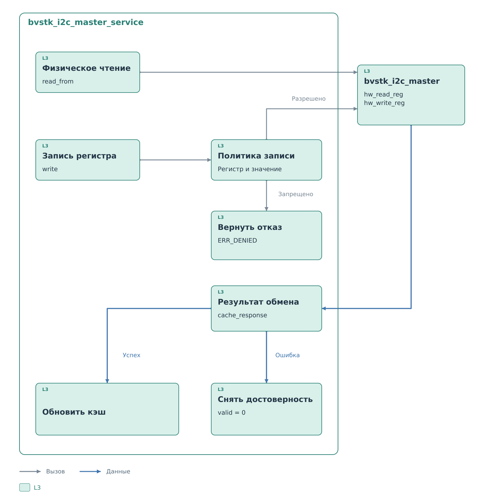

# Сервисы I²C

В [примере](../i2c.md) один и тот же байт `0x10` сначала появился на шине,
затем стал указателем регистра в программе. Это граница ответственности
сервиса: он придаёт аппаратным данным смысл и сохраняет состояние,
необходимое для следующей фазы обмена.

`bvstk_i2c_slave_service` разбирает запрос внешнего ведущего и выбирает
ответ. `bvstk_i2c_master_service` выполняет операции с физическим
устройством, проверяет запись и обновляет кэш. Оба относятся к L3
и используют общие модели устройств, политику и кэш. Код этих решений
общий для FreeRTOS и Нейтрино; способ его вызова задаёт
[порт ОС](../drivers/ports.md).

## Модель устройства

Профиль создаёт модель: имя, семибитный адрес, число регистров,
допустимые значения и правила записи. Внутри программы устройство
выбирается индексом модели. Адрес на I²C берётся из неё перед физической
операцией.

У ведомого сервиса есть выбранное устройство `target_device`.
Текущие порты первоначально выбирают первое настроенное устройство,
задают его адрес аппаратному slave и сверяют с ним принятые обращения.
Поэтому способность PL хранить маску из 128 адресов не означает,
что текущий сервис одновременно обслуживает 128 устройств.

## Указатель и разрешение чтения

Для выбранного устройства сервис хранит `register_pointer` и
`read_armed`. Указатель задаёт начало следующего окна. `read_armed`
показывает, разрешила ли предшествующая запись указателя готовить чтение.
Одного сохранившегося указателя для ответа недостаточно.

*Рисунок 1. Состояние ведомого сервиса между фазами обмена.*

Новая фаза записи сначала снимает прежнее разрешение. Если в ней ровно
один допустимый байт, он становится указателем, а `read_armed` получает 1.
Физическое чтение в этот момент не запускается. Если за указателем идут
данные, начинается обработка записи регистров; чтение этой фазой
не разрешается. Ошибочный или пустой фрагмент тоже оставляет его запрещённым.

При `RD_REQUEST` сервис готовит окно только с установленным
`read_armed`. Без него возвращается пустое окно, и код обслуживания
не публикует `rd_valid`. При завершении чтения или соответствующем
событии ошибки порт вызывает `end_transaction`: разрешение снимается,
сам указатель сохраняется. Следующая явная запись указателя задаёт
новое начало независимо от того, где остановилось прошлое чтение.

Допустим, предыдущее чтение
оставило указатель `0x12`, а затем завершилось. Адрес по-прежнему
хранится, но новый `RD_REQUEST` при снятом `read_armed` не получит
ответа. Для нового чтения ведущий должен снова передать допустимый
указатель.

Достоверность кэша проверяется позднее. Разрешённое чтение может
запросить регистр, значения которого в кэше ещё нет. И наоборот,
наличие достоверного значения не даёт права отвечать при снятом
`read_armed`.

## Подготовка окна ответа

Пусть указатель равен `0x10`, а кэш содержит:

| Регистр | Значение | Достоверность |
|---|---|---|
| `0x10` | `0x34` | Да |
| `0x11` | `0x56` | Да |
| `0x12` | Не используется | Нет |
| `0x13` | `0x78` | Да |

Сервис отдаст два байта: `34 56`. Он идёт по последовательным регистрам
и останавливается перед первой недостоверной записью. Если бы он
добавил `0x78`, внешний ведущий принял бы его как значение `0x12`:
номер регистра рядом с каждым байтом по шине не передаётся. Поэтому
разрыв в кэше завершает окно даже при наличии последующих значений.
Другие границы — конец модели устройства и вместимость переданного
буфера, сейчас до 64 байтов в портах ОС.

После подготовки этого окна указатель равен `0x12`. Если понадобится
следующее окно, поиск начнётся именно с него. Недостоверный первый
регистр вызовет одну физическую операцию master. При успехе сервис
вернёт только полученный байт; `0x13` сможет попасть в последующее
окно. Так границы окон определяются состоянием кэша и буфера PS,
хотя внешний ведущий видит непрерывную последовательность байтов.

За один запрос окна сервис не собирает цепочку физических чтений.
Но и единственная операция master может превысить
[срок ожидания slave](../i2c.md#промах-кэша-и-срок-ответа).

После подготовки указатель продвигается на длину окна. Дойдя до конца
устройства, он возвращается к нулю. Продвижение происходит до передачи
байтов на шину. В нашем примере ведущий может принять только `0x34`
и завершить чтение NACK. Сервис к этому моменту уже подготовил два
байта и передвинул указатель на `0x12`.

Ядро также может заранее запросить следующее окно. Поэтому длина
окна, положение указателя и число действительно принятых байтов
могут различаться. Порт завершает разрешённое чтение по аппаратному
событию, а последующая запись указателя задаёт новое начало явно.
Событие журнала `SLAVE_REPLY_PREPARED` учитывает подготовленные
значения; считать по нему байты, полученные внешним ведущим, нельзя.

## Ведущий сервис

Ведущий сервис получает запрос от ведомого сервиса или пользовательской
команды. Сначала он проверяет устройство, регистр и, для записи,
допустимость значения. После этого пути чтения и записи различаются:
физическое чтение сразу обращается к драйверу, запись сначала проходит
политику.

*Рисунок 2. Ведущий сервис: операция, политика и кэш.*

Схема начинается после проверки параметров. `read_from` запрашивает
новое значение у устройства даже при наличии достоверного байта в кэше.
Метод `write` вызывает драйвер только после разрешения политики.
Оба вызова ожидают результат физической операции; затем сервис учитывает
его в кэше и возвращает результат вызывающей стороне.

Отдельный метод `read_cached` возвращает сохранённый байт без вызова
драйвера. Сам этот метод не проверяет признак достоверности; состояние
записи доступно через `cache_entry`. При подготовке внешнего ответа
ведомый сервис отдельно проверяет достоверность и только затем
выбирает между сохранённым значением и физическим чтением.

## Политика записи

Продолжим пример с регистром `0x10`. Допустим, у устройства выбран режим
whitelist, в списке разрешений есть пара `(0x10, 0x7B)`, а сами адрес
регистра и значение укладываются в ограничения модели.

| Запрос | Решение | Физическая операция |
|---|---|---|
| Записать `0x7B` в `0x10` | Разрешён | Запускается master |
| Записать `0x7C` в `0x10` | Запрещён | Не запускается |
| Прочитать `0x10` | Политика записи не применяется | Зависит от выбранного пути чтения |

В I²C правило сравнивает **точную пару регистра и значения**. Маски
битов здесь нет. В режиме blacklist совпавшая пара запрещается,
остальные допустимые пары разрешаются. Применяется список выбранного
режима, а не оба списка последовательно.

Проверку выполняет ведущий сервис перед обращением к драйверу.
К нему поступают как записи внешнего ведущего, так и пользовательские
операции через сервис. Прямой вызов драйвера сам по себе политику
не выполняет.

Если внешний фрагмент содержит несколько значений, они направляются
в последовательные регистры по одному. Отказ или ошибка останавливает
дальнейшую передачу. Уже выполненные записи не откатываются: весь
фрагмент не является одной неделимой операцией.

Например, ведущий передал `10 7B 7C 7D`. Сервис последовательно
попытается записать `0x7B` в регистр `0x10`, `0x7C` в `0x11`
и `0x7D` в `0x12`. Если первая операция разрешена и завершилась,
а вторая запрещена, `0x7B` уже передан устройству. Третья операция
не запускается. При этом ведомое ядро могло подтвердить приём всех
байтов ещё до начала этой программной последовательности.

## Обновление кэша

Успешное физическое чтение сохраняет полученный байт и делает его
достоверным. Успешная запись сохраняет переданный байт. При ошибке
физической операции соответствующая запись кэша становится недостоверной.
Отказ политики происходит раньше и сам по себе прежний кэш не меняет.

После ошибки в памяти может оставаться прежний байт, но сервис
больше не считает его пригодным для ответа. Это существенно при
неоднозначном исходе записи: устройство могло принять данные до
срыва обмена. Возврат к прежнему значению кэша создал бы видимость,
что физический регистр точно остался прежним. Снятие достоверности
сохраняет эту неопределённость до следующей успешной операции.

Перед изменением кэша сервис повторно сверяет устройство с рабочей
моделью. Если во время ожидания адрес устройства сменился с `0x2A`
на `0x2B`, полученный байт относится к прежнему адресу. Сервис сверяет
имя, адрес и наличие регистра в текущей модели, прежде чем менять
кэш. Так ответ завершившейся операции не становится значением
другого устройства, занявшего тот же индекс модели.

Публикация выбранного окна в BRAM описана в
[драйверах I²C](../drivers/drivers.md).
