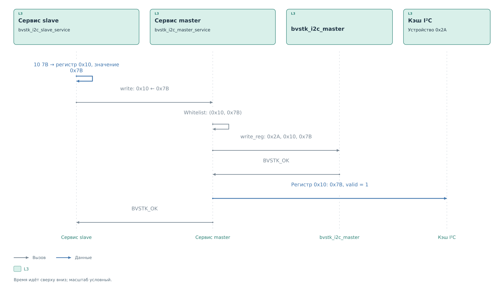
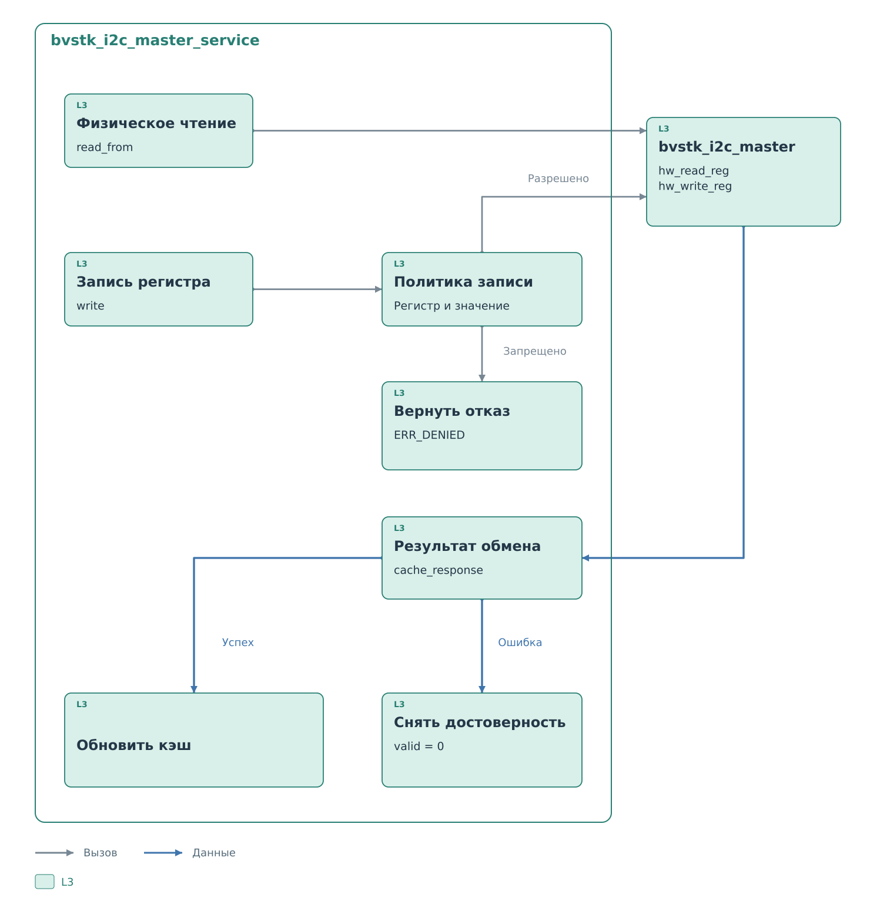

# Сервисы I²C

[Ведомый драйвер](../drivers/slave.md#получение-принятой-записи)
вернул адрес `0x2A` и два байта `10 7B`. Порт проверил адрес выбранного
устройства и вызвал `bvstk_i2c_slave_service_handle_frame`.
Теперь нужно определить операцию, проверить её допустимость
и связать внешний запрос с физическим устройством.

## Разбор принятой записи

`bvstk_i2c_slave_service` работает с выбранной моделью `target_device`.
В нашем примере это устройство `0x2A`. Модель задаёт число регистров,
допустимые значения и правила записи. Первый байт `0x10` становится
номером регистра. Следующий байт `0x7B` задаёт новое значение.
Сервис проверяет, что регистр существует в модели.

В начале новой записи снимается `read_armed`. Здесь длина равна 2,
поэтому чтение не разрешается: требуется записать значение.
Указатель сохраняет `0x10`, а ведомый сервис вызывает
`bvstk_i2c_master_service_write` с источником события HOST.
Один только байт `0x10` привёл бы к другой операции —
[подготовке последующего чтения](read.md#указатель-и-разрешение-чтения).

*Рисунок 1. Обработка принятой записи 0x7B.*

На этом этапе `0x7B` ещё не является новым значением кэша.
Сначала ведущий сервис должен проверить правила и получить результат
обмена с устройством. Оба сервиса относятся к L3; их код общий
для FreeRTOS и Нейтрино.

## Политика записи

Для примера в whitelist есть пара `(0x10, 0x7B)`. В I²C сравнивается
точная пара регистра и значения. Запись проходит проверку и поступает
в `bvstk_i2c_master_hw_write_reg`: адрес `0x2A`, регистр `0x10`,
значение `0x7B`. Программа получает адрес шины из той же модели,
которая использовалась при разборе запроса.

Если вместо `0x7B` пришёл бы `0x7C`, это правило не разрешило бы
операцию. При отказе драйвер master не вызывается, прежний кэш
сохраняется. ACK, ранее выданный внешнему ведущему, относится
к аппаратному приёму и остаётся фактом уже законченного кадра.

В режиме blacklist совпавшая пара запрещается, остальные допустимые
пары разрешаются. Сначала проверяются границы модели и диапазон
значения, затем применяется список выбранного режима.
Прямой вызов драйвера этих решений не выполняет.

## Физическая запись и результат

[Ведущий драйвер](../drivers/master.md#запись-регистра) кодирует
в TX FIFO заголовок `0x0000102A` и данные `0x00007B10`.
[Ведущее ядро](../cores/master.md#выполнение-записи) передаёт
на другом участке шины тот же адрес и байты `10 7B`.
Это новая транзакция, которую BVSTK начинает после разрешения политики.

Драйвер ждёт освобождения ядра и проверяет отсутствие `ERR_ACK`.
В успешном примере он возвращает `BVSTK_OK`. Ведущий сервис сохраняет
в кэше регистра `0x10` байт `0x7B` с признаком достоверности.
Отдельного перечитывания после записи этот путь I²C не выполняет:
кэш отражает успешно отправленное значение.

Статус возвращается ведомому сервису и порту. Порт очищает принятое
окно BRAM. Исходные байты `10 7B` обработаны; на их месте в программе
остались состояние регистра, запись журнала и результат операции.
Последующее [чтение](read.md) сможет использовать обновлённый кэш.

## Обновление кэша

*Рисунок 2. Операции ведущего сервиса и состояние кэша.*

Успешное физическое чтение сохраняет полученный байт. Успешная запись
сохраняет переданный байт. Ошибка физической операции снимает
достоверность соответствующего регистра. Это существенно при
неоднозначном исходе: устройство могло принять `0x7B`, хотя программа
не получила ожидаемое завершение. Старый байт может оставаться
в памяти кэша, но больше не пригоден для внешнего ответа.

Перед изменением кэша сервис повторно сверяет имя, адрес и наличие
регистра в текущей модели. Если за время аппаратного ожидания адрес
сменился с `0x2A` на `0x2B`, результат прежнего устройства не должен
стать значением нового.

`read_from` всегда запускает физическое чтение. `read_cached` возвращает
сохранённый байт без обмена, но сам не проверяет его достоверность.
При подготовке внешнего ответа проверку выполняет ведомый сервис.
Подробный выбор окна и его публикация описаны в [главе о чтении](read.md).

## Запись нескольких регистров

Если внешний фрагмент содержит `10 7B 7C 7D`, сервис последовательно
обрабатывает пары `(0x10, 0x7B)`, `(0x11, 0x7C)` и `(0x12, 0x7D)`.
Политика применяется к каждой паре. Ошибка или отказ прекращает
дальнейшую передачу. Уже выполненные записи не откатываются.

Например, первая пара разрешена, вторая запрещена. Значение `0x7B`
уже передано устройству и сохранено в кэше; третья операция не начнётся.
При этом slave мог подтвердить приём всех байтов до обработки PS.
Поэтому результат отдельной записи и результат всего фрагмента
нужно различать.

[Порт ОС](../drivers/ports.md) определяет контекст вызова этих функций
и синхронизацию. Текущие порты первоначально выбирают первое устройство
профиля и задают его адрес аппаратному slave. Его карта из 128 бит
не означает одновременное обслуживание всех адресов программой.

## Время жизни и обратные вызовы

Сервис хранит ссылки на драйвер, реестр устройств, кэш и политику.
Все они должны существовать до его остановки. Таблица
`bvstk_i2c_master_io_t` позволяет подставить операции одного регистра
при проверке общего кода на компьютере.

Приёмник события вызывается синхронно в контексте операции. Длительное
ожидание внутри него задержит запрос, а повторный вход в тот же сервис
может упереться в уже удерживаемую блокировку. Запись события в журнал
поэтому выполняется коротким адаптером без ввода-вывода.
