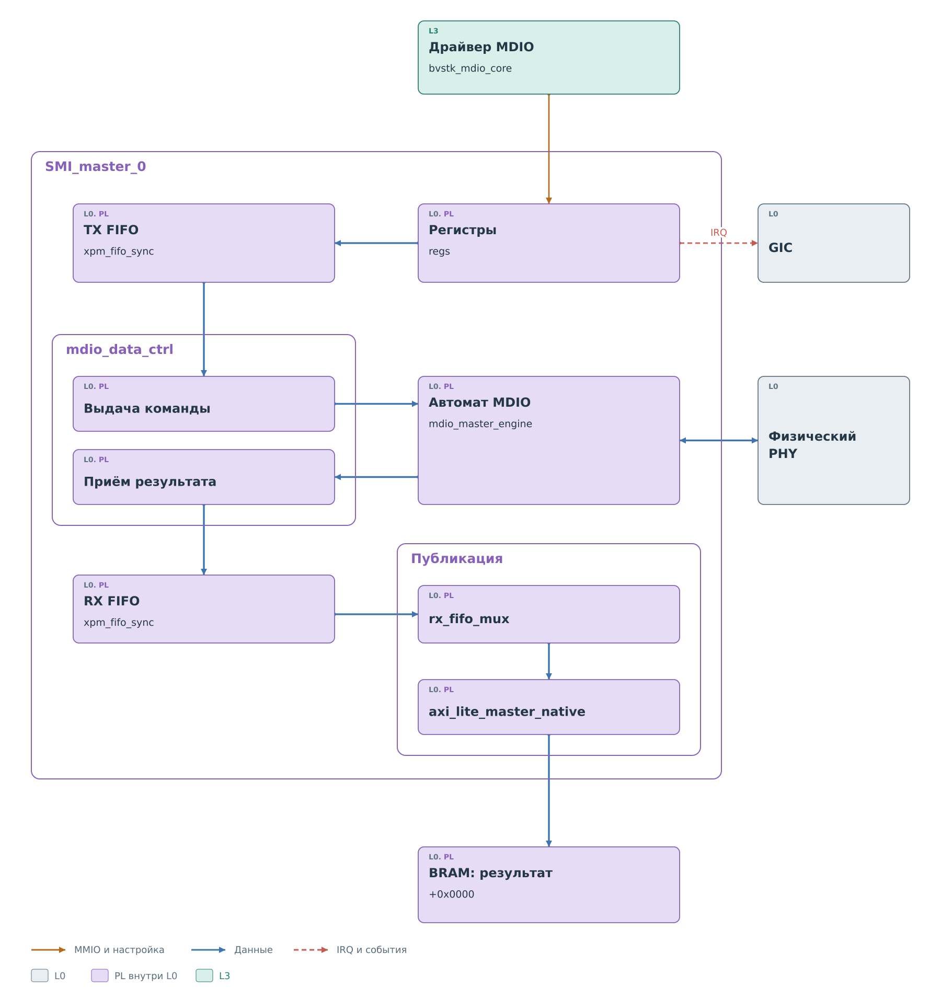
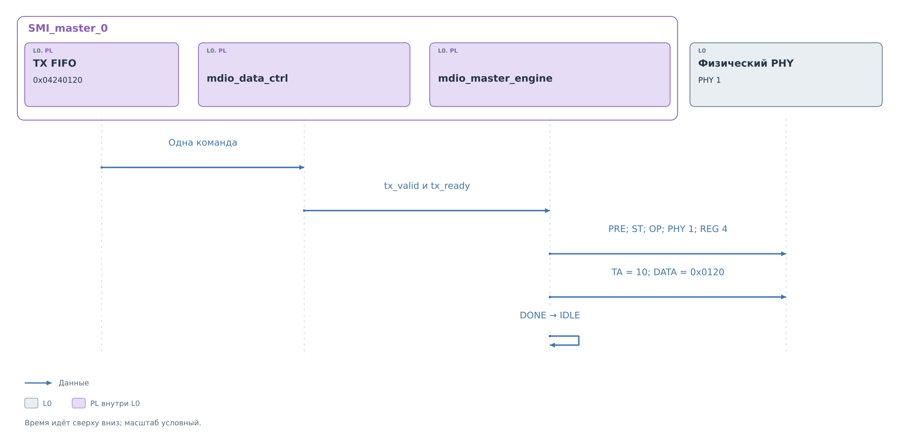
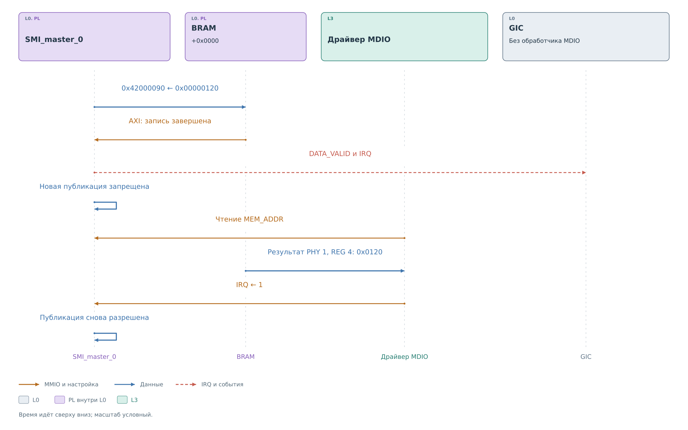

# Ведущее ядро MDIO

[Сервис](../services/services.md#политика-и-запись) разрешил запись
`0x0120` в регистр 4 PHY 1. Драйвер передал команду `0x04240120`
в TX FIFO. `SMI_master_0` должно выполнить её на участке физического
PHY. После записи сервис запустит чтение командой `0x00240000`.
Оба обмена сохраняют адрес исходного внешнего запроса.

## Состав ядра

*Рисунок 1. Состав MDIO master.*

Модуль `regs` принимает обращения через `axi_lite_slave_native`.
Запись в TX FIFO попадает через `tx_fifo_mux` в `xpm_fifo_sync`.
`mdio_data_ctrl` выдаёт команду, когда автомат готов и закончилась
заданная пауза между обменами. Внутренний формат `transaction_view_t`
сохраняет направление, PHY, REG и данные.

| Биты команды | Содержание |
|---|---|
| 31–27 | Резерв |
| 26 | 1 — запись, 0 — чтение |
| 25–21 | Адрес PHY |
| 20–16 | Номер регистра |
| 15–0 | Записываемое значение |

В текущем пути драйвер ждёт пустого TX FIFO и передаёт одну команду.
Очередь в аппаратуре позволяет разделить приём команды и работу
автомата, но программный вызов использует её последовательно.

## Передача команды автомату

*Рисунок 2. Выполнение разрешённой записи 0x0120.*

Поступление `0x04240120` в TX FIFO ещё не означает начала кадра.
`mdio_data_ctrl` ждёт наличия слова, готовности engine и окончания
межкадровой паузы. Затем он сохраняет слово в `tx_mdio_data_s`,
поднимает `tx_valid` и извлекает элемент из FIFO через `tx_rd_en`.
Совпадение `tx_valid` и `tx_ready` передаёт команду автомату.

На этой границе `rw`, PHY, REG и DATA ещё являются полями одного
32-битного слова. Engine готовит из них два регистра: `confg`
с полями ST, OP, PHY, REG и TA, а также `data` со значением `0x0120`.
Ни одно 32-битное слово не передаётся на MDIO целиком. Преамбула
и управляющие поля добавляются автоматом, затем поля выдаются
в установленном порядке старшим битом вперёд.

После приёма команды `tx_ready` снимается. Оно появится снова,
когда автомат свободен и у него нет ещё не принятого результата
чтения. Это связывает приём следующей команды с освобождением
внутреннего состояния. Одной пустоты TX FIFO для оценки готовности
всего ядра поэтому недостаточно.

## Обмен на шине

Для нашей записи последовательность состояний такова:
`PREAMBLE`, `SEND_CONFG`, `TA_TX`, `SEND_DATA`, `DONE`.
Первые два состояния формируют преамбулу и адресную часть.
На `TA_TX` ядро продолжает вести MDIO и передаёт `10`, затем
выдаёт `0x0120`. После конца кадра автомат освобождает линию
и возвращается в `IDLE`.

Последующее чтение сервис запускает отдельной командой `0x00240000`.
Адрес сохраняется, OP меняется на чтение. Теперь после `SEND_CONFG`
идут `TA_RX` и `RECEIVE_DATA`: ядро снимает разрешение своего выхода
MDIO и принимает биты PHY. Такты MDC в обеих операциях создаёт master.
Перечитывание не является продолжением первого аппаратного кадра:
у него собственные преамбула, адресная часть и завершение.

В `DONE` для чтения формируется новая `transaction_view_t` с PHY 1,
REG 4 и принятым словом. `rx_valid` удерживает готовность результата
до `rx_ready`. Контроллер принимает его, когда RX FIFO не заполнен,
и записывает в очередь через `rx_wr_en`. Если очередь не может
принять слово, результат остаётся у engine, а новая команда
не получает `tx_ready`.

## Тактирование и межкадровая пауза

Делитель MDC задан параметрами `FREQ_CLK_HZ` и `FREQ_MDC_HZ`.
Счётчик переключает MDC каждые
`FREQ_CLK_HZ / (2 × FREQ_MDC_HZ)` тактов ядра. В `IDLE` MDC удерживается
в нуле, при выполнении команды делитель формирует такты кадра.
Синхронизированные признаки фронтов управляют сдвигом полей.

Межкадровая пауза реализована отдельно в `mdio_data_ctrl`. При выдаче
команды её счётчик загружается из `timeout_s.timeout`, а уменьшается,
когда engine готов к следующей операции. Пока счётчик ненулевой,
новое слово из TX FIFO не выдаётся. Эта настройка не меняет частоту
битов MDC и не является программным тайм-аутом ожидания драйвера.

## Завершение записи и чтения

После записи обратного слова с содержимым регистра нет. Программа
может установить, что автомат освободился и TX FIFO пуст.
Эти признаки относятся к завершению отправки. Протокол MDIO
не предусматривает подтверждения записи со стороны PHY.

При чтении полезное слово сначала попадает в RX FIFO. Возврат
автомата в `IDLE` ещё не означает, что PS может его читать из BRAM:
публикация выполняется отдельной ветвью ядра. Эту границу обозначает
`DATA_VALID`, а не только занятость автомата.

Engine фиксирует бит turnaround во внутреннем `err_flag_ta`,
но этот признак не передаётся в CSR master. Драйвер проверяет адрес
и готовность опубликованного слова. Если на освобождённой линии
прочитано `0xFFFF`, слово остаётся допустимым аппаратным результатом.
Проверку присутствия PHY выполняет
[сервис по идентификационным регистрам](../services/services.md#проверка-присутствия-и-фоновый-опрос).

## Публикация результата

*Рисунок 3. Публикация прочитанного регистра и освобождение следующего результата.*

`rx_fifo_mux` извлекает PHY и REG из результата и вычисляет адрес
в банке `+0x0000`. `axi_lite_master_native` записывает младшие 16 бит
в 32-битную ячейку BRAM. Только после завершения AXI-записи `regs`
устанавливает `DATA_VALID` и IRQ.

Пока IRQ удерживается, `rx_fifo_mux` не начинает публикацию следующего
результата. Для чтения PHY 1, REG 4 значение попадёт в `0x42000090`.
В нашем успешном примере это `0x00000120`. PS получает устойчивую
пару: `MEM_ADDR` указывает ячейку, а BRAM содержит значение.
Сначала программа читает результат, затем подтверждает его обработку.

Удержание IRQ здесь участвует в согласовании потока. Если в RX FIFO
есть ещё один результат, `rx_fifo_mux` оставляет его в очереди.
Он не переписывает адрес и ячейку поверх результата, который PS
ещё не забрал. Шина и очередь при этом имеют собственные состояния:
остановлена именно публикация следующего слова в BRAM.

В этом ядре сброс IRQ требует двух обращений: чтение `MEM_ADDR`
устанавливает внутренний `read_ack`, после чего запись 1 в IRQ
снимает событие и `DATA_VALID`. Одна запись в IRQ без предварительного
чтения адреса не выполняет этот протокол. Само чтение `MEM_ADDR`
тоже не освобождает публикацию: оно только разрешает подтверждение.
Поэтому между чтением адреса и записью IRQ программа успевает
забрать содержимое BRAM.

После снятия IRQ `rx_fifo_mux` сможет начать следующий AXI-перенос,
когда интерфейс памяти свободен. У нового результата вновь будет
свой цикл публикации и подтверждения. В обычном программном пути
одновременно выполняется одна команда, но правило ядра объясняет,
почему драйвер обязан завершать оба обращения подтверждения.

IRQ также может сигнализировать заполнение FIFO. Поэтому сам уровень
прерывания не означает, что в BRAM уже лежит подходящий ответ.
[Ведущий драйвер](../drivers/master.md) проверяет `DATA_VALID`, адрес
результата и содержимое ячейки. В текущей программе он делает это
опросом; аппаратный выход IRQ при этом существует.

Полученное значение возвращается [драйверу](../drivers/master.md),
а затем [сервису](../services/services.md#политика-и-запись),
который публикует ответ slave и обновляет кэш.
