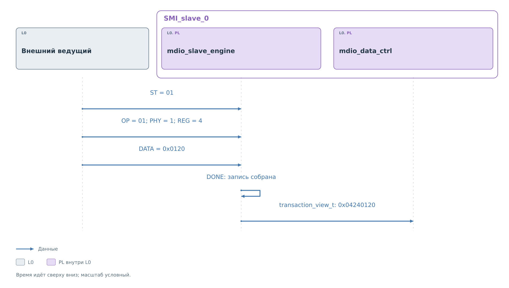
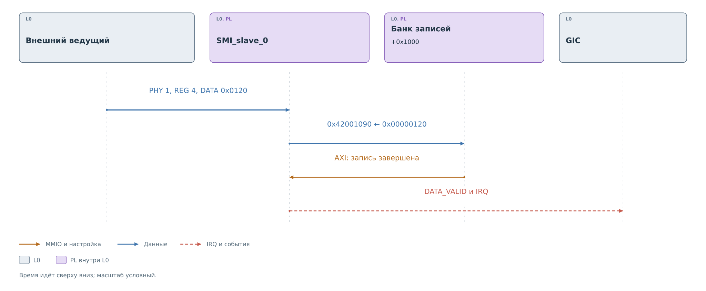
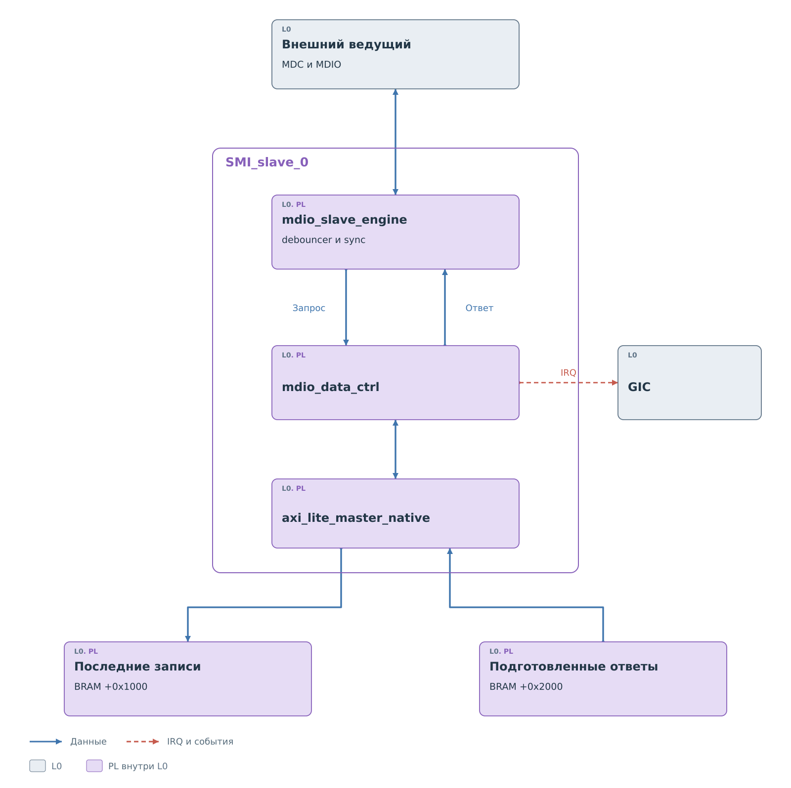
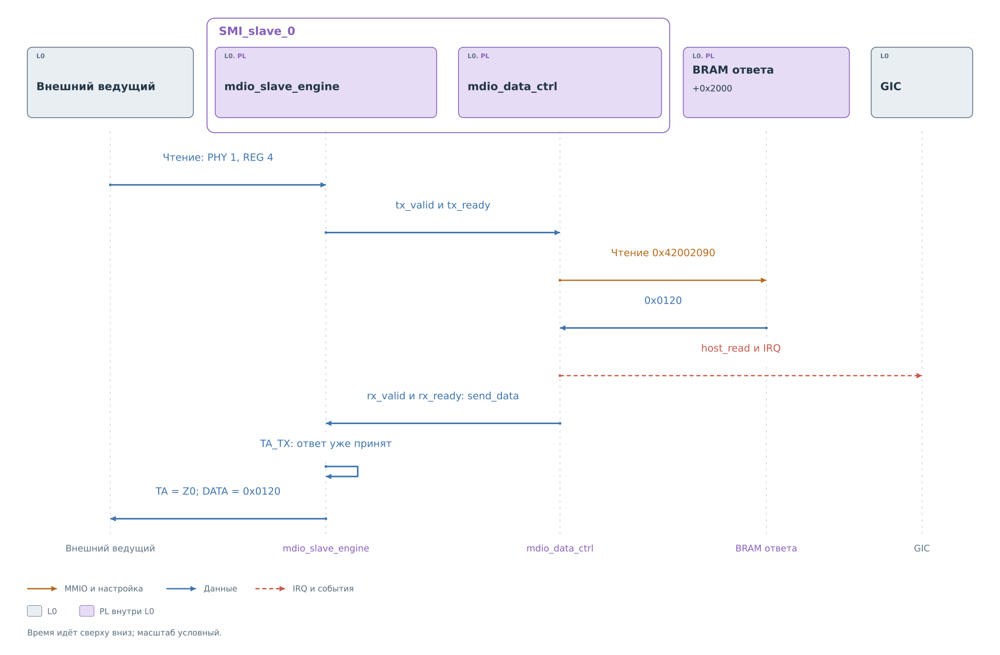

# Ведомое ядро MDIO

В [исходном кадре](../mdio.md#транзакция-на-шине) указаны PHY 1,
REG 4 и DATA `0x0120`. `SMI_slave_0` должно сохранить полученную
запись так, чтобы PS мог определить её адрес и значение.
Доступ к физическому PHY и проверка политики выполнятся позднее.

## Приём записи

Разбор начинается с начала кадра `01`. В `IDLE` автомат замечает ноль,
а в `DETECT_START` проверяет следующую единицу. Преамбула предшествует
этой паре, но отдельной проверки всех 32 единиц данный автомат
не выполняет. Далее рассматривается корректный кадр Clause 22
из основного примера.

*Рисунок 1. Преобразование кадра в запрос к контроллеру памяти.*

В `RECEIVE_CONFG` биты OP, PHY и REG последовательно попадают
в регистр `confg`. Значения `OP = 01`, `PHY = 1`, `REG = 4`
определяют запись в выбранный регистр. На turnaround автомат
переходит в `TA_RX` и продолжает принимать линию. Slave не выдаёт
подтверждения записи: поле `10` формирует внешний ведущий.

Затем `RECEIVE_DATA` собирает 16 бит, начиная со старшего.
После последнего бита в `receive_data` находится `0x0120`.
Только в `DONE` поднимается `tx_valid`: к этому моменту известны
и адрес, и всё записываемое значение. `mdio_data_ctrl` отвечает
через `tx_ready` и принимает структуру `transaction_view_t`.

Структура объединяет `rw = 1`, PHY 1, REG 4 и DATA `0x0120`.
Её упакованное представление равно `0x04240120`. Это внутренний
запрос PL; сервис PS ещё не получил его и не разрешал передачу
физическому PHY. Дальше адресные поля и данные расходятся:
первые выбирают ячейку, вторые становятся её содержимым.

*Рисунок 2. Публикация принятой записи PHY 1, REG 4.*

Контроллер объединяет пятибитные PHY и REG в десятибитный индекс.
У PHY 1 регистр 4 имеет индекс `32 × 1 + 4 = 36`.
Каждая ячейка занимает четыре байта, поэтому смещение равно
`36 × 4 = 0x90`. Для входящей записи выбирается банк `+0x1000`.

Через `axi_lite_master_native` в адрес `0x42001090` записывается
32-битное слово `0x00000120`. Старшая половина равна нулю.
После завершения AXI-записи устанавливаются `DATA_VALID` и IRQ.
Ни копирования в PS, ни проверки политики к этому моменту ещё нет.
Следующий этап — [потребление ячейки драйвером](../drivers/slave.md#получение-внешней-записи).

В BRAM сохраняется только значение. Повторять PHY и REG внутри слова
не требуется: их уже задаёт адрес `0x42001090`. При обходе банка PS
знает, какую пару проверяет. Поэтому заголовок переменной длины,
как в I²C, этому обмену не нужен: один кадр содержит одно 16-битное
значение с фиксированным адресом.

Новая запись PHY 1, REG 4 снова использует `0x42001090`. До обхода
программой она может заменить `0x0120` другим значением. Ядро
не сохраняет очередь кадров; `MEM_ADDR` тоже содержит только
последний адрес. IRQ сообщает о событии, но не заменяет содержимое банка.

## Состав ядра

*Рисунок 3. Состав MDIO slave.*

`mdio_slave_engine` обнаруживает начало кадра и разбирает его поля.
MDC проходит через `debouncer` и `sync`, которые выделяют фронты
в тактовом домене ядра. `mdio_data_ctrl` переводит разобранный запрос
в адрес AXI и ведёт признаки готовности. Обмен с памятью выполняет
`axi_lite_master_native`.

В аппаратном пути PHY и REG выбирают одну из 1024 ячеек банка.
Список настроенных устройств PS не служит аппаратным фильтром адресов.
Для ненастроенных ячеек программа первоначально публикует `0xFFFF`;
входящие записи неизвестному PHY позже отклоняет сервис.

## Чтение готового ответа

После обработки нашей записи сервис опубликовал `0x0120` в банке
ответов. Теперь внешний ведущий читает PHY 1, REG 4. Адреса банка
записей и банка ответов различаются, хотя индекс регистра одинаков:
новый кадр обращается к `0x42002090`.

*Рисунок 4. Подготовка 0x0120 к turnaround внешнего чтения.*

При чтении ждать `DONE` для обращения к памяти было бы поздно:
ведущий ожидает DATA уже в текущем кадре. Поэтому engine поднимает
`tx_valid` в конце `RECEIVE_CONFG`, при приёме последнего бита REG.
Одновременно он устанавливает `rx_ready` — готовность принять ответ.
Контроллер получает адрес и сразу запускает AXI-чтение.

Когда память возвращает слово, контроллер извлекает младшие 16 бит
и выставляет `rx_valid`. Совпадение `rx_valid` и `rx_ready` переносит
`0x0120` в `send_data` автомата; `rx_ready` снимается. Дальнейшая
выдача использует этот регистр. Обращаться к BRAM за каждым битом
ответа уже не требуется.

На turnaround slave формирует нулевой бит подтверждения чтения,
затем `SEND_DATA` выдаёт сохранённое слово старшим битом вперёд.
Даже если PS обновит ячейку после захвата `send_data`, текущий ответ
дойдёт из уже принятого слова. Новое значение относится к следующему
обращению к памяти.

## Срок подготовки ответа

В этой версии RTL проверка готовности происходит при входе
в `TA_TX`. Если `rx_ready` ещё установлен, ответ не был принят
и выставляется `err_flag_ta`. Оставшихся тактов всего кадра автомат
для ожидания не использует. При установленном признаке он оставляет
MDIO освобождённой на turnaround и во время DATA.

Таким образом, между завершением адреса и входом в `TA_TX` должны
успеть согласование запроса, AXI-чтение и перенос слова в `send_data`.
Задержки фильтра MDC и синхронизации тоже входят в аппаратный путь.
Внешний ведущий продолжает задавать MDC; механизма удержания тактов,
подобного I²C clock stretching, у этого slave нет.

Поэтому ответ заранее лежит в BRAM. Обращение через PS к физическому
PHY относится к подготовке следующего значения и не включается
в обслуживание уже идущего кадра чтения.

После AXI-чтения контроллер устанавливает `host_read` и IRQ.
Это уведомление о состоявшемся доступе к памяти. Оно не является
запросом к программе подготовить ответ текущего кадра.
Если память вернула данные поздно, само появление этого события
ещё не доказывает успешную выдачу на MDIO. Внутренний `err_flag_ta`
не включён в поля CSR slave; по `host_read` нельзя восстановить
исход внешнего кадра.

## События и обработка PS

Программа видит в CSR отдельные признаки `host_read`, занятости
автомата и `DATA_VALID`. Запись 1 в регистр IRQ снимает события.
Она не стирает банки данных и не сообщает внешнему ведущему результат
политики записи.

Текущий [ведомый путь драйвера](../drivers/slave.md) просматривает
ячейки банка входящих записей и ставит метки потребления. Даже
при снятом IRQ в банке могут оставаться ещё не обработанные значения.
Поэтому состояние памяти и состояние события учитываются раздельно.
Порядок конкурирующих записей PL и PS показан в
[разделе о повторной записи ячейки](../drivers/slave.md#повторная-запись-ячейки).
