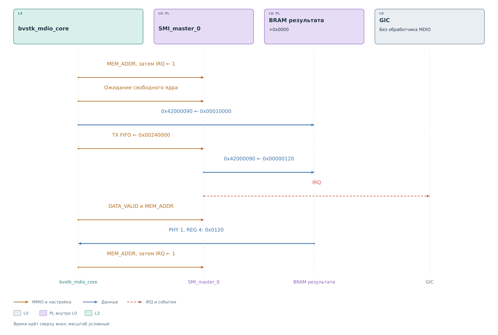

# Ведущая часть драйвера MDIO

[Сервис](../services/services.md#политика-и-запись) разрешил принятую
запись PHY 1, REG 4, DATA `0x0120`. Сначала он вызывает
`bvstk_mdio_core_write`, затем `bvstk_mdio_core_read` для того же
регистра. Оба вызова используют внутренний `transfer` и по отдельности
дожидаются аппаратного результата.

## Подготовка команды

Драйвер проверяет диапазон PHY и REG от 0 до 31 и захватывает mutex.
Один экземпляр master в этот момент принадлежит одному вызывающему.
Нулевой параметр ожидания заменяется на 100 мс.

Перед командой снимается старое событие: драйвер читает `MEM_ADDR`
и записывает 1 в IRQ. Затем ждёт одновременно трёх условий:
автомат свободен, TX FIFO пуст и не заполнен. При чтении в будущую
ячейку результата записывается метка `0x00010000`. Она позволяет
отличить старое содержимое от нового 16-битного ответа.

*Рисунок 1. Ведущий вызов драйвера MDIO.*

Для первой операции слово команды равно `0x04240120`.
После завершения записи сервис запрашивает чтение; ему соответствует
`0x00240000`. На рисунке показана именно эта вторая операция:
будущий результат PHY 1, REG 4 лежит в `0x42000090`.

Запись одного слова в TX FIFO запускает обмен через аппаратное
согласование. Отдельную команду START этот драйвер не посылает.
После загрузки он выдерживает 1 мс перед первой проверкой: иначе
можно увидеть ещё свободный автомат до того, как тот забрал команду.

## Условия завершения

Для чтения драйвер ждёт `DATA_VALID`, получает `MEM_ADDR` и читает
ожидаемую ячейку BRAM. Адрес должен совпасть с запрошенной парой
PHY и REG, а слово должно укладываться в 16 бит. Если контрольная
метка сохранилась, результат не принимается.

Эти проверки относятся к разным частям операции. `DATA_VALID`
показывает, что публикация в BRAM закончена. `MEM_ADDR` связывает
событие с нашей парой PHY 1, REG 4. Содержимое ячейки подтверждает,
что вместо заранее установленной метки появился 16-битный результат.
Например, одно лишь `DATA_VALID` не позволило бы отличить завершение
для другого регистра от ожидаемого ответа.

В успешном примере прочитано `0x00000120`, поэтому вызывающий
сервис получает 16-битное `0x0120` для публикации ответа.
Затем выполняется подтверждение: чтение `MEM_ADDR` и запись 1 в IRQ.
Оно освобождает аппаратный путь публикации следующего результата.
В текущем порте обработчик IRQ master не установлен: драйвер
обнаруживает готовность чтением CSR с паузами 1 мс.

Первое чтение `MEM_ADDR` уже разрешает аппаратное подтверждение.
Повторное чтение внутри общей функции `ack` сохраняет тот же порядок,
после чего запись IRQ освобождает публикацию. До этой записи
`rx_fifo_mux` не подменит результат следующим словом из RX FIFO.
Это [согласование с ядром](../cores/master.md#публикация-результата)
позволяет раздельно прочитать адрес и данные.

Для записи достаточно освобождения автомата и пустого TX FIFO
после запуска. Это означает завершение отправки кадра. Принятие
команды PHY и новое содержимое регистра по этим признакам неизвестны.
Поэтому [сервис записи](../services/services.md#политика-и-запись)
выполняет отдельное физическое чтение.

Значение `0xFFFF` само по себе допустимо для 16-битного результата.
Проверка драйвера не доказывает присутствие PHY на шине. Сервис
отдельно проверяет пару идентификационных регистров.

## Ошибка и освобождение ядра

Ожидание использует один отсчёт времени для подготовки и исполнения
операции после захвата mutex. Ошибка MMIO, неверный адрес результата
или истечение срока завершают вызов. Драйвер выполняет программный
сброс ядра, выдерживает паузу и снимает старое событие, затем
освобождает mutex.

Повтор записи автоматически не выполняется. Если кадр уже был
отправлен, повтор мог бы дважды запустить действие в устройстве.
Решение о последующем обращении принимает вызывающий код.
