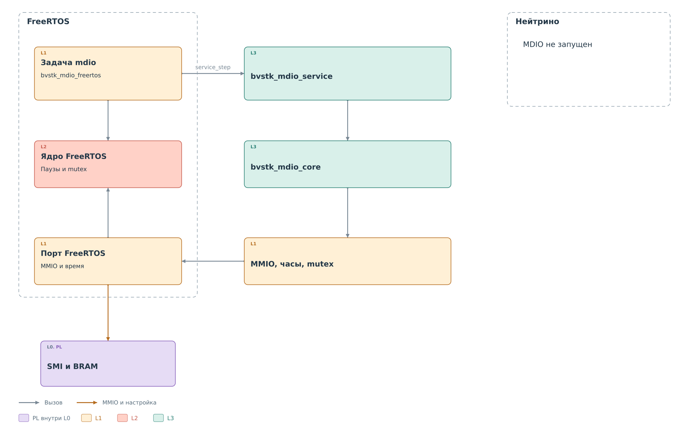

# Исполнение MDIO в ОС

Общие модули `bvstk_mdio_service` и `bvstk_mdio_core` описывают
операции подсистемы. Порт задаёт исполнителя, аппаратный доступ,
время и блокировки. Мост MDIO запускается во FreeRTOS и в рабочей
среде `bvstkd` Нейтрино.

*Рисунок 1. Общий код MDIO и подключение к ОС.*

## Задача обслуживания

`bvstk_mdio_freertos_start` создаёт задачу `mdio`. В цикле она вызывает
`bvstk_mdio_service_step` с аппаратным сроком ожидания 20 мс,
затем выполняет `vTaskDelay(1)`. Эта единица — тик планировщика,
а не фиксированная миллисекунда. Продолжительность прохода также
зависит от числа входящих записей и выполненных физических обменов.

Команды консоли и DCP2 обращаются к тому же сервису. Отдельный
mutex сервиса защищает модели, кэш и порядок операций. Он удерживается
в том числе во время аппаратного ожидания. Mutex драйвера защищает
сам ведущий обмен. Задержка одной физической операции поэтому
влияет и на остальные обращения к сервису.

## Доступ к аппаратуре

`bvstk_mmio` передаёт обращения реализации платформы FreeRTOS.
Часы порта MDIO читают `XTime_GetTime`, а короткие паузы драйвера
выполняются через `usleep`. Пауза 1 мс внутри опроса не превращается
в нулевое ожидание при более редком тике ОС.

Выходы IRQ обоих ядер подключены к GIC. Текущий порт MDIO
не устанавливает для них обработчики: master опрашивает CSR,
а задача просматривает банк записей slave. События в ядрах
подтверждаются через MMIO. Наличие IRQ на аппаратной схеме поэтому
не означает пробуждение задачи этим сигналом.

В Нейтрино [MDIO runtime](../../../../../src/apps/neutrino/runtime/bvstk_mdio_runtime.c)
создаёт общий драйвер и сервис, загружает профили `/flash/config/mdio/`
и запускает независимый pthread с паузой 10 мс между ограниченными шагами.
Используются MMIO и монотонные часы порта Нейтрино, отдельные mutex
рабочего состояния, сервиса и ведущего аппаратного обмена. После обработки
почтовых ящиков и опроса PHY runtime выполняет шаг общего acquisition,
если он включён профилем вместо autopoll. IRQ MDIO остаются неиспользуемыми.
Рисунок показывает исходное подключение FreeRTOS; Нейтрино использует
тот же аппаратный путь через собственный порт ОС.
