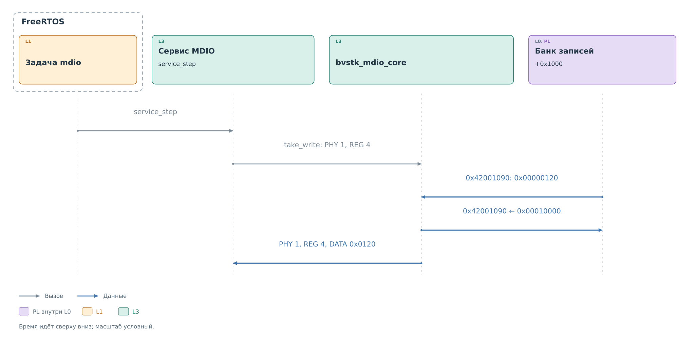
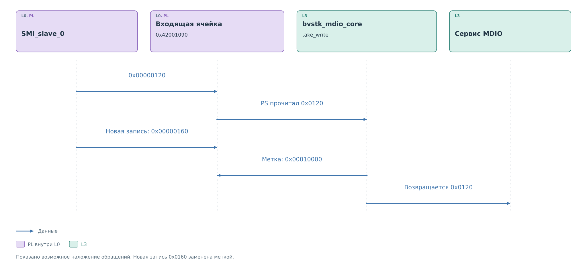

# Ведомая часть драйвера MDIO

[Slave](../cores/slave.md#приём-записи) сохранил `0x00000120`
в `0x42001090`. Это входящая запись PHY 1, REG 4 из нашего примера.
Аппаратный IRQ установлен, но текущий порт не ждёт его в обработчике.
Задача `mdio` вызывает `service_step`, а сервис просматривает ячейки
через общий `bvstk_mdio_core`.

## Получение внешней записи

*Рисунок 1. Потребление последнего записанного значения.*

Когда курсор доходит до PHY 1, REG 4, сервис вызывает
`take_write(1, 4)`. Драйвер читает `0x42001090` и получает
`0x00000120`. Нулевая старшая половина означает новую запись;
младшая содержит `0x0120`. Затем в эту же ячейку записывается
метка `0x00010000`.

Драйвер возвращает сервису значение `0x0120`. PHY и REG известны
из аргументов вызова, поэтому сервис получает полную операцию:
PHY 1, REG 4, DATA `0x0120`. Её [проверка политикой](../services/services.md#политика-и-запись)
начинается уже после установки метки. При отказе запись не появится
повторно в следующем обходе.

После потребления повторная запись точно такого же значения снова
наблюдаема: PL заменит метку обычным 16-битным словом. Сравнение
с предыдущим значением для этого не требуется.

## Повторная запись ячейки

В основном примере между чтением слова и установкой метки новой
записи не было. Рассмотрим ту же пару PHY 1, REG 4, когда внешний
ведущий успел передать ещё одно значение — `0x0160`.

*Рисунок 2. Потеря обновления при одновременном доступе к ячейке.*

Драйвер уже прочитал `0x0120` и держит его в локальной переменной.
PL записывает в ту же ячейку `0x0160`. Следующее действие PS —
обычная запись `0x00010000` — заменяет новое значение меткой.
Сервис получает старое `0x0120`, а следующий обход видит пустую ячейку.

Чтение и установка метки выполняются двумя обращениями MMIO.
Операции «забрать значение и пометить именно эту версию» в интерфейсе
нет. Mutex защищает программных участников, но аппаратный master
AXI продолжает обращаться к BRAM независимо от него. Подтверждение
IRQ также не закрывает этот промежуток.

Если `0x0160` поступит после установки метки, оно останется доступным
следующему обходу. Если обе записи произойдут до чтения PS, будет
видна только последняя. Поэтому сервис обрабатывает обнаруженные
значения регистров; восстановить последовательность всех внешних
кадров по этому банку нельзя. Для команд, где существенна каждая
отдельная запись, это ограничение пути данных.

## Начальное состояние

`prepare_slave` проходит все 1024 адреса. В банке входящих записей
устанавливается метка `0x00010000`, в банке ответов — `0xFFFF`.
После этого драйвер подтверждает старые события slave.

Метка потребления занимает старшую половину слова. PL записывает
только 16-битное значение с нулевыми старшими битами, поэтому
любые данные регистра, включая `0x0000` и `0xFFFF`, отличаются
от пустой ячейки.

## Публикация ответа

`publish` записывает 16-битное значение в адресованную ячейку банка
ответов. Для MDIO нет отдельного программного `rd_valid`, окна
байтов или указателя следующего регистра. Ядро само выбирает ячейку
по адресу очередного кадра.

Между обновлением кэша PS и записью BRAM нет общей атомарной операции.
Порядок публикации задаёт сервис. На успешном физическом чтении
он сначала обновляет BRAM, а затем запись программного кэша.
Внешнее чтение одновременно с публикацией может попасть до или
после обновления этой ячейки.

## Подтверждение события

`ack_slave` читает `MEM_ADDR` и записывает 1 в IRQ. Сервис вызывает
его после очередного просмотра входящих ячеек. На данном slave
событие снимается записью IRQ; чтение адреса сохранено в общем
порядке обращения драйвера.

Подтверждение не очищает банк входящих записей. Работа продолжается
по меткам ячеек при следующем вызове `service_step`, даже если
аппаратный IRQ уже снят. Доставка через обработчик прерывания
в [порте FreeRTOS](ports.md) для MDIO не используется.
