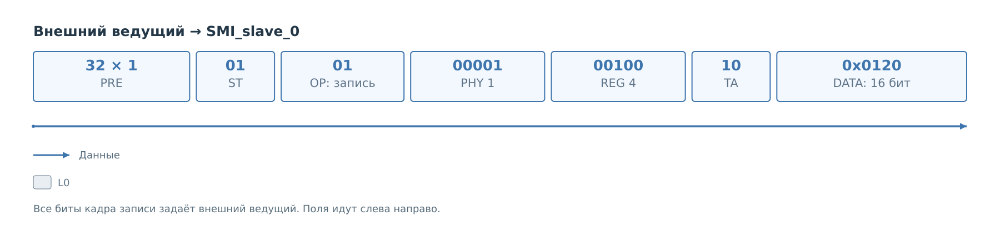
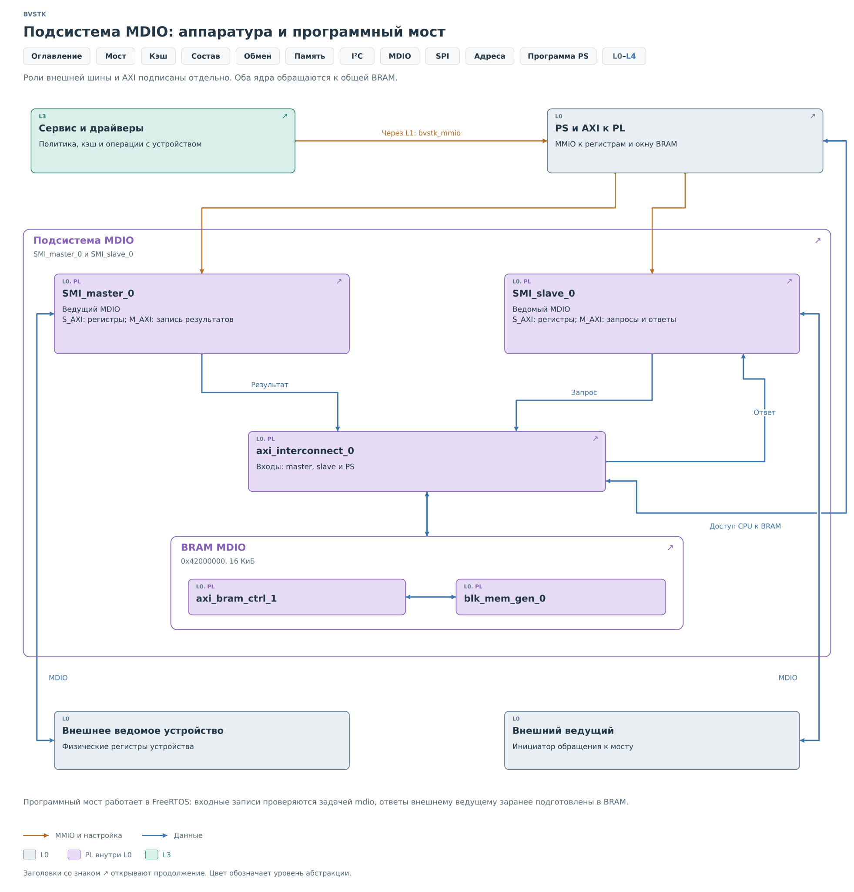

# Подсистема MDIO

Внешний ведущий записывает `0x0120` в регистр 4 устройства PHY 1.
Проследим этот кадр до решения сервиса и обновления ответа slave.
Числа выбраны для примера: модель PHY 1 настроена, регистр 4 существует,
а whitelist разрешает `0x0120` с маской `0xFFFF`. Мост обслуживает
задача FreeRTOS.

## Транзакция на шине

*Рисунок 1. Внешняя запись регистра 4 PHY 1.*

Ведущий задаёт MDC и все биты кадра записи. После преамбулы и кода
операции передаются PHY 1, REG 4, turnaround `10` и 16 бит `0x0120`.
В [Clause 22](protocol/protocol.md) адрес регистра уже является
полем самого кадра. В отличие от байтового запроса I²C, сервису
не нужно извлекать указатель из первого байта данных.

На внешнем участке работает `SMI_slave_0`. Ядро принимает запись
и адресует ячейку BRAM. На стороне физического PHY новое обращение
появится после обработки PS.

## Обработка принятой записи

1. [Ведомое ядро](cores/slave.md#приём-записи) сохраняет `0x0120`
   по адресу `0x42001090` и устанавливает аппаратное событие.
2. [Ведомая часть драйвера](drivers/slave.md#получение-внешней-записи)
   при обходе банка забирает значение и ставит в ячейку метку потребления.
3. [Сервис](services/services.md#политика-и-запись) находит модель PHY 1,
   применяет правило к регистру 4 и запускает разрешённую запись.
   После неё он перечитывает PHY, обновляет BRAM ответа и кэш PS.

Это один пример с неизменными PHY 1, REG 4 и DATA `0x0120`.
Адреса промежуточной памяти различаются по назначению банка.

## Состав подсистемы

*Рисунок 2. Участники операции MDIO.*

`bvstk_mdio_core` обслуживает регистры обоих ядер и три банка BRAM.
`bvstk_mdio_service` определяет политику и состояние кэша.
[Ведущее ядро](cores/master.md) и [ведущий драйвер](drivers/master.md)
выполняют обращения, которые сервис создаёт на участке физического PHY.
Аппаратный IRQ существует, но текущая программа обнаруживает работу
опросом; это отражено в [описании порта ОС](drivers/ports.md).

## Результат операции

Пусть после записи PHY вернул при перечитывании `0x0120`.
Внешнее чтение регистра 4 затем получит это значение из банка
ответов slave. Повторного физического чтения на каждый внешний
кадр нет. Если PHY самостоятельно изменит регистр, копия обновится
при следующем опросе. Срок существования разных копий разобран
в [сервисе](services/services.md#актуализация-кэша).

Банк входящих записей хранит последнее значение каждого регистра.
Повторный кадр до обработки PS может заменить предыдущий.
Сервис обрабатывает обнаруженное значение, поэтому его успешный
результат не доказывает сохранение всех промежуточных кадров.

В [SPI и SD](../spi/spi.md) далее прослеживается приём целого блока
через AXI Stream и DMA.
