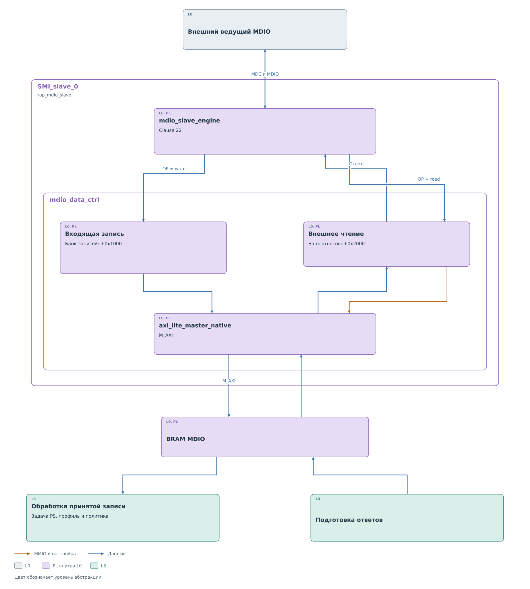
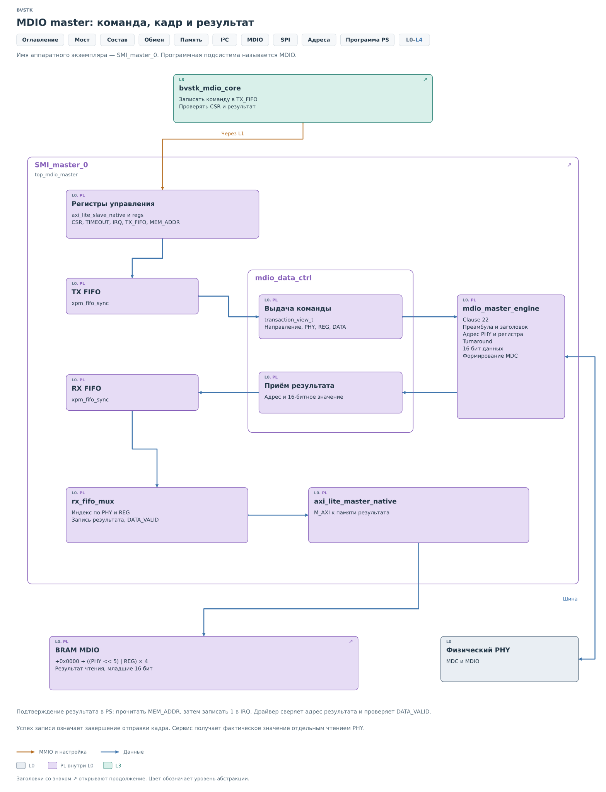
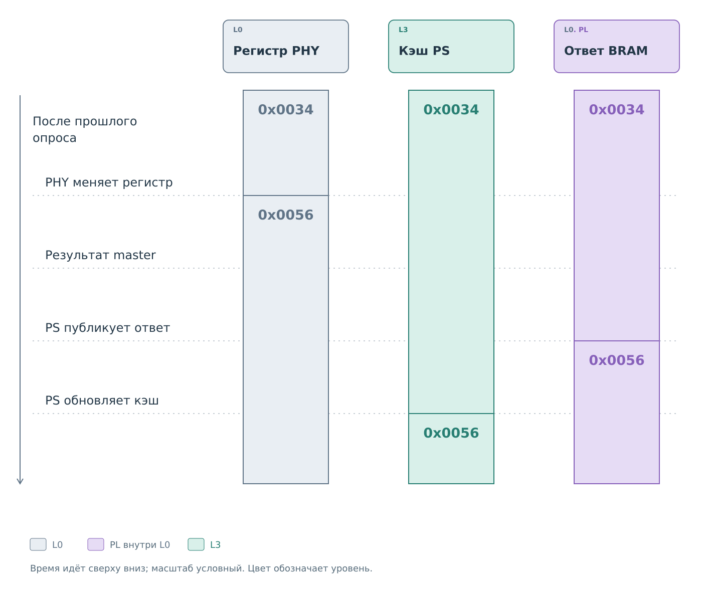

# Подсистема MDIO

В MDIO ведомое ядро выдаёт заранее подготовленный ответ. Возможности
приостановить такты до решения PS, как при удержании SCL в I²C,
у него нет. Поэтому работа моста зависит от своевременного обновления
банка ответов.

Используемый [формат Clause 22](protocol/protocol.md) адресует
16-битный регистр парой PHY и REG. Аппаратные роли master и slave
выполняют `SMI_master_0` и `SMI_slave_0`.

## Состав подсистемы

*Рисунок 1. Подсистема MDIO: аппаратура и программный мост.*

Ядра и PS обращаются к памяти через `axi_interconnect_0`; процессор
также управляет регистрами ядер по AXI. Внутри каждого банка паре PHY
и REG соответствует своя ячейка. Поэтому готовый ответ можно найти
непосредственно по адресу внешнего обращения.

BRAM начинается с `0x42000000`. Внутри каждого банка смещение
ячейки равно `4 × (32 × PHY + REG)`: одному 16-битному регистру
отведено 32-битное слово. Банки имеют разные назначения:

| Смещение банка | Содержимое | Производитель | Получатель |
|---|---|---|---|
| `+0x0000` | Результат чтения PHY | Master | PS |
| `+0x1000` | Последняя внешняя запись | Slave | PS |
| `+0x2000` | Подготовленный ответ | PS | Slave |

Программный мост подключён во FreeRTOS. Задача обслуживания вызывает
`bvstk_mdio_service`, который обрабатывает входящие записи, проверяет
политику, опрашивает устройства и обновляет ответы.

## Ведомые обращения

Рассмотрим сначала сторону внешнего ведущего. Чтение и запись здесь
используют разные банки и по-разному вовлекают программу.

*Рисунок 2. MDIO slave: два независимых пути BRAM.*

При чтении slave выбирает ячейку банка ответов и выдаёт её младшие
16 бит. К этому моменту PS уже должен был опубликовать значение.
На внешнее чтение не приходится новая операция master. Полученный
ответ отражает последнюю публикацию программы.

При записи slave сохраняет входящее значение в другой банк и отмечает
завершение через IRQ. Программа позднее забирает значение и ставит
метку потребления `0x00010000`. Если
ведущий успел дважды записать один регистр до обработки, в ячейке
останется последнее значение. Порядок обращений к разным регистрам
этот банк тоже не сохраняет. Это память последних записей, поэтому
её нельзя трактовать как журнал всех транзакций.

Полученное значение проходит политику в PS. При разрешении сервис
запускает запись физическому PHY; при запрете фиксирует отказ.
Аппаратный приём входящей записи к этому времени уже завершён.
Отдельного подтверждения решения политики на внешней записи MDIO нет.

Внешний ведущий может завершить запись и немедленно
начать чтение того же регистра. Однако задача PS ещё могла не забрать
входящее значение. Slave в таком случае вернёт прежнее содержимое
банка ответов. Окончание кадра записи на внешней стороне не задаёт
момент, к которому изменятся физический PHY и подготовленный ответ.

## Ведущая операция

Новое значение для ответа появляется после физического чтения.
Поводом может быть фоновый опрос, команда клиента или проверка
результата разрешённой записи.

*Рисунок 3. MDIO master: команда, кадр и результат.*

Драйвер `bvstk_mdio_core` загружает в TX FIFO направление, адрес PHY,
регистр и, для записи, данные. `mdio_data_ctrl` передаёт эту команду
автомату как `transaction_view_t`. `mdio_master_engine` формирует MDC
и кадр с адресными полями. При чтении он освобождает линию данных
на этапе turnaround, чтобы её могло вести устройство, и принимает
значение регистра.

Результат проходит через RX FIFO и `rx_fifo_mux` в BRAM. Драйвер ждёт
`DATA_VALID` и проверяет адрес: готовое значение должно относиться
к запрошенному регистру. При подтверждении он читает `MEM_ADDR`,
затем записывает единицу в IRQ.

Сервис публикует результат в банк ответов slave и обновляет кэш.
Свежесть этой публикации определяется последующими опросами PHY.

## Политика входящей записи

MDIO slave сохраняет значение в банке входящих записей. Задача
FreeRTOS периодически вызывает `service_step`. Сервис забирает
необработанную ячейку через `bvstk_mdio_core_take_write`, помечает
её потреблённой и находит описание устройства по адресу PHY.
Если описание PHY отсутствует, запрос отклоняется. За один вызов
`service_step` обрабатывается ограниченное число ячеек.

Политика сопоставляет номер регистра и записываемое значение с правилами.
Маска позволяет учитывать только выбранные биты. Режим whitelist
разрешает совпавшие записи, blacklist запрещает их. При отказе сервис
фиксирует результат, и ведущая операция не запускается.

При разрешении старое значение кэша помечается недостоверным,
а в ответ slave публикуется `0xFFFF`. Затем выполняется запись
физическому PHY. В MDIO отправка кадра не подтверждает, что регистр
принял именно это значение: часть битов может быть служебной или
сбрасываться самим устройством. Поэтому сервис выполняет отдельное
чтение и публикует уже полученный результат.

Например, запись может устанавливать управляющий бит, который PHY
сам сбросит после выполнения действия. Если сразу скопировать
переданное слово в банк ответов, внешний ведущий будет видеть
команду даже после её выполнения. Перечитывание получает состояние,
фактически оставшееся в регистре. Для команды RESET в регистре 0
сервис снимает достоверность значений всего устройства, поскольку
сброс затрагивает несколько регистров.

Успех отправки и успех последующего чтения учитываются отдельно.
Текущий путь записи может вернуть успешное завершение отправки,
хотя перечитать регистр не удалось. В этом случае кэш остаётся
недостоверным, а вместо прежнего ответа публикуется `0xFFFF`.
По одному результату записи нельзя заключить, что новое состояние
PHY уже доступно внешнему ведущему.

## Актуализация кэша

Проследим один 16-битный регистр. После опроса в нём и обеих копиях
находится `0x0034`. Устройство само меняет его на `0x0056`. Пока программа
не выполнила новый опрос, внешний ведущий по-прежнему получает `0x0034`.

*Рисунок 4. Значение устройства и две копии во времени.*

На рисунке сохранён порядок успешного пути MDIO: результат физического
чтения публикуется в BRAM, затем сервис отмечает обновление своего кэша.
Это последовательные действия, между которыми копии могут различаться.
Они не образуют мгновенный общий снимок состояния.

Профиль задаёт список регистров для фонового опроса, задержку между
ними и паузу между обходами. Сервис обновляет их последовательно.
Если регистр изменился сразу после собственного опроса, новое
значение попадёт в ответ только при следующем чтении этого регистра.
Заданный интервал влияет на свежесть, но не устраняет задержки
выполнения операций и ошибки связи.

Значения разных регистров также получены в разные моменты. Пусть
сначала прочитан регистр состояния, затем счётчик. Устройство может
измениться между этими операциями. Даже когда обе записи кэша
достоверны, их пара не обязательно описывает один момент работы PHY.
Это следует из последовательного опроса и важно для интерпретации
снимка, который показывает пользовательский интерфейс.

Во FreeRTOS изменение также передаётся через `bvstk_cache_sink` и
`bvstk_cache_bridges` в общий каталог значений. Он позволяет
пользовательским интерфейсам читать состояние подсистем единообразно.
Просмотр каталога получает сохранённое состояние; для нового обмена
с устройством нужна операция сервиса.

При ошибке чтения MDIO запись кэша становится недостоверной,
а в банк ответов помещается `0xFFFF`. На внешней шине нет отдельного
бита достоверности: это обычное передаваемое слово. Причину его
появления нужно смотреть в состоянии сервиса PS.

Начальное значение помечено как полученное из `settings`; после
успешного физического чтения источником становится устройство.
По одной величине регистра это различие не видно, поэтому источник
хранится в состоянии программного кэша.

В I²C кэш обновляется при операциях сервиса. Успешное физическое
чтение сохраняет полученный байт, успешная запись — переданный байт.
Показанный фоновый обход MDIO не распространяется автоматически
на устройства I²C.

В [SPI и SD](../spi/spi.md) рассматривается передача блока данных
через поток и DMA.
