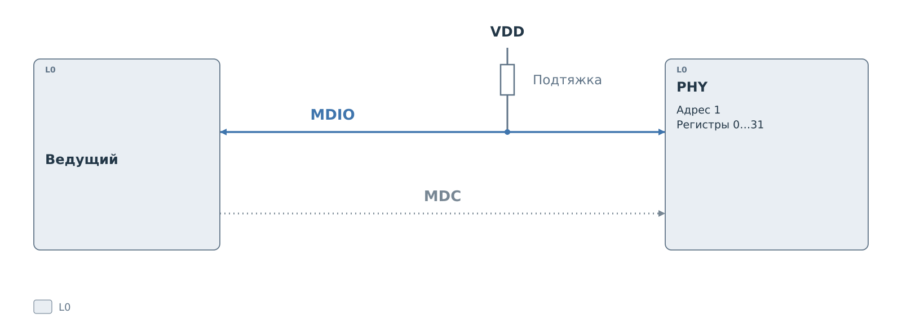
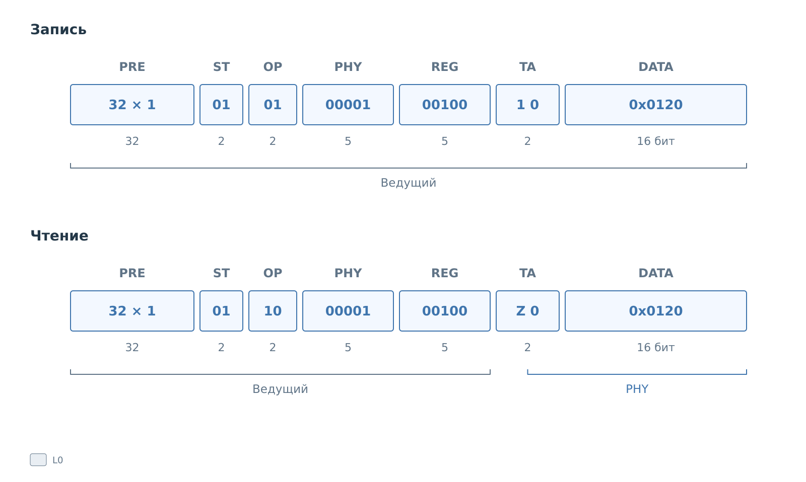
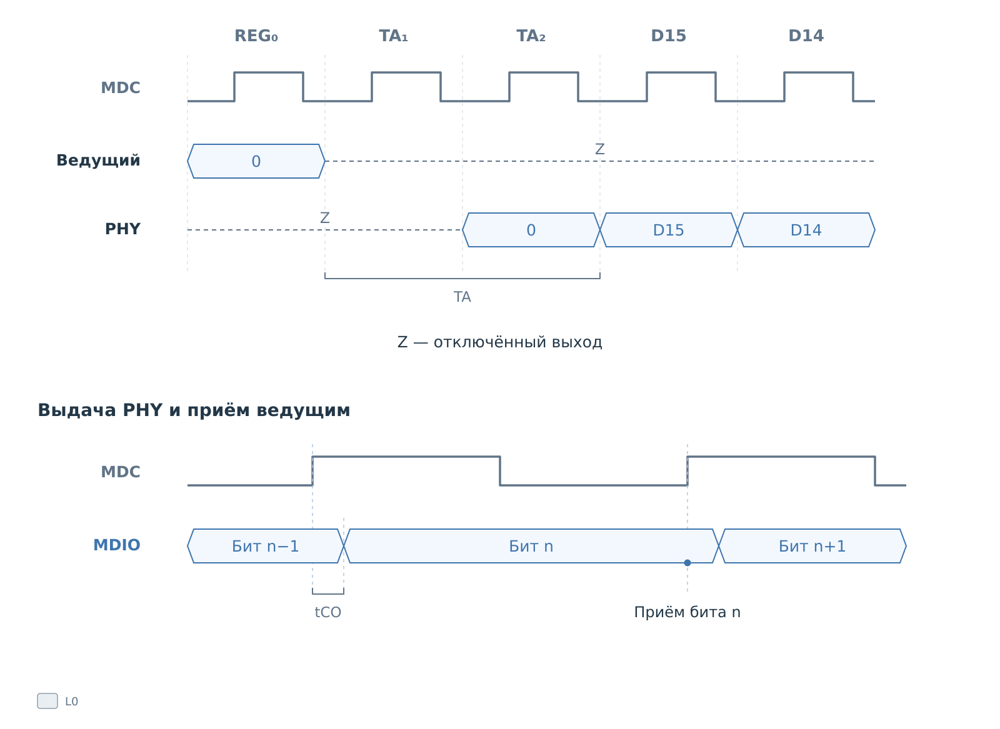

# Протокол MDIO

MDIO позволяет ведущему читать и изменять регистры PHY — микросхемы
физического интерфейса Ethernet. Так программа узнаёт состояние
соединения и меняет настройки PHY. Ethernet-кадры передаются другим
путём; здесь рассматривается именно доступ к регистрам.

В [подсистеме BVSTK](../mdio.md) используется формат **Clause 22**.
Разберём обращение к одному 16-битному регистру: как ведущий выбирает
его и в какой момент ведомое устройство начинает отвечать.

## Линии и участники

**MDC** задаёт такты, **MDIO** передаёт биты. Ведущий управляет MDC
и во время записи, и во время чтения. На MDIO передатчик меняется:
запрос выдаёт ведущий, ответ при чтении — выбранный PHY.

*Рисунок 1. MDIO: линии и участники.*

Несколько PHY могут быть подключены к одним линиям. Их различают
пятибитные адреса, передаваемые внутри кадра, поэтому отдельный
сигнал выбора не нужен. Участники имеют общую землю. Подтяжка
удерживает MDIO в единице, когда никто не управляет линией.

## Как выбирается регистр

Обращение начинается с преамбулы: ведущий передаёт 32 единицы,
по которым получатели синхронизируются. Затем идут начало кадра
**ST**, операция **OP**, адрес **PHY** и номер регистра **REG**.
После двух тактов **TA** передаются 16 бит **DATA**.

*Рисунок 2. MDIO: кадры Clause 22.*

В Clause 22 начало кадра всегда имеет значение `01`. Операция `01`
означает запись, `10` — чтение. Поля PHY и REG занимают по пять бит:
кадр прямо выбирает один из 32 регистров одного из 32 адресов PHY.
Старшие биты передаются первыми.

С полной преамбулой получается 64 такта MDC. Возможность опустить
преамбулу зависит от поддержки участниками; на рисунках она сохранена.
Формат Clause 45 использует другую адресацию и здесь не рассматривается.

## Запись и чтение

При записи ведущий управляет MDIO до конца кадра. Он передаёт
в поле TA последовательность `10`, затем новое значение регистра.
На рисунке это `0x007B`. Отдельного подтверждения записи со стороны
PHY в таком кадре нет.

При чтении ведущий передаёт те же адреса, но освобождает MDIO
перед ответом. PHY выдаёт ноль во втором такте TA, затем 16 бит
регистра — в примере `0x0034`. После ответа PHY отпускает линию.

В отличие от примера I²C, отдельная запись указателя регистра здесь
не нужна. Каждый кадр уже содержит PHY и REG. Следующее чтение
будет новым кадром с собственной адресной частью.

## Как линия переходит к PHY

**TA**, или turnaround, отводит время на смену передатчика. В первом
такте TA при чтении оба участника отпускают MDIO. Во втором такте
выбранный PHY выдаёт ноль. Поэтому поле чтения записывают как `Z0`.

*Рисунок 3. MDIO: передача линии при чтении.*

Z обозначает отключённый выход. На самой линии в этот момент
будет единица благодаря подтяжке.
Верхняя часть рисунка показывает владение линией по тактам;
точные моменты переключения выходов на ней не заданы.

Нижняя часть раскрывает временное соотношение. PHY выдаёт очередной
бит после подъёма MDC с задержкой **tCO**. В показанном примере
ведущий принимает этот бит на следующем подъёме, когда он уже
установился. При выборе частоты и момента приёма контроллер учитывает
задержку PHY и время распространения сигнала. Конкретные значения
берут из документации устройства.

Если никто не ответил, подтяжка может дать последовательность единиц.
Отсутствие ожидаемого нуля TA позволяет обнаружить такую ситуацию.
Само значение `0xFFFF` ещё не доказывает ошибку: оно может быть
содержимым регистра.

В Clause 22 нет сигнала, которым PHY мог бы задержать такты ведущего
до готовности ответа. Поэтому ведомому ядру BVSTK нужно заранее
иметь значение для выдачи. Следующая [глава о подсистеме MDIO](../mdio.md)
показывает, как программа готовит эти значения в BRAM и обновляет их
по результатам обращений к физическому PHY.
