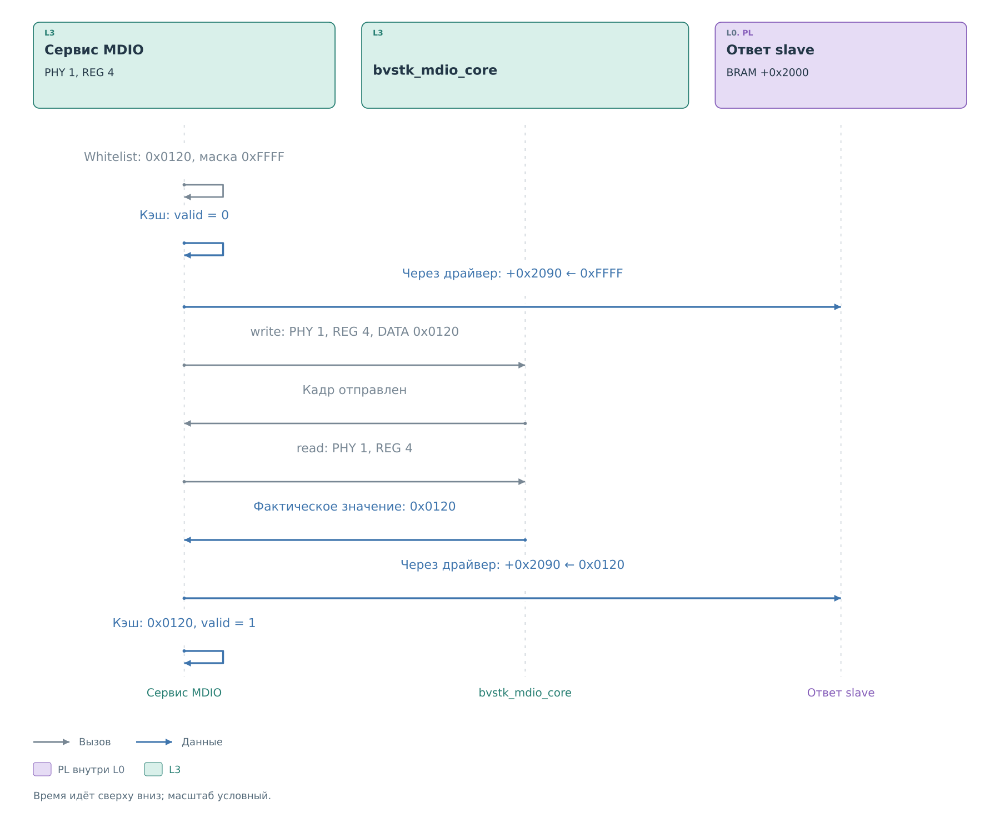
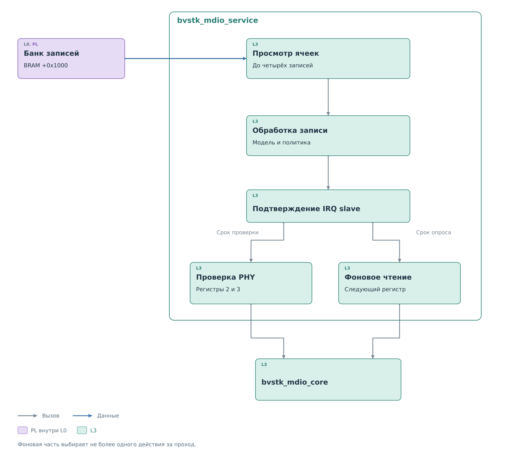
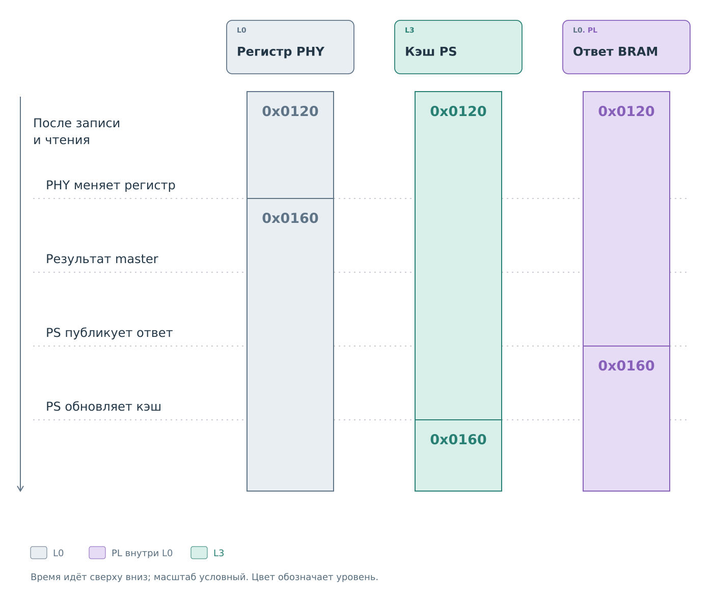

# Сервис MDIO

[Драйвер](../drivers/slave.md#получение-внешней-записи) вернул
`0x0120` для PHY 1, REG 4 и пометил входящую ячейку потреблённой.
`bvstk_mdio_service` теперь должен решить, допустима ли запись,
выполнить её на физическом PHY и подготовить будущие ответы slave.
Обе стороны моста обслуживает один общий модуль.

## Политика и запись

По адресу PHY 1 сервис находит модель устройства. Регистр 4
существует в ней. Для примера выбран whitelist с правилом:
регистр 4, значение `0x0120`, маска `0xFFFF`. Проверка
`(value & mask) == (rule.val & mask)` разрешает эту запись.
Неизвестный PHY или запрещённая пара остановили бы обработку
до обращения к master; прежний кэш при отказе политики сохраняется.

*Рисунок 1. Обработка принятой записи PHY 1, REG 4.*

Перед обращением к устройству сервис снимает достоверность регистра 4
и публикует `0xFFFF` в ответ slave по адресу `0x42002090`.
Затем [ведущий драйвер](../drivers/master.md#подготовка-команды)
передаёт master слово `0x04240120`: направление записи,
PHY 1, REG 4 и данные `0x0120`.
[Ведущее ядро](../cores/master.md#обмен-на-шине) создаёт новый кадр
на участке физического PHY.

Завершение отправки не сообщает содержимое регистра. Управляющие
биты могут сбрасываться, часть полей может быть доступна только
для чтения. Поэтому сервис отдельно вызывает физическое чтение
PHY 1, REG 4. Его команда равна `0x00240000`, а результат появится
в банке master по адресу `0x42000090`.

Пусть PHY вернул `0x0120`. После проверки результата сервис сначала
публикует это слово в `0x42002090`, затем обновляет кэш PS:
значение `0x0120`, `valid = 1`, `seeded = 0` и время чтения.
Именно фактически прочитанное значение становится ответом slave;
оно может отличаться от переданного в записи.

Исходный кадр теперь обработан. Порт продолжит обход входящих
ячеек, а следующее внешнее чтение PHY 1, REG 4 получит `0x0120`
из BRAM. Состояние IRQ slave подтверждается после порции записей.

Результат вызова записи относится к отправке кадра. Ошибка следующего
чтения не меняет уже полученный успешный статус отправки: кэш остаётся
недостоверным, а сервис оставляет ответ `0xFFFF`. При ошибке самого
доступа к BRAM гарантировать замену ответа нельзя.

Внешняя MDIO-запись не предусматривает отдельного ответа об отказе
политики. Немедленное чтение может увидеть прежнее значение,
промежуточное `0xFFFF` либо новый результат — в зависимости от этапа PS.

## Маски правил и сброс PHY

Правила записей внешнего ведущего, консоли и DCP2 проверяет общий
`write_phy`. В whitelist совпадение разрешает запись, в blacklist —
запрещает. Нулевая маска даёт совпадение любого значения выбранного
регистра. Применяется только список выбранного режима.

Например, для регистра 0 правило со значением `0x8000` и маской
`0x8000` проверяет бит сброса. `0x8000` и `0x9200` совпадают с ним,
`0x1200` — нет. При разрешённой записи RESET сервис снимает
достоверность всех регистров PHY и заменяет все его ответы на `0xFFFF`.
Обычная запись, как в основном примере, затрагивает один регистр.

## Модель PHY и начальные значения

Модель задаёт имя устройства, адрес PHY, число регистров, правила
записи и параметры фонового опроса. Имена и адреса разных моделей
не должны совпадать. Адрес аппаратного кадра выбирается из модели
перед обращением к драйверу.

При запуске сервис сначала подготавливает банки slave, затем
публикует значения из `settings`. Они становятся доступными
во внешних ответах ещё до первого физического чтения.
Запись кэша получает признаки `valid = 1` и `seeded = 1`.
Это начальное состояние из профиля; оно не означает, что значение
уже записано в физический PHY.

После успешного чтения `seeded` снимается, сохраняются результат
устройства и время обновления. Поэтому одинаковое численное
значение может иметь разное происхождение.

## Внешние записи и рабочий цикл

*Рисунок 2. Один проход обслуживания MDIO.*

Вызов `service_step` сначала просматривает банк последних записей.
Курсор идёт по всем парам PHY и REG, за один проход принимается
не более четырёх обнаруженных значений. Если заполненных ячеек мало,
сервис может проверить все 1024 адреса. Курсор сохраняется между
вызовами, поэтому следующий проход продолжает обход.

Полученное значение уже помечено потреблённым драйвером. Сервис
находит модель по PHY. Неизвестное устройство получает отказ;
для известного применяется обычный путь записи с политикой.
Затем подтверждается событие slave. Оставшиеся ячейки сохраняются
для следующих проходов независимо от состояния IRQ.

После входящих записей сервис выбирает фоновую работу: проверку
присутствия PHY либо чтение очередного регистра. За один проход
выполняется не более одного такого действия; проверка присутствия
содержит два физических чтения. Между проходами порт ОС даёт
возможность работать другим задачам.

Такой порядок ограничивает объём одной порции работы, но не задаёт
жёсткое время ответа внешнему ведущему. Физические операции могут
ждать свой срок завершения, а аппаратный slave в это время продолжает
выдавать опубликованные значения.

## Актуализация кэша

После нашей записи есть три копии регистра 4: физический PHY,
ответ в BRAM и запись кэша PS. Допустим, в них было `0x0120`, затем PHY
самостоятельно изменил регистр на `0x0160`. До нового опроса внешний ведущий получает
прежнее опубликованное значение.

*Рисунок 3. Значение PHY, BRAM и кэша во времени.*

Успешное физическое чтение сначала публикует результат в BRAM.
Только после успешной публикации сервис обновляет свой кэш:
значение, достоверность, источник и время. Эти записи происходят
последовательно. Несколько регистров тоже опрашиваются отдельными
кадрами, поэтому их снимок не относится к одному общему моменту.

`read_from` всегда обращается к устройству. `read_cached` проверяет
`valid` и возвращает сохранённое значение без кадра на шине.
Возраст сам по себе не снимает `valid`: свежесть обеспечивается
явными чтениями и расписанием опроса.

При ошибке обычного физического чтения текущая запись кэша становится
недостоверной, а сервис пытается заменить ответ на `0xFFFF`.
Если отказал сам доступ к BRAM, гарантировать эту замену нельзя.
На шине отдельного бита достоверности нет; `0xFFFF` выглядит как
обычное 16-битное слово.

Изменения передаются через `bvstk_cache_sink` в общий каталог
`bvstk_cache_bridges`. Пользовательские интерфейсы получают оттуда
сохранённое состояние. Сам просмотр каталога не запускает обмен.

## Проверка присутствия и фоновый опрос

Для модели как минимум с четырьмя регистрами сервис примерно раз
в секунду проверяет идентификатор PHY: читает регистры 2 и 3.
Оба чтения должны завершиться, ни одно слово не должно быть `0xFFFF`,
а пара не должна состоять из нулей. Только после принятия всей пары
присутствие отмечается в общем каталоге.

Эта проверка выполняется и при выключенном `autopoll`. Выключение
обновления выбранных регистров не останавливает обнаружение
подключённого устройства. При неудачной проверке весь кэш PHY
снимается с достоверности, ответы заменяются на `0xFFFF`, а следующая
попытка планируется отдельно.

Фоновый опрос проходит список `autopoll_regs`. Пауза между соседними
регистрами задаётся `autopoll_reg_delay_ms`, между полными обходами —
`autopoll_cycle_delay_ms`. Для модели с проверкой идентификатора
опрос выполняется после подтверждения присутствия. Ошибка фонового
чтения инвалидирует состояние всего устройства и возвращает его
к проверке присутствия.

Изменение профиля тоже может требовать очистки. При смене PHY,
числа регистров или `settings` сервис очищает прежние ответы,
применяет новую конфигурацию и заново публикует начальные значения.
Простая смена режима политики не означает обновления физических
регистров.

Доступ к состоянию и весь рабочий проход защищены mutex сервиса.
Устройство очереди задач и аппаратных ожиданий описано в
[разделе об ОС](../drivers/ports.md).

## Счётчики наблюдений

`observed` считает потреблённые ячейки банка записей. Повторные кадры,
перезаписавшие ячейку до обработки, из этого числа восстановить нельзя.
Неуспешная проверка присутствия ещё неизвестного PHY не увеличивает
`stats.errors`; ошибка обычной транзакции учитывается отдельно.
