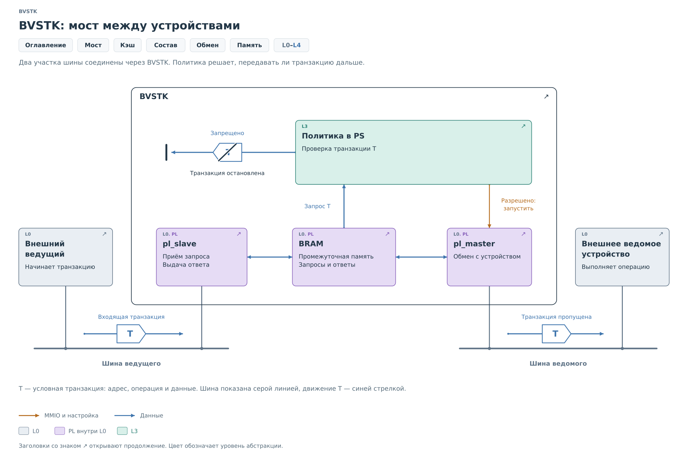
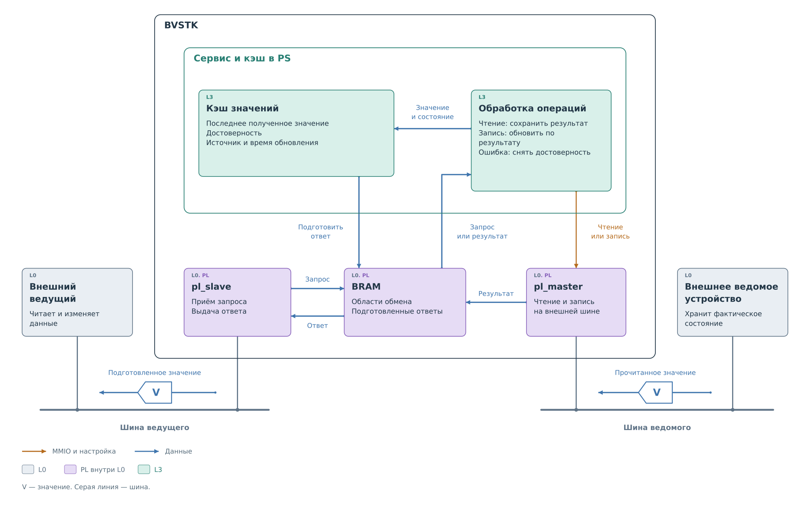
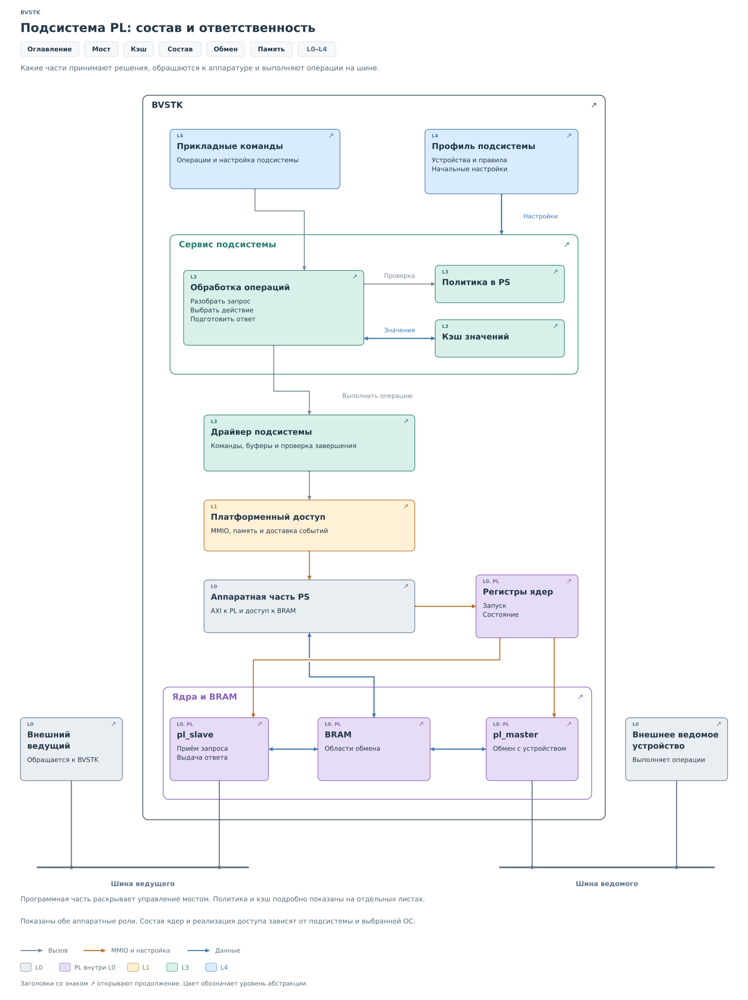
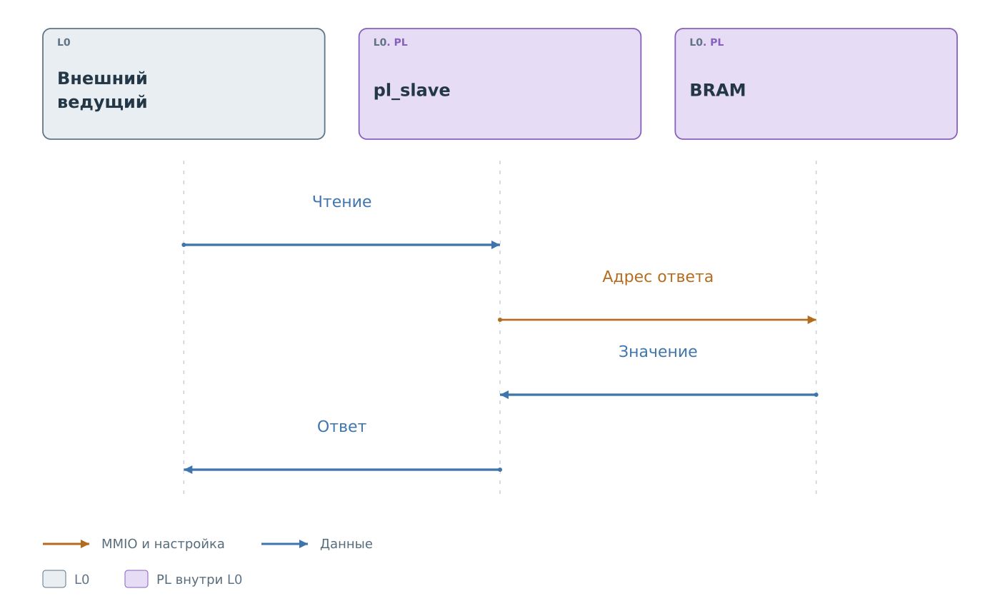
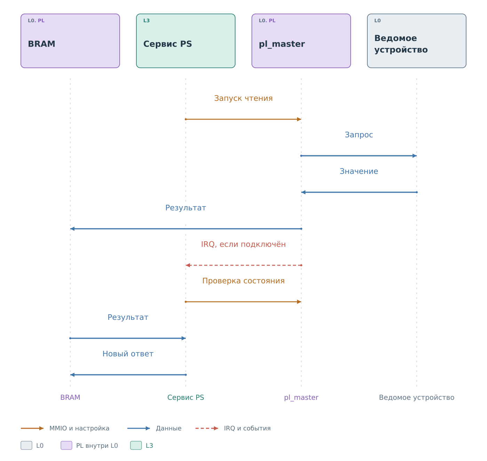
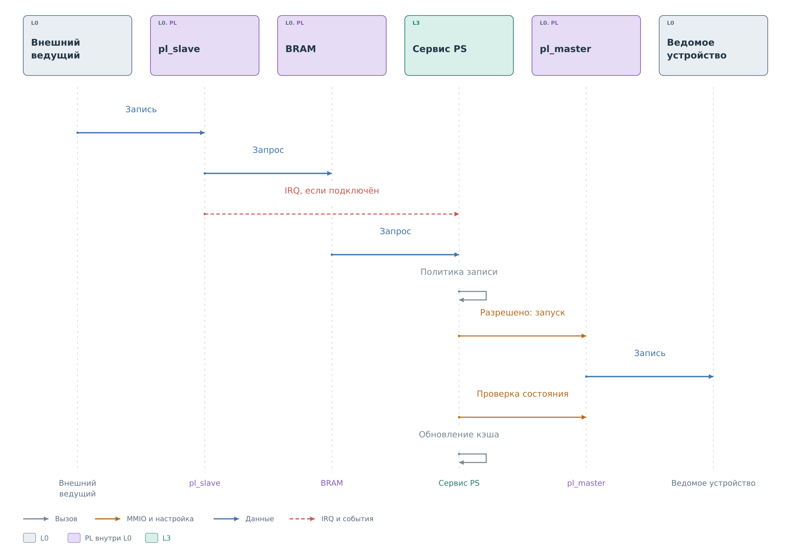
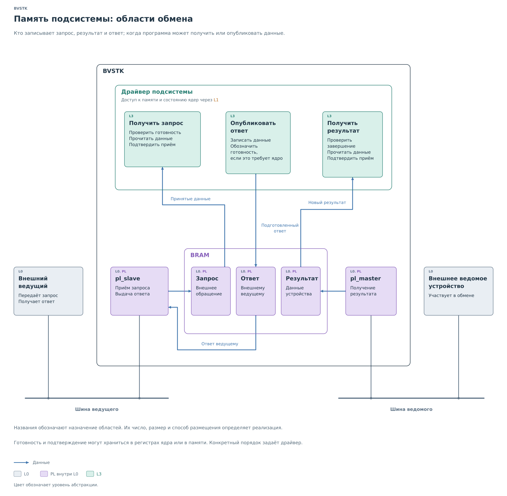

# Подсистемы PL

Внешний ведущий, программа PS и физическое устройство работают
независимо. Ведущий может уже ждать ответ, пока программа выбирает
данные, а физическое устройство ещё выполняет отдельный обмен.
Подсистема связывает эти действия через память и признаки готовности.

На общих рисунках `pl_slave` обозначает ядро, принимающее обращения
внешнего ведущего, а `pl_master` — ядро, начинающее обмен с ведомым
устройством. Это роли. Конкретная подсистема может использовать
обе или только одну из них.

## Мост между устройствами

Ведомую сторону BVSTK, показанную на [вводной схеме](../system.md),
обслуживает `pl_slave`, ведущую — `pl_master`. Рассмотрим обращение
внешнего ведущего к регистру R.

*Рисунок 1. BVSTK: мост между устройствами.*

Транзакция T на рисунке обозначает запись, которую проверяет политика.
Если внешний ведущий читает R, ему можно выдать уже подготовленное
значение. В таком случае новое обращение к физическому устройству
не требуется. При необходимости обновления программа отдельно
запускает `pl_master` и получает результат.

Теперь ведущий записывает новое значение в R. Входящие байты сначала
принимает `pl_slave`. Программа разбирает их и проверяет политику:
разрешена ли такая запись. При разрешении она запускает `pl_master`,
при запрете завершает обработку без записи в устройство. В действующих
сервисах I²C и MDIO именно запись проходит такую проверку политики.

В I²C подтверждение ACK может быть выдано ещё до решения программы.
Оно подтверждает приём
данных аппаратурой. Успешное изменение физического регистра можно
установить только на следующих этапах, с учётом возможностей протокола.

## Кэш и подготовленный ответ

Чтобы понять ответ на чтение, нужно различать три места хранения
одного значения. Физический регистр находится во внешнем устройстве.
Программный **кэш** хранит известное BVSTK значение в памяти PS.
Область ответа в **BRAM** содержит данные, которые сможет выдать
ведомое ядро.

*Рисунок 2. BVSTK: кэш и подготовка ответов.*

Например, программа прочитала R и получила значение V. Она учитывает
результат в кэше и подготавливает ответ ведомого ядра. После публикации
в BRAM это значение доступно внешнему ведущему. Если физический
регистр позже изменится самостоятельно, обе сохранённые копии останутся
прежними до следующего обновления.

Для внешнего ведущего такой ответ выглядит как обычное чтение регистра.
По самим байтам он не узнает, сколько времени прошло с физического
опроса. Кэш сокращает число обменов и позволяет быстро отвечать,
но свежесть значения теперь зависит от действий программы.

Поэтому запись кэша содержит признак достоверности, а в зависимости
от подсистемы — источник и время обновления. **Достоверность разрешает
сервису использовать значение**. Она не измеряет его возраст и не
доказывает, что физический регистр с тех пор не изменился. Начальное
значение из профиля также может быть доступно до первого опроса;
его происхождение отличается от результата чтения устройства.

Программный кэш нужен сервису для выбора ответа. BRAM нужна ядру
для его выдачи. Например, сервис I²C может хранить значения многих
регистров, а в BRAM поместить только небольшое окно от текущего
указателя. При смене указателя он подготовит другое окно из того же
кэша. У MDIO адресованным регистрам заранее выделены ячейки банка
ответов. Таким образом, содержимое BRAM определяется способом
обслуживания шины; оно не обязано повторять всю структуру кэша PS.

Аппаратный кэш процессора относится к доступу CPU и DMA к памяти.
Он не участвует в выборе значения регистра для внешнего ведущего.

Момент подготовки BRAM зависит от протокола. MDIO slave читает заранее
заполненный банк ответов. I²C slave может запросить у PS окно данных
и на время ожидания удерживать SCL. В обоих случаях процессор должен
закончить подготовку данных до их использования ядром. В I²C это
конкретный короткий срок, поэтому успешное обновление кэша и успешный
ответ на уже начавшийся запрос могут иметь разные результаты.

Изменение трёх копий во времени показано на [примере MDIO](mdio/services/services.md#актуализация-кэша).

После разрешённой записи кэш тоже требует обработки. В I²C успешная
операция сохраняет переданный байт в кэше. В MDIO сервис отдельно
перечитывает регистр: отправленное значение может отличаться от того,
которое устройство действительно хранит. При ошибке запись кэша
может быть помечена недостоверной. Так последующие читатели получают
состояние, соответствующее результату операции.

## Сервисы и драйверы

*Рисунок 3. Подсистема PL: состав и ответственность.*

Приложение L4 создаёт модель устройства и связывает сервис с драйвером.
Сервис L3 определяет смысл запроса: выбирает регистр, проверяет запись,
обращается к кэшу. Драйвер L3 выполняет выбранную операцию через
регистры ядра и BRAM. Платформа L1 предоставляет аппаратный доступ
и средства ОС L2; обмен на шине исполняет аппаратура L0.

Эта граница сохраняется и для команды из консоли. Она может вызвать
тот же сервис, который обрабатывает внешние обращения. Прямой вызов
драйвера обходит решения сервиса, включая политику и обновление кэша.

## Порядок операций

### Чтение подготовленного ответа

Предположим, что программа уже опубликовала значение R в BRAM.
Ведомое ядро может закончить внешнее чтение, не обращаясь ни к PS,
ни к физическому устройству.

*Рисунок 4. Выдача подготовленного ответа.*

Так работает банк ответов MDIO. Для I²C сначала требуется подготовить
окно в ответ на запрос ядра. Этот дополнительный этап показан
в [сценарии чтения I²C](i2c/services/read.md#чтение-из-кэша).

### Обновление значения

Новое значение получает `pl_master`. Операцию запускает сервис:
по запросу клиента, при отсутствии нужного значения или по расписанию,
если подсистема поддерживает опрос.

*Рисунок 5. Обновление значения.*

Обращения сервиса к аппаратуре на рисунке проходят через драйвер и L1.
Драйвер проверяет завершение и ошибки, затем забирает результат.
IRQ может уведомить о событии; если обработчик не подключён,
драйвер обнаруживает готовность опросом. Для некоторых ядер требуется
также подтвердить получение результата, прежде чем начать следующий обмен.

Последняя стрелка показывает подготовку нового ответа в BRAM.
В конкретной подсистеме она может произойти позднее самого чтения:
например, сервис I²C хранит результат в кэше до запроса нужного окна.
Сохранённое значение становится доступно ведомому ядру только после
публикации ответа по правилам этого ядра.

### Внешняя запись

Для записи программа должна сначала получить запрос внешнего ведущего.
На рисунке показано продолжение при разрешении политики.

*Рисунок 6. Обработка разрешённой записи.*

Подтверждение приёма ядру, если оно требуется, освобождает аппаратный
буфер. Решение политики принимается отдельно. При запрете обработка
заканчивается до запуска `pl_master`. При разрешении сервис ждёт
результат физической операции и учитывает его в кэше.

У этих этапов отдельные результаты. Принятые байты могут быть
отклонены политикой. Разрешённая запись может завершиться ошибкой
устройства. Полученный ответ может опоздать к сроку внешнего чтения.
Поэтому запись журнала о приёме запроса сама по себе не доказывает
успех всей операции.

## Память обмена

BRAM связывает участников, работающих в разное время. Важно знать,
кто заполняет область и по какому признаку другая сторона может
её читать.

*Рисунок 7. Память подсистемы: области обмена.*

Входящий запрос записывает ведомое ядро, читает программа. Ответ
готовит программа, читает ведомое ядро. Результат физического чтения
записывает ведущее ядро, затем его забирает программа. Разделение
областей позволяет сохранить эти данные независимо друг от друга.
Названия на рисунке обозначают назначение памяти. Число окон,
их размеры и способ адресации определяет конкретная подсистема.

Память сохраняет содержимое между операциями. До нового запроса
в ней могут лежать совершенно корректные байты предыдущего. Во время
заполнения часть слов уже обновлена, а часть ещё старая. Поэтому
получатель должен иметь отдельный признак, позволяющий считать
область законченной.

Например, I²C slave принимает шесть байтов. Первые четыре он записывает
в BRAM целым словом, оставшиеся два — хвостом. Затем публикует
заголовок с длиной 6 и устанавливает `DATA_VALID`. Программа узнаёт
о готовности после сохранения всех полезных байтов. Она читает
столько данных, сколько указано в заголовке, независимо от того,
что осталось за границей этого фрагмента.

Обратное направление подчиняется такому же требованию. PS записывает
окно ответа и только затем передаёт `rd_valid`. Ядро получает
разрешение использовать новую область. Само изменение заголовка
или первого слова ответа этого разрешения не заменяет.

Публикация завершённой области решает только часть задачи. Ещё нужно
успеть забрать данные до её повторного использования. Очередь событий
в ОС может хранить несколько уведомлений, хотя аппаратное окно
с байтами остаётся одно. Подтверждение IRQ тоже не переносит эти
байты в отдельный буфер. Если производитель уже заменил содержимое,
старое уведомление не позволяет его восстановить.

Способы обнаружения и обработки такого случая зависят от подсистемы.
I²C имеет признак аппаратного переполнения. MDIO хранит последние
записи по адресам регистров и допускает замену ещё не обработанного
значения. Эти особенности определяют, какие сведения PS сможет
получить после задержки обработки.

## Примеры транзакций

Далее каждая подсистема разобрана на одном конкретном обмене.
В `cores` прослеживается аппаратный приём, в `drivers` — получение
данных программой, в `services` — решение и результат операции.

| Подсистема | Пример | Результат обработки |
|---|---|---|
| [I²C](i2c/i2c.md) | Запись `0x7B` в регистр `0x10` устройства `0x2A` | Разрешённая физическая запись и обновление кэша |
| [MDIO](mdio/mdio.md) | Запись `0x0120` в регистр 4 PHY 1 | Запись, перечитывание PHY и публикация ответа slave |
| [SPI и SD](spi/spi.md) | Ответ карты на CMD17 для LBA 32 | Проверенный блок из 512 байтов для файлового слоя |

Адреса и значения сохраняются между главами и рисунками.
Дополнительные механизмы — чтение, начальная настройка, обработка
ошибок — раскрыты после основного пути соответствующей операции.
