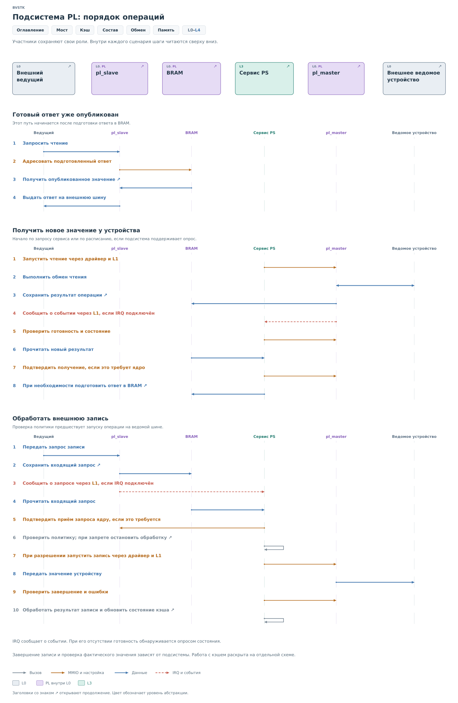

# Подсистемы PL

В [первой главе](../system.md) мы проследили общий путь обращения через
BVSTK. Теперь рассмотрим, что связывает его этапы. Внешний ведущий
может ждать ответ прямо сейчас, программа ещё выбирает источник данных,
а физическое устройство требует отдельного обмена. Подсистема должна
согласовать эти действия.

На общих рисунках `pl_slave` обозначает ядро, принимающее обращения
внешнего ведущего, а `pl_master` — ядро, начинающее обмен с ведомым
устройством. Это роли. Конкретная подсистема может использовать
обе или только одну из них.

## Мост между устройствами

Допустим, ведущий обращается к регистру R. На его участке шины
отвечает `pl_slave`. Для физического устройства ведущим является
`pl_master`. Каждое ядро обслуживает свою сторону обмена.

*Рисунок 1. BVSTK: мост между устройствами.*

Транзакция T обозначает обращение с адресом, направлением и данными.
Если внешний ведущий читает R, ему можно выдать уже подготовленное
значение. В таком случае новое обращение к физическому устройству
не требуется. При необходимости обновления программа отдельно
запускает `pl_master` и получает результат.

Теперь ведущий записывает новое значение в R. Входящие байты сначала
принимает `pl_slave`. Программа разбирает их и проверяет политику:
разрешена ли такая запись. При разрешении она запускает `pl_master`,
при запрете завершает обработку без записи в устройство. В действующих
сервисах I²C и MDIO именно запись проходит такую проверку политики.

Это разделение имеет следствие для подтверждений. ACK на внешней шине
может быть выдан ещё до решения программы. Он подтверждает приём
данных аппаратурой. Успешное изменение физического регистра можно
установить только на следующих этапах, с учётом возможностей протокола.

## Кэш и подготовленный ответ

Чтобы понять ответ на чтение, нужно различать три места хранения
одного значения. Физический регистр находится во внешнем устройстве.
Программный **кэш** хранит известное BVSTK значение в памяти PS.
Область ответа в **BRAM** содержит данные, которые сможет выдать
ведомое ядро.

*Рисунок 2. BVSTK: кэш и подготовка ответов.*

Например, программа прочитала R и получила значение V. Она учитывает
результат в кэше и подготавливает ответ ведомого ядра. После публикации
в BRAM это значение доступно внешнему ведущему. Если физический
регистр позже изменится самостоятельно, обе сохранённые копии останутся
прежними до следующего обновления.

Поэтому запись кэша содержит сведения о достоверности, а в зависимости
от подсистемы — также об источнике и времени обновления. Признак
достоверности означает, что сервис разрешает использовать сохранённое
значение. Он сам по себе не гарантирует совпадения с физическим
регистром в момент внешнего чтения. Начальное значение из профиля
также может использоваться до получения первого ответа устройства.

Момент подготовки BRAM зависит от протокола. MDIO slave читает заранее
заполненный банк ответов. I²C slave может запросить у PS окно данных
и на время ожидания удерживать SCL. В обоих случаях процессор должен
закончить подготовку данных до их использования ядром.

После разрешённой записи кэш тоже требует обработки. В I²C успешная
операция сохраняет переданный байт в кэше. В MDIO сервис отдельно
перечитывает регистр: отправленное значение может отличаться от того,
которое устройство действительно хранит. При ошибке запись кэша
может быть помечена недостоверной. Так последующие читатели получают
состояние, соответствующее результату операции.

## Кто выполняет каждый этап

На этом пути нужны две разновидности знания. Нужно понимать устройство
и его правила, а также знать способ управления аппаратным ядром.
Они разделены между сервисом и драйвером.

*Рисунок 3. Подсистема PL: состав и ответственность.*

Приложение L4 создаёт модель устройства по профилю и связывает сервис
с аппаратной реализацией. Сервис L3 использует эту модель: находит
регистр, проверяет правило, выбирает сохранённое значение или новое
чтение. Драйвер L3 переводит выбранную операцию в команды ядра,
заполнение буферов и ожидание результата.

Через платформу L1 драйвер получает доступ к регистрам и времени.
Средства ОС L2 нужны там, где требуется ожидание, доставка события
или взаимное исключение. Аппаратура L0 исполняет обмен на шине.
Возвращаемый результат проходит тот же путь обратно до сервиса.

Так можно продолжить чтение между рисунками: блок «сервис» на общем
рисунке раскрывается в программной главе, а `pl_slave` и `pl_master` —
в главах об аппаратных ядрах. Принятое деление уровней остаётся тем же,
что в [общем описании](../system.md#уровни-абстракции).

## Порядок операций

Рассмотрим три ситуации с тем же регистром R: ответ уже готов, значение
нужно обновить, либо ведущий хочет его изменить.

*Рисунок 4. Подсистема PL: порядок операций.*

При чтении подготовленного ответа ведомое ядро получает данные
из своей области BRAM. Для MDIO вся эта операция проходит аппаратно.
В I²C подготовку окна инициирует запрос ядра к PS; сервис при этом
может взять уже имеющиеся значения кэша.

При обновлении сервис вызывает ведущую операцию. Драйвер запускает
ядро и ожидает результат, проверяя его состояние. Прерывание может
сообщить о готовности, но конкретный драйвер может использовать
и опрос. После успешного чтения данные учитываются в кэше и используются
для подготовки ответа на ведомой стороне.

При записи сначала принимается внешний запрос, затем проверяется
политика. Отказ останавливает последовательность до ведущей операции.
Разрешение позволяет начать обмен, но результат этого обмена всё ещё
нужно проверить: устройство может не ответить или операция может
не завершиться в срок.

Таким образом, для одного обращения существуют разные события:
приняты байты, разрешено действие, завершён физический обмен,
подготовлен ответ. Журнал и программный клиент должны различать их.
Сообщение о принятом запросе ещё не доказывает успех всей операции.

## Память обмена

BRAM связывает участников, работающих в разное время. Важно знать,
кто заполняет область и по какому признаку другая сторона может
её читать.

*Рисунок 5. Память подсистемы: области обмена.*

Входящий запрос записывает ведомое ядро, читает программа. Ответ
готовит программа, читает ведомое ядро. Результат физического чтения
записывает ведущее ядро, затем его забирает программа. Разделение
областей позволяет сохранить эти данные независимо друг от друга.

Одной записи байтов недостаточно. Например, ядро I²C сначала сохраняет
принятые данные, затем заголовок с длиной и только после этого
устанавливает признак готовности. До этого момента в области может
находиться смесь старого и нового содержимого. Для ответа порядок
обратного обмена задаёт PS: заполняет окно, затем передаёт `rd_valid`.

Такая область не становится очередью автоматически. Если производитель
повторно использует её раньше потребителя, данные могут быть потеряны.
I²C сигнализирует о предусмотренных ядром случаях переполнения;
MDIO хранит последние записи по адресам регистров и допускает замену
ещё не обработанного значения. Размеры, число буферов и способы
подтверждения определяются конкретной реализацией.

Мы разобрали, как связаны обмены и копии данных. Теперь нужно понять,
откуда программа берёт описание устройства и кто продолжает работу
после аппаратного события. Этому посвящена
[следующая глава о программе PS](ps-interaction/ps-interaction.md).

Затем общий путь будет раскрыт для [I²C](i2c/i2c.md),
[MDIO](mdio/mdio.md) и [SPI и SD](spi/spi.md).
Численные адреса собраны в [карте памяти](reference/reference.md).
