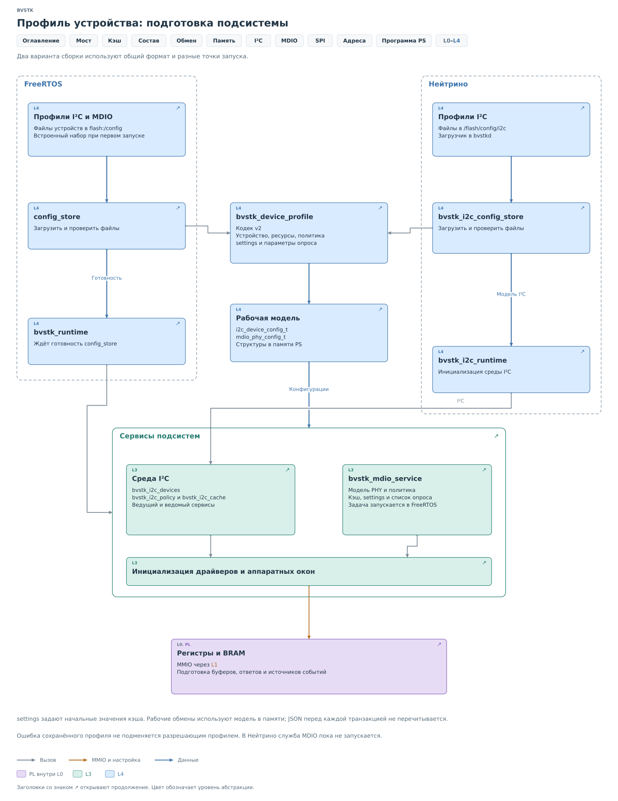
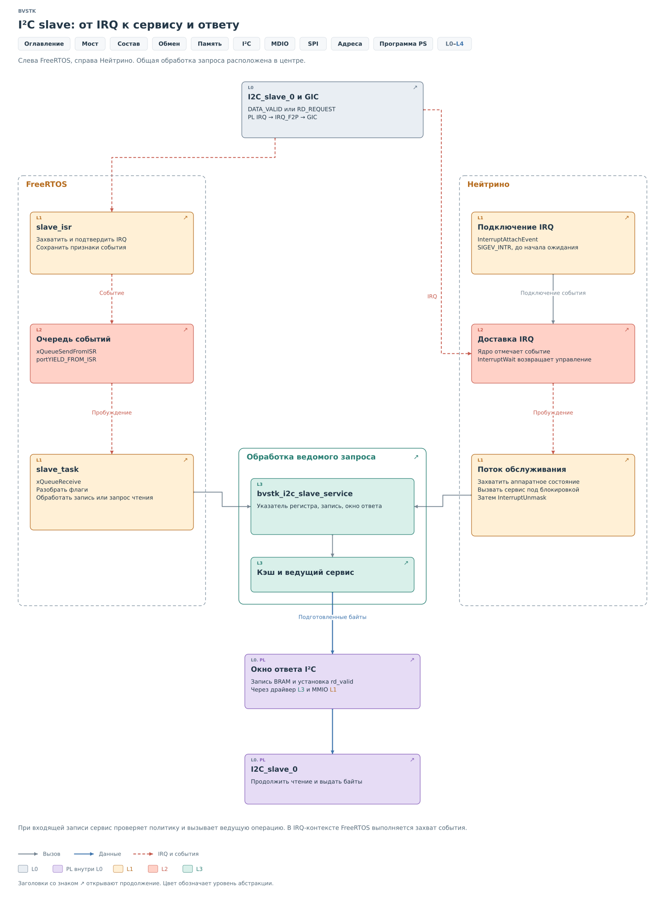
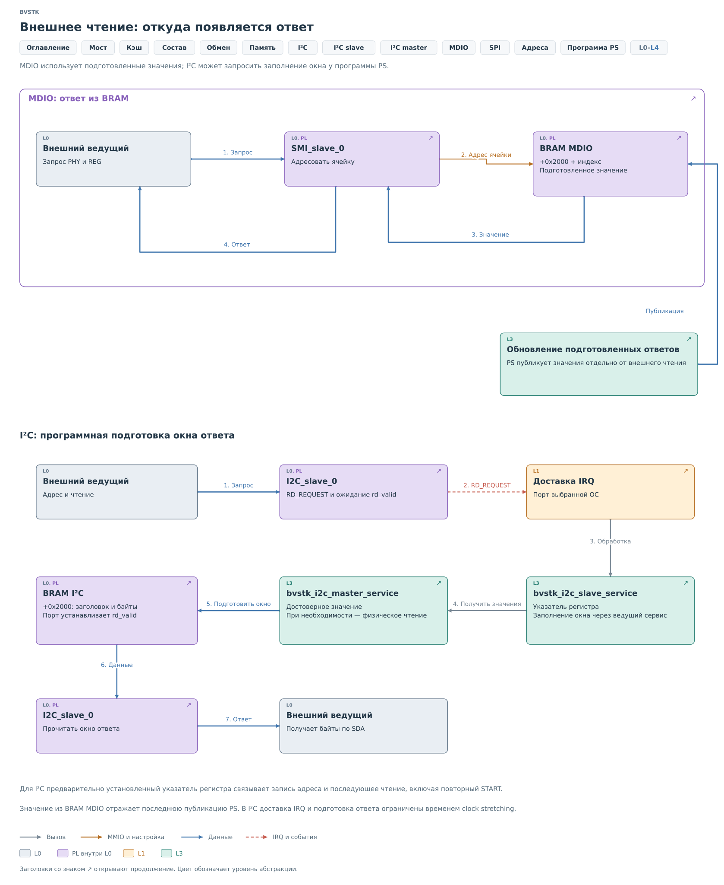
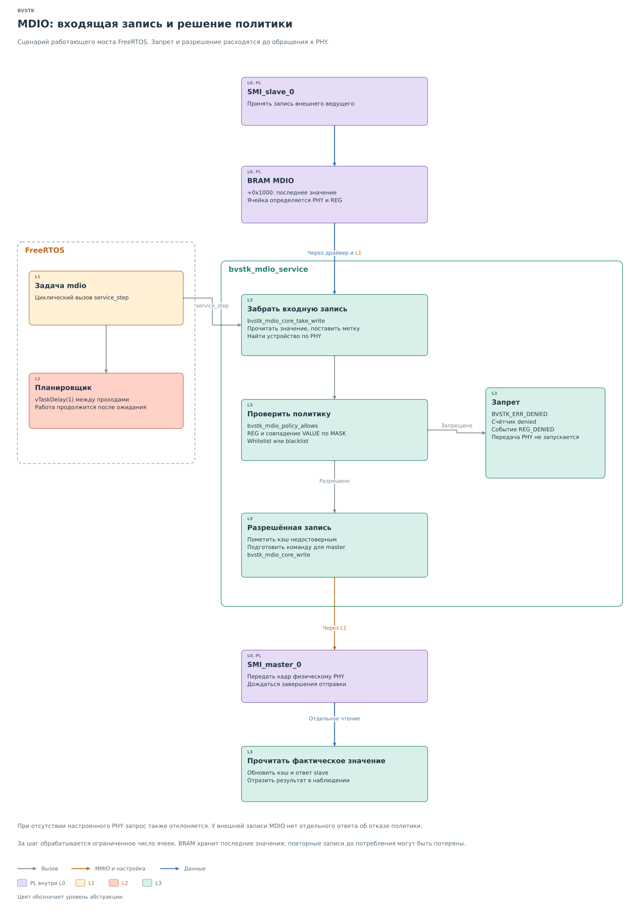
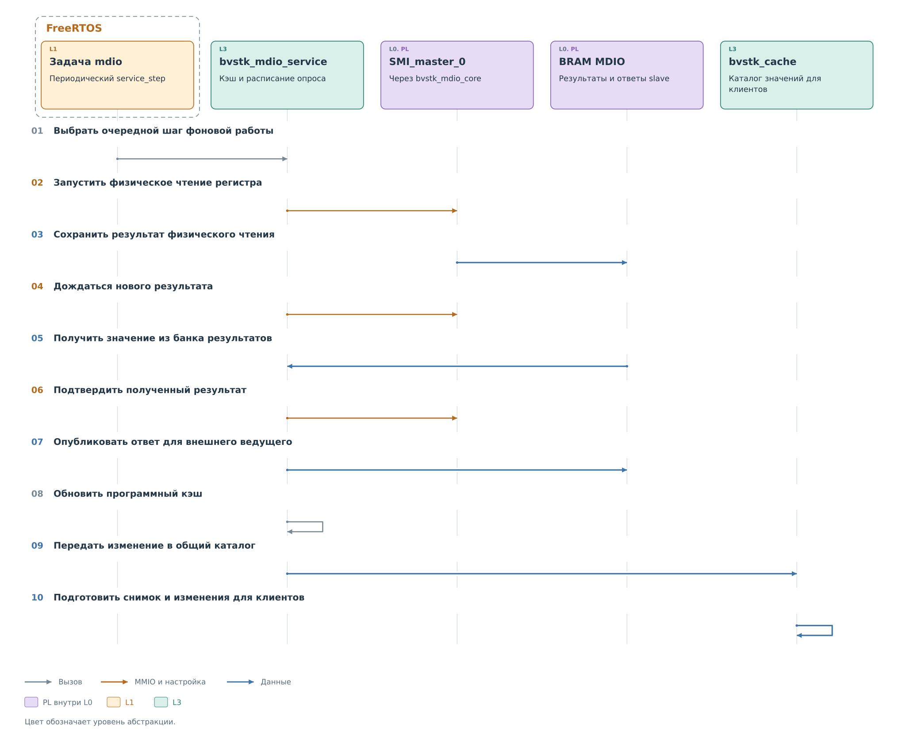
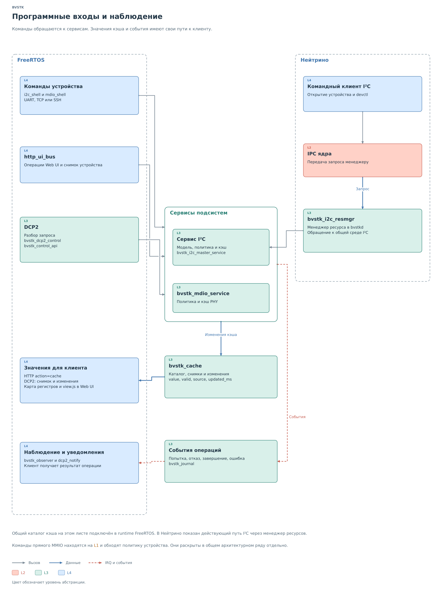
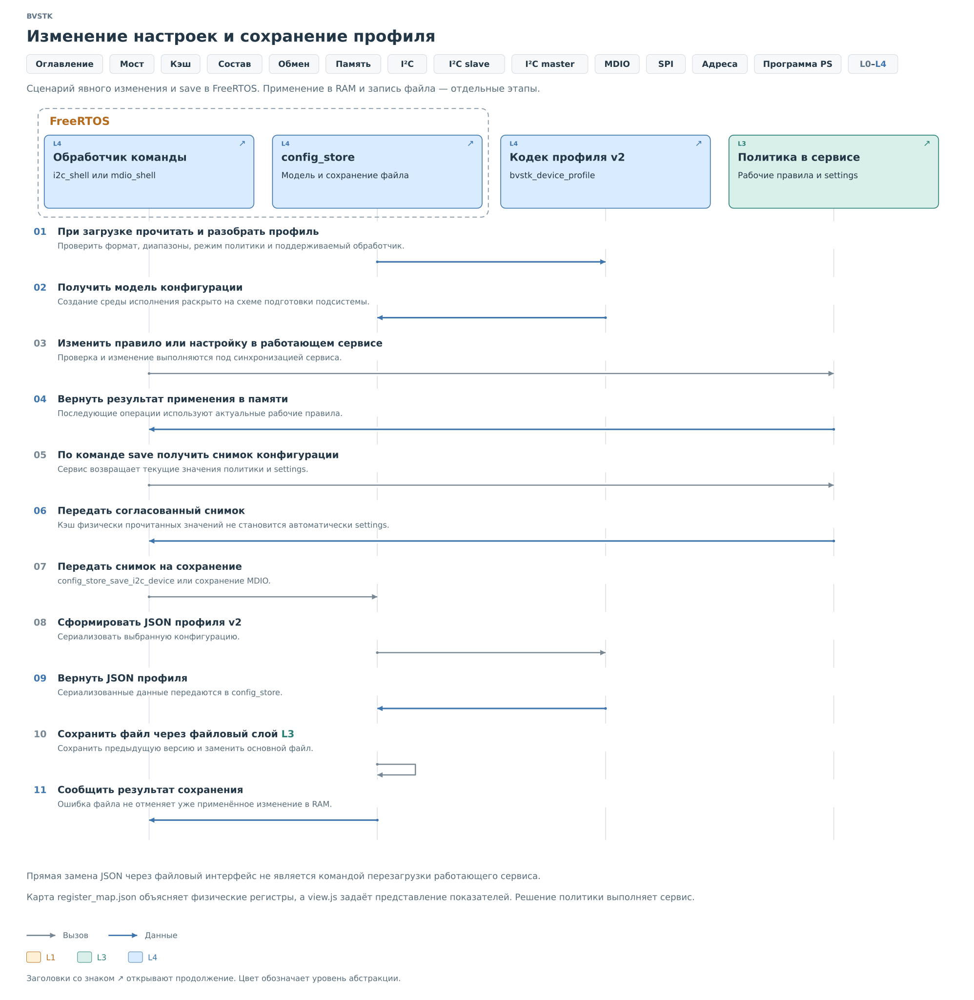

# Взаимодействие подсистем с программой PS

В [предыдущей главе](../pl-subsystem.md) внешний запрос дошёл до
программы. Чтобы его обработать, ей нужны описание устройства,
правила записи и известные значения регистров. Здесь рассмотрим,
как это состояние создаётся и используется между обращениями.

## Подготовка по профилю

Адрес на шине сам по себе мало говорит программе. Нужно знать,
сколько у устройства регистров, какие записи допустимы и откуда взять
начальные значения. Эти сведения задаёт профиль. При запуске его файл
преобразуется в рабочую модель в памяти PS.

*Рисунок 1. Профиль устройства: подготовка подсистемы.*

Во FreeRTOS `config_store` загружает файлы из `flash:/config`, а
`bvstk_runtime` ждёт готовности модели. В Нейтрино процесс `bvstkd`
загружает профили из `/flash/config/i2c`, после чего
`bvstk_i2c_runtime` создаёт среду I²C. Обе стороны используют общий
кодек `bvstk_device_profile` для разбора формата профиля.

Ошибка сохранённого профиля не подменяется профилем, разрешающим
все обращения.

По полученным структурам создаются устройства, политика, кэш и сервисы.
Затем подготавливаются драйверы, регистры, аппаратные буферы и доставка
событий. Программа должна знать, как обработать обращение, к моменту,
когда ядро начнёт его передавать.

Дальнейшие запросы используют модель в памяти. JSON при каждой
транзакции не читается. Поле `settings` задаёт начальные значения;
сервис учитывает их происхождение отдельно от результатов чтения
устройства. В частности, наличие начального значения ещё не означает,
что физическое устройство было опрошено.

Возможность запустить такой путь зависит от сборки. Служба MDIO
подключена во FreeRTOS; в Нейтрино эта рабочая среда пока не создаётся.

## Событие от ведомого I2C

Продолжим пример чтения регистра. Ведомое ядро приняло указатель
регистра, затем увидело адресную фазу чтения. Ему нужен первый байт
ответа. Оно поднимает событие `RD_REQUEST` и удерживает SCL,
предоставляя программе ограниченное время на подготовку.

*Рисунок 2. I²C slave: от IRQ к сервису и ответу.*

Во FreeRTOS обработчик `slave_isr` читает и подтверждает признаки
события, затем передаёт их в очередь. `slave_task` получает событие
и вызывает сервис. Короткий обработчик IRQ таким образом отделён
от работы, которая может потребовать блокировки или обращения
к физическому устройству.

В Нейтрино порт связывает прерывание с событием `SIGEV_INTR` через
`InterruptAttachEvent`. Поток ждёт в `InterruptWait`, после пробуждения
читает состояние ядра и вызывает сервис под блокировкой. Завершив
обработку, он выполняет `InterruptUnmask`. Средства ОС различаются,
но в обоих случаях запрос попадает в `bvstk_i2c_slave_service`.

Значим и порядок событий. Признак принятой записи `DATA_VALID` может
прийти вместе с `RD_REQUEST`. Сначала сервис должен разобрать запись
указателя, чтобы готовить ответ уже от нужного регистра. В обоих
портах принятую запись обрабатывают раньше запроса чтения.

Сервис возвращает подготовленные байты. Код обслуживания записывает
их в BRAM через драйвер и только после успешного заполнения окна
передаёт ядру `rd_valid`. IRQ сообщает о работе для PS, а `rd_valid`
сообщает ядру о готовности ответа. Эти сигналы имеют разные назначения.

## Происхождение ответа на чтение

Теперь нужно выбрать сами байты. Здесь проявляется различие между
подготовленным ответом и получением данных по запросу.

*Рисунок 3. Внешнее чтение: откуда появляется ответ.*

MDIO slave выбирает ячейку по адресу PHY и номеру регистра и сразу
выдаёт опубликованное значение. Внешнее чтение не вызывает новое
чтение физического PHY. Поэтому программа должна обновлять ответы
отдельно, например при фоновом опросе.

В I²C ведомый сервис при `RD_REQUEST` проверяет общий кэш начиная
с сохранённого указателя. Последовательные достоверные значения
составляют окно ответа. Если на пути встретится недостоверная запись,
сервис отдаёт уже собранную часть. Если же отсутствует первый нужный
байт, он вызывает ведущее чтение одного регистра и возвращает окно
из одного байта.

Так один внешний запрос не превращается сразу в длинную серию
физических чтений. Если ведущий продолжит обмен, ядро сможет запросить
следующее окно. Ведущий сервис выполняет физическое чтение, а решение
воспользоваться кэшем здесь принимает ведомый сервис.

Подготовка должна укладываться во время удержания SCL. При опоздании
ответа срабатывает аппаратное завершение ожидания; поведение зависит
от того, ожидался первый байт или продолжение. Оно разобрано в
[главе slave](../i2c/cores/slave.md#завершение-ошибки-и-irq).

## Запись MDIO и политика

Перейдём от чтения к изменению регистра. На примере MDIO удобно
увидеть, почему аппаратный приём, решение политики и проверка
результата разделены во времени.

*Рисунок 4. MDIO: входящая запись и решение политики.*

MDIO slave сохраняет значение в банке входящих записей. Задача
FreeRTOS периодически вызывает `service_step`. Сервис забирает
необработанную ячейку через `bvstk_mdio_core_take_write`, помечает
её потреблённой и находит описание устройства по адресу PHY.
Если описание PHY отсутствует, запрос отклоняется. За один вызов
`service_step` обрабатывается ограниченное число ячеек.

Политика сопоставляет номер регистра и записываемое значение с правилами.
Маска позволяет учитывать только выбранные биты. Режим whitelist
разрешает совпавшие записи, blacklist запрещает их. При отказе сервис
фиксирует результат, и ведущая операция не запускается.

При разрешении старое значение кэша помечается недостоверным,
а в ответ slave публикуется `0xFFFF`. Затем выполняется запись
физическому PHY. В MDIO отправка кадра не подтверждает, что регистр
принял именно это значение: часть битов может быть служебной или
сбрасываться самим устройством. Поэтому сервис выполняет отдельное
чтение и публикует уже полученный результат.

Банк входящих записей хранит последнее значение каждой ячейки.
Повторное обращение до обработки может заменить предыдущее. Это
ограничение аппаратного обмена нужно учитывать при интерпретации
наблюдаемых событий; оно раскрыто в [главе MDIO](../mdio/mdio.md).

## Актуализация кэша

После внешнего обращения устройство продолжает работать и может
самостоятельно менять регистры. Чтобы подготовленные ответы отражали
эти изменения, сервису нужен повод получить новое значение.

*Рисунок 5. MDIO: обновление кэша и ответов slave.*

Для MDIO такой повод даёт фоновый обход: профиль задаёт регистры
и интервалы опроса. Драйвер запускает чтение, ждёт новый результат
и проверяет его адрес. После получения и подтверждения результата
сервис публикует ответ slave, затем отмечает успешное обновление
собственного кэша.

Во FreeRTOS изменение также передаётся через `bvstk_cache_sink` и
`bvstk_cache_bridges` в общий каталог значений. Он позволяет
пользовательским интерфейсам читать состояние подсистем единообразно.
Просмотр каталога получает сохранённое состояние; для нового обмена
с устройством нужна операция сервиса.

При ошибке чтения MDIO запись кэша становится недостоверной,
а в банк ответов помещается `0xFFFF`. Начальное значение помечено
как полученное из `settings`; после успешного физического чтения
источником становится устройство. Это помогает отличить известное
начальное состояние от реально полученного ответа.

В I²C кэш обновляется при операциях сервиса. Успешное физическое
чтение сохраняет полученный байт, успешная запись — переданный байт.
Показанный фоновый обход MDIO не распространяется автоматически
на устройства I²C.

## Программные входы

До сих пор запрос приходил с внешней шины. Пользовательская команда
может войти в тот же сервис со стороны PS, например чтобы прочитать
регистр вручную. При этом нужно различать команду устройству,
просмотр сохранённого значения и наблюдение за событиями.

*Рисунок 6. Программные входы и наблюдение.*

Во FreeRTOS консоль, HTTP и DCP2 предоставляют входы к функциям
подсистем. Команда операции передаётся сервису. Снимок кэша показывает,
какое значение известно программе. Журнал и уведомления сообщают,
что происходило: была попытка, отказ, завершение или ошибка. По одной
записи о попытке нельзя заключить, что регистр устройства изменился.

В Нейтрино командный клиент I²C использует `devctl` и менеджер ресурса
в `bvstkd`. Этот процесс владеет рабочей средой I²C и обрабатывает
запросы клиентов. Сетевой вход DCP2 также находится в нём.

Прямой доступ к MMIO обращается к аппаратуре ниже сервиса. Он обходит
проверку политики и сам по себе не обновляет программный кэш или
сохранённый профиль. Его место показано на
[уровне платформы](../../system.md#l1-платформа-и-обращение-к-ядру-ос).

## Настройки и сохранение

Вернёмся к правилу, по которому разрешалась запись. Пользователь может
изменить его во время работы. После применения сервис использует
новую модель в памяти. Чтобы та же модель восстановилась после
перезапуска, её нужно отдельно сохранить.

*Рисунок 7. Изменение настроек и сохранение профиля.*

В показанном пути FreeRTOS обработчик команды меняет правила под
синхронизацией сервиса. Команда `save` получает согласованный снимок
политики и `settings`, передаёт его в `config_store`, а кодек создаёт
JSON профиля v2. Файловый слой сохраняет предыдущую версию и заменяет
основной файл.

Ошибка сохранения оставляет уже применённое изменение в памяти.
После перезапуска будет использована сохранённая версия. Обратная
ситуация тоже возможна: замена JSON через файловый интерфейс меняет
файл, но не перезагружает модель работающего сервиса.

Кэш при этом имеет собственный жизненный цикл. Прочитанные значения
устройства не становятся автоматически сохраняемыми `settings`.
Профиль определяет начальные условия и правила, а кэш хранит то,
что сервис узнал во время работы.

Мы связали профиль, запрос, решение сервиса и подготовленный ответ.
В [следующей главе об I²C](../i2c/i2c.md) пройдём этот путь на примере
одного регистра и разберём, как он превращается в байты на двух шинах.
Поля профиля описаны в [справочнике конфигурации](../../../reference/configuration.md).

## Реализация

Выбор окна ответа находится в
[ведомом сервисе I²C](../../../../src/services/i2c/bvstk_i2c_slave_service.c).
Физические операции и обновление кэша — в
[ведущем сервисе I²C](../../../../src/services/i2c/bvstk_i2c_master_service.c)
и [сервисе MDIO](../../../../src/services/mdio/bvstk_mdio_service.c).
Доставку событий реализуют
[порт FreeRTOS](../../../../src/ports/freertos-xilinx/os/i2c/bvstk_i2c_slave_freertos.c)
и [порт Нейтрино](../../../../src/ports/neutrino-zynq7000/os/i2c/bvstk_i2c_slave_neutrino.c).
