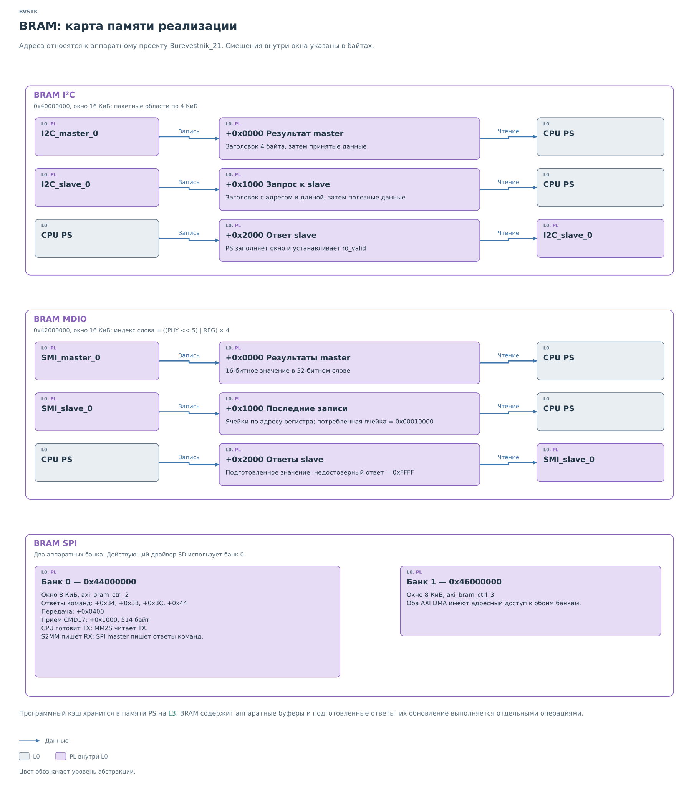

# Память подсистем PL

В основных главах мы следили за назначением памяти: кто сохраняет
запрос, где появляется результат и откуда ядро берёт ответ. Этот
раздел связывает те же области с адресами аппаратного проекта
`Burevestnik_21`. Он нужен при переходе от объяснения к драйверам
и карте аппаратуры.

*Рисунок 1. BRAM: карта памяти реализации.*

База задаёт начало аппаратного окна. Смещение выбирает область
внутри него; адрес обращения получается их сложением. Полное окно
может быть больше используемых программой областей. Адрес определяет,
где лежат данные, а право считать их готовыми задаёт порядок
[публикации](../pl-subsystem.md#память-обмена).

## I²C

BRAM I²C начинается с `0x40000000`. Адресное окно занимает 16 КиБ.
Три области по 4 КиБ используются для обмена:

| Смещение | Назначение | Кто записывает | Кто читает |
|---|---|---|---|
| `+0x0000` | Результат ведущего чтения | `I2C_master_0` | PS |
| `+0x1000` | Принятая ведомым ядром запись | `I2C_slave_0` | PS |
| `+0x2000` | Ответ внешнему ведущему | PS | `I2C_slave_0` |

Программное окно объединяет эти три области и занимает 12 КиБ.
Оно меньше полного аппаратного адресного окна BRAM.

Первое слово области содержит заголовок, далее располагаются данные.
Форматы заголовков раскрыты отдельно для
[master](../i2c/cores/master.md#форматы-команды-и-результата)
и [slave](../i2c/cores/slave.md#формат-памяти).

## MDIO

BRAM MDIO начинается с `0x42000000` и также имеет окно 16 КиБ.
Банки результатов, последних записей и ответов имеют смещения
`+0x0000`, `+0x1000` и `+0x2000` соответственно.

Внутри банка ячейка выбирается по формуле
`((PHY << 5) | REG) * 4`. Значение занимает младшие 16 бит слова.
В банке входящих записей потреблённая ячейка помечается `0x00010000`.
Для недостоверного ответа slave программа публикует `0xFFFF`.

Порядок обмена с этими банками описан в [главе MDIO](../mdio/mdio.md).

## SPI и SD

Два банка BRAM начинаются с `0x44000000` и `0x46000000`.
Каждый занимает 8 КиБ; к обоим имеют доступ PS и оба AXI DMA.
Действующий драйвер SD использует банк 0.

| Смещение в банке 0 | Назначение |
|---|---|
| `+0x34`, `+0x38`, `+0x3C`, `+0x44` | Ответы аппаратных команд SD |
| `+0x0400` | Передача команды и данных |
| `+0x1000` | Приём CMD17: 512 байтов данных и два байта CRC16 |

CPU готовит передаваемые данные, MM2S читает их, S2MM записывает
принятый поток. SPI master отдельно сохраняет ответы команд.
Последовательность разобрана в [сценарии чтения SD](../spi/spi.md#чтение-блока-sd).

Кэш значений устройств хранится в памяти PS. Публикация в BRAM —
отдельная операция с аппаратной областью. Её место в работе подсистемы
показано в [главе о кэше и ответах](../pl-subsystem.md#кэш-и-подготовленный-ответ).
