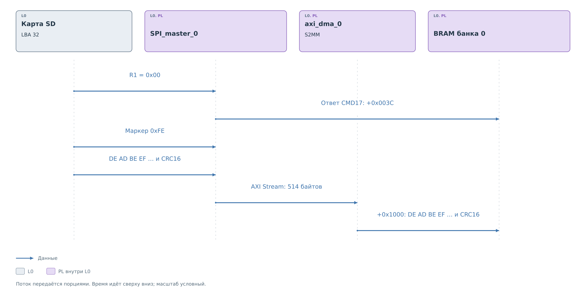
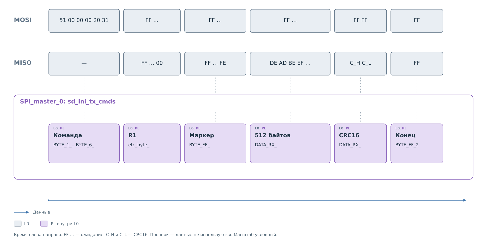
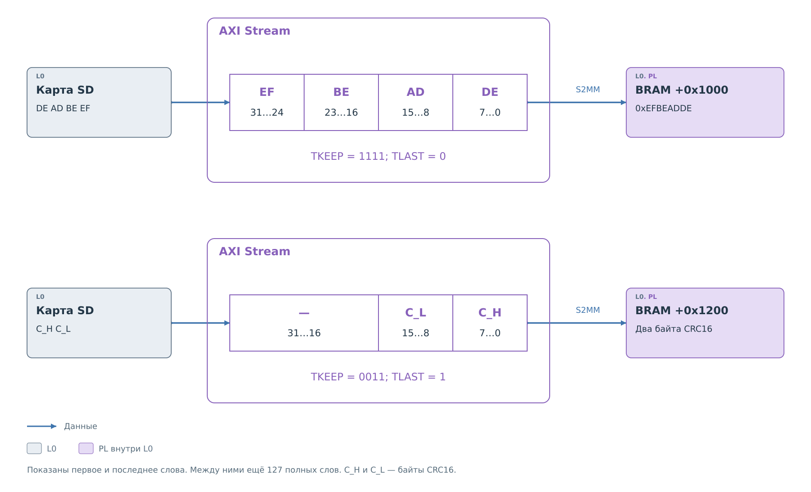
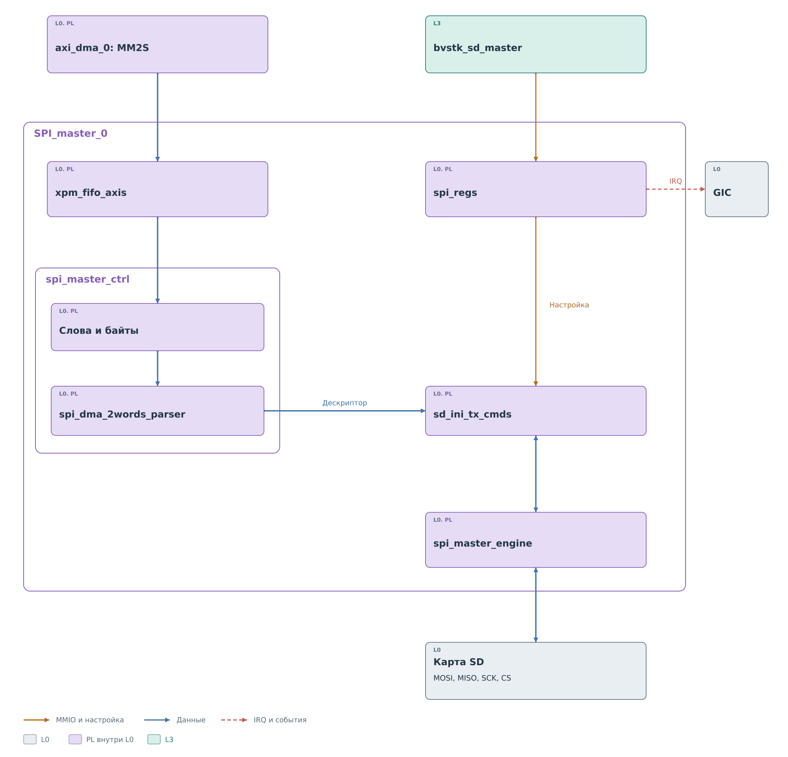
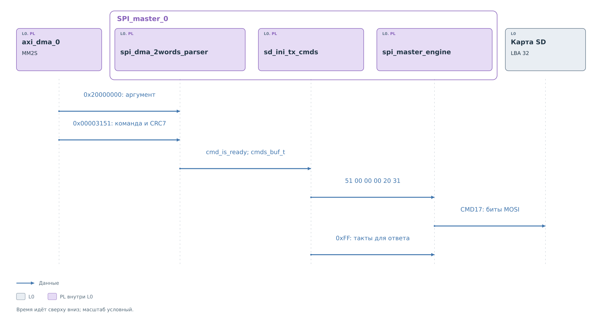
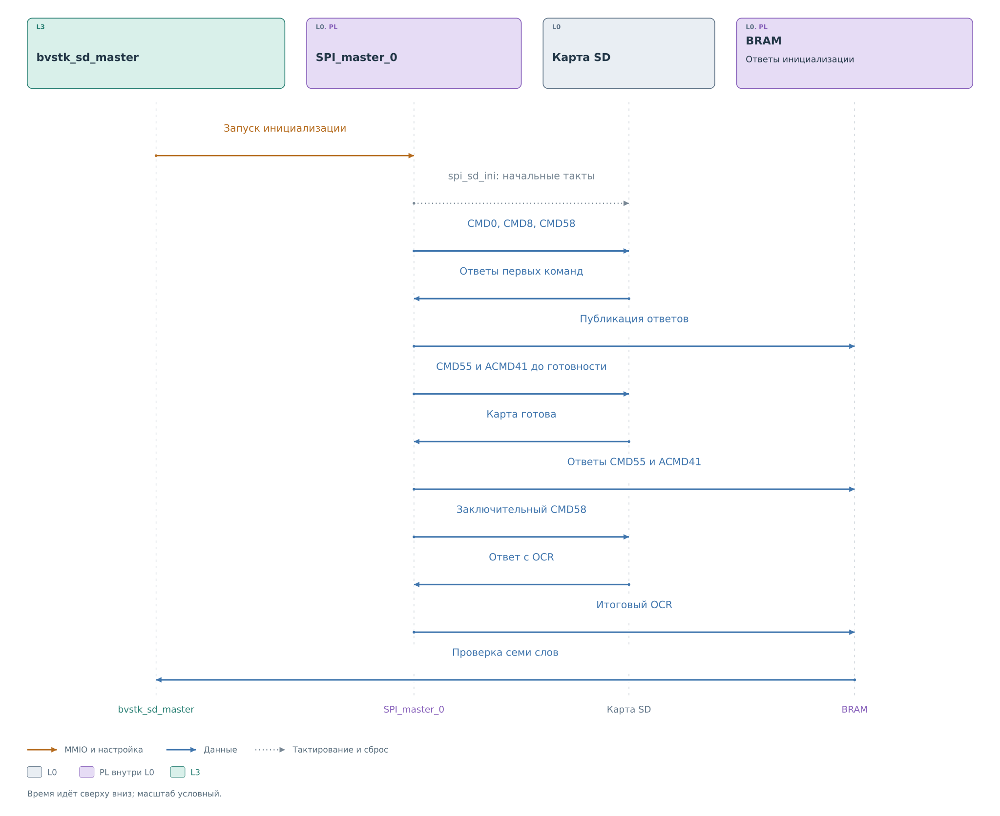
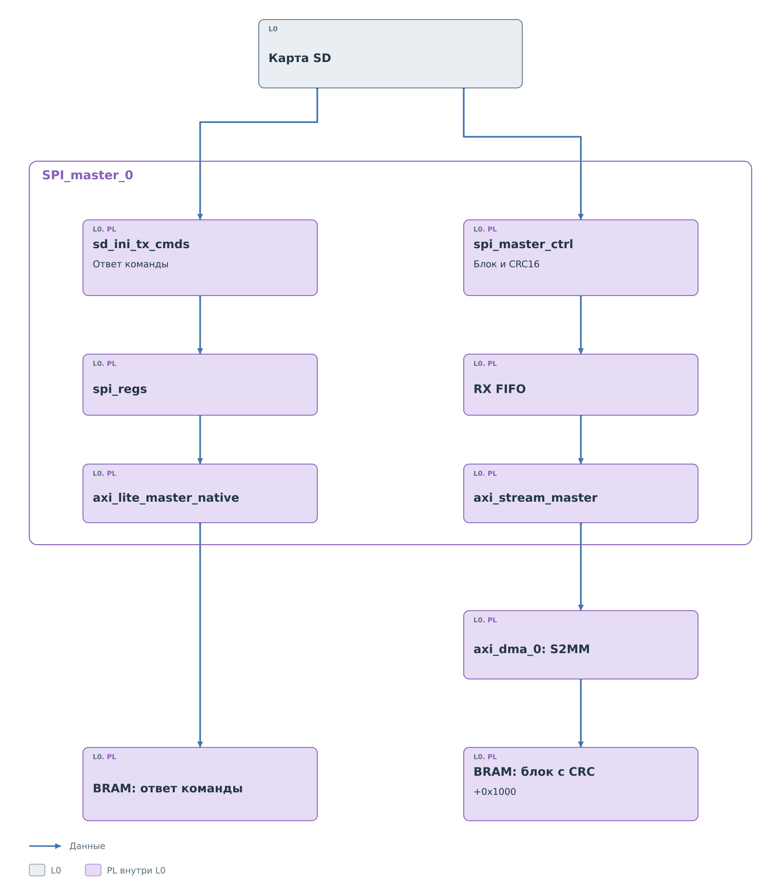

# Ведущее ядро SPI

В [примере подсистемы](../spi.md#транзакция-на-шине) CMD17 уже
передана карте. `SPI_master_0` принимает на MISO ответ для LBA 32:
`0x00`, маркер `0xFE`, данные `DE AD BE EF …` и CRC16.
Задача ядра — выделить поля ответа и опубликовать результат для PS.

## Приём блока

*Рисунок 1. Приём блока SD с LBA 32.*

`spi_master_engine` собирает биты MISO в байты. Командный автомат
`sd_ini_tx_cmds` распознаёт ответ R1 и начало блока. R1 относится
к выполнению команды; `0xFE` обозначает начало полезных данных.
Эти байты не должны стать первыми байтами сектора.

Ответ команды передаётся через `spi_regs` и ведущий AXI-порт
в ячейку BRAM `+0x003C`. Поток блока проходит через `spi_master_ctrl`,
RX FIFO и `axi_stream_master` в S2MM. DMA сохраняет 512 байтов
сектора и два байта CRC16 начиная с `0x44001000`.
В памяти сохраняется порядок байтов `DE AD BE EF`; первое
32-битное слово для PS равно `0xEFBEADDE`.

Поток идёт порциями: ядро и DMA передают слова по мере приёма,
не ожидая сборки всего блока в отдельном аппаратном буфере.
Граница последнего фрагмента сообщает DMA конец переноса.
Управляющий ответ публикуется отдельным путём, поэтому его появление
не доказывает готовности всех 514 байтов.

Аппаратные события ядра формируют IRQ. Драйвер должен сопоставить
этот сигнал, ответ и завершение каналов DMA. Следующий этап —
[получение и проверка блока в PS](../drivers/master.md#получение-блока).

## Фазы чтения CMD17

*Рисунок 2. Команда, ожидание ответа и приём данных SD.*

Шесть байтов команды передаются состояниями `BYTE_1_`…`BYTE_6_`.
Затем `etc_byte_` продолжает выдавать по MOSI `0xFF`, чтобы получать
такты для ответа MISO. В успешном примере карта сначала может выдавать
`0xFF`, затем возвращает R1 со значением `0x00`.

Нулевой R1 разрешает перейти к ожиданию блока. Через промежуточный
`BYTE_FF_` автомат попадает в `BYTE_FE_` и продолжает тактирование,
пока не получит `0xFE`. Этот маркер задаёт границу: следующий байт
уже относится к сектору. `0xFF` до маркера не занимает место
в 512-байтовом буфере данных.

После маркера `DATA_RX_` принимает сектор и CRC16. По MOSI продолжают
идти байты `0xFF`; программа не подаёт каждый из них через MM2S.
Их создаёт командный автомат. Поэтому исходного дескриптора из
восьми байтов достаточно для чтения всего блока.

В начале этой фазы устанавливаются `useful_data_en_o` и
`cmd_is_done_o`. Второй сигнал своим названием может ввести
в заблуждение: для CMD17 он появляется уже при переходе к данным.
Он разрешает следующую часть внутренней обработки, но не означает,
что сектор принят и программа может вернуть успех.

Командный автомат считает приёмные обмены вместе со служебными
переходами. В конце выполняются `BYTE_FF_2` и `WAIT_`, затем
управление возвращается к ожиданию следующей команды. Счётчик
внутренних обменов и число полезных байтов сектора имеют разные
границы; длину переноса S2MM программа проверяет отдельно.

Ветвь CMD17 продвигается при получении ожидаемых `0x00` и `0xFE`.
Если карта не выдаёт нужный ответ, ожидание не превращается
в готовый блок. После истечения программного срока ожидания драйвер
завершает вызов ошибкой и восстанавливает аппаратуру.

## Упаковка блока в поток

Байтовый автомат и DMA работают с разными единицами данных.
`spi_master_engine` возвращает очередной байт, а `spi_master_ctrl`
помещает его в `data_reg_rx` по смещению `cnt_read × 8`.
В рабочем режиме накопленные четыре байта передаются в RX FIFO
одним 32-битным словом.

*Рисунок 3. Упаковка 512 байтов и CRC16 в AXI Stream.*

В начале нашего сектора `DE` занимает биты `7…0`, `AD` — `15…8`,
`BE` — `23…16`, `EF` — `31…24`. Поэтому первое слово равно
`0xEFBEADDE`. Обратный порядок цифр в записи слова не означает
перестановки байтов сектора: драйвер извлекает их с младших разрядов.

`axi_stream_master` соединяет данные и готовность RX FIFO с
`TDATA`, `TVALID` и `TREADY`. Передача слова происходит при совместной
готовности источника и DMA. Очередь позволяет накапливать принятые
слова между такими передачами. Приём S2MM подготавливается до
CMD17, чтобы поток данных уже имел настроенного получателя.

Для сектора длиной 512 байтов получаются 128 полных слов.
Два следующих байта CRC16 занимают младшую половину ещё одного
слова. На этом последнем переносе `spi_master_ctrl` задаёт
`TKEEP = 0011` и `TLAST = 1`. Маска разрешает только две младшие
байтовые позиции, а `TLAST` завершает пакет для S2MM.
У полных слов маска равна `1111`.

В BRAM CRC начинается по адресу `0x44001200`: это смещение `512`
от начала приёмной области. Первым лежит старший байт CRC,
следующим — младший. Старшие два байта последнего слова не входят
в перенос. Драйвер заранее заполняет их контрольным значением
и [проверяет сохранность](../drivers/master.md#длина-и-границы-буфера).
Так аппаратная маска последних байтов связана с проверкой границ в PS.

Сигналы `TKEEP` и `TLAST` создаёт контроллер SPI; модуль
`axi_stream_master` передаёт их на потоковый интерфейс.
Сам DMA не знает, где у SD закончился сектор и началась CRC.
Для него это пакет из 514 разрешённых байтов по заданному адресу.

## Состав и путь команды

*Рисунок 4. Командный путь SPI master.*

Поток от `axi_dma_0` сначала попадает в `xpm_fifo_axis`.
`spi_master_ctrl` согласует чтение слов и выдачу байтов.
Внутри него `spi_dma_2words_parser` собирает дескриптор SD:
первое слово содержит аргумент, второе — код команды и CRC7.
Только после получения обоих слов выставляется `cmd_is_ready`.

`sd_ini_tx_cmds` выбирает последовательность команды и передаёт
байты в `spi_master_engine`. Автомат шины выполняет сдвиг битов,
управляет SCK и CS и возвращает принятые байты. Регистры `spi_regs`
задают запуск, делитель, режим пакетов и параметры инициализации.

Наличие кода команды в аппаратном разборе не означает готовой
операции в PS. Текущий драйвер предоставляет CMD13, CMD16, CMD17
и CMD24, а начальную последовательность запускает отдельно.
Другие перечисленные в RTL команды не образуют автоматически
доступный программный интерфейс.

## Дескриптор и передача команды

Для нашего CMD17 драйвер заранее вычислил аргумент и CRC7.
В BRAM по смещению `+0x0400` находятся два слова:

| Смещение | Слово | Содержимое для аппаратного разбора |
|---|---|---|
| `+0x0400` | `0x20000000` | Аргумент, байты для передачи `00 00 00 20` |
| `+0x0404` | `0x00003151` | Код `0x51`, байт CRC7 с завершающим битом `0x31` |

*Рисунок 5. Преобразование дескриптора LBA 32 в CMD17.*

MM2S доставляет слова через `xpm_fifo_axis` в контроллер.
`spi_dma_2words_parser` сначала заполняет `cmds_buf_reg.argument`,
затем извлекает `opcode` из битов `7…0` второго слова и `crc`
из битов `15…8`. Только после второго слова появляется
`cmd_is_ready`: до этого команда ещё неполна.

Аргумент в дескрипторе переставлен драйвером специально для
последовательного выбора байтов от младшего к старшему.
Из `0x20000000` автомат получает `00`, `00`, `00`, `20`.
Код `0x51` выбирает CMD17, поэтому на MOSI уходит последовательность
`51 00 00 00 20 31`. Верхние 16 бит второго слова не становятся
дополнительными байтами команды. Восемь байтов внутреннего
дескриптора превращаются в шесть байтов протокола SD.

`sd_ini_tx_cmds` выдаёт очередной байт по согласованию готовности
с `spi_master_engine`. Engine выполняет восемь тактов сдвига
и возвращает принятый байт MISO. После команды тот же механизм
используется для выдачи `0xFF` и приёма ответа. Переходы между R1,
маркером и данными выполняются внутри PL; PS в них не участвует.

Настройка MM2S и S2MM разобрана в
[подготовке CMD17 драйвером](../drivers/master.md#подготовка-cmd17).

## Подготовка карты

*Рисунок 6. Аппаратная подготовка SD.*

Сначала `spi_sd_ini` выдаёт заданное число тактов с MOSI в единице.
При установленном `sd_ini_en` именно его сигналы подключаются
к внешним SCK и MOSI. Этот модуль формирует начальные такты;
команды и ответы обрабатывает `sd_ini_tx_cmds` совместно
с обычным автоматом SPI.

Командная часть проходит CMD0, CMD8 и предварительный CMD58,
затем CMD55 с ACMD41. Пока карта отвечает состоянием ожидания,
пара CMD55 и ACMD41 повторяется. После готовности выполняется
заключительный CMD58 с чтением OCR.

Ответы этой последовательности нужны программе по разным причинам.
CMD8 возвращает проверочное поле, ACMD41 показывает выход карты
из начального ожидания, заключительный OCR сообщает готовность
и признаки адресации. Завершение начальных тактов само по себе
не сообщает ни одного из этих результатов.

Ответы сохраняются через `spi_regs` и `axi_lite_master_native`
в область BRAM. Раннее аппаратное событие, например окончание
начальных тактов, ещё не означает готовность карты.
[Драйвер](../drivers/master.md#инициализация)
проверяет опубликованные ответы всей последовательности.

## Ответ команды и блок данных

*Рисунок 7. Два пути результата SD-команды.*

Ответ команды проходит через регистровую часть и ведущий AXI-порт
ядра в свою ячейку BRAM. Для CMD17 принятие команды — только начало:
карта ещё должна выдать маркер блока, данные и CRC16.
Полезные байты проходят через `spi_master_ctrl`, RX FIFO и
`axi_stream_master`, затем DMA записывает их в приёмную область.

Для чтения одного блока программа ожидает 512 байтов данных
и два байта CRC16. При передаче последнего фрагмента поток
сообщает границу пакета DMA. Адрес приёмной области и предельную
длину задаёт PS до запуска команды.

У ячейки ответа CMD17 есть особенность текущего RTL. Во время
`DATA_RX_` регистр `reg_rx_cmds_resp` продолжает получать принятые
байты, а `answr_etc_en_o` разрешает записи через `spi_regs`.
Поэтому `+0x003C` не является неизменяемой копией первого R1:
после приёма данных там может оказаться `0xFF`. Эта ячейка сообщает
драйверу об активности команды, но содержимое сектора следует
получать из области S2MM.

Именно поэтому [драйвер](../drivers/master.md#ответ-команды)
проверяет ответ совместно с длиной, границами и CRC16 блока.
Один изменившийся байт в `+0x003C` не подтверждает успешное чтение.

При CMD24 направление блока меняется: после дескриптора MM2S
доставляет записываемые данные и CRC16. Аппаратная командная часть
обрабатывает ответ на данные и занятость карты. Область ответа
сообщает результат этого обмена; подтверждение фактического
содержимого сектора выполняется отдельным чтением на уровне сервиса.

IRQ, завершение MM2S и окончание S2MM наблюдаются независимо.
Завершённый MM2S означает доставку команды или данных к ядру.
Достоверность принятого блока устанавливает
[драйвер проверки результата](../drivers/master.md#завершение-и-проверка).
