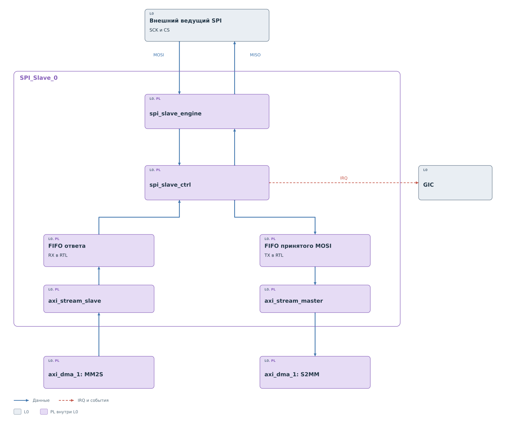
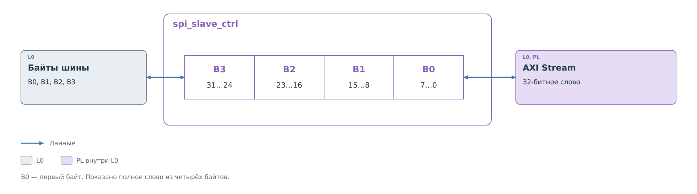

# Ведомое ядро SPI

Ответ SD из [основного примера](../spi.md) принимает `SPI_master_0`.
Описанное здесь ядро обслуживает другой, внешний участок SPI.
В текущем проекте программное продолжение этого пути не подключено.

`SPI_Slave_0` получает SCK и CS от внешнего ведущего. По MOSI
принимаются байты запроса, по MISO выдаются заранее поданные байты
ответа. Процессор не управляет длительностью внешней транзакции.

## Состав ядра

*Рисунок 1. Состав SPI slave.*

`spi_slave_engine` выделяет фронты внешнего SCK и выполняет
побитный обмен. `spi_slave_ctrl` связывает байты с 32-битными
словами. Два `xpm_fifo_sync` отделяют скорость последовательной
шины от выдачи слов по AXI Stream.

Имена FIFO в RTL относятся к потоковой стороне. RX FIFO принимает
слова от `axi_stream_slave` для будущей выдачи по MISO.
TX FIFO получает собранные байты MOSI и передаёт их через
`axi_stream_master` в S2MM. Направление лучше отслеживать
по этим участникам, поскольку внешняя шина использует обе линии
одновременно.

## Слова и границы потока

*Рисунок 2. Байты шины и слово потока.*

Контроллер выбирает байт ответа по `cnt_byte × 8` и таким же способом
помещает принятый байт в слово. Первый байт занимает биты 7–0,
второй — 15–8 и так далее. Внутри каждого байта порядок битов
задаёт автомат SPI. Порядок байтов в слове памяти и порядок битов
на проводе — разные части представления данных.

На границе слова контроллер передаёт собранное значение в TX FIFO.
Сигнал окончания внешнего обмена также участвует в выдаче накопленного
слова. Однако потоковый интерфейс этой версии не передаёт отдельную
достоверную длину неполного хвоста: `TKEEP` постоянно разрешает
все четыре байта.

В `axi_stream_master` сигнал `TLAST` выставляется при каждой выдаче
слова. Поэтому пакет потока нельзя автоматически приравнять
к целой транзакции от одного активного CS до его снятия.
Описание потока здесь показывает существующий RTL; завершённый
программный контракт приёма произвольного кадра в BVSTK не подключён.

## Готовность и события

Поля CSR задают программный сброс, запуск и разрешение чтения.
Статус отражает заполнение FIFO. IRQ формируется при заполнении
FIFO и по аппаратному условию окончания обмена. Запись подтверждения
в IRQ снимает запрос.

Поток DMA может ждать готовности получателя, но внешняя SPI-шина
не получает от этого возможности остановить SCK. Ответ должен
быть доступен в передающем пути заранее, а приёмный путь — успевать
забирать поступающие слова.

В текущей PS-части нет исполнителя, который настраивал бы `axi_dma_1`,
поддерживал запас ответов и обрабатывал события этого ядра.
Состояние программной поддержки описано в
[ведомой части драйверов](../drivers/slave.md).
