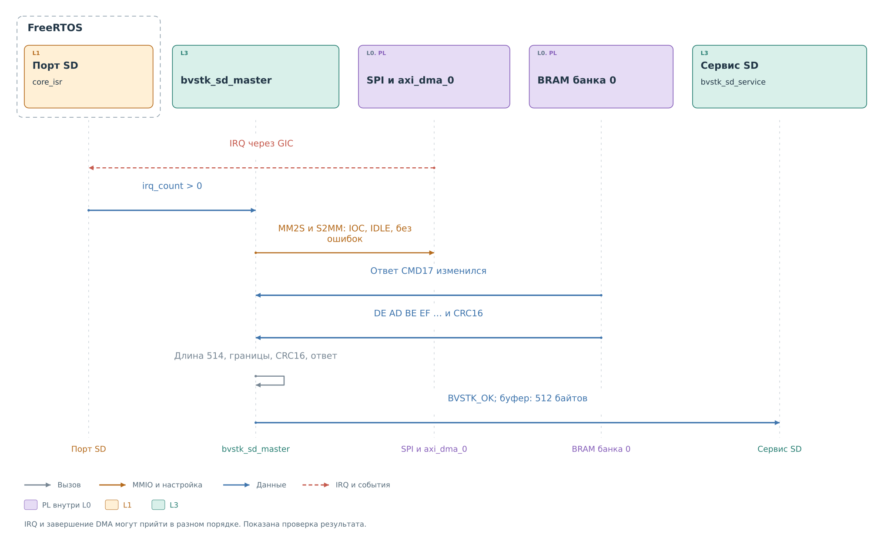
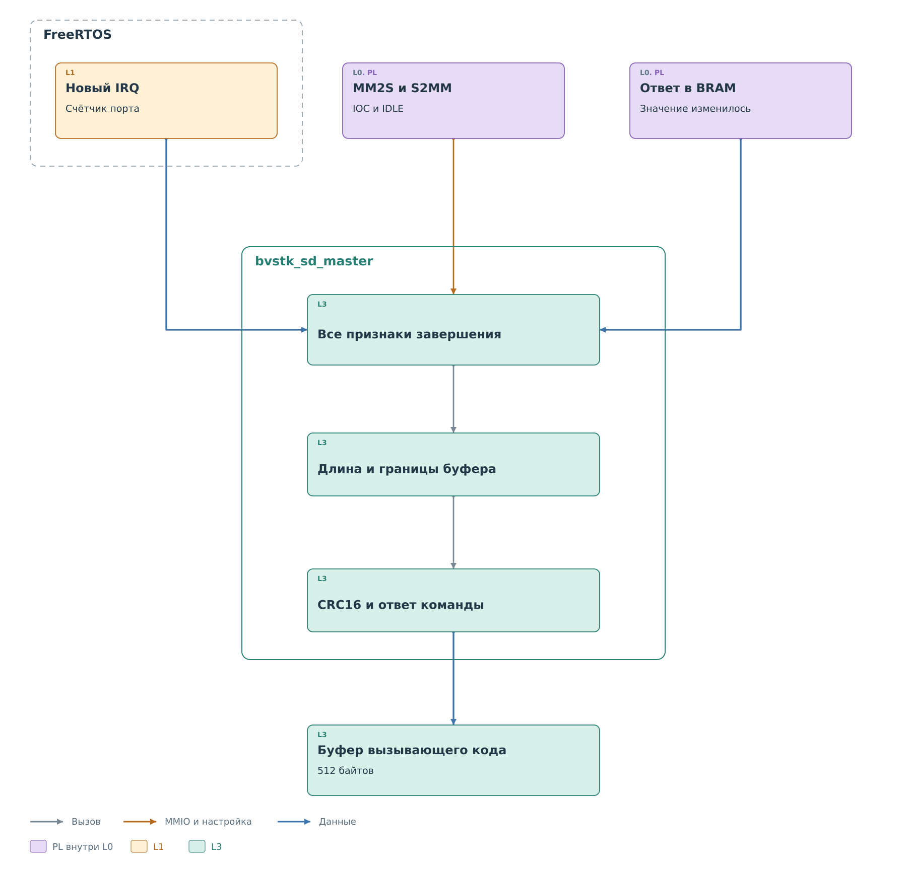
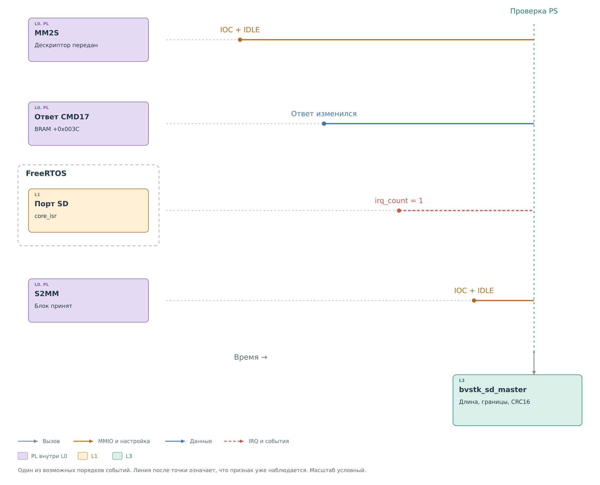
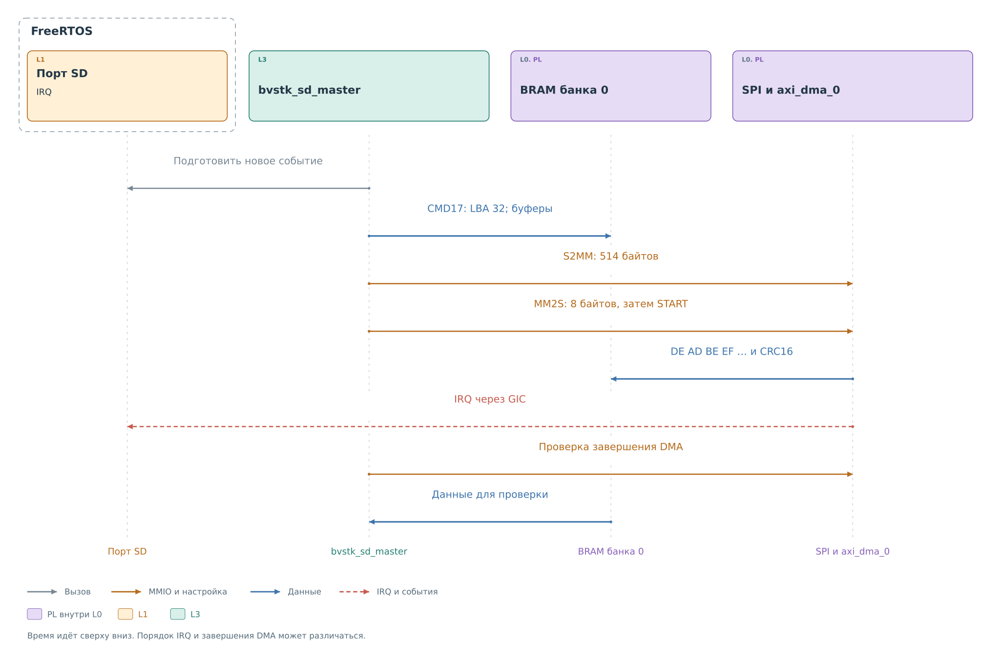
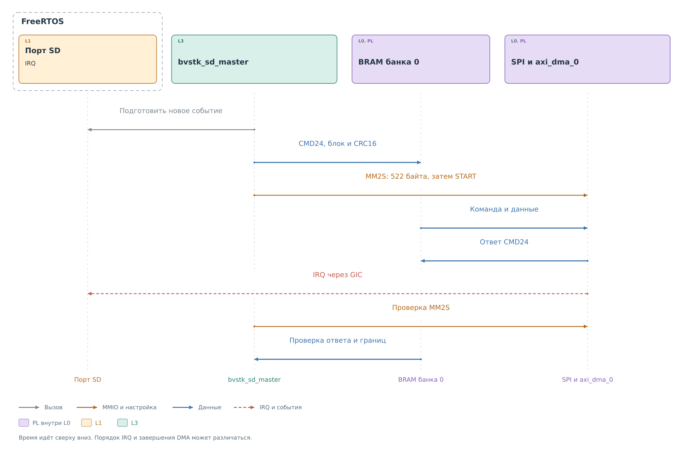

# Ведущий драйвер SD через SPI

[Ядро и DMA](../cores/master.md#приём-блока) сохраняют принятый блок
LBA 32 в BRAM: 512 байтов `DE AD BE EF …` и два байта CRC16.
`bvstk_sd_master` уже находится внутри вызова CMD17. Теперь ему
нужно проверить полноту ответа и его принадлежность текущей операции.

## Получение блока

*Рисунок 1. Получение блока 32 драйвером.*

Порт FreeRTOS фиксирует IRQ от `SPI_master_0`. Его `core_isr`
маскирует источник и увеличивает счётчик. Драйвер наблюдает счётчик
из контекста вызвавшей его задачи; сам обработчик не читает сектор
и не вычисляет CRC. Этот порядок раскрыт в
[описании IRQ](ports.md#учёт-irq).

IRQ, запись ответа CMD17 и завершение S2MM могут наблюдаться
в разном порядке. Поэтому после события драйвер продолжает опрос.
Одновременно он проверяет MM2S: дескриптор исходной команды тоже
должен быть полностью передан ядру.

## Завершение и проверка

*Рисунок 2. Условия успешного чтения блока.*

Ожидание заканчивается успешно, когда есть новый IRQ, ячейка ответа
изменилась, а оба канала DMA завершены. Для DMA проверяется сочетание
`IOC` и `IDLE` при отсутствии `HALTED` и ошибок. Любая ошибка канала
или MMIO прерывает ожидание. Отсутствие всех условий к сроку
завершает вызов ошибкой ожидания.

*Рисунок 3. Независимые признаки завершения аппаратных путей.*

MM2S обычно заканчивает короткий перенос дескриптора раньше,
чем карта возвращает сектор. Это означает, что восемь байтов
доставлены в поток ядра. Командному автомату ещё предстоит передать
кадр, дождаться R1 и маркера, затем принять данные.

Изменение ячейки `+0x003C` показывает, что ядро записало ответ
поверх контрольного значения. Оно не задаёт число принятых байтов.
IRQ поступает от ядра SPI. Обработчик `core_isr` фиксирует событие
и маскирует источник, после чего вызывающая задача продолжает
проверку аппаратуры.

S2MM завершает свою часть после приёма потока. Если первым наблюдался
IRQ, драйвер всё ещё ждёт S2MM. Если DMA уже закончил перенос,
но порт пока не зафиксировал новое событие, условие завершения
тоже не выполнено. Рисунок показывает один возможный порядок;
драйвер проверяет совокупность признаков при каждом опросе.

Новая операция предварительно сбрасывает состояния DMA, готовит
учёт IRQ и заменяет ответ контрольным словом. Эти действия отделяют
текущее чтение от предыдущего. Иначе старые признаки завершения
могли бы пройти проверку до получения нового сектора.

## Длина и границы буфера

Аппаратное ожидание сообщает о завершении путей обмена. Затем
драйвер проверяет, что они записали результат в ожидаемых пределах.
Число принятых байтов берётся из регистра длины S2MM и должно быть
равно 514: 512 байтов сектора и два байта CRC16.

До запуска приёмная область заполняется `SENTINEL = 0xA5963CC3`.
По краям устанавливается `GUARD = 0x69C35AA5`. Для нашего буфера
расположение выглядит так:

| Адрес | Назначение после успешного приёма |
|---|---|
| `0x44000FFC` | Защитное слово перед приёмной областью |
| `0x44001000`…`0x440011FF` | 512 байтов сектора |
| `0x44001200`…`0x44001201` | Два байта CRC16 |
| `0x44001202`…`0x44001203` | Сохранённые байты контрольного слова |
| `0x44001204` | Защитное слово после области |

Последний перенос содержит только две разрешённые байтовые позиции.
Их [маску `TKEEP = 0011`](../cores/master.md#упаковка-блока-в-поток)
формирует ядро. Проверка старшей половины слова по `0x44001200`
подтверждает, что перенос не затронул две соседние позиции.
Защитные слова отдельно проверяют выход за границы приёмного
и передающего буферов.

Верная длина не заменяет проверку границ. Например, запись лишних
байтов в последнем слове могла бы повредить соседние позиции,
сохранив основную часть сектора. CRC16, в свою очередь, относится
к содержимому 512 байтов и не проверяет эти соседние области.

## Проверка CRC16 и копирование

Драйвер читает BRAM 32-битными словами и извлекает байты от младших
разрядов к старшим. Первое слово `0xEFBEADDE` снова превращается
в `DE AD BE EF`. Пока они попадают во временный массив `received`
внутри вызова драйвера. Буфер файлового клиента ещё не изменяется.

По первым 512 байтам вычисляется CRC16. Принятое контрольное число
собирается как `(received[512] << 8) | received[513]`:
в потоке сначала идёт старший байт CRC. Порядок байтов CRC
и упаковка байтов в слово BRAM — отдельные правила, поэтому
простого чтения младших 16 бит последнего слова недостаточно.

При несовпадении CRC вызов завершается ошибкой. Даже правильная
длина и завершённый DMA не доказывают целостность данных карты.
При совпадении остаётся оценить ответ команды; только затем
выполняется `memcpy` 512 байтов в буфер вызывающей стороны.

## Ответ команды

Ответ команды оценивается отдельно. Обычный успешный ответ равен
нулю. Для текущего порта включён `read_mailbox_is_stream`:
CMD17 допускает итоговое `0xFF` в ячейке ответа, поскольку аппаратный
путь этой конфигурации обновляет её во время передачи данных.
Исключение применяется только после проверки нового IRQ,
обоих DMA, границ, длины и CRC16. Произвольный `0xFF` без этих
признаков успешным чтением не считается.

Поле отчёта `first_reply` сохраняет первое изменившееся значение,
которое успел увидеть программный опрос. Оно полезно для разбора
операции, но не является отдельной аппаратной копией R1:
к моменту первого чтения ячейка уже могла обновиться несколько раз.

Лишь после проверок 512 полезных байтов, начиная с `DE AD BE EF`,
доступны вызывающей стороне как успешный сектор. Служебная CRC
и аппаратные слова в этот буфер не передаются.

Для нашего LBA 32 это завершает аппаратную часть. Вызов возвращает
`BVSTK_OK` и заполненный буфер. Его адрес был передан через сервис
из файлового порта. Обработку результата продолжает
[сервис SD](../services/services.md#завершение-чтения).

## Подготовка CMD17

*Рисунок 4. Запуск и выполнение CMD17.*

До появления рассматриваемого ответа драйвер подготовил команду.
Для LBA 32 аргумент CMD17 равен `0x00000020`. Первое слово
дескриптора после перестановки байтов — `0x20000000`.
Второе слово равно `0x00003151`: код команды `0x51` и вычисленный
байт CRC7 с завершающей единицей `0x31`. Текущий порт передаёт восемь
байтов дескриптора. Аргумент уже подготовлен сервисом из номера
блока с учётом типа адресации карты. Его
[разбор в PL](../cores/master.md#дескриптор-и-передача-команды)
объясняет требуемый порядок байтов.

Ответ CMD17 получает контрольное значение. Приёмная область
заполняется маркерами, по обе стороны буферов ставятся защитные
слова. Затем первым запускается S2MM: адрес `BRAM + 0x1000`,
длина 514 байтов. Приём должен быть готов до появления данных карты.

MM2S получает адрес `BRAM + 0x400` и длину дескриптора.
После задания длины программа пишет `SDM_START_COMMAND` в CSR.
Аппаратура получает команду, выполняет обмен и записывает ответ
и поток данных в разные области BRAM.

Адреса S2MM и MM2S принадлежат одному банку, но их области разнесены.
Дескриптор не должен изменяться, пока MM2S его читает, а приёмный
буфер нельзя использовать для следующей команды до окончания
проверок. Последовательное владение всем циклом обеспечивает
mutex [сервиса SD](../services/services.md#начало-операции).

## Инициализация

Драйвер запрещает старое событие, сбрасывает DMA и ядро, заполняет
семь слов ответа контрольным значением. Затем задаёт делитель,
режим пакетов и начальные настройки чтения. После подготовки
учёта нового IRQ запускается аппаратная последовательность SD.

Окончание определяется по совокупности признаков. Обработчик должен
зафиксировать новый IRQ, все семь слов должны заменить контрольные
значения, а ответы CMD0, CMD8, ACMD41 и OCR — соответствовать
успешной последовательности. Проверяются также готовность карты
в OCR и ненулевой поддерживаемый диапазон напряжений.

Таким образом, ранний IRQ от начальных тактов не завершает вызов.
По умолчанию ожидание всей инициализации ограничено 20 секундами.
При ошибке выполняется восстановление аппаратного состояния.

## Запись блока

*Рисунок 5. Передача блока CMD24.*

Передающая область содержит восемь байтов дескриптора, 512 байтов
блока и два байта CRC16 — всего 522 байта для MM2S. Драйвер
упаковывает полезные данные в порядке, ожидаемом аппаратной
командной частью. S2MM для этой операции не запускается.

Драйвер ждёт новый IRQ, обновление ответа CMD24 и завершение MM2S,
проверяет границы буфера и ответ. Эти условия описывают выполнение
команды записи. [Сервис](../services/services.md#запись-с-проверкой)
затем читает тот же сектор CMD17 и сравнивает все 512 байтов.

## Ошибка и восстановление

Перед каждым обменом DMA сбрасывается. При неудачном завершении
драйвер сохраняет отчёт, запрещает IRQ, снова сбрасывает DMA
и переводит ядро в состояние сброса. Частично принятый блок
не выдаётся как успешный результат.

Автоматического повтора команды записи нет. Следующий допустимый
вызов и необходимость новой инициализации определяет сервис.
Весь цикл команды и проверки должен быть защищён снаружи:
собственного mutex у `bvstk_sd_master` нет.
