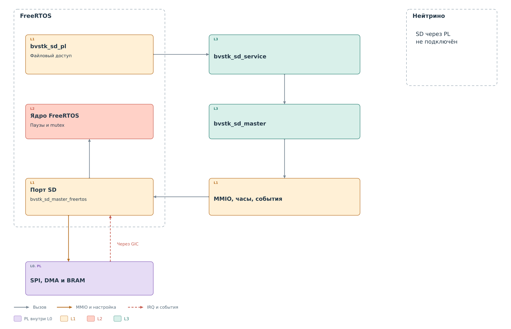
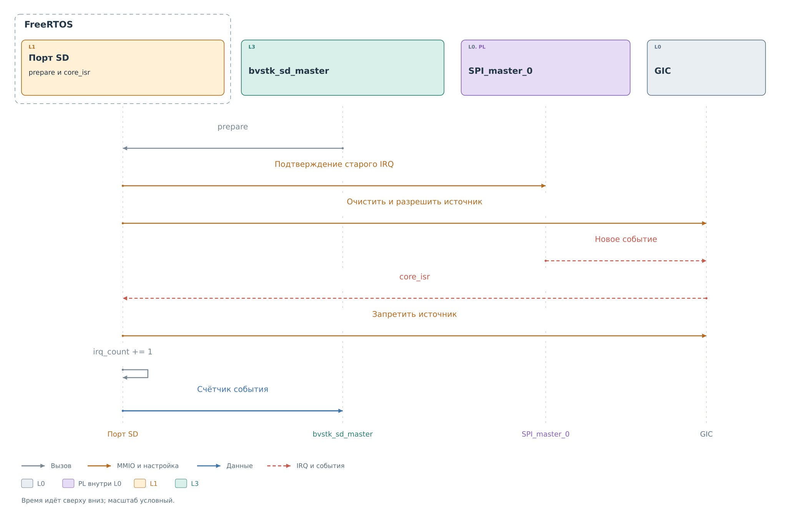

# Исполнение SPI и SD в ОС

Общий `bvstk_sd_master` описывает команду и проверки результата.
Общий `bvstk_sd_service` задаёт порядок операций с картой.
Действующее подключение к аппаратуре выполняет
`bvstk_sd_master_freertos`. Порт этого пути для Нейтрино
в рабочую среду не включён.

*Рисунок 1. Общий код SD и порт ОС.*

## Память и запуск

Порт получает адреса SPI master, `axi_dma_0`, BRAM и номер IRQ
из параметров XSA. Он отображает регистры и буферы как память
устройств и использует барьеры после аппаратных записей.
В этом пути DMA работает с BRAM банка 0. Передача владения
строками кэша DDR между CPU и DMA здесь не требуется.

Стартовая задача создаёт mutex, подключает обработчик к общему GIC,
открывает драйвер и связывает с ним сервис. После этого задача
завершается. Само создание сервиса ещё не инициализирует карту:
начальную последовательность вызывает клиент либо файловый порт.

## Учёт IRQ

*Рисунок 2. Учёт аппаратного события SD.*

Перед командой `prepare` запрещает источник GIC, подтверждает
старый IRQ в ядре, сбрасывает программный счётчик и накопленное
состояние GIC. Затем источник снова разрешается. Благодаря этому
проверяется событие новой операции.

Обработчик `core_isr` запрещает источник и увеличивает счётчик.
Уровневый IRQ не вызывает бесконечную цепочку повторных входов.
Разбор ответа, контроль DMA и CRC остаются в контексте вызывающей
задачи. Она опрашивает состояние с паузой через `vTaskDelay`;
порт гарантирует как минимум один тик при ненулевой паузе.

В этой схеме IRQ не переносит данные и не завершает вызов сам.
Он является одним из условий, которые общий драйвер сопоставляет
с памятью и состоянием DMA.

## Владение аппаратурой

Mutex сервиса удерживается на протяжении полной операции,
включая перечитывание после записи. Он защищает общие буферы
и последовательность команд. Драйвер и регистры master должны
иметь единственного программного владельца.

Общие платформенные средства Нейтрино сами по себе не создают
такого подключения. В текущей сборке отсутствуют экземпляр
данного SD-сервиса и адаптер его событий к ядру ОС. Доступный
в Нейтрино путь к SD через периферию PS относится к другому
контроллеру и не проходит через рассматриваемый SPI master.
