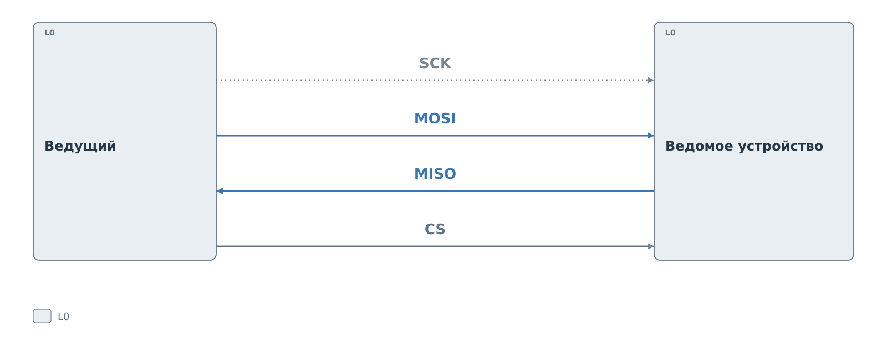
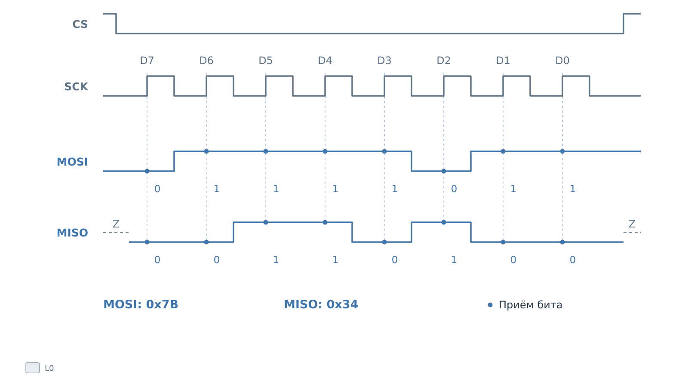

# Протокол SPI

Рассмотрим SPI с одним ведущим, отдельными линиями передачи и приёма
и выбором устройства активным нулём. Особенности SD и ядер BVSTK
описаны в [главе о подсистеме](../spi.md).

## Линии и участники

Ведущий формирует тактовый сигнал **SCK** и выбирает устройство
линией **CS**. Данные идут одновременно в двух направлениях:
**MOSI** от ведущего к ведомому, **MISO** обратно.

*Рисунок 1. SPI: линии и участники.*

В показанном подключении устройство выбрано, пока CS равен нулю.
Остальные устройства могут использовать общие SCK, MOSI и MISO,
но каждому нужен свой CS. Невыбранные участники должны отпускать
MISO, чтобы их выходы не мешали выбранному передатчику. Участникам
также нужна общая земля.

## Передача байта

Один такт позволяет передать по одному биту в каждом направлении.
Если оба участника обмениваются восьмибитными словами, за восемь
тактов ведущий отправит байт и одновременно получит другой.

*Рисунок 2. SPI: два байта за восемь тактов.*

На рисунке старший бит идёт первым. Точки отмечают момент приёма:
в режиме 0 это подъём SCK. Между моментами приёма передатчик готовит
следующий бит. Первый бит должен быть выставлен ещё до первого
подъёма SCK. Обозначение Z у MISO означает отключённый выход.

CS удерживается активным на протяжении всей транзакции. В неё может
входить несколько слов: отпускать CS после каждого байта не требуется.
Длину слова, порядок битов и допустимые паузы задаёт устройство.
Временные диаграммы здесь условные: длительности импульсов и запасы до фронта
не показаны в масштабе.

## Режимы тактирования

Передатчик должен успеть установить бит до того, как приёмник его
прочитает. Поэтому участники заранее согласуют режим тактирования.
**CPOL** задаёт уровень SCK в покое. **CPHA** определяет, на каком
из двух фронтов такта принимается бит: на первом при CPHA = 0,
на втором при CPHA = 1.

*Рисунок 3. SPI: четыре режима тактирования.*

Например, при CPOL = 1 первым будет спад, поэтому режим 2 принимает
данные по спаду, а режим 3 — по подъёму. Смена очередного бита
приходится на противоположный фронт. Это относится к обоим
направлениям передачи.

Первый фронт означает уход SCK от уровня покоя, второй — возврат
к нему. Поэтому указания «читать на первом фронте» и «читать по
подъёму» совпадают только при определённом CPOL. При CPHA = 0
первый бит готовится до начала тактов; при CPHA = 1 первый фронт
используется для его выдачи, второй — для приёма. Ошибка режима
может привести к выборке именно в момент смены данных.

Режим выбирают по документации устройства. Конкретное ядро может
поддерживать только часть показанных вариантов.

## Команды чтения и записи

SPI сам по себе не задаёт код команды и формат адреса регистра.
Рассмотрим условное устройство, которому нужны байт команды, байт
адреса и байт значения. Обозначения WRITE и READ на рисунке заменяют
конкретные коды из документации такого устройства.

*Рисунок 4. SPI: чтение и запись регистра.*

Запись проходит за три байта: WRITE, адрес `0x10`, значение `0x7B`.
Байты, одновременно поступившие по MISO, в этом примере не используются.
После последнего бита ведущий снимает CS.

Чтение начинается с READ и того же адреса. Чтобы получить `0x34`,
ведущий выдаёт ещё восемь тактов. Его передающий тракт при этом
отправляет **байт-заполнитель**. Допустимое значение заполнителя
определяет устройство.

Пока по MOSI уходили READ и адрес, по MISO тоже принимались биты.
В нашем примере они ещё не являются значением регистра. Полезный
байт находится только в третьей позиции принятой последовательности.
Программе нужно знать эту границу, чтобы отделить ответ от данных,
полученных во время передачи команды.

Если после адреса просто ждать, новые биты по MISO не появятся:
такты формирует ведущий. Байт-заполнитель обеспечивает восемь тактов
для ответа, хотя его собственное содержимое не несёт команды.
При чтении нескольких байтов ведущий продолжает передачу заполнителей
столько, сколько нужно для получения ответа.

У другого устройства адрес может быть длиннее, команда может включать
бит направления, а перед ответом могут потребоваться дополнительные
такты ожидания. Общего для SPI подтверждения ACK тоже нет: способ
проверки результата задаёт протокол устройства.

В [подсистеме SPI и SD](../spi.md) передачу команды и приём ответа
обслуживают программа, ядро PL и DMA.
