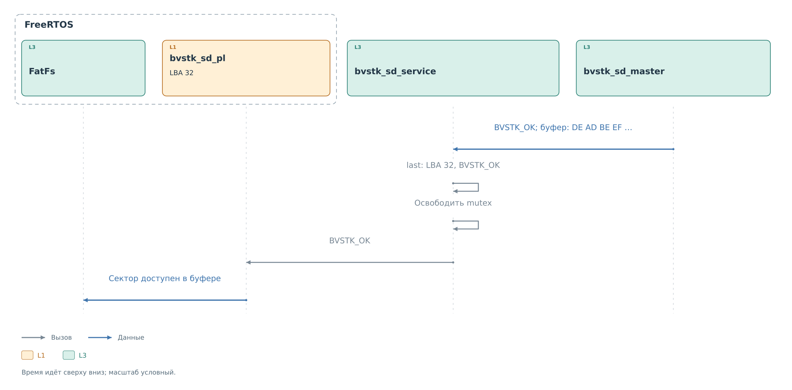
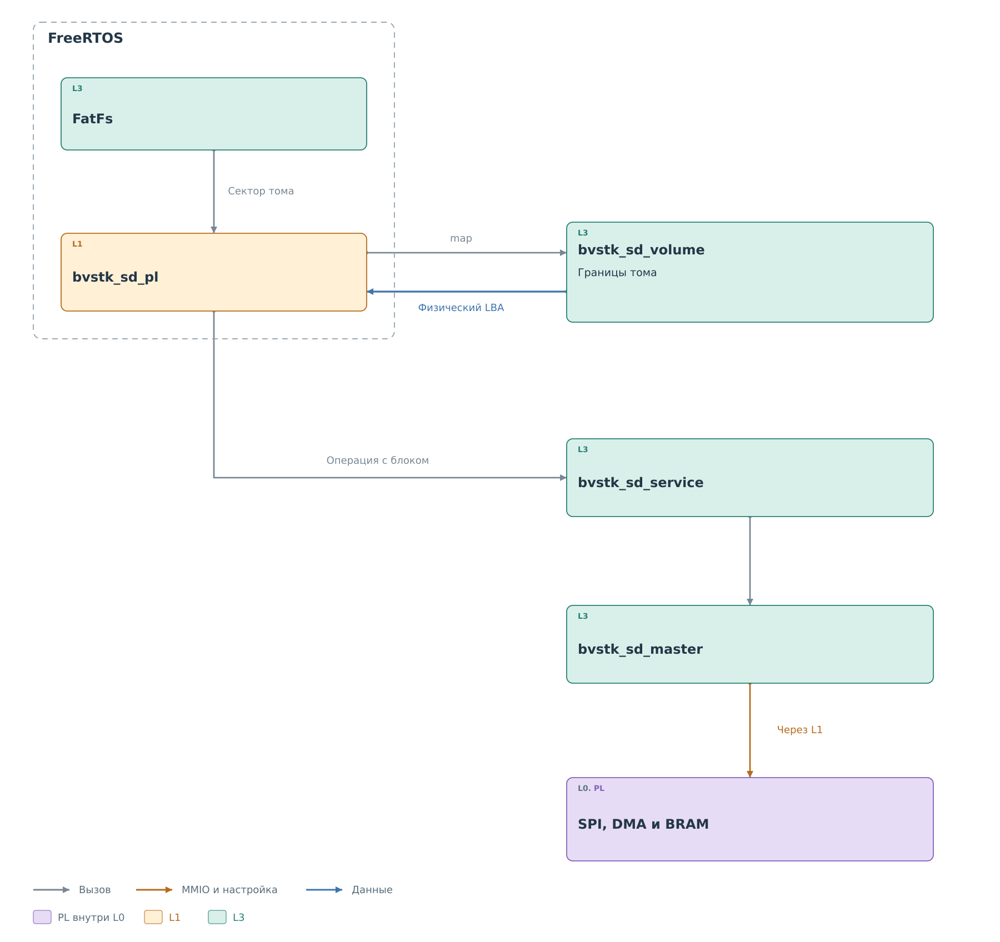
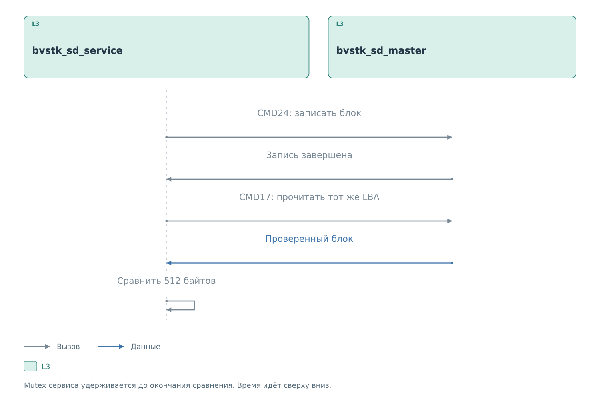

# Сервис SD через SPI

[Ведущий драйвер](../drivers/master.md#завершение-и-проверка)
завершил CMD17 для LBA 32. CRC16, длина и аппаратные признаки
проверены; в буфере вызывающего кода находятся 512 байтов,
начиная с `DE AD BE EF`. `bvstk_sd_service` получает результат
того же вызова, который начался запросом файлового порта.

## Завершение чтения

*Рисунок 1. Завершение чтения LBA 32.*

В `bvstk_sd_service_disk_read` всё ещё удерживается mutex сервиса.
Номер блока не извлекается из ответа карты: `lba = 32` сохранён
в контексте операции до запуска CMD17. Поэтому сервис связывает
принятые байты с правильным запросом даже при отсутствии номера
блока в самом ответе SD.

`finish` записывает `BVSTK_OK` в отчёт, сохраняет его в `info.last`
и освобождает mutex. Признак готовности карты остаётся установленным.
Сектор уже записан драйвером в переданный буфер; дополнительного
копирования 512 байтов внутри сервиса нет.

Управление возвращается в `bvstk_sd_pl`, затем файловому слою.
Его запрос получил сектор с теми же первыми байтами `DE AD BE EF`,
которые появились на MISO. На этом путь данных одного CMD17 закончен.

При ошибке MMIO, DMA, CRC или истечении ожидания `finish` сохраняет
ошибочный отчёт и снимает `ready`. Файловый порт также прекращает
работу своего пути доступа. Неудачное чтение не выдаётся как
успешный сектор, а последующая операция требует восстановления
готовности карты.

## Начало операции

До кадра на шине тот же сервис получил физический LBA 32
от `bvstk_sd_pl`. Порт предварительно проверил границы выбранного
тома и преобразовал его логический сектор в адрес карты.
`begin` захватил mutex, проверил файловое владение и готовность.
`transfer` сохранил LBA и передал CMD17 драйверу.

Для блочной адресации аргумент команды равен `0x00000020`.
Драйвер подготовил приём S2MM до запуска передачи команды через MM2S.
Эта подготовка объясняет, почему принятый ответ попал в ожидаемый
буфер, а проверка результата относится именно к нашему запросу.

В основном примере используется действующий файловый путь FreeRTOS.
Прямой `bvstk_sd_service_read` выполняет ту же операцию с блоком,
но допускается, пока карта не принадлежит файловому слою.

Вызовы синхронные и выполняются из задачи или потока. Контексты
драйвера, часов и mutex должны существовать до остановки сервиса.
Предел ожидания mutex — 1000 мс, отдельной команды — 5000 мс,
подготовительной инициализации — 20000 мс. Сложная операция складывается
из нескольких таких ожиданий. Например, запись с проверкой не имеет
единого пятисекундного предела на запись, подготовку и повторное чтение.
Программный тайм-аут не прерывает зависшую физическую транзакцию AXI.

## Участники файлового доступа

*Рисунок 2. Обработка обращения к сектору SD.*

Во FreeRTOS файловый слой передаёт запрос в `bvstk_sd_pl`.
Этот порт знает выбранный том и переводит его логический сектор
в физический LBA карты. `bvstk_sd_service` выполняет операцию
с одним блоком, а `bvstk_sd_master` обеспечивает её аппаратную часть.

Сервис и `bvstk_sd_volume` — общий код. Подключение к FatFs,
запуск и аппаратные события относятся к порту FreeRTOS.
Прямые команды консоли обращаются к сервису, пока карта
не передана файловому слою.

## Готовность и адресация

После создания сервис ещё не считает карту готовой. Инициализация
получает OCR и определяет способ адресации. Для SDHC и SDXC
аргумент CMD17 или CMD24 равен LBA. Для SDSC требуется байтовый
адрес `LBA × 512` и установка длины блока CMD16.

Текущий порт включает `reinitialize_between_commands`.
После уже выполненной команды сервис предварительно повторяет
аппаратную инициализацию перед следующей. Это учёт поведения
используемой конфигурации: следующая операция подготавливается
до её запуска. Ошибочная запись не повторяется автоматически.

После такой подготовки OCR должен совпасть с сохранённым.
Изменение OCR требует явной новой инициализации. Для этого режима
сервис также отклоняет SDSC; действующий путь опирается на блочную
адресацию карты. Эти ограничения относятся к данной рабочей
конфигурации, а не ко всем возможным SPI-контроллерам.

Совпадение OCR не идентифицирует карту: разные носители могут иметь
одинаковое значение. Оно не делает горячую замену безопасной.

## Запись с проверкой

*Рисунок 3. Проверка записанного блока.*

Для записи сервис сначала выполняет CMD24. Если команда завершилась,
он читает тот же LBA через CMD17 и сравнивает все 512 байтов
с исходным блоком. Mutex удерживается на протяжении обоих обменов
и сравнения. Другой клиент сервиса не может вклинить команду
между записью и проверкой.

При расхождении сохраняется смещение первого отличающегося байта,
операция завершается ошибкой, готовность карты снимается.
Если чтение после записи не удалось, запись уже могла изменить
носитель. Ошибка проверки не откатывает физическое содержимое.

В отчёте отдельно сохраняются результаты отправки и последующей
проверки. Это позволяет отличить отказ CMD24 от ошибки DMA,
CRC или несовпадения прочитанных данных.

## Том и владение картой

Файловый порт вызывает `disk_claim`, после чего сервис допускает
файловые операции и отклоняет прямые команды к карте как занятой.
Так файловые структуры защищены от одновременного обходного доступа.
Признак владения устанавливается до инициализации; неудачная
подготовка не отдаёт карту автоматически прямым командам.

`bvstk_sd_volume_probe` читает сектор 0. Если в нём допустимый
загрузочный сектор FAT, том начинается с нуля. Иначе проверяются
основные записи MBR и загрузочный сектор подходящего раздела.
Из них получаются начало тома, число секторов и разрядность FAT.

Перед передачей сектора в сервис `bvstk_sd_volume_map` проверяет
диапазон и прибавляет начало тома. Благодаря этому логический
сектор 0 файлового слоя соответствует началу выбранного тома.
MBR и соседние разделы не входят в доступный ему диапазон записи.

Многосекторный запрос выполняется серией одноблочных операций.
При ошибке обработка останавливается. Уже завершённые записи
остаются на карте; весь запрос не образует одну атомарную транзакцию.
Файловый порт после ошибки снимает собственную готовность
и требует перезапуска своего пути доступа.

## Буферы и правила доступа

На этом пути нет программного кэша регистров, из которого
ведомое ядро отвечало бы внешнему ведущему. Буферы BRAM принадлежат
текущему переносу. Массив, используемый для перечитывания сектора,
нужен для проверки записи и не служит долговременной копией карты.
У файловой системы может быть собственное буферизованное состояние.

Правила доступа здесь задаются владельцем карты, границами тома
и состоянием готовности. Списков разрешённых пар регистра
и значения, как в MDIO, SD-сервис не применяет. Запись становится
успешной после аппаратной проверки и сравнения с повторным чтением.

Практическая работа с файловым томом описана в
[руководстве PL SD](../../../../operations/sd-pl.md).

Продолжение общего описания: [файлы и носители](../../../storage/storage.md).
