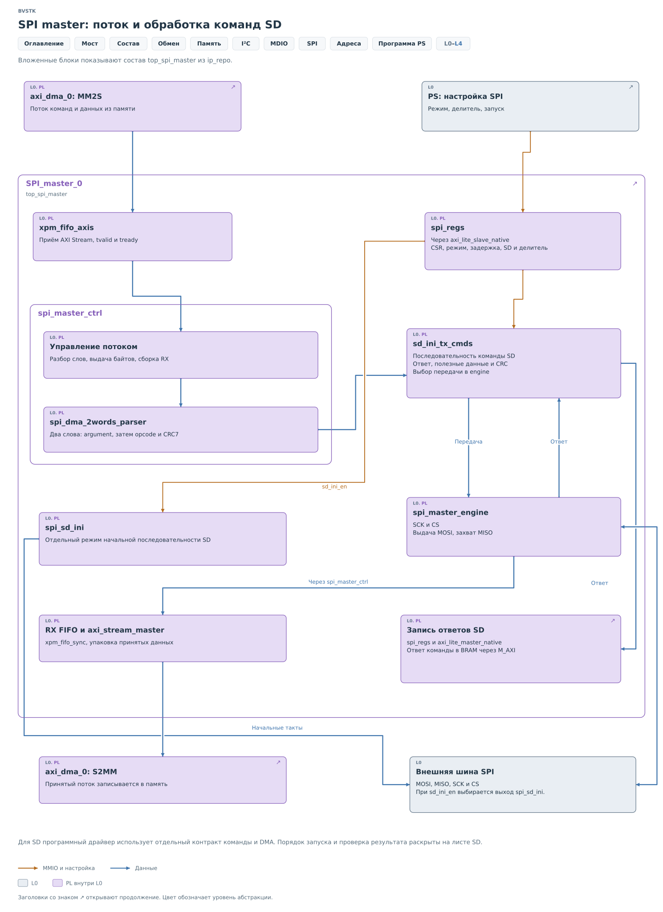
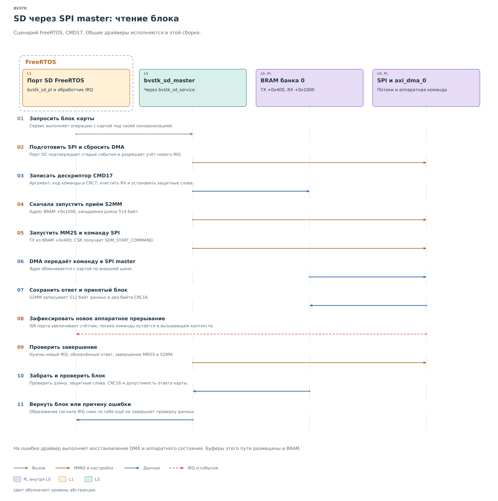
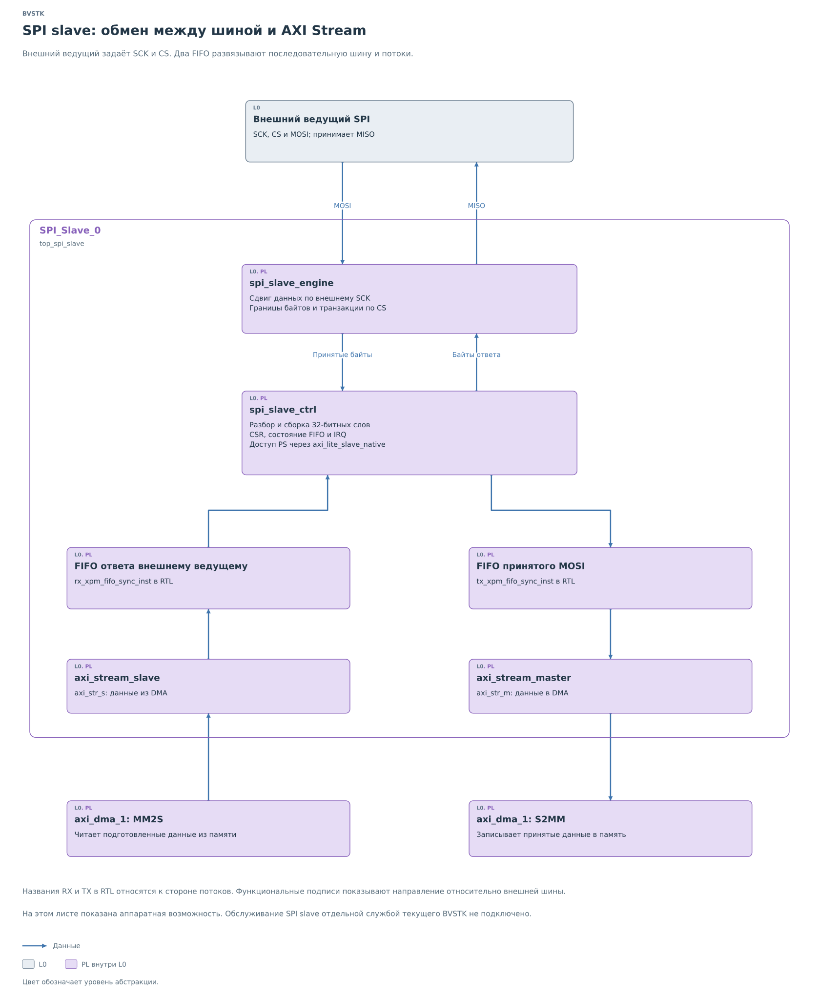

# SPI и SD

В действующей сборке BVSTK SPI master обслуживает внешнюю карту SD
через `bvstk_sd_service` и `bvstk_sd_master`. Обычный SPI-сервис
выключен в профиле AX7020; политика устройств SPI в эту рабочую
среду не подключена. Общий интерфейс шины описан в
[главе о протоколе](protocol/protocol.md).

Основная единица данных здесь — блок карты. Процессор готовит
команду и буферы, аппаратура переносит поток, затем драйвер решает,
можно ли передать полученный блок файловому слою.

## Потоки и память

*Рисунок 1. Подсистема SPI: потоки, DMA и память.*

Канал **MM2S** читает память и передаёт поток ядру. Канал **S2MM**
записывает принимаемый поток в память. `SPI_master_0` связан
с `axi_dma_0`, `SPI_Slave_0` — с `axi_dma_1`.

Оба DMA имеют доступ к двум банкам BRAM; через `S_AXI_HP0` также
существует путь к DDR и нижней OCM. Текущий драйвер SD использует
банк 0 BRAM. Процессор задаёт области переноса, после чего DMA
работает без программного копирования каждого элемента потока.

Банки отображены по адресам `0x44000000` и `0x46000000`, каждому
выделено окно 8 КиБ. DMA работают без scatter-gather: для каждого
переноса программа задаёт отдельный непрерывный буфер и его длину.

## Ведущее ядро

*Рисунок 2. SPI master: поток и обработка команд SD.*

`spi_master_ctrl` передаёт байты автомату шины. Тот формирует SCK
и CS, выдаёт MOSI и принимает MISO. В режиме SD модуль
`spi_dma_2words_parser` принимает два слова: сначала аргумент,
затем код команды и CRC7. `sd_ini_tx_cmds` обслуживает обмен.
Начальную последовательность карты выполняет `spi_sd_ini`;
сигнал `sd_ini_en` переключает внешние выходы на этот модуль.

У ответа два аппаратных пути. Ответ команды записывается в BRAM
через ведущий порт AXI ядра. Блок данных проходит через поток
и S2MM. Эти части операции завершаются независимо.

## Чтение блока SD

Пусть файловому слою FreeRTOS нужен один блок с карты PL SD.
Блочный сервис передаёт запрос драйверу, который готовит CMD17.

*Рисунок 3. SD через SPI master: чтение блока.*

Перед новым обменом драйвер сбрасывает DMA, подготавливает учёт
событий и помещает в область ответа команды контрольное значение.
Позднее его изменение позволит отличить новую публикацию ядра
от содержимого, оставшегося после предыдущего вызова.

В передающей области BRAM по смещению `+0x400` размещается
дескриптор CMD17. Приёмная область `+0x1000` предназначена
для 512 байтов данных и двух байтов
CRC16. Рядом с буферами устанавливаются защитные слова. Они нужны
для обнаружения изменения памяти за ожидаемыми границами переноса.

Первым запускается S2MM. Драйвер задаёт ему адрес приёмного буфера
и длину 514 байтов. Затем запускает MM2S с подготовленной командой
и передаёт команду старта ядру SPI. К появлению потока от карты
приёмный путь уже должен быть готов.

Завершение MM2S означает, что передающие данные доставлены ядру.
Карта в этот момент ещё может обрабатывать команду. Завершение
S2MM означает окончание приёмного переноса, но само по себе
не подтверждает правильность содержимого. Поэтому драйвер ждёт
совокупность событий: новый IRQ, изменение области ответа команды
и завершение обоих каналов DMA. Ошибка любого канала прерывает
ожидание.

После этого начинается проверка полученного блока. Драйвер проверяет
защитные слова и длину переноса, извлекает данные из BRAM и вычисляет
CRC16 по 512 полезным байтам. Вычисленная сумма сравнивается с двумя
принятыми байтами CRC. Отдельно оценивается ответ команды с учётом
выбранного аппаратного режима. Наличие нужного количества байтов
без этих проверок ещё не даёт успешного результата.

Только после всех проверок 512 байтов копируются в буфер вызывающей
стороны. CRC и аппаратные служебные слова файловому слою не передаются.
При ошибке драйвер останавливает перенос и восстанавливает DMA
и состояние ядра; частично полученный блок не возвращается как
успешное чтение.

Таким образом, в памяти может уже находиться весь блок, пока вызов
ещё не завершён. Разрешение использовать его выдаёт драйвер после
сопоставления аппаратного завершения, ответа карты и целостности
данных. Это тот же принцип публикации, что применялся к результату
I²C, с дополнительными условиями для потокового переноса.

## Ведомое ядро

*Рисунок 4. SPI slave: обмен между шиной и AXI Stream.*

Аппаратный SPI slave принимает MOSI по внешним SCK и CS, передаёт
байты через FIFO в S2MM и выдаёт по MISO ответ, заранее доставленный
из памяти через MM2S. В текущем BVSTK служба обслуживания этой
стороны не подключена. В чтении карты SD она не участвует.

Внутри ядра `spi_slave_ctrl` собирает принятые байты в 32-битные
слова и разбирает слова ответа на байты. Имена FIFO в RTL даны
относительно потокового интерфейса: RX принимает данные из DMA
для ответа по MISO, TX передаёт принятые по MOSI данные в DMA.

Практическая работа с файловым томом описана в
[руководстве PL SD](../../../operations/sd-pl-prototype.md).
