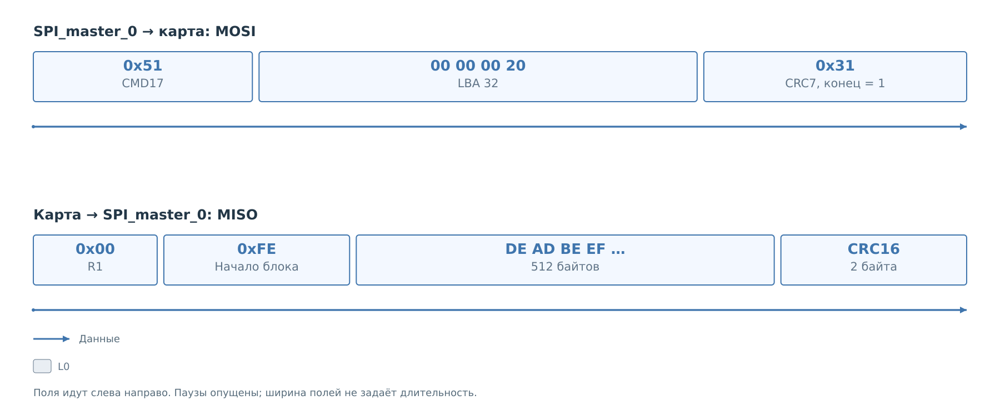
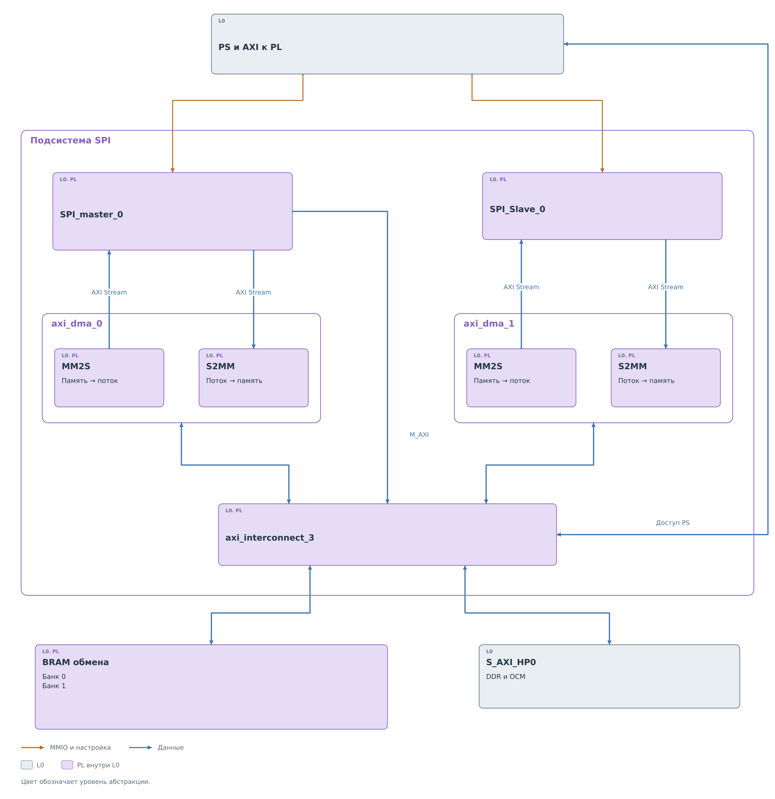

# SPI и SD

Проследим чтение одного блока SD через действующий путь BVSTK.
Для примера файловый порт `bvstk_sd_pl` запросил физический LBA 32
после проверки границ тома. Карта инициализирована и использует
блочную адресацию. Её первые четыре байта в этом секторе —
`DE AD BE EF`; всего в блоке 512 байтов. Адрес и содержимое условные,
порядок обработки соответствует коду проекта.

## Транзакция на шине

*Рисунок 1. Чтение блока SD с LBA 32.*

Команду начинает BVSTK. Файловый порт вызывает `bvstk_sd_service_disk_read`,
сервис передаёт CMD17 ведущему драйверу, а тот запускает
`SPI_master_0` и `axi_dma_0`. На MOSI появляются байт `0x51`,
аргумент `0x00000020` и CRC7 с завершающим битом.

Карта отвечает на MISO: `R1 = 0x00`, затем после возможной паузы
маркер `0xFE`, 512 байтов и два байта CRC16. Именно этот принятый
ответ будем отслеживать дальше. Общие линии и тактирование описаны
в [главе о протоколе SPI](protocol/protocol.md).

## Обработка принятого блока

1. [Ведущее ядро](cores/master.md#приём-блока) отделяет ответ команды
   и маркер от данных. Блок с CRC проходит через AXI Stream и S2MM
   в BRAM по смещению `+0x1000`.
2. [Драйвер](drivers/master.md#получение-блока) сопоставляет IRQ,
   ответ команды и завершение DMA. После проверки длины, границ
   и CRC16 в буфере вызывающей стороны остаются 512 полезных байтов.
3. [Сервис](services/services.md#завершение-чтения) сохраняет результат
   операции с LBA 32, освобождает mutex и возвращает управление
   файловому порту. Тот завершает запрос к сектору.

Байты `DE AD BE EF` на следующих рисунках относятся к тому же блоку.
Его номер хранится в контексте программного вызова: ответ SD
не повторяет LBA рядом с передаваемыми данными.

## Состав подсистемы

*Рисунок 2. Потоки SPI и память обмена.*

`SPI_master_0` связан с `axi_dma_0`, `SPI_Slave_0` — с `axi_dma_1`.
MM2S читает память и подаёт поток ядру, S2MM сохраняет принятый поток
в память. У каждого ядра свои внешние линии. В нашем чтении
используются master и DMA 0.

Оба DMA имеют доступ к банкам BRAM по адресам `0x44000000`
и `0x46000000`, по 8 КиБ на банк. Через `S_AXI_HP0` также доступна
DDR и нижняя OCM. Текущий драйвер SD размещает буферы в BRAM банка 0;
переносы используют непрерывную область и длину без scatter-gather.

Общие `bvstk_sd_master` и `bvstk_sd_service` подключены портом
FreeRTOS. В Нейтрино этот путь через PL не запущен.
Обслуживание [SPI slave](drivers/slave.md) в PS отсутствует;
это ядро не принимает ответ рассматриваемой SD-карты.

## Другие операции

Инициализация объяснена в [ядре](cores/master.md#подготовка-карты)
и [драйвере](drivers/master.md#инициализация). Запись CMD24
завершается [перечитыванием и сравнением](services/services.md#запись-с-проверкой).
Работа с томом описана в [сервисе](services/services.md#том-и-владение-картой)
и [руководстве PL SD](../../../operations/sd-pl-prototype.md).
