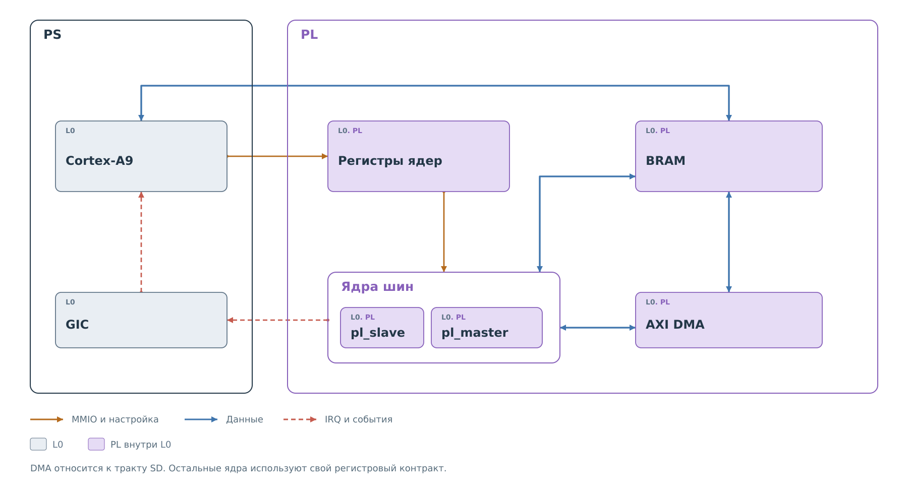
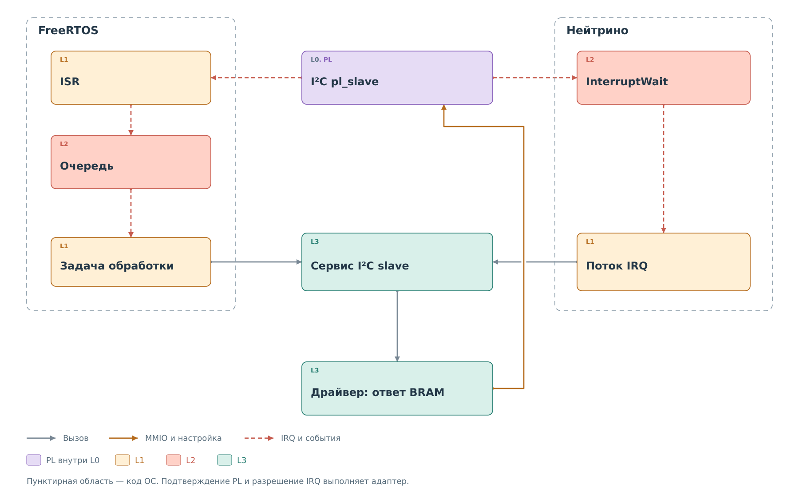

# Доступ к аппаратуре и ОС

Драйвер описывает последовательность действий с ядром PL: записать
команду, дождаться завершения, забрать данные. Он использует интерфейсы
L1 для MMIO, времени и блокировки. Реализацию этих интерфейсов выбирает
порт ОС. Через него драйвер обращается к аппаратуре L0 и средствам ядра L2.

## MMIO и память обмена

*Рисунок 1. Управление регистрами, обмен через BRAM и передача через DMA.*

Для процессора регистры PL и доступная ему BRAM находятся в адресном
пространстве. Драйвер открывает окно с физической базой и размером,
затем читает и записывает слова по смещениям. Порт проверяет границы
и выравнивание. Значение бита `START`, порядок публикации данных и
условие готовности определяются контрактом конкретного ядра.

Во FreeRTOS доступ выполняется средствами BSP. В Нейтрино физическая
область отображается в адресное пространство процесса без кэширования.
Полученный указатель принадлежит процессу; передать его клиенту через
IPC как общий аппаратный адрес нельзя.

BRAM обмена и программный кэш имеют разное назначение. BRAM связывает
автоматы PL с драйвером. Кэш сервиса хранит значение регистра вместе
с достоверностью, происхождением и временем обновления. Для ответа
ведомого ядра программа переносит нужное значение в формат BRAM.
В тракте SD добавляется DMA: данные идут между потоком PL и доступными PS буферами BRAM,
а драйвер проверяет завершение и целостность всего блока.

## Ожидание IRQ

*Рисунок 2. Системные адаптеры вызывают общий сервис из допустимого контекста.*

Во FreeRTOS короткий ISR захватывает событие и передаёт его задаче.
Обработка политики и обращение к физическому ведомому выполняются
уже в задаче. В Нейтрино ядро будит поток, ожидающий `InterruptWait`;
после обработки поток разрешает следующий IRQ. Снятие причины
в PL и разрешение прерывания в ОС — разные операции.

Рисунок относится к ведомому I²C. Наличие аппаратного IRQ у другого
ядра не означает, что его программный путь устроен так же: действующий
MDIO-worker опрашивает состояние. Последовательности конкретных
ядер разобраны в [подсистемах PL](../pl-subsystem/pl-subsystem.md).

## Время и блокировки

Общий код получает часы и mutex как таблицы функций с контекстом.
Он может ждать завершения операции, не включая заголовки ОС. При этом
пределы ожидания зависят от порта: FreeRTOS переводит миллисекунды в тики,
а текущий mutex Нейтрино использует `pthread_mutex_lock` без ограничения
по переданному `timeout_ms`.

Поэтому число в параметре тайм-аута нельзя автоматически считать пределом
всего внешнего запроса. В нём могут последовательно участвовать ожидание
блокировки, аппаратная операция и восстановление.

Следующая глава описывает [конфигурацию сервисов](../configuration/configuration.md).
