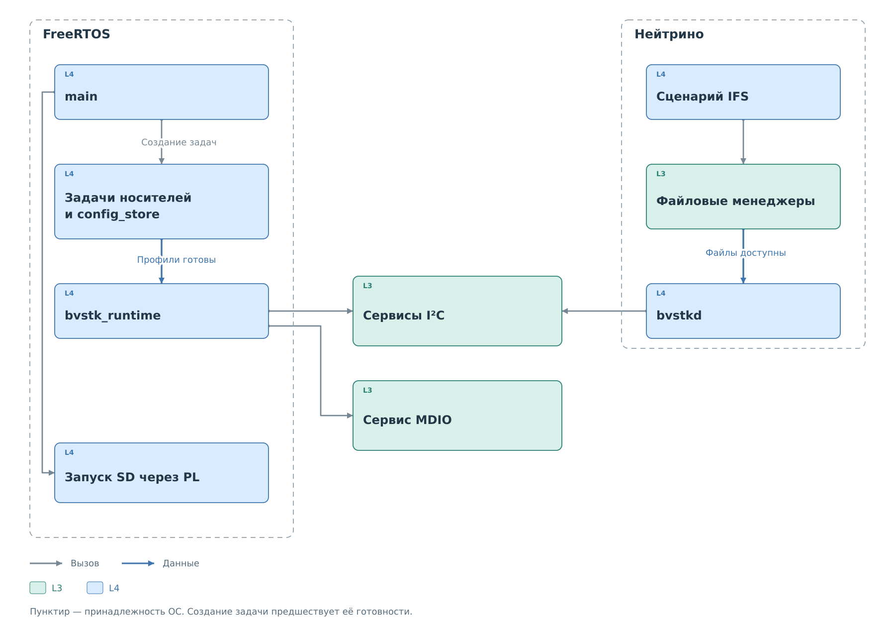

# Запуск и рабочая среда

Архитектурные карты показывают модули, но сами по себе модули ещё не
образуют работающую подсистему. Приложение создаёт экземпляры драйверов,
передаёт им средства ОС, загружает устройства и запускает обработку
запросов. Этот набор объектов и задач далее называется рабочей средой.

## Порядок запуска

*Рисунок 1. Подготовка среды и подключение общих сервисов.*

Во FreeRTOS `main()` создаёт задачи носителей, загрузчика конфигурации,
сети и внешних интерфейсов, затем передаёт управление планировщику.
Порядок вызовов `start_*` задаёт создание задач. Готовность файловой
системы или шины наступает позже, когда соответствующая задача завершит
инициализацию. Поэтому ответ HTTP-сервера ещё не означает готовность I²C.

Задача `bvstk_runtime` ожидает загрузчик конфигурации. Получив список
устройств, она связывает драйверы с mutex и часами, создаёт сервисы,
подключает кэш и приёмник событий. После запуска постоянных работников
задача инициализации удаляется; созданные объекты продолжают жить.
Ведомый I²C обслуживается через IRQ, MDIO — периодическим работником.
SD через PL имеет отдельный путь запуска и владельца аппаратуры.

В Нейтрино ОС и её файловые менеджеры уже работают к моменту запуска
`bvstkd`. Процесс создаёт общий каталог кэша и журналы наблюдений,
затем независимо загружает наборы профилей I²C и MDIO, создаёт общие
сервисы и поток обработки IRQ I²C. Каждая шина получает
собственный фоновый поток: I²C проверяет присутствие и выполняет
`profile.acquisition`; MDIO обслуживает почтовые ящики ведомого,
проверяет ID PHY и выполняет autopoll либо acquisition по профилю.
Потоки выполняют ограниченный шаг и уступают управление на 10 мс;
проверка присутствия I²C выбирает одно устройство каждые 250 мс.
Затем процесс подключает менеджер ресурсов I²C и принимает DCP2-соединения.
Пассивный менеджер `/dev/bvstk-observe` выдаёт снимки журналов,
DCP2 CACHE использует общий каталог и доставляет подписки независимо
от новых клиентских запросов.
Отказ загрузки или запуска одной шины не завершает сервер и не отключает
соседнюю подсистему. Клиентская программа
обращается к этому процессу; собственный экземпляр драйвера ей не нужен.
Подробный состав обеих целей приведён в [вариантах сборки](../architecture/variants.md).

## Владение состоянием

У драйвера есть состояние текущей аппаратной операции. У сервиса —
список устройств, политика и кэш. У порта — mutex, очередь или поток
ожидания. Приложение хранит эти объекты и соединяет их указателями.
Копирование таблицы вызовов не продлевает жизнь объекта, на который
указывает её `context`.

Один и тот же сервис получает запросы от разных входов. Например,
запись I²C из консоли и обработка записи внешнего ведущего должны
согласовываться с одной рабочей конфигурацией. Если каждый интерфейс
создаст свою копию сервиса, политики и кэш разойдутся. Поэтому обработчики
FreeRTOS получают экземпляры через `bvstk_runtime`, а программы Нейтрино
обращаются к владельцу через его интерфейсы.

Блокировки нужны на разных границах. Mutex драйвера защищает целую
транзакцию от второго пользователя аппаратуры. Блокировка сервиса
защищает его конфигурацию и состояние. Короткая защита журнала
обеспечивает целостность записи события. Эти участки имеют разную
длительность и не заменяют друг друга.

## Границы управления и синхронизации

`bvstk_control_api` предоставляет RAM-only применение и снимок конфигурации
I²C с метаданными профиля. Захват действительных записей кэша включается
вызывающей операцией: консольное I²C save использует его, сохранение политики
DCP2 — нет. API не выполняет файловый ввод-вывод. Внешний интерфейс сначала
проверяет запрос, затем вызывает сервис и синхронизирует рабочую модель.
Запись профиля остаётся отдельным действием владельца.

Во FreeRTOS снимок сервиса и изменение RAM-хранилища выполняются под одной
критической секцией. Файловое сохранение начинается после её завершения.
В Нейтрино у каждой шины собственный `state_mutex`. Он сериализует
команды, DCP2 и фоновые операции; у I²C также обработку ведомого IRQ.
Фоновый поток использует trylock и пропускает занятый шаг. MDIO дополнительно
использует mutex сервиса; аппаратная операция защищена mutex драйвера.
DCP2 POLICY берёт блокировки в порядке I²C, затем MDIO;
сетевое чтение и отправка ответа выполняются вне этих блокировок.
Функции с суффиксом `_locked` требуют блокировку состояния нужной шины
от вызывающего кода. Явный SAVE Нейтрино сериализуется тем же
владельцем; короткие защиты кэша не должны включать аппаратный или файловый
обмен. Смена профиля и копирование политики не создают новые драйверы.

В Нейтрино за состоянием шины следует короткая защита каталога,
а публикация событий использует отдельный mutex журнала. Копирование
каталога и журнала не вызывает аппаратный обмен. Локальный запрос с именем
устройства предварительно разрешает фильтр под блокировкой состояния шины.
Ввод-вывод, форматирование и передача выполняются после копирования.
Mutex каталога рекурсивный, с наследованием приоритета; это позволяет
публиковать изменения из синхронного cache sink. Остановленный провайдер
удаляется из каталога, и прежняя подписка требует нового снимка.

DCP2 MEM обеих ОС вызывает общий обработчик через `bvstk_memory_t`.
Его `check` проверяет полный диапазон без отображения памяти и I/O.
Последующие аппаратные обращения и разрешённые области определяет порт.
Кэш отображений Нейтрино принадлежит процессу; доступ к нему сериализует
владелец DCP2. Прямой MEM остаётся диагностической операцией вне политики
регистровых сервисов.

## Готовность и остановка

Готовность экземпляра сообщает, что он создан и подключён. Присутствие
ведомого устройства устанавливается отдельным обменом. Профиль в списке,
доступное окно MMIO и сохранённое значение в кэше не доказывают, что
устройство отвечает на шине.

При освобождении среды сначала прекращают новые обращения и работу
обработчиков, затем завершают текущие операции. Только после этого можно
закрыть MMIO и уничтожить объекты ОС. Иначе отложенный IRQ или внешний
запрос обратится к уже освобождённому состоянию.

Далее [платформенный слой](../platform/platform.md) раскрывает аппаратный
доступ и ожидания. [Конфигурация](../configuration/configuration.md)
объясняет, откуда сервис получает правила обработки запросов.
