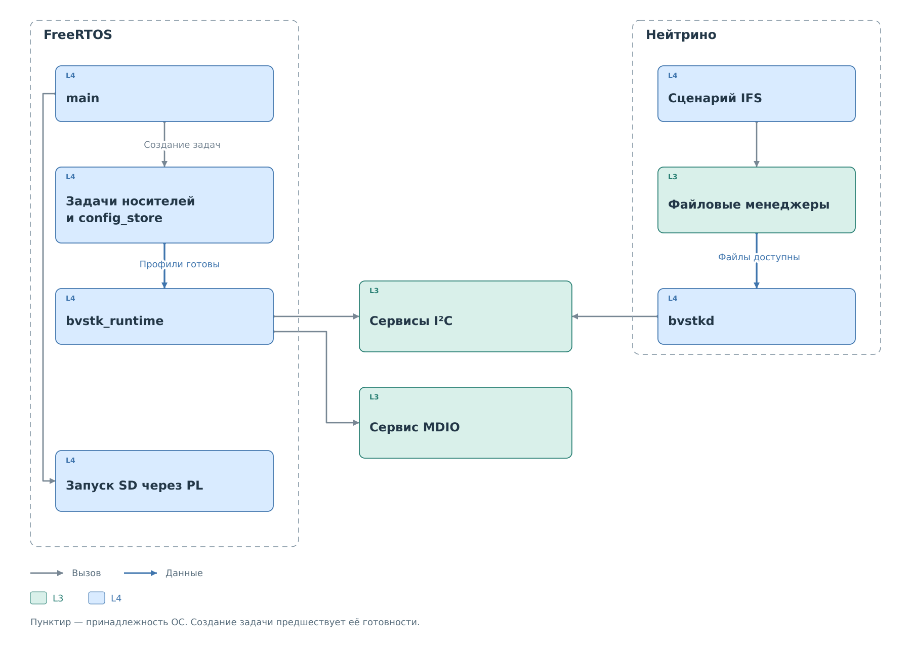

# Запуск и рабочая среда

Архитектурные карты показывают модули, но сами по себе модули ещё не
образуют работающую подсистему. Приложение создаёт экземпляры драйверов,
передаёт им средства ОС, загружает устройства и запускает обработку
запросов. Этот набор объектов и задач далее называется рабочей средой.

## Порядок запуска

*Рисунок 1. Подготовка среды и подключение общих сервисов.*

Во FreeRTOS `main()` создаёт задачи носителей, загрузчика конфигурации,
сети и внешних интерфейсов, затем передаёт управление планировщику.
Порядок вызовов `start_*` задаёт создание задач. Готовность файловой
системы или шины наступает позже, когда соответствующая задача завершит
инициализацию. Поэтому ответ HTTP-сервера ещё не означает готовность I²C.

Задача `bvstk_runtime` ожидает загрузчик конфигурации. Получив список
устройств, она связывает драйверы с mutex и часами, создаёт сервисы,
подключает кэш и приёмник событий. После запуска постоянных работников
задача инициализации удаляется; созданные объекты продолжают жить.
Ведомый I²C обслуживается через IRQ, MDIO — периодическим работником.
SD через PL имеет отдельный путь запуска и владельца аппаратуры.

В Нейтрино ОС и её файловые менеджеры уже работают к моменту запуска
`bvstkd`. Процесс получает доступ к аппаратуре, загружает профили I²C,
создаёт общие сервисы и поток обработки IRQ. Затем он подключает
менеджер ресурсов I²C и принимает DCP2-соединения. Клиентская программа
обращается к этому процессу; собственный экземпляр драйвера ей не нужен.
Подробный состав обеих целей приведён в [вариантах сборки](../architecture/variants.md).

## Владение состоянием

У драйвера есть состояние текущей аппаратной операции. У сервиса —
список устройств, политика и кэш. У порта — mutex, очередь или поток
ожидания. Приложение хранит эти объекты и соединяет их указателями.
Копирование таблицы вызовов не продлевает жизнь объекта, на который
указывает её `context`.

Один и тот же сервис получает запросы от разных входов. Например,
запись I²C из консоли и обработка записи внешнего ведущего должны
согласовываться с одной рабочей конфигурацией. Если каждый интерфейс
создаст свою копию сервиса, политики и кэш разойдутся. Поэтому обработчики
FreeRTOS получают экземпляры через `bvstk_runtime`, а программы Нейтрино
обращаются к владельцу через его интерфейсы.

Блокировки нужны на разных границах. Mutex драйвера защищает целую
транзакцию от второго пользователя аппаратуры. Блокировка сервиса
защищает его конфигурацию и состояние. Короткая защита журнала
обеспечивает целостность записи события. Эти участки имеют разную
длительность и не заменяют друг друга.

## Готовность и остановка

Готовность экземпляра сообщает, что он создан и подключён. Присутствие
ведомого устройства устанавливается отдельным обменом. Профиль в списке,
доступное окно MMIO и сохранённое значение в кэше не доказывают, что
устройство отвечает на шине.

При освобождении среды сначала прекращают новые обращения и работу
обработчиков, затем завершают текущие операции. Только после этого можно
закрыть MMIO и уничтожить объекты ОС. Иначе отложенный IRQ или внешний
запрос обратится к уже освобождённому состоянию.

Далее [платформенный слой](../platform/platform.md) раскрывает аппаратный
доступ и ожидания. [Конфигурация](../configuration/configuration.md)
объясняет, откуда сервис получает правила обработки запросов.
