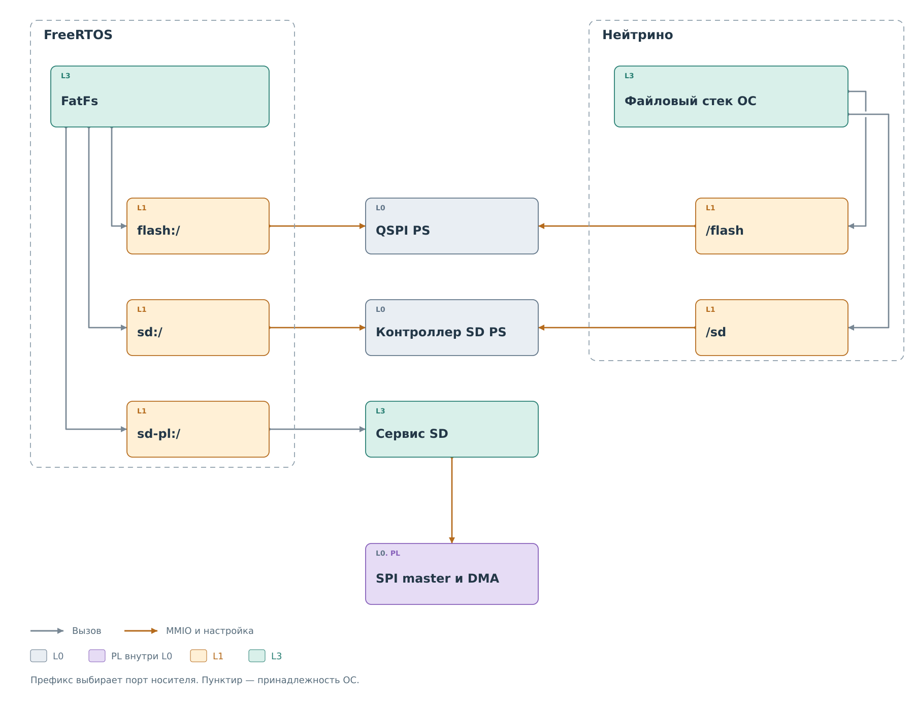

# Файлы и носители

В предыдущих главах профиль читался из Flash, а SD-тракт передавал
секторы. Файловая система связывает эти операции с привычными именами
каталогов и файлов. Она переводит смещение внутри файла в операции
с блоками носителя; аппаратный сервис не знает имени файла.

*Рисунок 1. Три тома FreeRTOS и файловые менеджеры Нейтрино.*

## Выбор тома

Во FreeRTOS префикс пути выбирает том: `flash:/` относится к QSPI,
`sd:/` — к контроллеру SD в PS, `sd-pl:/` — к внешней карте через PL.
Все три используют FatFs, но имеют разные низкоуровневые пути.
Успешное монтирование одной карты ничего не сообщает о другой.

Например, чтение `sd-pl:/log.bin` начинается с поиска файла и его
кластеров в FAT. Для нужного сектора FatFs вызывает дисковый адаптер,
тот передаёт запрос сервису SD. Далее выполняется последовательность
CMD17, DMA и проверки блока из [главы SPI и SD](../pl-subsystem/spi/spi.md).
Файловый слой получает 512 байт сектора и выбирает из них запрошенную
часть файла. Один вызов чтения файла может потребовать несколько
транзакций, включая чтение метаданных FAT.

В Нейтрино программы используют пути `/flash` и `/sd` и файловые
вызовы ОС. Raw-драйверы проекта предоставляют носители файловому стеку
ОС. FatFs из приложения FreeRTOS в этот путь не переносится.
Файловый том SD через PL в штатной Нейтрино не подключён.

## Общие файловые операции

`bvstk_fs_backend_t` предоставляет чтение, метаданные и обход каталогов.
Поверх него общий `bvstk_fs_reader` формирует поток файла, дерева или TAR.
`bvstk_fs_storage_t` добавляет создание и запись файла, каталоги,
копирование, переименование, удаление и явное сохранение профиля.
Общий код находится в `services/fs`; он не зависит от FatFs или POSIX.

Адаптер FreeRTOS переводит логические пути в номера томов FatFs,
преобразует UTF-8 и использует блокировку соответствующего носителя.
Общие файловые команды, маршруты HTTP UI и DCP2 FS используют этот адаптер; во время
сетевого ожидания файловая блокировка не удерживается.
Порт Нейтрино отображает `flash:/` в `/flash`, `sd:/` в `/sd`,
а `sd-pl:/` объявляет неподключённым. Каталог точки монтирования без
смонтированного носителя не считается готовым томом.

Общий формат пути исключает переходы через `.` и `..`, пустые компоненты,
управляющие символы и имена с завершающей точкой или пробелом, которые
FatFs могла бы нормализовать иначе, чем POSIX. Порт POSIX отвергает
существующие символические ссылки в пути. Имена и пути на общей границе
передаются в UTF-8; регистр имён при перечислении зависит от файлового стека.
Ни чтение, ни запись общего слоя не монтируют и не форматируют носитель.

Создание файла не перезаписывает существующий файл без явного признака
overwrite. Прерванная загрузка сохраняет полученную часть файла;
успех записи подтверждается только после синхронизации и закрытия.
Append открывает существующий файл в конце или создаёт отсутствующий;
открытие и закрытие без записи сохраняют содержимое (`fs touch`).
Копируется обычный файл, в том числе между томами; переименование
разрешено внутри одного тома и не заменяет существующее назначение.
Удаление каталога требует, чтобы он был пустым. Корень тома изменять нельзя.

Сохранение профиля сначала записывает отдельный временный файл и
синхронизирует его. Предыдущая версия сохраняется как `.bak`.
POSIX заменяет основной файл переименованием; FatFs использует
последовательность с резервной копией и откатом при отказе установки.
Это не обещает атомарную транзакцию при произвольном отключении питания.
Правила восстановления описаны в [жизненном цикле профиля](../../configuration/lifecycle.md).

В Нейтрино общий слой уже используется сохранением профилей I²C/MDIO.
DCP2 FS и общие команды `fs`/`tar` подключены в обеих ОС. В Нейтрино
также доступны штатные средства ОС и SFTP; HTTP/Web остаётся отдельным этапом.

## Владение носителем

После передачи PL SD файловой системе сервис запрещает внешние raw-записи
секторов. Иначе команда из консоли могла бы изменить блок, который FatFs
считает неизменным, и повредить её состояние. Захват сохраняется до
перезапуска, в том числе после неудачного монтирования.

Текущий PL SD монтирует существующую FAT и не форматирует карту.
После ошибки ввода-вывода том остаётся недоступным до перезапуска.
Такие ограничения относятся к этому аппаратному пути; их нельзя
переносить на все файловые системы BVSTK.

## Flash и загрузочный образ

QSPI используется и для автономной загрузки, и для файлов.
В штатной разметке первые 8 МиБ отделены от файлового диапазона
8–32 МиБ. `BOOT.bin` содержит загрузчик, bitstream и приложение.
Профили, карты регистров и веб-ресурсы находятся в файловой части.

Поэтому обновление приложения не должно стирать сохранённые профили.
Сценарий записи QSPI проверяет границы образа и сравнивает содержимое
за пределами области стирания. Обновление веб-ресурсов, в свою очередь,
не заменяет пакет устройства в `config/`.

Файловые интерфейсы также имеют разные возможности. DCP2 FS читает
файлы и деревья; HTTP и консоль FreeRTOS предоставляют изменения.
TAR собирается по мере чтения и не является атомарным снимком каталога.
Процедуры приведены в [работе с файлами](../../files.md).

Следующая глава описывает [сетевой доступ](../network/network.md).
