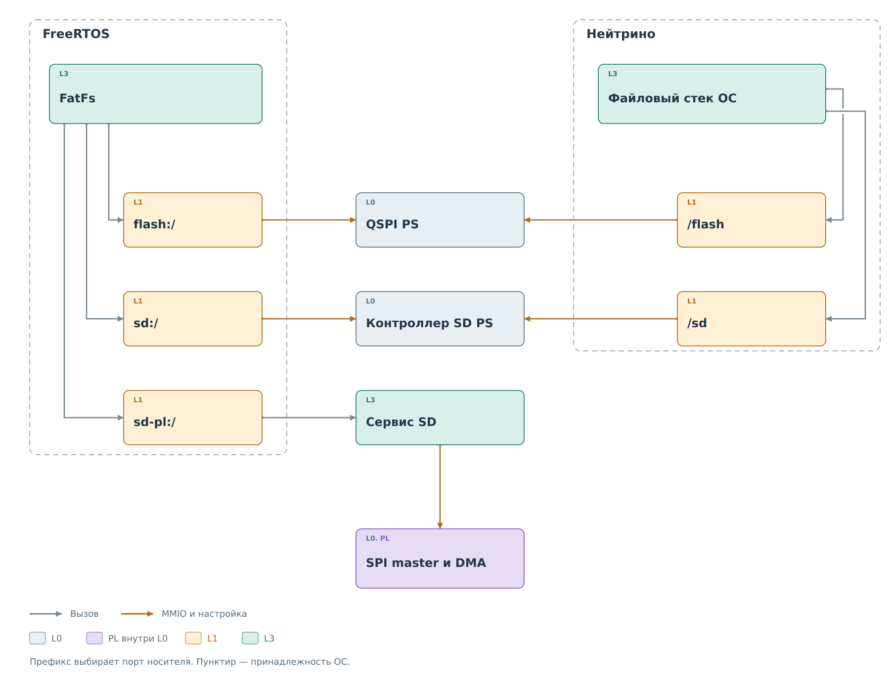

# Файлы и носители

В предыдущих главах профиль читался из Flash, а SD-тракт передавал
секторы. Файловая система связывает эти операции с привычными именами
каталогов и файлов. Она переводит смещение внутри файла в операции
с блоками носителя; аппаратный сервис не знает имени файла.

*Рисунок 1. Три тома FreeRTOS и файловые менеджеры Нейтрино.*

## Выбор тома

Во FreeRTOS префикс пути выбирает том: `flash:/` относится к QSPI,
`sd:/` — к контроллеру SD в PS, `sd-pl:/` — к внешней карте через PL.
Все три используют FatFs, но имеют разные низкоуровневые пути.
Успешное монтирование одной карты ничего не сообщает о другой.

Например, чтение `sd-pl:/log.bin` начинается с поиска файла и его
кластеров в FAT. Для нужного сектора FatFs вызывает дисковый адаптер,
тот передаёт запрос сервису SD. Далее выполняется последовательность
CMD17, DMA и проверки блока из [главы SPI и SD](../pl-subsystem/spi/spi.md).
Файловый слой получает 512 байт сектора и выбирает из них запрошенную
часть файла. Один вызов чтения файла может потребовать несколько
транзакций, включая чтение метаданных FAT.

В Нейтрино программы используют пути `/flash` и `/sd` и файловые
вызовы ОС. Raw-драйверы проекта предоставляют носители файловому стеку
ОС. FatFs из приложения FreeRTOS в этот путь не переносится.
Файловый том SD через PL в штатной Нейтрино не подключён.

## Владение носителем

После передачи PL SD файловой системе сервис запрещает внешние raw-записи
секторов. Иначе команда из консоли могла бы изменить блок, который FatFs
считает неизменным, и повредить её состояние. Захват сохраняется до
перезапуска, в том числе после неудачного монтирования.

Текущий PL SD монтирует существующую FAT и не форматирует карту.
После ошибки ввода-вывода том остаётся недоступным до перезапуска.
Такие ограничения относятся к этому аппаратному пути; их нельзя
переносить на все файловые системы BVSTK.

## Flash и загрузочный образ

QSPI используется и для автономной загрузки, и для файлов.
В штатной разметке первые 8 МиБ отделены от файлового диапазона
8–32 МиБ. `BOOT.bin` содержит загрузчик, bitstream и приложение.
Профили, карты регистров и веб-ресурсы находятся в файловой части.

Поэтому обновление приложения не должно стирать сохранённые профили.
Сценарий записи QSPI проверяет границы образа и сравнивает содержимое
за пределами области стирания. Обновление веб-ресурсов, в свою очередь,
не заменяет пакет устройства в `config/`.

Файловые интерфейсы также имеют разные возможности. DCP2 FS читает
файлы и деревья; HTTP и консоль FreeRTOS предоставляют изменения.
TAR собирается по мере чтения и не является атомарным снимком каталога.
Процедуры приведены в [работе с файлами](../../operations/files.md).

Следующая глава описывает [сетевой доступ](../network/network.md).
