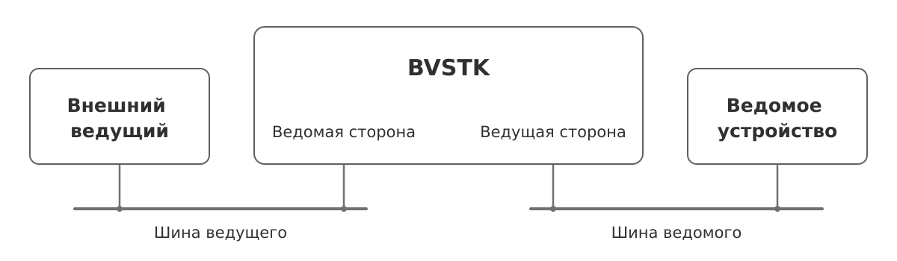

# Устройство BVSTK

BVSTK стоит между контроллером и ведомым устройством. Со стороны
контроллера она принимает обращения как ведомое устройство, а на другой
стороне сама начинает обмен как ведущий. Программа выбирает данные
ответа и проверяет запись до её передачи физическому устройству.

*Рисунок 1. BVSTK между ведущим и ведомым устройством.*

Через мост проходят **два самостоятельных обмена**. Например, программа
заранее читает регистр устройства и сохраняет значение. Несколько
последующих обращений внешнего ведущего могут получить эту копию
без нового чтения устройства. При записи входящие байты сначала
принимаются мостом, затем программа решает, передавать ли их дальше.

Связь этих обменов — основная тема статьи. Проследим, где находятся
данные, кто ими распоряжается и в какой момент они становятся доступны
следующему участнику. На примере I²C разберём также случай, когда
программа получает правильное значение, но ответить вовремя уже не может.

## Аппаратура PS и PL

BVSTK работает на Zynq-7000. Процессорная система **PS** исполняет
программу под управлением ОС. Программируемая логика **PL** содержит
ядра внешних интерфейсов: они формируют такты, принимают адреса
и передают биты в соответствии с протоколом шины.

PS работает с устройствами, регистрами и правилами записи. Ядра PL
обмениваются с ней данными через **BRAM**, внутреннюю память логики,
и аппаратные регистры. Признаки готовности сообщают, когда данные
можно забирать. Такое разделение позволяет менять программные правила
без изменения автомата шины.

## Уровни абстракции

Для описания приняты пять уровней ответственности:

*Рисунок 2. Уровни абстракции BVSTK.*

| Уровень | Содержание |
|---|---|
| L0 | Процессор, память, периферия PS и ядра PL |
| L1 | Доступ программы к аппаратуре и средствам ОС |
| L2 | Ядро ОС: планирование, ожидание, системные события |
| L3 | Сервисы устройств, драйверы и протокольные стеки |
| L4 | Запуск рабочей среды и пользовательские функции |

Нумерация не задаёт обязательную цепочку вызовов. Сервис L3 вызывает
драйвер L3, тот использует платформу L1, а платформа обращается к ядру
L2 для ожидания или блокировки.

Цвет блока обозначает уровень; фиолетовый выделяет PL внутри L0.
Вложенность раскрывает состав. Цвет и тип стрелки задают способ
взаимодействия, пояснённый в легенде каждого рисунка.

## Варианты ОС

*Рисунок 3. BVSTK в двух ОС.*

Во FreeRTOS BVSTK работает как приложение с задачами. В Нейтрино
`bvstkd`, его клиенты и менеджеры носителей — отдельные процессы.
Сервисы и драйверы используют общий код; аппаратный доступ, ожидания
и синхронизацию предоставляет порт ОС. На схемах эти порты находятся
в пунктирных областях, общая часть — между ними.

Состав действующей конфигурации AX7020 различается:

| Путь | FreeRTOS | Нейтрино |
|---|---|---|
| Мост I²C, сервисы master и slave | Подключён | Подключён в `bvstkd` |
| Мост MDIO с политикой и опросом | Подключён | Рабочая среда не запускается |
| Файловый доступ к SD через PL | Подключён | Этот путь не подключён |
| Обычный сервис SPI | Отключён; master используется для SD | Не подключён |
| Обслуживание SPI slave программой | Не подключено | Не подключено |

Состав сборок приведён в [справочнике профилей](../reference/profiles.md).
Далее описываются исходники проекта; численные задержки на конкретной
плате могут отличаться от расчётных.

## Разделы статьи

1. [Подсистемы PL](pl-subsystem/pl-subsystem.md) — общий механизм моста,
   кэша и памяти обмена.
2. [I²C](pl-subsystem/i2c/i2c.md) — подробный разбор чтения и записи
   через сервисы, драйверы и аппаратные ядра.
3. [MDIO](pl-subsystem/mdio/mdio.md) — заранее подготовленные ответы
   и фоновое обновление значений.
4. [SPI и SD](pl-subsystem/spi/spi.md) — передача блока через DMA.

[Карты L0–L4](architecture/architecture.md) раскрывают состав модулей
и их связи. [Карта исходников](../development/source-map.md) помогает
найти соответствующий код.
